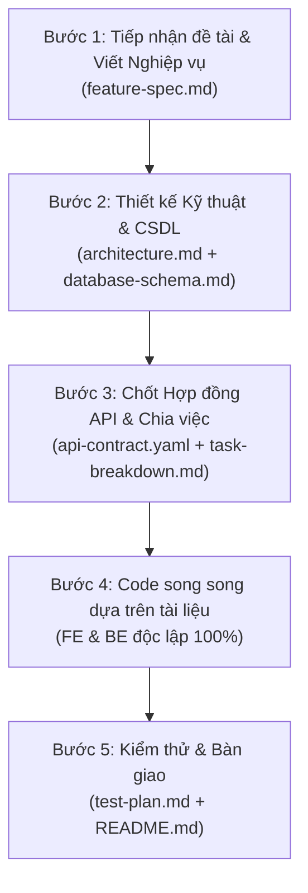

# 📚 SỔ TAY TOÀN TẬP VỀ THƯ MỤC `docs/` TRONG DỰ ÁN PHẦN MỀM
> **Dành cho Sinh viên eProject (Aptech), Lập trình viên & Trưởng nhóm phát triển phần mềm.**  
> *Hướng dẫn về Ý nghĩa, Tác dụng, Cấu trúc chuẩn và Quy trình vận hành thực chiến từ A-Z để áp dụng cho mọi dự án sau này.*

---

## 🎯 PHẦN 1: TẠI SAO PHẢI CÓ THƯ MỤC `docs/`? (Ý NGHĨA & TÁC DỤNG)

### 1. Sự khác biệt giữa "Dự án nghiệp dư" và "Dự án chuyên nghiệp"
- **Dự án nghiệp dư ("Code trước nghĩ sau"):** Nhận đề tài là nhảy vào viết code ngay. Hậu quả:
  - Frontend và Backend cãi nhau vì không thống nhất định dạng dữ liệu (ví dụ: FE đợi `userId`, BE lại trả về `id_user`).
  - Càng code càng rối, sửa chỗ này hỏng chỗ kia.
  - Sau 2 tuần nhìn lại không hiểu mình đã viết gì.
  - Khi bảo vệ đồ án, giảng viên hỏi sơ đồ luồng, kiến trúc hay lý do chọn công nghệ thì không trả lời được.
- **Dự án chuyên nghiệp (Spec-Driven Development):** Thư mục `docs/` đóng vai trò là **"Bản vẽ thiết kế thi công"** trước khi đặt viên gạch code đầu tiên.

### 2. Ba tác dụng cốt lõi của thư mục `docs/`:
1. **Kim chỉ nam phát triển (Single Source of Truth):** Tất cả thành viên trong nhóm (hoặc chính bạn sau vài tháng) nhìn vào một nơi duy nhất để biết hệ thống làm gì, CSDL gồm những bảng nào, API gọi ra sao.
2. **Cầu nối làm việc độc lập giữa Frontend & Backend:** Nhờ có tài liệu đặc tả API trước, lập trình viên Frontend có thể tự giả lập dữ liệu (Mock data) để làm giao diện mà không cần chờ Backend viết xong.
3. **Bằng chứng năng lực khi Chấm điểm / Phỏng vấn tuyển dụng:** Thư mục `docs/` chỉn chu thể hiện tư duy kỹ sư phần mềm thực thụ, giúp đồ án đạt điểm tối đa (Distinction/High Distinction) trong các kỳ eProject Aptech.

---

## 📂 PHẦN 2: BẢN ĐỒ CẤU TRÚC CHUẨN CỦA THƯ MỤC `docs/`

Dưới đây là cấu trúc mẫu hoàn chỉnh nhất được áp dụng trong dự án **CraftRoots** mà bạn có thể tái sử dụng cho mọi dự án Web/App/Mobile tiếp theo:

```text
docs/
├── README.md                          # 1. Cổng thông tin tổng quan của toàn bộ hệ thống
├── feature-spec.md                    # 2. Đặc tả yêu cầu nghiệp vụ & tính năng (WHAT & WHY)
├── architecture.md                    # 3. Kiến trúc kỹ thuật & thiết kế hệ thống (HOW)
├── database-schema.md                 # 4. Thiết kế Cơ sở dữ liệu chi tiết (ERD, Bảng, Khóa)
├── data.md                            # 5. Từ điển dữ liệu & Mẫu dữ liệu ban đầu (Data Dictionary & Seed)
├── api-contract.yaml                  # 6. Hợp đồng giao tiếp API chuẩn OpenAPI 3.0 (Contract)
├── task-breakdown.md                  # 7. Phân rã công việc & Kế hoạch chia Sprint (WBS)
├── test-plan.md                       # 8. Kế hoạch kiểm thử chất lượng & Bộ Test Cases
└── craftroots.postman_collection.json # 9. Bộ kiểm thử API tự động trên Postman
```

---

## 🔍 PHẦN 3: CHI TIẾT TỪNG TÀI LIỆU – NỘI DUNG & CÁCH VIẾT

| Tên File | Trả lời câu hỏi gì? | Người phụ trách chính | Nội dung cốt lõi cần có |
| :--- | :--- | :--- | :--- |
| **`feature-spec.md`** | *Hệ thống làm cái gì? Cho ai dùng?* | Business Analyst / Team Lead | • Chân dung người dùng (User Personas)<br>• Danh sách User Stories ("Là một khách hàng, tôi muốn...")<br>• Quy tắc nghiệp vụ (Business Rules: pass tối thiểu 8 ký tự, sync LocalStorage thế nào)<br>• Luồng trải nghiệm người dùng (User Flows & Wireframe logic) |
| **`architecture.md`** | *Hệ thống được xây bằng gì? Kết nối ra sao?* | Solution Architect / Tech Lead | • Tech Stack đã chọn & Lý do chọn<br>• Sơ đồ phân tầng (Frontend - Express Server - PostgreSQL DB)<br>• Luồng xử lý dữ liệu (Request-Response Lifecycle)<br>• Cơ chế bảo mật (JWT, Helmet, CORS, Băm bcrypt)<br>• Chiến lược quản lý lỗi & Logging |
| **`database-schema.md`** | *Dữ liệu được lưu trữ thế nào?* | Database Designer / Backend Dev | • Sơ đồ thực thể quan hệ (ERD - Mermaid Diagram)<br>• Chi tiết từng bảng, kiểu dữ liệu, khóa chính (PK), khóa ngoại (FK)<br>• Các mối quan hệ 1-N, N-N (bảng trung gian)<br>• Đánh chỉ mục (Indexes) để tăng tốc truy vấn SQL |
| **`data.md`** | *Dữ liệu mẫu trông như thế nào?* | Content / Data Analyst / Dev | • Từ điển dữ liệu (Data Dictionary): giải thích từng trường dữ liệu<br>• Dữ liệu mẫu (Seed Data) chuẩn bị sẵn để nạp vào DB thử nghiệm |
| **`api-contract.yaml`** | *Frontend và Backend nói chuyện bằng ngôn ngữ gì?* | Backend Lead & Frontend Lead | • Chuẩn OpenAPI 3.0 / Swagger<br>• Đường dẫn URL (`/api/crafts`, `/api/auth/login`)<br>• Phương thức (GET, POST, PUT, DELETE)<br>• Cấu trúc Request Body & Headers (Bearer Token)<br>• Cấu trúc Response chuẩn (HTTP 200, 201, 400, 401, 404, 500) |
| **`task-breakdown.md`** | *Ai làm việc gì? Bao giờ xong?* | Project Manager / Scrum Master | • Cấu trúc phân chia công việc (WBS)<br>• Chia theo Sprint (ví dụ: Sprint 1 Database, Sprint 2 API, Sprint 3 UI)<br>• Tiêu chí hoàn thành (Acceptance Criteria - AC)<br>• Độ ưu tiên và người thực hiện |
| **`test-plan.md`** | *Làm sao biết code chạy đúng hay sai?* | QA / Tester / All Devs | • Phạm vi kiểm thử (Scope of Testing)<br>• 10 - 20 kịch bản kiểm thử chi tiết (Test Case ID, Input, Expected Output)<br>• Ma trận kiểm thử hồi quy (Regression Test Matrix) |
| **`postman_collection.json`** | *Làm sao test API nhanh nhất?* | Backend Dev / Tester | • Bộ request Postman gom nhóm theo thư mục (Auth, Crafts, Users)<br>• Tự động lưu Token vào biến môi trường (`{{jwt_token}}`) để gọi các API cần đăng nhập |
| **`README.md`** | *Người ngoài/Thầy cô mở dự án này lên chạy bằng cách nào?* | Team Lead | • Tên dự án, mục tiêu, thành viên nhóm<br>• Hướng dẫn cài đặt từng bước (`npm install`, `.env`, `npm run dev`)<br>• Bảng tài khoản demo để đăng nhập test thử |

---

## ⚙️ PHẦN 4: QUY TRÌNH VẬN HÀNH 5 BƯỚC CHO MỌI DỰ ÁN MỚI
*(Áp dụng quy trình này từ Ngày 1 đến Ngày nghiệm thu)*



### Bước 1: Tiếp nhận đề tài -> Viết `feature-spec.md`
- **Thời điểm:** Ngay tuần đầu tiên khi nhận đồ án hoặc yêu cầu từ khách hàng.
- **Cách làm:** Liệt kê tất cả tính năng ra bảng. Xác định tính năng nào bắt buộc (Must-have), tính năng nào phụ (Nice-to-have). Định nghĩa rõ ràng luồng hành vi của người dùng.

### Bước 2: Thiết kế Hệ thống & CSDL -> Viết `architecture.md` & `database-schema.md`
- **Cách làm:** 
  1. Vẽ sơ đồ kiến trúc các module kết nối với nhau.
  2. Xác định các thực thể và vẽ sơ đồ ERD (Bảng nào quan hệ 1-N, N-N).
  3. Viết file SQL schema tạo bảng (`db/schema.sql`).

### Bước 3: Đóng băng Hợp đồng API -> Viết `api-contract.yaml` & `task-breakdown.md`
- **Cách làm (CỰC KỲ QUAN TRỌNG):**
  - Hai người phụ trách Frontend và Backend ngồi lại cùng nhau chốt file `api-contract.yaml`.
  - Quy định rõ ràng: URL là gì? Method gì? Request body gửi lên những trường gì? Response trả về JSON như thế nào?
  - Một khi file này đã chốt, **Frontend và Backend bắt đầu code cùng một lúc**, không ai phải ngồi đợi ai!

### Bước 4: Triển khai Code theo đúng Spec (Implementation)
- **Backend Dev:** Cứ nhìn vào `database-schema.md` để tạo bảng, nhìn vào `api-contract.yaml` để tạo Route/Controller đúng 100% chuẩn định dạng.
- **Frontend Dev:** Nhìn vào `api-contract.yaml` để tạo API service và mockup dữ liệu làm giao diện, animation, routing.
- **Khi Backend code xong:** Chỉ cần cắm URL vào là Frontend chạy khớp ngay lập tức, không tốn dù chỉ 1 phút để sửa xung đột!

### Bước 5: Kiểm thử chất lượng & Hoàn thiện bàn giao -> `test-plan.md` & `README.md`
- Viết các kịch bản test trong `test-plan.md` (Test đăng ký trùng email, test giỏ hàng, test tìm kiếm không có kết quả).
- Chạy toàn bộ test để đảm bảo không lỗi trước khi nộp bài hoặc demo trước hội đồng.
- Cập nhật `README.md` với đầy đủ lệnh khởi chạy để người khác chỉ cần gõ 1 dòng lệnh là dự án chạy được.

---

## 💡 PHẦN 5: BÍ QUYẾT ĐẠT ĐIỂM TỐI ĐA TRONG CÁC ĐỒ ÁN EPPROJECT (APTECH)

1. **Vẽ sơ đồ bằng Markdown Mermaid:**
   - Thay vì chèn ảnh chụp màn hình dễ bị mờ hoặc khó chỉnh sửa, hãy viết bằng cú pháp ```` ```mermaid ```` trong file `.md`. Giảng viên và nhà tuyển dụng đánh giá cực kỳ cao kỹ năng này vì tài liệu sẽ đồng bộ với git.
2. **Quy tắc Single Source of Truth:**
   - Khi có thay đổi về code (ví dụ thêm 1 trường `phone` vào bảng `users`), hãy nhớ cập nhật ngay vào `database-schema.md` và `api-contract.yaml`. Đừng để tài liệu bị lỗi thời so với code thực tế.
3. **Luôn có file Script tự động hóa (`db:setup`):**
   - Đừng bắt người chấm bài phải tự gõ từng lệnh SQL dài dằng dặc. Luôn có 1 script (như `npm run db:setup` chúng ta vừa làm) để tự tạo database, tự nạp dữ liệu mẫu chỉ với 1 cú click.

---

> 🏆 **Lời khuyên cho dự án tiếp theo:**  
> Mỗi khi bắt đầu một dự án mới, hãy tạo ngay thư mục `docs/`, copy danh sách các file trên vào và bắt đầu điền nội dung từ Bước 1. Bạn sẽ thấy tốc độ hoàn thành dự án nhanh gấp đôi và sản phẩm làm ra vững chắc, chuyên nghiệp như một sản phẩm thương mại thực thụ!
