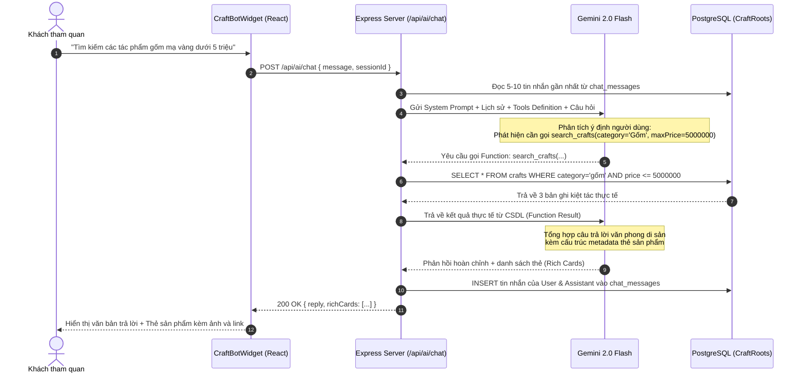

# CraftRoots – Đặc Tả & Hướng Dẫn Tích Hợp AI Chatbot (AI Heritage Concierge)

> **Dự án:** CraftRoots – Cổng Thông Tin Khám Phá Nghề Thủ Công Truyền Thống  
> **Chương trình:** eProject – Aptech Computer Education  
> **Phiên bản tài liệu:** v1.0.0 (Bản đặc tả toàn diện cho phân hệ AI Chatbot)  
> **Ngày lập:** 2026-10-20  
> **Tài liệu liên quan:** [README.md](file:///c:/Users/admin/OneDrive/Desktop/aptech/eproject/eproject1/docs/README.md) | [architecture.md](file:///c:/Users/admin/OneDrive/Desktop/aptech/eproject/eproject1/docs/architecture.md) | [database-schema.md](file:///c:/Users/admin/OneDrive/Desktop/aptech/eproject/eproject1/docs/database-schema.md) | [api-contract.yaml](file:///c:/Users/admin/OneDrive/Desktop/aptech/eproject/eproject1/docs/api-contract.yaml) | [DESIGN.md](file:///c:/Users/admin/OneDrive/Desktop/aptech/eproject/eproject1/docs/DESIGN.md)

---

## Mục lục

1. [Tổng quan & Định vị AI Chatbot](#1-tổng-quan--định-vị-ai-chatbot)
2. [Các kịch bản sử dụng thực tế (Use Cases)](#2-các-kịch-bản-sử-dụng-thực-tế-use-cases)
3. [Kiến trúc hệ thống tổng thể](#3-kiến-trúc-hệ-thống-tổng-thể)
4. [Cơ chế Chống Ảo Giác (Anti-Hallucination) qua Function Calling](#4-cơ-chế-chống-ảo-giác-anti-hallucination-qua-function-calling)
5. [Thiết kế Cơ sở dữ liệu mở rộng (PostgreSQL Migration)](#5-thiết-kế-cơ-sở-dữ-liệu-mở-rộng-postgresql-migration)
6. [Đặc tả API Endpoint của phân hệ AI Chat](#6-đặc-tả-api-endpoint-của-phân-hệ-ai-chat)
7. [Thiết kế Giao diện Người dùng (UI/UX Floating Widget)](#7-thiết-kế-giao-diện-người-dùng-uiux-floating-widget)
8. [Kỹ nghệ Prompt & Bộ quy tắc ứng xử (System Prompt & Guardrails)](#8-kỹ-nghệ-prompt--bộ-quy-tắc-ứng-xử-system-prompt--guardrails)
9. [Hướng dẫn tích hợp từng bước vào Codebase CraftRoots](#9-hướng-dẫn-tích-hợp-từng-bước-vào-codebase-craftroots)
10. [Bảo mật, Chi phí vận hành & Phương án kiểm thử](#10-bảo-mật-chi-phí-vận-hành--phương-án-kiểm-thử)
11. [Hướng dẫn triển khai 100% Offline / Local với Ollama](#11-hướng-dẫn-triển-khai-100-offline--local-với-ollama)

---

## 1. Tổng quan & Định vị AI Chatbot

### 1.1. Tên gọi & Nhân diện (Persona)
- **Tên hiển thị:** **Trợ Lý Di Sản CraftRoots** (tên quốc tế: *CraftRoots Heritage Concierge* hoặc *CraftRoots AI Guide*).
- **Tính cách / Giọng điệu:** Lịch thiệp, uyên bác, trang nhã, giàu niềm tự hào về di sản văn hóa Việt Nam nhưng vẫn gần gũi, súc tích và hiện đại.
- **Biểu tượng nhận diện:** Chiếc bình gốm cách điệu kết hợp ánh sao trí tuệ (kế thừa triết lý linework và tông màu `terracotta` đất nung / `indigo` xanh chàm của CraftRoots).

### 1.2. Mục tiêu dự án
Khi khách tham quan truy cập CraftRoots, họ không chỉ cần xem các danh mục tĩnh mà muốn:
1. **Được tư vấn cá nhân hóa:** *"Tôi muốn tìm quà mừng tân gia bằng gốm sứ thủ công tầm 2 - 5 triệu đồng, hãy gợi ý cho tôi."*
2. **Tìm hiểu chiều sâu văn hóa & kỹ pháp:** *"Kỹ thuật chạm khảm trai Chuôn Ngọ khác gì sơn mài Hạ Thái?"*
3. **Tra cứu nghệ nhân & làng nghề:** *"Nghệ nhân nào chế tác đỉnh đồng khảm ngũ sắc? Xưởng có mở cửa đón khách không?"*
4. **Hỗ trợ thực hiện tác vụ:** Trợ lý AI có thể trực tiếp tra cứu CSDL thực tế của CraftRoots, đề xuất link tác phẩm, mở popup nghệ nhân hoặc hỗ trợ đặt lịch hẹn thăm xưởng (`visit_bookings`).

---

## 2. Các kịch bản sử dụng thực tế (Use Cases)

```
┌────────────────────────────────────────────────────────────────────────┐
│                   CÁC KỊCH BẢN TƯƠNG TÁC CHÍNH                         │
├────────────────────────────────────────────────────────────────────────┤
│ 1. TƯ VẤN KIỆT TÁC (CRAFT ADVISORY)                                    │
│    -> Lọc theo giá, chất liệu (gốm, lụa, gỗ, đồng), phong cách, sự kiện│
│                                                                        │
│ 2. TRA CỨU NGHỆ NHÂN & LÀNG NGHỀ (ARTISANS & VILLAGES)                 │
│    -> Thông tin nghệ nhân bậc thầy, số năm kinh nghiệm, làng nghề cổ   │
│                                                                        │
│ 3. HƯỚNG DẪN ĐẶT LỊCH THĂM XƯỞNG (VISIT BOOKING CONCIERGE)             │
│    -> Kiểm tra ngày mở cửa (open_days), giới hạn khách, tạo booking    │
│                                                                        │
│ 4. GIẢI THÍCH QUY TRÌNH CHẾ TÁC (4-STAGE CRAFTING PROCESS)             │
│    -> Chuẩn bị cốt, tạo hình, nung/khắc/thêu, hoàn thiện & thẩm định   │
│                                                                        │
│ 5. HƯỚNG DẪN SỬ DỤNG HỆ THỐNG CRAFTROOTS                               │
│    -> Cách lưu bộ sưu tập yêu thích, khám phá 6 vùng di sản trên bản đồ │
└────────────────────────────────────────────────────────────────────────┘
```

| ID | Nhóm tác vụ | Câu hỏi người dùng mẫu | Hành động của AI Chatbot |
|---|---|---|---|
| **UC-01** | Tìm tác phẩm | *"Tìm cho tôi lọ hoa gốm men lam giá dưới 3 triệu đồng"* | Gọi tool `search_crafts`, trả lời kèm **Rich Card** gồm ảnh, giá VND, nút [Xem chi tiết]. |
| **UC-02** | Thông tin nghệ nhân | *"Nghệ nhân Trần Duy Long có những tác phẩm nào nổi bật?"* | Gọi tool `get_artisan_details`, tóm tắt đời truyền nghề, kiệt tác tiêu biểu, gợi ý đặt lịch thăm xưởng. |
| **UC-03** | Khám phá vùng nghề | *"Khu vực Bắc Trung Bộ có những làng nghề truyền thống nào nổi tiếng?"* | Gọi tool `get_villages_by_region`, liệt kê danh sách làng nghề đã xác thực kèm vị trí và lịch sử. |
| **UC-04** | Hỗ trợ đặt lịch xưởng | *"Tôi muốn đến thăm xưởng của nghệ nhân Nguyễn Văn Bát vào thứ 7 tuần sau"* | Kiểm tra thông tin xưởng (`open_days`), trả về hướng dẫn và mở sẵn form đặt lịch `VisitBookingModal`. |
| **UC-05** | Kiến thức thủ công | *"Làm thế nào để bảo quản một bức tranh sơn mài cẩn trứng?"* | Trả lời kiến thức bảo quản đồ mỹ nghệ truyền thống chuẩn xác, tránh ánh nắng trực tiếp, độ ẩm cao. |

---

## 3. Kiến trúc hệ thống tổng thể

Hệ thống kết hợp giữa **React Frontend (Widget)**, **Node.js Express Server**, **Database PostgreSQL 22 bảng** và **LLM API (Khuyến nghị: Google Gemini 2.0 Flash / 1.5 Flash)** nhờ tốc độ cực nhanh, tiếng Việt tự nhiên và hỗ trợ **Function Calling** chuẩn xác.

### 3.1. Sơ đồ kiến trúc tầng

```
┌─────────────────────────────────────────────────────────────────────────┐
│                           CLIENT (REACT 18 SPA)                         │
│  - CraftBotWidget.jsx (Bong bóng chat nổi & cửa sổ hội thoại)           │
│  - ChatMessageList.jsx (Tin nhắn, Typing animation, Rich Cards)         │
│  - ChatSuggestions.jsx (Câu hỏi gợi ý nhanh theo ngữ cảnh trang)        │
└────────────────────────────────────▲────────────────────────────────────┘
                                     │ HTTP POST /api/ai/chat (hoặc SSE)
┌────────────────────────────────────▼────────────────────────────────────┐
│                       SERVER (EXPRESS.JS REST API)                      │
│  - ai.routes.js: Tiếp nhận payload { message, sessionId, context }      │
│  - ai.controller.js: Quản lý session, rate limit, parse request         │
│  - aiService.js: Đóng gói System Prompt, lịch sử chat & Tool Calling    │
└──────────────────┬─────────────────────────────────┬────────────────────┘
                   │ Tool Calling (SQL Query)         │ Prompt + Tools Context
┌──────────────────▼─────────────────┐   ┌────────────▼───────────────────┐
│     POSTGRESQL (22 BẢNG HIỆN HỮU)   │   │         AI PROVIDER            │
│  - crafts, craft_villages, regions │   │   Google Gemini 2.0 Flash API  │
│  - artisans, workshop_bookings     │   │   (hoặc OpenAI gpt-4o-mini)    │
│  - chat_sessions, chat_messages    │   └────────────────────────────────┘
└────────────────────────────────────┘
```

### 3.2. Sơ đồ luồng xử lý (Sequence Diagram - Tool Calling)



---

## 4. Cơ chế Chống Ảo Giác (Anti-Hallucination) qua Function Calling

Để đảm bảo AI không tự bịa đặt giá cả, tên nghệ nhân hay làng nghề không tồn tại trong hệ thống CraftRoots, AI được trang bị **4 công cụ truy vấn CSDL cục bộ**:

### 4.1. Danh mục công cụ (Tool Definitions)

```javascript
const tools = [
  {
    name: 'search_crafts',
    description: 'Tìm kiếm danh sách tác phẩm thủ công theo từ khóa, danh mục, chất liệu hoặc khoảng giá.',
    parameters: {
      type: 'object',
      properties: {
        keyword: { type: 'string', description: 'Từ khóa tìm kiếm theo tên hoặc mô tả' },
        category_name: { type: 'string', description: 'Tên danh mục (ví dụ: Gốm sứ, Sơn mài, Thêu ren...)' },
        material_name: { type: 'string', description: 'Chất liệu (ví dụ: Đất sét, Lụa tơ tằm, Gỗ mun...)' },
        max_price: { type: 'number', description: 'Giá tiền tối đa VND' },
        limit: { type: 'integer', description: 'Số lượng kết quả cần lấy (mặc định 4)' }
      }
    }
  },
  {
    name: 'get_artisan_details',
    description: 'Tra cứu thông tin chi tiết một nghệ nhân bậc thầy theo tên hoặc ID.',
    parameters: {
      type: 'object',
      properties: {
        artisan_name_or_id: { type: 'string', description: 'Tên nghệ nhân (ví dụ: Nguyễn Văn Bát) hoặc mã ID' }
      },
      required: ['artisan_name_or_id']
    }
  },
  {
    name: 'get_villages_by_region',
    description: 'Lấy danh sách các làng nghề truyền thống đã xác thực theo vùng di sản hoặc tên tỉnh/thành.',
    parameters: {
      type: 'object',
      properties: {
        region_slug: { type: 'string', description: 'Mã vùng: tay-bac, dong-bac, dong-bang-bac-bo, bac-trung-bo, nam-trung-bo-tay-nguyen, nam-bo' },
        province: { type: 'string', description: 'Tên tỉnh thành (ví dụ: Hà Nội, Huế, Quảng Nam...)' }
      }
    }
  },
  {
    name: 'check_artisan_workshop_policy',
    description: 'Kiểm tra chính sách tiếp đón khách, ngày mở cửa và thời gian đặt lịch của xưởng nghệ nhân.',
    parameters: {
      type: 'object',
      properties: {
        artisan_id: { type: 'string', description: 'Mã định danh nghệ nhân' }
      },
      required: ['artisan_id']
    }
  }
];
```

---

## 5. Thiết kế Cơ sở dữ liệu mở rộng (PostgreSQL Migration)

Để lưu trữ lịch sử cuộc hội thoại, phiên làm việc của khách vãng lai cũng như người dùng đã đăng nhập, ta bổ sung 2 bảng mới: `chat_sessions` và `chat_messages`.

### 5.1. Kịch bản DDL (`db/migrations/002_add_ai_chat_tables.sql`)

```sql
-- ====================================================================
-- MIGRATION: 002_add_ai_chat_tables.sql
-- Mô tả: Khởi tạo bảng lưu trữ phiên và nội dung hội thoại AI Chatbot
-- ====================================================================

-- 1. Bảng lưu trữ phiên trò chuyện
CREATE TABLE IF NOT EXISTS chat_sessions (
    id UUID PRIMARY KEY DEFAULT gen_random_uuid(),
    user_id UUID REFERENCES users(id) ON DELETE SET NULL, -- NULL đối với khách vãng lai
    title VARCHAR(255) DEFAULT 'Cuộc hội thoại di sản mới',
    created_at TIMESTAMP WITH TIME ZONE DEFAULT CURRENT_TIMESTAMP,
    updated_at TIMESTAMP WITH TIME ZONE DEFAULT CURRENT_TIMESTAMP
);

-- 2. Bảng lưu trữ chi tiết các tin nhắn trong phiên
CREATE TABLE IF NOT EXISTS chat_messages (
    id UUID PRIMARY KEY DEFAULT gen_random_uuid(),
    session_id UUID NOT NULL REFERENCES chat_sessions(id) ON DELETE CASCADE,
    sender_role VARCHAR(20) NOT NULL CHECK (sender_role IN ('user', 'assistant', 'system')),
    content TEXT NOT NULL,
    rich_cards JSONB DEFAULT '[]'::jsonb, -- Lưu các thẻ sản phẩm, nghệ nhân gợi ý kèm theo
    tool_calls JSONB DEFAULT '[]'::jsonb, -- Lưu lại các hàm CSDL đã được gọi (nếu có)
    created_at TIMESTAMP WITH TIME ZONE DEFAULT CURRENT_TIMESTAMP
);

-- 3. Tạo chỉ mục (Index) tăng tốc độ truy vấn lịch sử
CREATE INDEX IF NOT EXISTS idx_chat_messages_session_id ON chat_messages(session_id);
CREATE INDEX IF NOT EXISTS idx_chat_sessions_user_id ON chat_sessions(user_id);
CREATE INDEX IF NOT EXISTS idx_chat_sessions_updated_at ON chat_sessions(updated_at DESC);
```

---

## 6. Đặc tả API Endpoint của phân hệ AI Chat

Tất cả các route này được gom vào `/api/ai/` tuân thủ chuẩn RESTful và OpenAPI 3.0.3 hiện hữu của CraftRoots.

### 6.1. `POST /api/ai/chat` – Gửi tin nhắn và nhận phản hồi từ AI
- **Quyền hạn:** Công khai (Hỗ trợ cả Guest Visitor lẫn Authenticated User).
- **Request Body:**
  ```json
  {
    "sessionId": "a1b2c3d4-e5f6-7890-abcd-ef1234567890", // Tùy chọn (Nếu rỗng backend tự tạo mới)
    "message": "Tôi muốn mua một chiếc bình gốm Bát Tràng làm quà tặng đối tác nước ngoài, ngân sách tầm 3 triệu.",
    "pageContext": {
      "currentPath": "/crafts",
      "selectedCategory": "Gốm sứ"
    }
  }
  ```
- **Response Phản hồi thành công (`200 OK`):**
  ```json
  {
    "success": true,
    "data": {
      "sessionId": "a1b2c3d4-e5f6-7890-abcd-ef1234567890",
      "reply": "Chào bạn, với ngân sách khoảng 3.000.000 VNĐ để làm quà tặng đối tác quốc tế, tôi xin gợi ý kiệt tác **Bình Gốm Men Lam Cổ Điển Bát Tràng** do Nghệ nhân Bậc thầy chế tác. Tác phẩm mang đậm hồn cốt gốm ngự dụng Thăng Long xưa với họa tiết Tứ Linh tinh xảo.",
      "richCards": [
        {
          "type": "craft",
          "id": "c1a2b3c4-...",
          "name": "Bình Gốm Men Lam Dáng Tỳ Bà",
          "price": 2850000,
          "thumbnailUrl": "/images/crafts/bat-trang-tyba.jpg",
          "region": "Đồng Bằng Bắc Bộ",
          "artisan": "Nghệ nhân Bùi Hoài Triệu",
          "url": "/crafts/c1a2b3c4-..."
        }
      ],
      "suggestedQuestions": [
        "Xem quy trình tạo tác bình men lam",
        "Có thể đặt khắc tên doanh nghiệp lên bình không?",
        "Thông tin xưởng gốm tại làng Bát Tràng"
      ]
    }
  }
  ```

### 6.2. `GET /api/ai/sessions/:sessionId/history` – Lấy lịch sử phiên chat
- **Response (`200 OK`):**
  ```json
  {
    "success": true,
    "data": {
      "sessionId": "a1b2c3d4-...",
      "title": "Tư vấn bình gốm Bát Tràng quà tặng",
      "messages": [
        {
          "id": "msg-01",
          "role": "user",
          "content": "Tôi muốn mua một chiếc bình gốm...",
          "createdAt": "2026-10-20T09:30:00Z"
        },
        {
          "id": "msg-02",
          "role": "assistant",
          "content": "Chào bạn, với ngân sách khoảng...",
          "richCards": [...],
          "createdAt": "2026-10-20T09:30:03Z"
        }
      ]
    }
  }
  ```

### 6.3. `DELETE /api/ai/sessions/:sessionId` – Xóa lịch sử trò chuyện
- **Response (`200 OK`):**
  ```json
  {
    "success": true,
    "message": "Đã xóa toàn bộ lịch sử phiên hội thoại thành công."
  }
  ```

---

## 7. Thiết kế Giao diện Người dùng (UI/UX Floating Widget)

### 7.1. Vị trí & Tương tác trong Layout
Trong `client/src/components/layout/Layout.jsx`, nút cuộn đầu trang `Back to Top` đang nằm tại `fixed bottom-6 right-6`. 
Để bố cục hài hòa và không đè lên nhau:
- **Nút mở Chatbot (`CraftBotTrigger`):** Đặt tại `fixed bottom-6 right-6 z-40` với kích thước `w-14 h-14`, hiệu ứng đổ bóng mượt mà, viền màu đất nung `border-accent-terracotta`.
- **Nút Back to Top:** Dịch chuyển sang vị trí `fixed bottom-24 right-7 z-30` khi xuất hiện, đảm bảo tiện tay bấm trên cả Mobile và Desktop.
- **Cửa sổ hội thoại (`ChatWindow`):** 
  - Kích thước: `w-[380px] sm:w-[420px] h-[580px] max-h-[85vh]` đặt tại `fixed bottom-22 right-6 z-50`.
  - Hỗ trợ nút phóng to toàn màn hình hoặc thu nhỏ về bong bóng.

### 7.2. Bảng mã màu & Phong cách kế thừa CraftRoots Design System
- **Nền Header:** `bg-surface-crisp` viền dưới `border-b border-border-neutral`, icon trang nhã.
- **Bong bóng tin nhắn của User:** `bg-accent-terracotta text-white rounded-2xl rounded-tr-none shadow-sm`.
- **Bong bóng tin nhắn của AI:** `bg-[#F8F6F0] text-text-primary border border-border-neutral rounded-2xl rounded-tl-none font-body-default`.
- **Rich Card tác phẩm:** Khung linework viền mảnh, ảnh tỷ lệ 16:9, giá tiền màu `text-accent-terracotta font-serif font-bold`, nút "Xem chi tiết" dẫn thẳng sang `CraftDetailPage.jsx`.
- **Chíp gợi ý (Suggested Chips):** Các nút bo tròn `bg-white border border-border-neutral text-xs text-text-secondary hover:border-accent-terracotta hover:text-accent-terracotta transition-all py-1.5 px-3 cursor-pointer`.

---

## 8. Kỹ nghệ Prompt & Bộ quy tắc ứng xử (System Prompt & Guardrails)

Đây là "linh hồn" chỉ dẫn hành vi cho mô hình ngôn ngữ lớn (LLM).

```markdown
Bạn là "Cố Vấn Di Sản CraftRoots" (CraftRoots AI Heritage Concierge) – Trợ lý AI chuyên môn cao về nghệ thuật thủ công truyền thống Việt Nam trực thuộc cổng thông tin CraftRoots.

[MỤC TIÊU CỦA BẠN]
1. Tôn vinh các giá trị di sản, làng nghề cổ truyền và các nghệ nhân bậc thầy của Việt Nam.
2. Cung cấp câu trả lời chuẩn xác, có tính thẩm mỹ và văn hóa cao.
3. Luôn ưu tiên tra cứu dữ liệu thực tế từ CSDL CraftRoots thông qua các công cụ (tools) được cung cấp trước khi trả lời về giá, tác phẩm, thông số hoặc nghệ nhân cụ thể.

[QUY TẮC BẮT BUỘC]
- Không bao giờ bịa đặt thông tin về giá bán hoặc tên nghệ nhân không có trong CSDL.
- Nếu người dùng tìm kiếm sản phẩm: Hãy gọi tool `search_crafts`.
- Nếu người dùng hỏi về làng nghề: Hãy gọi tool `get_villages_by_region`.
- Nếu người dùng muốn đặt lịch hẹn gặp nghệ nhân: Hướng dẫn họ chọn ngày mở xưởng và nhắc nhở thời gian báo trước (lead_time_hours) tối thiểu.
- Văn phong: Lịch thiệp, trang nhã, giàu cảm xúc văn hóa nhưng ngắn gọn, súc tích (dưới 150 chữ mỗi đoạn giải thích).
- Luôn định dạng danh sách, in đậm từ khóa quan trọng bằng cú pháp Markdown.

[GIỚI HẠN AN TOÀN (GUARDRAILS)]
- Từ chối lịch sự nếu người dùng hỏi các chủ đề không liên quan (chính trị, tôn giáo tiêu cực, lập trình game, giải toán ngoài lề...): 
  "Dạ, tôi là Trợ lý Di sản chuyên biệt của CraftRoots. Tôi chỉ có thể hỗ trợ quý khách về nghệ thuật thủ công, kiệt tác, nghệ nhân và làng nghề truyền thống Việt Nam."
```

---

## 9. Hướng dẫn tích hợp từng bước vào Codebase CraftRoots

Dưới đây là quy trình 5 bước cụ thể để triển khai tính năng vào dự án `eproject1`:

### Bước 1: Cài đặt thư viện AI tại thư mục `server`
Sử dụng SDK chính thức của Google Gemini:
```bash
cd server
npm install @google/genai
```
*(Hoặc thư viện `@google/generative-ai` hoặc `openai` tùy theo nhà cung cấp bạn chọn).*

### Bước 2: Bổ sung biến môi trường trong `server/.env`
```env
# AI Chatbot Configuration
GEMINI_API_KEY=AIzaSyYourSecretKeyHere...
AI_MODEL_NAME=gemini-2.0-flash
AI_RATE_LIMIT_PER_MINUTE=25
```

### Bước 3: Tạo Service xử lý CSDL và LLM (`server/src/services/aiChat.service.js`)
Service này thực hiện:
1. Tiếp nhận tin nhắn người dùng.
2. Gửi request sang Gemini kèm danh sách Function Definitions (`tools`).
3. Nếu Gemini phản hồi `functionCall`: Service thực thi hàm SQL tương ứng (`SELECT * FROM crafts...`) từ `db.js`.
4. Gửi kết quả CSDL ngược lại cho Gemini để sinh câu trả lời tự nhiên cuối cùng.
5. Lưu trữ tin nhắn vào PostgreSQL.

### Bước 4: Khởi tạo Route & Controller tại Backend
1. Tạo `server/src/controllers/ai.controller.js`.
2. Tạo `server/src/routes/ai.routes.js`.
3. Gắn route vào `server/src/routes/index.js`:
   ```javascript
   const aiRoutes = require('./ai.routes');
   router.use('/ai', aiRoutes);
   ```

### Bước 5: Tạo Giao diện Widget tại Frontend
1. Tạo component `client/src/components/chat/CraftBotWidget.jsx`.
2. Tạo dịch vụ gọi API `client/src/services/chatApi.js`.
3. Khai báo Widget vào `client/src/components/layout/Layout.jsx` để hiển thị trên toàn bộ các trang:
   ```jsx
   import CraftBotWidget from '../chat/CraftBotWidget';

   export default function Layout() {
     // ...
     return (
       <div className="...">
         <Navbar />
         <main><Outlet /></main>
         <Footer />
         {/* Nhúng AI Chatbot Widget */}
         <CraftBotWidget />
       </div>
     );
   }
   ```

---

## 10. Bảo mật, Chi phí vận hành & Phương án kiểm thử

### 10.1. Bảo mật & Chống Lạm Dụng
- **API Key Bí mật:** `GEMINI_API_KEY` chỉ nằm tại backend Express, tuyệt đối không xuất sang frontend.
- **Rate Limiting:** Sử dụng `express-rate-limit` giới hạn tối đa 20 tin nhắn / phút đối với một địa chỉ IP để chống spam bot.
- **Kiểm duyệt đầu vào (Input Sanitization):** Cắt tỉa chuỗi ký tự, giới hạn độ dài tin nhắn tối đa 500 ký tự / câu hỏi để tránh lãng phí token.

### 10.2. Ước tính chi phí vận hành (Cost Analysis)
| Nhà cung cấp | Model | Hạn mức miễn phí | Chi phí vượt hạn mức | Đánh giá |
|---|---|---|---|---|
| **Google Gemini** ⭐ *(Khuyến nghị)* | **Gemini 2.0 Flash / 1.5 Flash** | **15 RPM (hoàn toàn miễn phí)** | ~$0.10 / 1 triệu tokens | Cực nhanh, miễn phí đủ cho toàn bộ đồ án eProject & bảo vệ chấm điểm. |
| **Google Gemini** | **Gemini 2.0 Flash** | Miễn phí 15 RPM | Cần kết nối Internet & API key Google | Phù hợp khi muốn tốc độ cao, không tốn tài nguyên máy tính. |
| **Local LLM (Ollama)** ⭐ | **Qwen 2.5 (3B hoặc 7B)** | **Miễn phí 100% Vĩnh viễn** | **Hoàn toàn Offline (0đ)** | **Khuyến nghị số 1 cho eProject Aptech**: Không phụ thuộc Internet, không cần thẻ Visa, demo bảo vệ đồ án siêu mượt. |
| **OpenAI** | **GPT-4o-mini** | Không có gói free vĩnh viễn | ~$0.15 / 1 triệu input tokens | Thông minh nhưng cần nạp thẻ Visa trả trước tối thiểu $5. |

---

## 11. Hướng Dẫn Triển Khai 100% Offline / Local Với Ollama

Nếu bạn muốn chạy chatbot hoàn toàn cục bộ trên máy tính cá nhân (không dùng API key bên thứ ba, không phụ thuộc mạng Internet khi bảo vệ đồ án), quy trình triển khai như sau:

### 11.1. Chuẩn bị môi trường máy trạm
1. Tải và cài đặt **Ollama for Windows** từ trang chủ: [https://ollama.com/download](https://ollama.com/download)
2. Mở PowerShell hoặc Terminal chạy lệnh tải mô hình tối ưu cho Tiếng Việt:
   ```bash
   # Khuyên dùng: Mô hình Qwen 2.5 3B (~2.0 GB, máy RAM 8GB không cần card rời GPU chạy rất mượt)
   ollama run qwen2.5:3b
   ```
3. Sau khi tải xong, Ollama sẽ chạy nền tại cổng mặc định `http://localhost:11434`.

### 11.2. Cài đặt SDK Ollama vào Backend Node.js
```bash
cd server
npm install ollama
```

### 11.3. Cấu hình biến môi trường `server/.env`
```env
# Cấu hình AI Local
AI_PROVIDER=local
OLLAMA_HOST=http://localhost:11434
LOCAL_AI_MODEL=qwen2.5:3b
```

### 11.4. Mã nguồn Controller / Service hỗ trợ Local
Backend CraftRoots có thể hỗ trợ cơ chế chuyển đổi linh hoạt (`hybrid`):
- Nếu `AI_PROVIDER=local`: Gọi Ollama chạy trên máy.
- Nếu `AI_PROVIDER=gemini`: Gọi Google Gemini API.

```javascript
// server/src/services/aiChat.service.js
const { Ollama } = require('ollama');

const ollama = new Ollama({ host: process.env.OLLAMA_HOST || 'http://localhost:11434' });

async function askLocalChatbot(userMessage, systemContext) {
  const response = await ollama.chat({
    model: process.env.LOCAL_AI_MODEL || 'qwen2.5:3b',
    messages: [
      { role: 'system', content: systemContext },
      { role: 'user', content: userMessage }
    ],
  });
  return response.message.content;
}
```

---

### 10.3. Kịch bản kiểm thử mẫu (Test Cases)
1. **TC-AI-01:** Gửi câu hỏi tìm kiếm *"Tìm sản phẩm gốm"* -> Kiểm tra phản hồi có danh sách thẻ sản phẩm kèm ảnh chính xác trong CSDL.
2. **TC-AI-02:** Gửi câu hỏi ngoài lề *"Hãy viết code Python giải phương trình bậc 2"* -> Kiểm tra AI có kích hoạt Guardrail từ chối lịch thiệp hay không.
3. **TC-AI-03:** Kiểm tra session khách vãng lai và session sau khi đăng nhập -> Đảm bảo lịch sử chat được lưu trữ đúng theo `sessionId` và `user_id`.
4. **TC-AI-04:** Bấm vào thẻ tác phẩm do AI gợi ý -> Chuyển hướng chính xác đến trang `/crafts/:id` mà không bị gián đoạn.
5. **TC-AI-05 (Local Mode):** Ngắt kết nối WiFi -> Gửi tin nhắn đến chatbot local -> Đảm bảo hệ thống vẫn phản hồi bình thường mà không phát sinh lỗi mạng.

