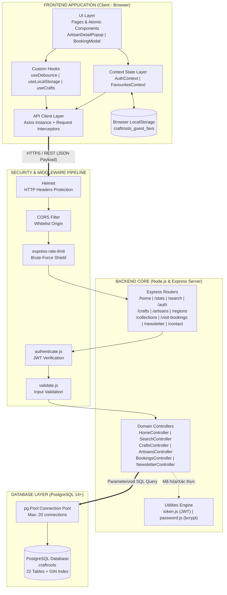
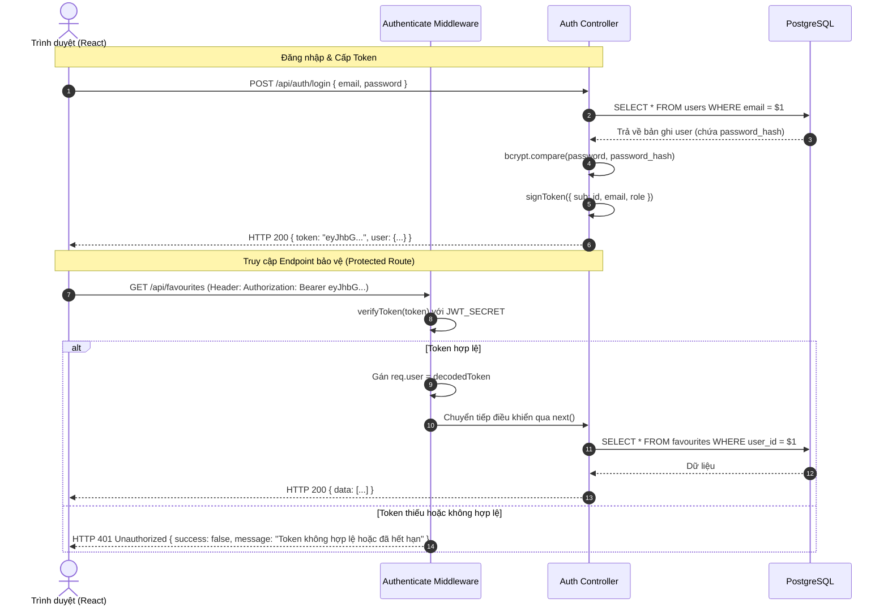
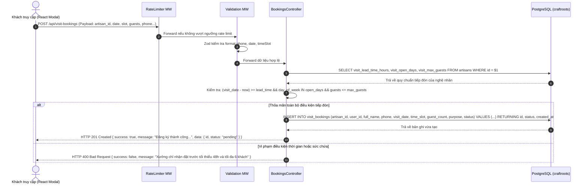
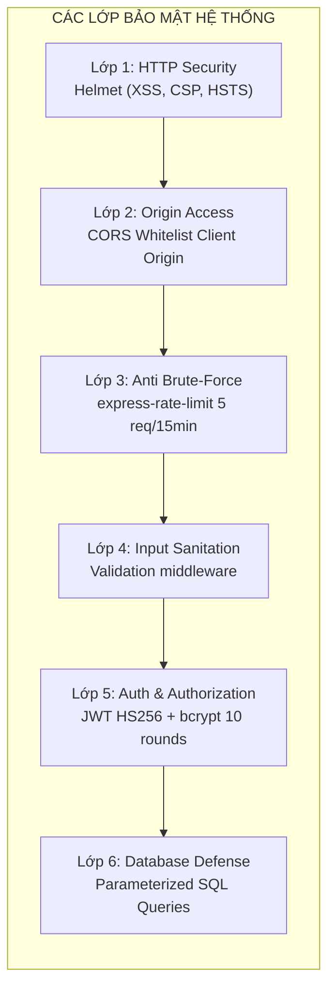

# CraftRoots – Kiến Trúc Hệ Thống & Giao Tiếp Module (Architecture Specification)

> **Dự án:** CraftRoots – Cổng Thông Tin Khám Phá Nghề Thủ Công Truyền Thống  
> **Chương trình:** eProject – Aptech Computer Education  
> **Phiên bản:** v1.1.0 (Nâng cấp toàn diện theo 9 bản thiết kế Stitch UI & 22 bảng CSDL)  
> **Ngày cập nhật:** 2026-10-15  
> **Tài liệu liên quan:** [feature-spec.md](file:///e:/eproject1/docs/feature-spec.md) | [database-schema.md](file:///e:/eproject1/docs/database-schema.md) | [api-contract.yaml](file:///e:/eproject1/docs/api-contract.yaml) | [DESIGN.md](file:///e:/eproject1/docs/DESIGN.md) | [DECISIONS.md](file:///e:/eproject1/docs/DECISIONS.md)

---

## Mục lục
1. [Tổng quan phong cách kiến trúc (Architectural Overview)](#1-tổng-quan-phong-cách-kiến-trúc-architectural-overview)
2. [Sơ đồ kiến trúc tổng thể (System Architecture Diagrams)](#2-sơ-đồ-kiến-trúc-tổng-thể-system-architecture-diagrams)
3. [Phân rã các Module Frontend (React SPA)](#3-phân-rã-các-module-frontend-react-spa)
4. [Phân rã các Module Backend (Node.js & Express REST API)](#4-phân-rã-các-module-backend-nodejs--express-rest-api)
5. [Tầng cơ sở dữ liệu (PostgreSQL Persistence Layer)](#5-tầng-cơ-sở-dữ-liệu-postgresql-persistence-layer)
6. [Cơ chế và Giao thức giao tiếp giữa các Module](#6-cơ-chế-và-giao-thức-giao-tiếp-giữa-các-module)
   - 6.1. [Giao thức Client - Server & Chuẩn hóa dữ liệu](#61-giao-thức-client---server--chuẩn-hóa-dữ-liệu)
   - 6.2. [Luồng giao tiếp Xác thực & Cấp quyền (Auth Flow)](#62-luồng-giao-tiếp-xác-thực--cấp-quyền-auth-flow)
   - 6.3. [Luồng đồng bộ hóa dữ liệu Favourites lưỡng thể (Hybrid Sync Flow)](#63-luồng-đồng-bộ-hóa-dữ-liệu-favourites-lưỡng-thể-hybrid-sync-flow)
   - 6.4. [Chuẩn hóa cấu trúc phản hồi API (Unified Response Envelope)](#64-chuẩn-hóa-cấu-trúc-phản-hồi-api-unified-response-envelope)
   - 6.5. [Xử lý lỗi tập trung (Global Error Handling Architecture)](#65-xử-lý-lỗi-tập-trung-global-error-handling-architecture)
   - 6.6. [Luồng đăng ký lịch hẹn thăm xưởng (Visit Booking Flow) ⭐](#66-luồng-đăng-ký-lịch-hẹn-thăm-xưởng-visit-booking-flow-)
   - 6.7. [Luồng tìm kiếm đa diện tập trung (Multi-Faceted Search Flow) ⭐](#67-luồng-tìm-kiếm-đa-diện-tập-trung-multi-faceted-search-flow-)
7. [Bảo mật & Các khía cạnh liên thông (Cross-Cutting Concerns)](#7-bảo-mật--các-khía-cạnh-liên-thông-cross-cutting-concerns)
8. [Môi trường triển khai & Cấu trúc mã nguồn (Project Organization)](#8-môi-trường-triển-khai--cấu-trúc-mã-nguồn-project-organization)
9. [Nhật ký tiến hóa kiến trúc (Architecture Evolution & Changelog v1.1.0)](#9-nhật-ký-tiến-hóa-kiến-trúc-architecture-evolution--changelog-v110)

---

## 1. Tổng quan phong cách kiến trúc (Architectural Overview)

Hệ thống CraftRoots được thiết kế theo mô hình **Kiến trúc phân tầng hướng dịch vụ tách rời (Decoupled Layered Architecture)** kết hợp với kiến trúc ứng dụng một trang (**SPA - Single Page Application**) và giao diện lập trình ứng dụng RESTful (**RESTful API**).

```
┌──────────────────────────────────────────────────────────────┐
│                    TẦNG TRÌNH DIỄN (PRESENTATION)             │
│            React 18 SPA (Vite/Client) + React Router         │
│         Tailwind CSS Design System Token + Stitch Layouts    │
└──────────────────────────────▲───────────────────────────────┘
                               │ HTTP/HTTPS - JSON (Bearer JWT)
┌──────────────────────────────▼───────────────────────────────┐
│               TẦNG CỔNG DỊCH VỤ / API (APPLICATION API)       │
│           Node.js + Express.js Framework (REST Endpoints)    │
│  [Helmet, CORS, RateLimit] -> [Auth & Validation Middleware]  │
│                   -> [Domain Controllers]                    │
└──────────────────────────────▲───────────────────────────────┘
                               │ Parameterized SQL ($1, $2...)
┌──────────────────────────────▼───────────────────────────────┐
│                 TẦNG LƯU TRỮ DỮ LIỆU (PERSISTENCE)            │
│         PostgreSQL 14+ Database Pool (pg connection pool)    │
│              22 Bảng CSDL Chuẩn Hóa 3NF + GIN Index           │
└──────────────────────────────────────────────────────────────┘
```

### Các nguyên tắc thiết kế trọng yếu
1. **Stateless Backend:** Máy chủ Express không lưu trạng thái phiên làm việc (Session) trong bộ nhớ, toàn bộ việc xác thực danh tính dựa vào mã thông báo có chữ ký số mã hóa (**JSON Web Token - JWT**).
2. **Separation of Concerns (SoC):** Tách biệt rạch ròi giữa giao diện người dùng (UI Components), trạng thái nghiệp vụ (Context/Hooks), tầng giao tiếp mạng (API Client) và tầng truy cập dữ liệu (Controllers & DB Queries).
3. **Resilience & Defensive Coding:** Phòng thủ đa tầng, từ kiểm tra dữ liệu đầu vào tại Client, lọc qua Validation Middleware ở Server đến việc áp đặt ràng buộc toàn vẹn khóa ngoại cứng (Foreign Keys) tại Database.

---

## 2. Sơ đồ kiến trúc tổng thể (System Architecture Diagrams)

### 2.1. Sơ đồ khối tương tác các thành phần hệ thống


---

## 3. Phân rã các Module Frontend (React SPA)

Frontend được cấu trúc thành các module độc lập, có thể tái sử dụng cao và dễ bảo trì:

| Tên Module | Trách nhiệm chính | Các thành phần cốt lõi |
|---|---|---|
| **1. UI Presentation Module** | Hiển thị giao diện người dùng, xử lý layout và tương tác đồ họa bám sát Design System [DESIGN.md](file:///e:/eproject1/docs/DESIGN.md). | - **Layouts:** `Navbar`, `Footer`, `Breadcrumbs`, `MobileDrawer`<br>- **Card/Views:** `CraftCard`, `ArtisanCard`, `RegionCard`, `VillageCard`<br>- **Interactive Modals:** `ArtisanDetailPopup` (Popup chi tiết nghệ nhân 6 góc nhìn), `VisitBookingModal`, `SearchModal`, `LightboxModal`<br>- **Widgets:** `FilterBar`, `SearchBar`, `BackToTop`, `RegionsInteractiveMap` (Bản đồ tương tác SVG 6 vùng)<br>- **Feedback:** `LoadingSkeleton`, `ToastNotification`, `EmptyState` |
| **2. Page Views Module** | Điều phối toàn bộ vòng đời và trải nghiệm của 9 trang màn hình Stitch. | - `HomePage` (`docs/design/home`): Hero spotlight CR-BT-2025-08MR, bộ chỉ số động, danh mục tuyển chọn, nghệ nhân hàng đầu, ký họa điền dã.<br>- `DirectoryPage` (`docs/design/directory`): Danh bạ tác phẩm, bộ lọc kết hợp đa diện (Vùng, Ngành nghề, Làng, Giá), phân trang.<br>- `CraftDetailPage` (`docs/design/craft-detail`): Chi tiết hiện vật 4 cột, thông số kỹ thuật, quy trình 4 giai đoạn, nghệ nhân đồng chế tác (N-N).<br>- `ArtisansPage` (`docs/design/artisans`): Lưới nghệ nhân bậc thầy, hỗ trợ mở popup `ArtisanDetailPopup`.<br>- `ArtisanDetailPage` (`docs/design/artisan-detail`): Hồ sơ nghệ nhân chuyên sâu, triết lý nghề, niên biểu mốc son sự nghiệp, widget đặt lịch hẹn thăm xưởng.<br>- `RegionsPage` (`docs/design/regions`): Bản đồ văn hóa 6 vùng, danh sách làng nghề đã kiểm chứng và tác phẩm di sản vùng.<br>- `SeasonalPage` (`docs/design/seasonal`): Bộ sưu tập mùa hè, triết lý giám tuyển, tác phẩm Hero Craft và lưới sản phẩm mùa hè.<br>- `FavouritesPage` (`docs/design/favourites`): Danh sách yêu thích cá nhân, xóa hàng loạt, cơ chế đồng bộ Hybrid Sync.<br>- `ContactPage` (`docs/design/contact`): Biểu mẫu liên hệ hợp tác giám tuyển, xác thực di sản và thông tin xưởng. |
| **3. Context State Module** | Quản lý trạng thái toàn cục xuyên suốt các thành phần không phụ thuộc cấu trúc cây DOM. | - `AuthContext`: Lưu thông tin `user`, trạng thái `isAuthenticated`, phương thức `login()`, `logout()`, `register()`, `updateProfile()`.<br>- `FavouritesContext`: Quản lý danh sách ID yêu thích, logic kiểm tra `isFav(id)`, `toggleFav(id)`, và tự động kích hoạt đồng bộ khi đăng nhập.<br>- `ModalContext`: Quản lý trạng thái mở/đóng và dữ liệu payload của `ArtisanDetailPopup` và `BookingModal`. |
| **4. Custom Hooks Module** | Trừu tượng hóa logic phức tạp để dùng lại nhiều nơi. | - `useDebounce`: Làm trễ tín hiệu nhập từ khóa (350ms) để tối ưu tìm kiếm.<br>- `useLocalStorage`: Đọc/ghi đồng bộ dữ liệu vào `localStorage` của trình duyệt.<br>- `useCrafts`: Xử lý fetch dữ liệu sản phẩm, caching và quản lý cờ `isLoading`, `error`.<br>- `useLightbox`: Quản lý index ảnh hiện tại, sự kiện bàn phím ESC / Arrow.<br>- `useArtisanDetail`: Tự động tải hồ sơ và tác phẩm liên kết cho modal nghệ nhân. |
| **5. API Services Module** | Cấu hình mạng tập trung thông qua thư viện Axios. | - `api/client.js`: Axios instance cấu hình Base URL, timeout (10000ms), gắn tự động header `Authorization: Bearer <token>` qua Request Interceptor.<br>- `api/home.js`, `api/crafts.js`, `api/artisans.js`, `api/regions.js`, `api/seasonal.js`, `api/bookings.js`, `api/newsletter.js`, `api/favourites.js`, `api/contact.js`: Các hàm gọi API chuyên biệt. |

---

## 4. Phân rã các Module Backend (Node.js & Express REST API)

Backend tuân thủ kiến trúc phân tầng linh hoạt (Controller-Service-Data), phục vụ 22 bảng CSDL và toàn bộ endpoints OpenAPI v1.1.0:

```
server/src/
├── app.js                 # Cấu hình Express app, gắn Middleware Pipeline & Routers
├── server.js              # Điểm khởi chạy (Entry point), mở cổng lắng nghe HTTP (PORT=5000)
├── config/
│   ├── db.js              # Khởi tạo pg.Pool, kiểm tra kết nối CSDL PostgreSQL
│   └── env.js             # Quản lý và validate các biến môi trường từ .env
├── middleware/
│   ├── authenticate.js    # Kiểm tra tính hợp lệ của JWT Bearer Token
│   ├── validate.js        # Kiểm tra tính hợp lệ dữ liệu Body/Params qua Zod schemas
│   ├── rateLimiter.js     # Giới hạn tần suất request (chống spam/DDoS)
│   └── errorHandler.js    # Bắt mọi ngoại lệ và trả về mã lỗi chuẩn JSON
├── routes/                # Định nghĩa các Endpoint RESTful và ánh xạ vào Controller
│   ├── home.routes.js     # GET /api/home, GET /api/stats
│   ├── search.routes.js   # GET /api/search
│   ├── auth.routes.js     # POST /api/auth/register, login, me, profile, change-password
│   ├── crafts.routes.js   # GET /api/crafts, /crafts/:id, /crafts/:id/related
│   ├── artisans.routes.js # GET /api/artisans, /artisans/:id
│   ├── regions.routes.js  # GET /api/regions, /regions/:idOrCode, /regions/:id/crafts
│   ├── categories.routes.js# GET /api/categories, /materials, /techniques
│   ├── collections.routes.js # GET /api/collections, /seasonal-collections, /latest
│   ├── favourites.routes.js# GET, POST, DELETE /api/favourites, /sync, /summary
│   ├── bookings.routes.js # POST, GET /api/visit-bookings
│   ├── newsletter.routes.js # POST /api/newsletter
│   └── contact.routes.js  # POST /api/contact
├── controllers/           # Điều hướng luồng nghiệp vụ và tương tác CSDL
│   ├── home.controller.js
│   ├── search.controller.js
│   ├── auth.controller.js
│   ├── crafts.controller.js
│   ├── artisans.controller.js
│   ├── regions.controller.js
│   ├── collections.controller.js
│   ├── favourites.controller.js
│   ├── bookings.controller.js
│   ├── newsletter.controller.js
│   └── contact.controller.js
└── utils/                 # Các tiện ích bổ trợ độc lập
    ├── token.js           # Ký và giải mã JSON Web Token (jsonwebtoken)
    ├── password.js        # Băm và so sánh mật khẩu (bcrypt)
    └── asyncHandler.js    # Bọc hàm async bắt lỗi tự động sang errorHandler
```

---

## 5. Tầng cơ sở dữ liệu (PostgreSQL Persistence Layer)

- **Quản trị Kết nối (Connection Pool):**
  - Sử dụng thư viện `pg` với `Pool` quản lý tối đa 20 kết nối đồng thời.
  - Tự động tái sử dụng kết nối (keep-alive), ngăn chặn cạn kiệt tài nguyên hệ thống (connection leak).
- **Nguyên tắc Truy vấn Tham số hóa (Parameterized Queries):**
  - Mọi câu lệnh SQL đều sử dụng biến vị trí dạng `$1, $2, $3...` để loại trừ hoàn toàn nguy cơ bị tấn công **SQL Injection**.
- **Chỉ mục Hiệu năng cao (Indexing Strategy):**
  - B-Tree Index trên toàn bộ các khóa ngoại (`region_id`, `category_id`, `artisan_id`, `craft_id`).
  - GIN Index (Generalized Inverted Index) áp dụng `to_tsvector` hỗ trợ tìm kiếm không dấu/toàn văn bản với tốc độ microsecond trên bảng `crafts`.

---

## 6. Cơ chế và Giao thức giao tiếp giữa các Module

### 6.1. Giao thức Client - Server & Chuẩn hóa dữ liệu
- **Giao thức:** HTTPS (hoặc HTTP trên môi trường phát triển cục bộ `http://localhost:5000/api`).
- **Định dạng tải trọng:** `application/json` với bảng mã UTF-8.
- **Tiêu chuẩn RESTful:** Sử dụng đúng các động từ HTTP:
  - `GET`: Đọc tài nguyên (Idempotent, Safe).
  - `POST`: Tạo mới tài nguyên hoặc hành động xử lý (Non-idempotent).
  - `PUT`: Cập nhật toàn bộ hoặc thay đổi trạng thái (Idempotent).
  - `DELETE`: Xóa tài nguyên (Idempotent).

### 6.2. Luồng giao tiếp Xác thực & Cấp quyền (Auth Flow)


### 6.3. Luồng đồng bộ hóa dữ liệu Favourites lưỡng thể (Hybrid Sync Flow)
1. **Trạng thái khách:** Khách chọn sản phẩm -> Lưu mảng ID `[1, 5, 12]` vào `localStorage`.
2. **Kích hoạt sau đăng nhập:** Sau khi nhận JWT từ `/api/auth/login`, `FavouritesContext` tự động đọc `localStorage`.
3. **Gọi API Đồng bộ:** Gửi request `POST /api/favourites/sync` với payload `{ craftIds: [1, 5, 12] }`.
4. **Xử lý phía Server:**
   ```sql
   INSERT INTO favourites (user_id, craft_id)
   VALUES ($1, UNNEST($2::INT[]))
   ON CONFLICT (user_id, craft_id) DO NOTHING;
   ```
5. **Phản hồi & Dọn dẹp:** Server trả về danh sách đầy đủ các sản phẩm đã yêu thích. Client xóa key `craftroots_guest_favs` trong `localStorage` và chuyển hoàn toàn sang trạng thái đám mây.

### 6.4. Chuẩn hóa cấu trúc phản hồi API (Unified Response Envelope)

#### Cấu trúc Thành công (Success Response):
```json
{
  "success": true,
  "statusCode": 200,
  "message": "Lấy danh sách sản phẩm thành công",
  "data": [
    {
      "id": 1,
      "name": "Bình gốm men lam Bát Tràng",
      "slug": "binh-gom-men-lam-bat-trang",
      "region": { "id": 1, "name": "Bắc Bộ" },
      "category": { "id": 1, "name": "Gốm sứ truyền thống" },
      "thumbnailUrl": "https://..."
    }
  ],
  "pagination": {
    "page": 1,
    "limit": 12,
    "totalItems": 48,
    "totalPages": 4
  }
}
```

#### Cấu trúc Thất bại / Lỗi (Error Response):
```json
{
  "success": false,
  "statusCode": 400,
  "error": "BAD_REQUEST",
  "message": "Dữ liệu gửi lên không hợp lệ",
  "details": [
    { "field": "email", "issue": "Email không đúng định dạng chuẩn" }
  ]
}
```

### 6.5. Xử lý lỗi tập trung (Global Error Handling Architecture)
- Mọi Controller được bao bọc bởi tiện ích `asyncHandler` hoặc khối `try...catch`.
- Khi có lỗi phát sinh ngoài dự kiến, Controller chuyển tiếp lỗi sang `next(err)`.
- Middleware `errorHandler.js` ở cuối chuỗi sẽ:
  - Phân loại mã lỗi (400 Client error, 401 Unauthorized, 403 Forbidden, 404 Not Found, 500 Internal Error).
  - Ẩn thông tin nhạy cảm của stack trace nếu đang chạy ở môi trường `production`.
  - Trả về phản hồi JSON chuẩn hóa.

### 6.6. Luồng đăng ký lịch hẹn thăm xưởng (Visit Booking Flow) ⭐
Luồng tiếp nhận đặt lịch hẹn đàm đạo trà và tham quan xưởng chế tác của nghệ nhân với các điều kiện nghiệp vụ khắt khe:
1. **Kiểm tra thời gian đặt trước (`lead_time_hours`):** So sánh `visit_date` với thời điểm hiện tại: phải cách tối thiểu 24h hoặc 48h tùy theo nghệ nhân (`artisans.visit_lead_time_hours`).
2. **Kiểm tra ngày mở cửa (`visit_open_days`):** Thứ trong tuần của `visit_date` phải thuộc mảng ngày mở cửa của nghệ nhân (Mặc định: Thứ Ba đến Chủ Nhật `[2,3,4,5,6,7]`, Nghỉ Thứ Hai).
3. **Kiểm tra sức chứa (`guest_count`):** Số lượng khách không vượt quá `artisans.visit_max_guests` (thường là 6 khách).
4. **Kiểm tra khung giờ (`time_slot`):** Chỉ chấp nhận `'morning'` (09:00 - 11:30) hoặc `'afternoon'` (14:00 - 17:00).



### 6.7. Luồng tìm kiếm đa diện tập trung (Multi-Faceted Search Flow) ⭐
Luồng tra cứu siêu tốc đa thực thể (`GET /api/search?q=bat-trang&limit=6`):
1. Client gửi từ khóa tìm kiếm (được `useDebounce` trễ 350ms).
2. Server thực thi song song 3 truy vấn độc lập thông qua `Promise.all`:
   - **Tác phẩm (`crafts`):** Kết hợp Full-Text Search qua GIN Index `idx_crafts_fts` và `ILIKE` trên tên, bối cảnh văn hóa.
   - **Nghệ nhân (`artisans`):** Tra cứu theo tên nghệ nhân, danh hiệu và chuyên môn sở trường.
   - **Làng nghề (`craft_villages`):** Tra cứu theo tên làng nghề, huyện/tỉnh và niên đại lịch sử.
3. Tổng hợp kết quả thành payload JSON duy nhất gửi về UI hiển thị tức thì trên Search Modal.

---

## 7. Bảo mật & Các khía cạnh liên thông (Cross-Cutting Concerns)



1. **Bảo vệ tiêu đề HTTP với Helmet:** Tự động loại bỏ header `X-Powered-By`, bật chính sách `X-Content-Type-Options: nosniff`, `X-Frame-Options: DENY`.
2. **Kiểm soát CORS đa nguồn:** Chỉ cho phép Client React tại `http://localhost:5173` (hoặc các domain tin cậy được khai báo trong `CLIENT_ORIGIN`) gửi yêu cầu.
3. **Mã hóa mật khẩu an toàn:** Sử dụng thư viện `bcrypt` với muối mã hóa 10 vòng lặp (10 salt rounds), bảo vệ mật khẩu người dùng ngay cả khi cơ sở dữ liệu bị rò rỉ.
4. **Phân quyền vai trò (Role-based Access Control - RBAC):** Hệ thống sẵn sàng với 3 cấp độ vai trò trong bảng `users`: `user` (người dùng cuối), `editor` (người kiểm duyệt), `admin` (quản trị toàn hệ thống).

---

## 8. Môi trường triển khai & Cấu trúc mã nguồn (Project Organization)

### 8.1. Cấu trúc tổ chức mã nguồn chuẩn v1.1.0
```
eproject1/
├── client/                      # Frontend React 18 SPA (Vite + Tailwind CSS)
│   ├── src/
│   │   ├── components/          # ArtisanDetailPopup, BookingModal, FilterBar, Navbar...
│   │   ├── context/             # AuthContext, FavouritesContext, ModalContext
│   │   ├── hooks/               # useDebounce, useLocalStorage, useCrafts...
│   │   ├── pages/               # 9 trang bám sát Stitch HTML designs
│   │   ├── services/            # Axios API client modules
│   │   ├── App.jsx
│   │   └── main.jsx
│   ├── package.json
│   └── vite.config.js
│
├── server/                      # Backend REST API (Node.js + Express)
│   ├── src/
│   │   ├── config/              # db.js, env.js (kiểm tra JWT_SECRET & CORS)
│   │   ├── controllers/         # 11 Domain controllers (Home, Search, Crafts, Artisans...)
│   │   ├── middleware/          # authenticate.js, validate.js, rateLimiter.js, errorHandler.js
│   │   ├── routes/              # 12 REST routes
│   │   ├── utils/               # token.js, password.js, asyncHandler.js
│   │   ├── app.js               # Cấu hình Express app
│   │   └── server.js            # Khởi động máy chủ cổng 5000
│   ├── .env.example
│   └── package.json
│
├── db/                          # Quản lý CSDL PostgreSQL (22 bảng)
│   ├── migrations/
│   │   └── 001_expand_schema.sql# Migration mở rộng schema v1.1.0 (5 bảng mới + cột mở rộng)
│   ├── schema.sql               # Khởi tạo CSDL hoàn chỉnh 22 bảng v1.1.0
│   └── seed.sql                 # Dữ liệu mẫu chuẩn xác thực di sản
│
├── docs/                        # Toàn bộ tài liệu kỹ thuật dự án
│   ├── README.md
│   ├── DECISIONS.md             # Quyết định kỹ thuật & giải quyết xung đột 9 trang Stitch
│   ├── DESIGN.md                # Design System tokens & đặc tả ArtisanDetailPopup
│   ├── design/                  # Bản thiết kế gốc 9 trang Stitch
│   │   ├── home/code.html
│   │   ├── directory/code.html
│   │   ├── craft-detail/code.html
│   │   ├── artisans/code.html
│   │   ├── artisan-detail/code.html
│   │   ├── regions/code.html
│   │   ├── seasonal/code.html
│   │   ├── favourites/code.html
│   │   └── contact/code.html
│   ├── data.md                  # Kiến trúc dữ liệu chi tiết & từ điển 22 bảng
│   ├── feature-spec.md          # Đặc tả nghiệp vụ chức năng 9 trang
│   ├── architecture.md          # Kiến trúc hệ thống & giao tiếp module
│   ├── database-schema.md       # Thiết kế CSDL & Kịch bản Migration/Rollback
│   ├── api-contract.yaml        # Đặc tả OpenAPI 3.0.3 v1.1.0
│   ├── task-breakdown.md        # Phân rã công việc WBS & Sprints
│   └── test-plan.md             # Kế hoạch & Kịch bản kiểm thử
├── package.json                 # Quản lý scripts khởi chạy & dependencies chung
├── .env                         # Biến môi trường hệ thống cục bộ
└── README.md                    # Hướng dẫn tổng quan toàn dự án
```

### 8.2. Biến môi trường hệ thống (`.env`)
```ini
# Cấu hình Cổng máy chủ Backend
PORT=5000
NODE_ENV=development

# Kết nối Cơ sở dữ liệu PostgreSQL
DB_HOST=localhost
DB_PORT=5432
DB_NAME=craftroots
DB_USER=postgres
DB_PASSWORD=your_secure_password
DB_SSL=false

# Cấu hình Bảo mật JWT (Production bắt buộc chuỗi an toàn >= 32 ký tự)
JWT_SECRET=super_secret_craftroots_jwt_key_2026_x!99
JWT_EXPIRES_IN=1d

# Cấu hình CORS Whitelist (hỗ trợ nhiều origin ngăn cách bằng dấu phẩy)
CLIENT_ORIGIN=http://localhost:5173,http://127.0.0.1:5173
```

---

## 9. Nhật ký tiến hóa kiến trúc (Architecture Evolution & Changelog v1.1.0)

| Phiên bản | Ngày | Hạng mục thay đổi | Lý do kiến trúc & Nghiệp vụ |
|:---:|:---:|:---|:---|
| **v1.0.0** | 2026-10-12 | Khởi tạo kiến trúc 17 bảng CSDL, 8 module route cơ bản, React SPA. | Xây dựng khung nền móng ban đầu của eProject. |
| **v1.1.0** | 2026-10-15 | - Mở rộng từ **17 lên 22 bảng CSDL** (thêm `craft_villages`, `artisan_milestones`, `visit_bookings`, `newsletter_subscribers`, `field_notes`).<br>- Bổ sung component **Artisan Detail Popup** (modal 6 góc nhìn).<br>- Tích hợp trọn vẹn **9 trang giao diện Stitch**.<br>- Bổ sung các endpoints: `GET /home`, `GET /stats`, `GET /search`, `GET /regions/{idOrCode}`, `GET /seasonal-collections/latest`, `POST /visit-bookings`, `POST /newsletter`, `PUT /auth/profile`.<br>- Bổ sung cơ chế bảo mật CORS multi-origin và chống JWT default secret. | Đồng bộ kiến trúc theo hệ thống thiết kế Stitch UI, nâng cao trải nghiệm khám phá di sản và hỗ trợ nghiệp vụ đặt lịch thăm xưởng trực tiếp với nghệ nhân. |
