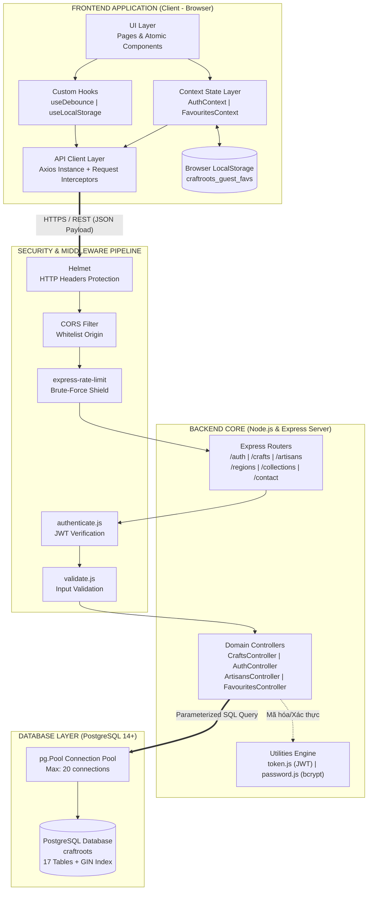
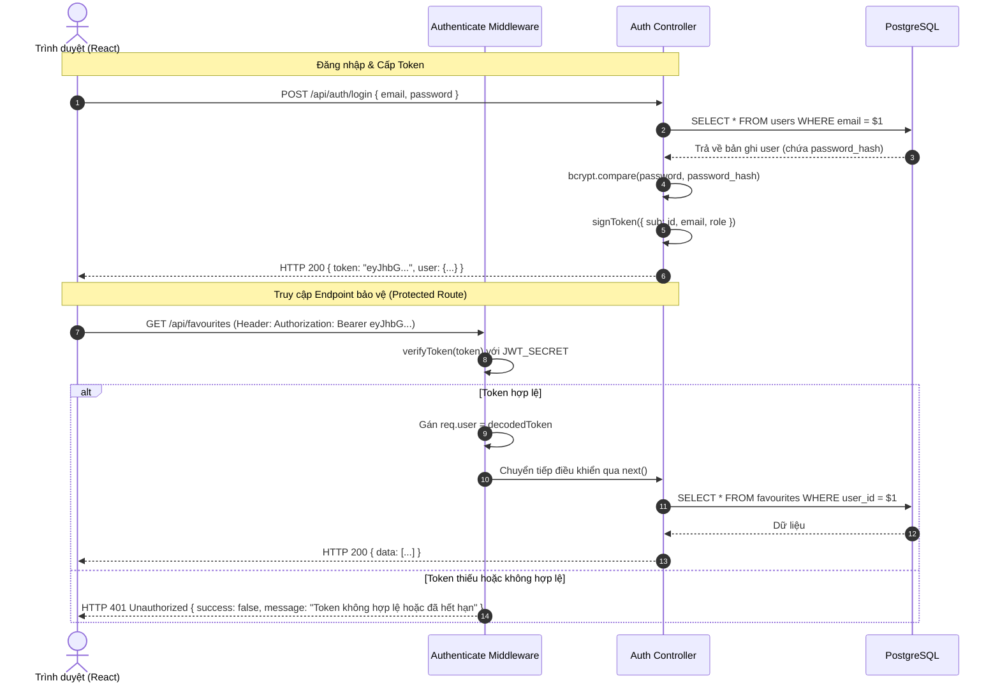
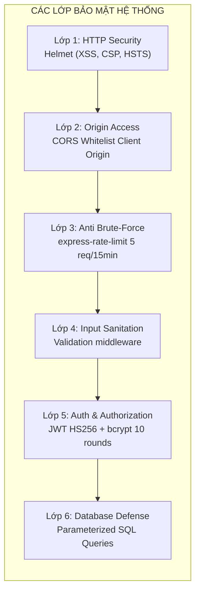

# CraftRoots – Kiến Trúc Hệ Thống & Giao Tiếp Module (Architecture Specification)

> **Dự án:** CraftRoots – Cổng Thông Tin Khám Phá Nghề Thủ Công Truyền Thống  
> **Chương trình:** eProject – Aptech Computer Education  
> **Phiên bản:** v1.0.0  
> **Ngày cập nhật:** 2026-10-12  
> **Tài liệu liên quan:** [feature-spec.md](file:///e:/eproject1/docs/feature-spec.md) | [database-schema.md](file:///e:/eproject1/docs/database-schema.md) | [api-contract.yaml](file:///e:/eproject1/docs/api-contract.yaml)

---

## Mục lục
1. [Tổng quan phong cách kiến trúc (Architectural Overview)](#1-tổng-quan-phong-cách-kiến-trúc-architectural-overview)
2. [Sơ đồ kiến trúc tổng thể (System Architecture Diagrams)](#2-sơ-đồ-kiến-trúc-tổng-thể-system-architecture-diagrams)
3. [Phân rã các Module Frontend (React SPA)](#3-phân-rã-các-module-frontend-react-spa)
4. [Phân rã các Module Backend (Node.js & Express REST API)](#4-phân-rã-các-module-backend-nodejs--express-rest-api)
5. [Tầng cơ sở dữ liệu (PostgreSQL Persistence Layer)](#5-tầng-cơ-sở-dữ-liệu-postgresql-persistence-layer)
6. [Cơ chế và Giao thức giao tiếp giữa các Module](#6-cơ-chế-và-giao-thức-giao-tiếp-giữa-các-module)
   - 6.1. [Giao thức Client - Server & Chuẩn hóa dữ liệu](#61-giao-thức-client---server--chuẩn-hóa-dữ-liệu)
   - 6.2. [Luồng giao tiếp Xác thực & Cấp quyền (Auth Flow)](#62-luồng-giao-tiếp-xác-thực--cấp-quyền-auth-flow)
   - 6.3. [Luồng đồng bộ hóa dữ liệu Favourites lưỡng thể (Hybrid Sync Flow)](#63-luồng-đồng-bộ-hóa-dữ-liệu-favourites-lưỡng-thể-hybrid-sync-flow)
   - 6.4. [Chuẩn hóa cấu trúc phản hồi API (Unified Response Envelope)](#64-chuẩn-hóa-cấu-trúc-phản-hồi-api-unified-response-envelope)
   - 6.5. [Xử lý lỗi tập trung (Global Error Handling Architecture)](#65-xử-lý-lỗi-tập-trung-global-error-handling-architecture)
7. [Bảo mật & Các khía cạnh liên thông (Cross-Cutting Concerns)](#7-bảo-mật--các-khía-cạnh-liên-thông-cross-cutting-concerns)
8. [Môi trường triển khai & Cấu trúc mã nguồn (Project Organization)](#8-môi-trường-triển-khai--cấu-trúc-mã-nguồn-project-organization)

---

## 1. Tổng quan phong cách kiến trúc (Architectural Overview)

Hệ thống CraftRoots được thiết kế theo mô hình **Kiến trúc phân tầng hướng dịch vụ tách rời (Decoupled Layered Architecture)** kết hợp với kiến trúc ứng dụng một trang (**SPA - Single Page Application**) và giao diện lập trình ứng dụng RESTful (**RESTful API**).

```
┌──────────────────────────────────────────────────────────────┐
│                    TẦNG TRÌNH DIỄN (PRESENTATION)             │
│            React 18 SPA (Vite/Client) + React Router         │
└──────────────────────────────▲───────────────────────────────┘
                               │ HTTP/HTTPS - JSON (Bearer JWT)
┌──────────────────────────────▼───────────────────────────────┐
│               TẦNG CỔNG DỊCH VỤ / API (APPLICATION API)       │
│           Node.js + Express.js Framework (REST Endpoints)    │
│  [Helmet, CORS, RateLimit] -> [Auth & Validation Middleware]  │
│                   -> [Domain Controllers]                    │
└──────────────────────────────▲───────────────────────────────┘
                               │ Parameterized SQL ($1, $2...)
┌──────────────────────────────▼───────────────────────────────┐
│                 TẦNG LƯU TRỮ DỮ LIỆU (PERSISTENCE)            │
│         PostgreSQL 14+ Database Pool (pg connection pool)    │
└──────────────────────────────────────────────────────────────┘
```

### Các nguyên tắc thiết kế trọng yếu
1. **Stateless Backend:** Máy chủ Express không lưu trạng thái phiên làm việc (Session) trong bộ nhớ, toàn bộ việc xác thực danh tính dựa vào mã thông báo có chữ ký số mã hóa (**JSON Web Token - JWT**).
2. **Separation of Concerns (SoC):** Tách biệt rạch ròi giữa giao diện người dùng (UI Components), trạng thái nghiệp vụ (Context/Hooks), tầng giao tiếp mạng (API Client) và tầng truy cập dữ liệu (Controllers & DB Queries).
3. **Resilience & Defensive Coding:** Phòng thủ đa tầng, từ kiểm tra dữ liệu đầu vào tại Client, lọc qua Validation Middleware ở Server đến việc áp đặt ràng buộc toàn vẹn khóa ngoại cứng (Foreign Keys) tại Database.

---

## 2. Sơ đồ kiến trúc tổng thể (System Architecture Diagrams)

### 2.1. Sơ đồ khối tương tác các thành phần hệ thống


---

## 3. Phân rã các Module Frontend (React SPA)

Frontend được cấu trúc thành các module độc lập, có thể tái sử dụng cao và dễ bảo trì:

| Tên Module | Trách nhiệm chính | Các thành phần cốt lõi |
|---|---|---|
| **1. UI Presentation Module** | Hiển thị giao diện người dùng, xử lý layout và tương tác đồ họa. | - **Layouts:** `Navbar`, `Footer`, `Breadcrumbs`, `MobileDrawer`<br>- **Card/Views:** `CraftCard`, `ArtisanCard`, `RegionCard`<br>- **Widgets:** `FilterBar`, `SearchBar`, `LightboxModal`, `BackToTop`<br>- **Feedback:** `LoadingSkeleton`, `ToastNotification`, `EmptyState` |
| **2. Page Views Module** | Điều phối toàn bộ vòng đời và trải nghiệm của từng trang màn hình. | - `HomePage`: Landing page, Hero, Featured, Seasonal carousel<br>- `DirectoryPage`: Lưới sản phẩm, Bộ lọc kết hợp, Phân trang<br>- `CraftDetailPage`: Chi tiết sản phẩm, N-N nghệ nhân, gallery<br>- `ArtisansPage` / `ArtisanDetailPage`: Danh sách và tiểu sử nghệ nhân<br>- `RegionsPage`: Bản đồ văn hóa làng nghề<br>- `GalleryPage`: Thư viện ảnh tương tác Lightbox<br>- `FavouritesPage`: Danh sách yêu thích cá nhân<br>- `ContactPage`: Biểu mẫu liên hệ<br>- `LoginPage` / `RegisterPage` / `ProfilePage`: Xác thực tài khoản |
| **3. Context State Module** | Quản lý trạng thái toàn cục xuyên suốt các thành phần không phụ thuộc cấu trúc cây DOM. | - `AuthContext`: Lưu thông tin `user`, trạng thái `isAuthenticated`, phương thức `login()`, `logout()`, `register()`.<br>- `FavouritesContext`: Quản lý danh sách ID yêu thích, logic kiểm tra `isFav(id)`, `toggleFav(id)`, và tự động kích hoạt đồng bộ khi đăng nhập. |
| **4. Custom Hooks Module** | Trừu tượng hóa logic phức tạp để dùng lại nhiều nơi. | - `useDebounce`: Làm trễ tín hiệu nhập từ khóa (350ms) để tối ưu tìm kiếm.<br>- `useLocalStorage`: Đọc/ghi đồng bộ dữ liệu vào `localStorage` của trình duyệt.<br>- `useCrafts`: Xử lý fetch dữ liệu sản phẩm, caching và quản lý cờ `isLoading`, `error`.<br>- `useLightbox`: Quản lý index ảnh hiện tại, sự kiện bàn phím ESC / Arrow. |
| **5. API Services Module** | Cấu hình mạng tập trung thông qua thư viện Axios. | - `api/client.js`: Axios instance cấu hình Base URL, timeout (10000ms), gắn tự động header `Authorization: Bearer <token>` qua Request Interceptor.<br>- `api/crafts.js`, `api/auth.js`, `api/artisans.js`, `api/favourites.js`, `api/contact.js`: Các hàm gọi API chuyên biệt. |

---

## 4. Phân rã các Module Backend (Node.js & Express REST API)

Backend tuân thủ kiến trúc phân tầng linh hoạt (Controller-Service-Data):

```
server/src/
├── app.js                 # Cấu hình Express app, gắn Middleware Pipeline & Routes
├── server.js              # Điểm khởi chạy (Entry point), mở cổng lắng nghe HTTP (PORT=5000)
├── config/
│   ├── db.js              # Khởi tạo pg.Pool, kiểm tra kết nối CSDL PostgreSQL
│   └── env.js             # Quản lý và validate các biến môi trường từ .env
├── middleware/
│   ├── authenticate.js    # Kiểm tra tính hợp lệ của JWT Bearer Token
│   ├── validate.js        # Kiểm tra tính hợp lệ dữ liệu Body/Params
│   ├── rateLimiter.js     # Giới hạn tần suất request (chống spam/DDoS)
│   └── errorHandler.js    # Bắt mọi ngoại lệ và trả về mã lỗi chuẩn JSON
├── routes/                # Định nghĩa các Endpoint RESTful và ánh xạ vào Controller
│   ├── auth.routes.js
│   ├── crafts.routes.js
│   ├── artisans.routes.js
│   ├── regions.routes.js
│   ├── categories.routes.js
│   ├── collections.routes.js
│   ├── favourites.routes.js
│   └── contact.routes.js
├── controllers/           # Điều hướng luồng nghiệp vụ và tương tác CSDL
│   ├── auth.controller.js
│   ├── crafts.controller.js
│   ├── artisans.controller.js
│   ├── regions.controller.js
│   ├── collections.controller.js
│   ├── favourites.controller.js
│   └── contact.controller.js
└── utils/                 # Các tiện ích bổ trợ độc lập
    ├── token.js           # Ký và giải mã JSON Web Token (jsonwebtoken)
    └── password.js        # Băm và so sánh mật khẩu (bcrypt)
```

---

## 5. Tầng cơ sở dữ liệu (PostgreSQL Persistence Layer)

- **Quản trị Kết nối (Connection Pool):**
  - Sử dụng thư viện `pg` với `Pool` quản lý tối đa 20 kết nối đồng thời.
  - Tự động tái sử dụng kết nối (keep-alive), ngăn chặn cạn kiệt tài nguyên hệ thống (connection leak).
- **Nguyên tắc Truy vấn Tham số hóa (Parameterized Queries):**
  - Mọi câu lệnh SQL đều sử dụng biến vị trí dạng `$1, $2, $3...` để loại trừ hoàn toàn nguy cơ bị tấn công **SQL Injection**.
- **Chỉ mục Hiệu năng cao (Indexing Strategy):**
  - B-Tree Index trên toàn bộ các khóa ngoại (`region_id`, `category_id`, `artisan_id`, `craft_id`).
  - GIN Index (Generalized Inverted Index) áp dụng `to_tsvector` hỗ trợ tìm kiếm không dấu/toàn văn bản với tốc độ microsecond trên bảng `crafts`.

---

## 6. Cơ chế và Giao thức giao tiếp giữa các Module

### 6.1. Giao thức Client - Server & Chuẩn hóa dữ liệu
- **Giao thức:** HTTPS (hoặc HTTP trên môi trường phát triển cục bộ `http://localhost:5000/api`).
- **Định dạng tải trọng:** `application/json` với bảng mã UTF-8.
- **Tiêu chuẩn RESTful:** Sử dụng đúng các động từ HTTP:
  - `GET`: Đọc tài nguyên (Idempotent, Safe).
  - `POST`: Tạo mới tài nguyên hoặc hành động xử lý (Non-idempotent).
  - `PUT`: Cập nhật toàn bộ hoặc thay đổi trạng thái (Idempotent).
  - `DELETE`: Xóa tài nguyên (Idempotent).

### 6.2. Luồng giao tiếp Xác thực & Cấp quyền (Auth Flow)


### 6.3. Luồng đồng bộ hóa dữ liệu Favourites lưỡng thể (Hybrid Sync Flow)
1. **Trạng thái khách:** Khách chọn sản phẩm -> Lưu mảng ID `[1, 5, 12]` vào `localStorage`.
2. **Kích hoạt sau đăng nhập:** Sau khi nhận JWT từ `/api/auth/login`, `FavouritesContext` tự động đọc `localStorage`.
3. **Gọi API Đồng bộ:** Gửi request `POST /api/favourites/sync` với payload `{ craftIds: [1, 5, 12] }`.
4. **Xử lý phía Server:**
   ```sql
   INSERT INTO favourites (user_id, craft_id)
   VALUES ($1, UNNEST($2::INT[]))
   ON CONFLICT (user_id, craft_id) DO NOTHING;
   ```
5. **Phản hồi & Dọn dẹp:** Server trả về danh sách đầy đủ các sản phẩm đã yêu thích. Client xóa key `craftroots_guest_favs` trong `localStorage` và chuyển hoàn toàn sang trạng thái đám mây.

### 6.4. Chuẩn hóa cấu trúc phản hồi API (Unified Response Envelope)

#### Cấu trúc Thành công (Success Response):
```json
{
  "success": true,
  "statusCode": 200,
  "message": "Lấy danh sách sản phẩm thành công",
  "data": [
    {
      "id": 1,
      "name": "Bình gốm men lam Bát Tràng",
      "slug": "binh-gom-men-lam-bat-trang",
      "region": { "id": 1, "name": "Bắc Bộ" },
      "category": { "id": 1, "name": "Gốm sứ truyền thống" },
      "thumbnailUrl": "https://..."
    }
  ],
  "pagination": {
    "page": 1,
    "limit": 12,
    "totalItems": 48,
    "totalPages": 4
  }
}
```

#### Cấu trúc Thất bại / Lỗi (Error Response):
```json
{
  "success": false,
  "statusCode": 400,
  "error": "BAD_REQUEST",
  "message": "Dữ liệu gửi lên không hợp lệ",
  "details": [
    { "field": "email", "issue": "Email không đúng định dạng chuẩn" }
  ]
}
```

### 6.5. Xử lý lỗi tập trung (Global Error Handling Architecture)
- Mọi Controller được bao bọc bởi cấu trúc `try...catch` hoặc tiện ích `asyncHandler`.
- Khi có lỗi phát sinh ngoài dự kiến, Controller chuyển tiếp lỗi sang `next(err)`.
- Middleware `errorHandler.js` ở cuối chuỗi sẽ:
  - Phân loại mã lỗi (400 Client error, 401 Unauthorized, 403 Forbidden, 404 Not Found, 500 Internal Error).
  - Ẩn thông tin nhạy cảm của stack trace nếu đang chạy ở môi trường `production`.
  - Trả về phản hồi JSON chuẩn hóa.

---

## 7. Bảo mật & Các khía cạnh liên thông (Cross-Cutting Concerns)



1. **Bảo vệ tiêu đề HTTP với Helmet:** Tự động loại bỏ header `X-Powered-By`, bật chính sách `X-Content-Type-Options: nosniff`, `X-Frame-Options: DENY`.
2. **Kiểm soát CORS:** Chỉ cho phép Client React tại `http://localhost:5173` (hoặc domain chính thức) gửi yêu cầu và nhận header.
3. **Mã hóa mật khẩu an toàn:** Sử dụng thư viện `bcrypt` với muối mã hóa 10 vòng lặp (10 salt rounds), bảo vệ mật khẩu người dùng ngay cả khi cơ sở dữ liệu bị rò rỉ.
4. **Phân quyền vai trò (Role-based Access Control - RBAC):** Hệ thống sẵn sàng với 3 cấp độ vai trò trong bảng `users`: `user` (người dùng cuối), `editor` (người kiểm duyệt), `admin` (quản trị toàn hệ thống).

---

## 8. Môi trường triển khai & Cấu trúc mã nguồn (Project Organization)

### 8.1. Cấu trúc tổ chức mã nguồn chuẩn
```
eproject1/
├── client/                      # Thư mục Frontend (giao diện người dùng)
├── server/                      # Thư mục Backend (Node.js & Express REST API)
│   ├── src/
│   │   ├── config/              # db.js, env.js
│   │   ├── controllers/         # Xử lý nghiệp vụ API
│   │   ├── middleware/          # authenticate.js, errorHandler.js...
│   │   ├── routes/              # Routing modules
│   │   ├── utils/               # token.js, password.js
│   │   ├── app.js               # Cấu hình Express app
│   │   └── server.js            # Khởi động máy chủ
│   ├── .env.example
│   └── package.json
│
├── db/                          # CSDL & Dữ liệu chung toàn dự án (PostgreSQL)
│   ├── schema.sql               # Khởi tạo CSDL PostgreSQL (17 bảng)
│   └── seed.sql                 # Nạp dữ liệu mẫu
│
├── node_modules/                # Môi trường thư viện phụ thuộc dùng chung toàn dự án
├── docs/                        # Toàn bộ tài liệu kỹ thuật dự án
│   ├── README.md
│   ├── data.md
│   ├── feature-spec.md          # Đặc tả nghiệp vụ
│   ├── architecture.md          # Kiến trúc hệ thống
│   ├── database-schema.md       # Thiết kế CSDL & Migration
│   ├── api-contract.yaml        # Đặc tả OpenAPI 3.0
│   ├── task-breakdown.md        # Phân rã công việc WBS
│   └── test-plan.md             # Kế hoạch & Kịch bản kiểm thử
├── package.json                 # Quản lý scripts khởi chạy & dependencies chung
├── .env                         # Biến môi trường hệ thống chung
└── README.md                    # Hướng dẫn tổng quan toàn dự án
```

### 8.2. Biến môi trường hệ thống (`.env`)
```ini
# Cấu hình Cổng máy chủ Backend
PORT=5000
NODE_ENV=development

# Kết nối Cơ sở dữ liệu PostgreSQL
DB_HOST=localhost
DB_PORT=5432
DB_NAME=craftroots
DB_USER=postgres
DB_PASSWORD=your_secure_password
DB_SSL=false

# Cấu hình Bảo mật JWT
JWT_SECRET=super_secret_craftroots_jwt_key_2026_x!99
JWT_EXPIRES_IN=1d

# Cấu hình CORS Whitelist
CLIENT_ORIGIN=http://localhost:5173
```
