# CraftRoots – Thiết Kế Cơ Sở Dữ Liệu Chi Tiết (Database Architecture & Data Dictionary)

> **Tài liệu đặc tả chi tiết kiến trúc cơ sở dữ liệu PostgreSQL cho hệ thống CraftRoots.**  
> Phiên bản: **v1.1.0** (Nâng cấp toàn diện theo hệ thống thiết kế Stitch UI & 22 bảng CSDL).  
> Kế thừa định hướng từ [docs/README.md](file:///e:/eproject1/docs/README.md), [docs/DESIGN.md](file:///e:/eproject1/docs/DESIGN.md) và [docs/DECISIONS.md](file:///e:/eproject1/docs/DECISIONS.md).  
> **Điểm cải tiến cốt lõi:** Chuẩn hóa quan hệ Nhiều - Nhiều `craft_artisans`, bổ sung thực thể Làng nghề `craft_villages`, Niên biểu nghệ nhân `artisan_milestones`, Phiếu hẹn xưởng `visit_bookings`, Bản tin `newsletter_subscribers`, Ký họa điền dã `field_notes` và mở rộng các trường định danh mã SKU, giá, thông số JSONB.

---

## Mục lục

1. [Tổng quan & Mục tiêu thiết kế](#1-tổng-quan--mục-tiêu-thiết-kế)
2. [Sơ đồ quan hệ thực thể (ERD Diagram v1.1.0)](#2-sơ-đồ-quan-hệ-thực-thể-erd-diagram)
3. [Quy chuẩn định danh & Kiểu dữ liệu PostgreSQL](#3-quy-chuẩn-định-danh--kiểu-dữ-liệu-postgresql)
4. [Từ điển dữ liệu chi tiết 22 bảng (Data Dictionary)](#4-từ-điển-dữ-liệu-chi-tiết-data-dictionary)
   - 4.1. [Bảng `users` (Người dùng & Xác thực)](#41-bảng-users-người-dùng--xác-thực)
   - 4.2. [Bảng `regions` (Vùng miền & 6 vùng văn hóa)](#42-bảng-regions-vùng-miền--địa-danh-văn-hóa)
   - 4.3. [Bảng `craft_categories` (Loại hình nghề thủ công)](#43-bảng-craft_categories-loại-hình-nghề-thủ-công)
   - 4.4. [Bảng `craft_villages` (Làng nghề truyền thống) ⭐](#44-bảng-craft_villages-làng-nghề-truyền-thống-)
   - 4.5. [Bảng `materials` (Chất liệu chế tác)](#45-bảng-materials-chất-liệu-chế-tác)
   - 4.6. [Bảng `techniques` (Kỹ thuật chế tác)](#46-bảng-techniques-kỹ-thuật-chế-tác)
   - 4.7. [Bảng `artisans` (Hồ sơ nghệ nhân) ⭐](#47-bảng-artisans-hồ-sơ-nghệ-nhân)
   - 4.8. [Bảng `crafts` (Tác phẩm / Sản phẩm thủ công) ⭐](#48-bảng-crafts-tác-phẩm--sản-phẩm-thủ-công)
   - 4.9. [Bảng `craft_artisans` (Quan hệ N-N: Nghệ nhân ↔ Sản phẩm) ⭐](#49-bảng-craft_artisans-quan-hệ-n-n-nghệ-nhân--sản-phẩm-)
   - 4.10. [Bảng `craft_materials` (Quan hệ N-N: Sản phẩm ↔ Chất liệu)](#410-bảng-craft_materials-quan-hệ-n-n-sản-phẩm--chất-liệu)
   - 4.11. [Bảng `craft_techniques` (Quan hệ N-N: Sản phẩm ↔ Kỹ thuật)](#411-bảng-craft_techniques-quan-hệ-n-n-sản-phẩm--kỹ-thuật)
   - 4.12. [Bảng `craft_images` (Thư viện ảnh chi tiết sản phẩm)](#412-bảng-craft_images-thư-viện-ảnh-chi-tiết-sản-phẩm)
   - 4.13. [Bảng `artisan_milestones` (Niên biểu mốc son nghệ nhân) ⭐](#413-bảng-artisan_milestones-niên-biểu-mốc-son-nghệ-nhân-)
   - 4.14. [Bảng `collections` (Bộ sưu tập chuyên đề thông thường)](#414-bảng-collections-bộ-sưu-tập-chuyên-đề-thông-thường)
   - 4.15. [Bảng `collection_crafts` (Quan hệ N-N: Bộ sưu tập ↔ Sản phẩm)](#415-bảng-collection_crafts-quan-hệ-n-n-bộ-sưu-tập--sản-phẩm)
   - 4.16. [Bảng `seasonal_collections` (Bộ sưu tập theo mùa: Xuân, Hạ, Thu, Đông) ⭐](#416-bảng-seasonal_collections-bộ-sưu-tập-theo-mùa-xuân-hạ-thu-đông-)
   - 4.17. [Bảng `seasonal_collection_crafts` (Quan hệ N-N: Sản phẩm thuộc Bộ sưu tập mùa) ⭐](#417-bảng-seasonal_collection_crafts-quan-hệ-n-n-sản-phẩm-thuộc-bộ-sưu-tập-mùa-)
   - 4.18. [Bảng `favourites` (Danh sách yêu thích)](#418-bảng-favourites-danh-sách-yêu-thích)
   - 4.19. [Bảng `contact_messages` (Tin nhắn liên hệ)](#419-bảng-contact_messages-tin-nhắn-liên-hệ)
   - 4.20. [Bảng `visit_bookings` (Phiếu đăng ký hẹn thăm xưởng) ⭐](#420-bảng-visit_bookings-phiếu-đăng-ký-hẹn-thăm-xưởng-)
   - 4.21. [Bảng `newsletter_subscribers` (Bản tin di sản) ⭐](#421-bảng-newsletter_subscribers-bản-tin-di-sản-)
   - 4.22. [Bảng `field_notes` (Ký họa điền dã) ⭐](#422-bảng-field_notes-ký-họa-điền-dã-)
5. [Phân tích chuyên sâu các mô hình nghiệp vụ đặc thù](#5-phân-tích-chuyên-sâu-các-mô-hình-nghiệp-vụ-đặc-thù)
6. [Mã nguồn DDL PostgreSQL hoàn chỉnh (`schema.sql`)](#6-mã-nguồn-ddl-postgresql-hoàn-chỉnh-schemasql)
7. [Dữ liệu mẫu kiểm thử (`seed.sql` minh họa N-N & Bộ sưu tập mùa hè)](#7-dữ-liệu-mẫu-kiểm-thử-seedsql-minh-họa-quan-hệ-n-n)
8. [Chiến lược Đánh chỉ mục (Indexing Strategy) & Hiệu năng](#8-chiến-lược-đánh-chỉ-mục-indexing-strategy--hiệu-năng)
9. [Checklist Thẩm định & Kiểm soát chất lượng](#9-checklist-thẩm-định--kiểm-soát-chất-lượng)

---

## 1. Tổng quan & Mục tiêu thiết kế

Cơ sở dữ liệu CraftRoots phục vụ nền tảng số hóa di sản làng nghề thủ công truyền thống Việt Nam. Kiến trúc cơ sở dữ liệu được xây dựng nhằm đáp ứng các mục tiêu trọng tâm:

1. **Bảo tồn và phản ánh chính xác thực tế văn hóa làng nghề:**
   - Trong mỹ nghệ truyền thống (gốm sứ, sơn mài, đúc đồng...), một tác phẩm đỉnh cao thường là sự kết tinh tài hoa của **nhiều nghệ nhân** (nghệ nhân tạo dáng cốt, nghệ nhân vẽ men/thêu tay, nghệ nhân cẩn xà cừ/dát vàng).
   - Đồng thời, mỗi nghệ nhân trong suốt sự nghiệp sáng tạo ra **hàng trăm tác phẩm**.
   - Do đó, việc thiết kế quan hệ giữa `artisans` và `crafts` là **Nhiều - Nhiều (N-N)** là yêu cầu bắt buộc về cả mặt nghiệp vụ lẫn tính chân thực của văn hóa.
2. **Hỗ trợ tìm kiếm, lọc đa chiều mượt mà:**
   - Lọc sản phẩm kết hợp nhiều tiêu chí: Vùng miền (`regions`), Danh mục (`craft_categories`), Chất liệu (`materials`), Kỹ thuật (`techniques`), Nghệ nhân (`artisans`).
3. **Hiệu năng & Bảo mật:**
   - Khóa chính chuẩn hóa `SERIAL`/`BIGSERIAL`, khóa ngoại có chỉ số B-Tree tương ứng.
   - Hỗ trợ Full-Text Search (PostgreSQL `tsvector` + GIN Index) cho tên và ngữ cảnh văn hóa.
   - Mật khẩu người dùng được băm chuẩn bcrypt (`password_hash`), xác thực JWT không lưu session rác trên database.

---

## 2. Sơ đồ quan hệ thực thể (ERD Diagram)

```mermaid
erDiagram
    users ||--o{ favourites : "saves"
    users ||--o{ visit_bookings : "books"
    users ||--o{ contact_messages : "sends"
    crafts ||--o{ favourites : "is saved in"
    
    regions ||--o{ craft_villages : "contains"
    regions ||--o{ crafts : "originates"
    regions ||--o{ artisans : "belongs to"
    
    craft_categories ||--o{ craft_villages : "specializes"
    craft_categories ||--o{ crafts : "classifies"
    
    craft_villages ||--o{ artisans : "resides in"
    craft_villages ||--o{ crafts : "produced at"
    
    crafts ||--|{ craft_images : "has gallery"
    crafts ||--|{ craft_artisans : "crafted by"
    artisans ||--|{ craft_artisans : "participates in"
    artisans ||--o{ artisan_milestones : "achieves"
    artisans ||--o{ visit_bookings : "hosts"
    
    crafts ||--|{ craft_materials : "composed of"
    materials ||--|{ craft_materials : "used in"
    
    crafts ||--|{ craft_techniques : "created with"
    techniques ||--|{ craft_techniques : "applied to"
    
    collections ||--|{ collection_crafts : "groups"
    crafts ||--|{ collection_crafts : "included in"

    seasonal_collections ||--|{ seasonal_collection_crafts : "curates"
    crafts ||--|{ seasonal_collection_crafts : "featured in"
    
    contact_messages {
        int id PK
        int user_id FK
        string full_name
        string email
        string phone
        string topic
        string subject
        text message
        string status
        timestamptz created_at
    }

    visit_bookings {
        int id PK
        int artisan_id FK
        int user_id FK
        string full_name
        string phone
        date visit_date
        string time_slot
        string purpose
        string status
        timestamptz created_at
    }

    newsletter_subscribers {
        int id PK
        string email UK
        timestamptz created_at
    }

    field_notes {
        int id PK
        string title
        text body
        string coordinates
        jsonb metrics
        boolean is_published
        timestamptz created_at
    }

    artisan_milestones {
        int id PK
        int artisan_id FK
        string year
        text event
        int sort_order
    }

    craft_villages {
        int id PK
        int region_id FK
        int category_id FK
        string name
        string slug UK
        string district
        string province
        string century_label
    }

    users {
        int id PK
        string full_name
        string email UK
        string password_hash
        string role
        string avatar_url
        boolean is_active
        timestamptz created_at
        timestamptz updated_at
    }

    regions {
        int id PK
        string name UK
        string code UK
        string map_key
        text description
        string image_url
        int registered_village_count
        int national_heritage_count
        boolean is_verified
        timestamptz created_at
    }

    craft_categories {
        int id PK
        string name UK
        string slug UK
        text description
        string icon_url
    }

    materials {
        int id PK
        string name UK
        text description
    }

    techniques {
        int id PK
        string name UK
        text description
    }

    artisans {
        int id PK
        string name
        string slug UK
        string code UK
        int region_id FK
        int village_id FK
        string title
        int age
        int generation
        int years_of_experience
        text quote
        text biography
        jsonb technique_specs
        int visit_max_guests
        int visit_lead_time_hours
        timestamptz created_at
    }

    crafts {
        int id PK
        string name
        string slug UK
        string code UK
        int region_id FK
        int category_id FK
        int village_id FK
        bigint price_vnd
        string tag
        string origin_line
        string dimensions
        jsonb specs
        jsonb process_stages
        boolean is_spotlight
        boolean is_featured
        timestamptz created_at
    }

    craft_artisans {
        int craft_id PK, FK
        int artisan_id PK, FK
        string role_title
        text contribution_notes
        boolean is_lead
        int display_order
    }

    craft_materials {
        int craft_id PK, FK
        int material_id PK, FK
    }

    craft_techniques {
        int craft_id PK, FK
        int technique_id PK, FK
    }

    craft_images {
        int id PK
        int craft_id FK
        string url
        string alt_text
        string caption
        int display_order
        timestamptz created_at
    }

    collections {
        int id PK
        string title
        string slug UK
        text description
        string banner_url
        string season
        boolean is_featured
        timestamptz created_at
    }

    collection_crafts {
        int collection_id PK, FK
        int craft_id PK, FK
        int display_order
    }

    seasonal_collections {
        int id PK
        string title
        string slug UK
        string season_code
        int year
        text philosophy_quote
        string archive_code
        jsonb metrics
        jsonb process_steps
        string banner_url
        string color_tone
        date start_date
        date end_date
        boolean is_active
        timestamptz created_at
    }

    seasonal_collection_crafts {
        int seasonal_collection_id PK, FK
        int craft_id PK, FK
        text curator_note
        string highlight_badge
        boolean is_hero
        int display_order
    }

    favourites {
        int user_id PK, FK
        int craft_id PK, FK
        timestamptz created_at
    }
```



---

## 3. Quy chuẩn định danh & Kiểu dữ liệu PostgreSQL

Tuân thủ nghiêm ngặt theo **Database Architecture Standard**:

* **Quy chuẩn tên bảng & cột:**
  - Tên bảng: Toàn bộ chữ thường dạng số nhiều (`users`, `crafts`, `artisans`), ngăn cách bằng `_` (`snake_case`).
  - Tên bảng liên kết Nhiều-Nhiều (Pivot / Junction Table): `<entity1>_<entity2>` (Ví dụ: `craft_artisans`, `craft_materials`, `collection_crafts`).
  - Khóa chính: Luôn là `id` trên các bảng thực thể độc lập.
  - Khóa ngoại: `<singular_entity>_id` (Ví dụ: `region_id`, `craft_id`, `artisan_id`).
  - Khóa chính bảng nối: Composite Primary Key `(craft_id, artisan_id)`.
* **Kiểu dữ liệu khuyến nghị cho PostgreSQL:**
  - Định danh khóa chính: `SERIAL` hoặc `INT GENERATED ALWAYS AS IDENTITY` (tương đương `INT4` 32-bit đủ cho ~2.1 tỷ bản ghi) hoặc `BIGSERIAL` cho bảng có lượng truy cập lớn.
  - Chuỗi văn bản: `VARCHAR(n)` có giới hạn hợp lý cho tên, mã; `TEXT` cho văn bản dài, bối cảnh văn hóa.
  - Cờ logic: `BOOLEAN NOT NULL DEFAULT FALSE`.
  - Mốc thời gian: `TIMESTAMPTZ` (Timestamp with time zone - lưu giờ chuẩn UTC).
* **Quy tắc xóa toàn vẹn (`ON DELETE`):**
  - Bảng trung gian n-n (`craft_artisans`, `craft_materials`, `favourites`): `ON DELETE CASCADE` (xóa sản phẩm hoặc nghệ nhân thì dòng liên kết trung gian tự hủy).
  - Khóa ngoại danh mục phân loại (`category_id`, `region_id`): `ON DELETE RESTRICT` (ngăn chặn vô tình xóa vùng miền hoặc danh mục nếu còn sản phẩm trực thuộc).

---

## 4. Từ điển dữ liệu chi tiết (Data Dictionary)

### 4.1. Bảng `users` (Người dùng & Xác thực)
Lưu trữ thông tin định danh và tài khoản người dùng đã đăng ký, hỗ trợ xác thực JWT và phân quyền RBAC (`user`, `editor`, `admin`).

| Cột | Kiểu dữ liệu | Ràng buộc | Mặc định | Mô tả nghiệp vụ |
| :--- | :--- | :--- | :--- | :--- |
| `id` | `SERIAL` | **PK** | Tự tăng | Mã định danh duy nhất của người dùng |
| `full_name` | `VARCHAR(100)` | NOT NULL | | Họ và tên hiển thị |
| `email` | `VARCHAR(255)` | NOT NULL, **UNIQUE** | | Địa chỉ email đăng nhập (chuẩn hóa chữ thường) |
| `password_hash` | `VARCHAR(255)` | NOT NULL | | Mật khẩu đã băm bằng thuật toán bcrypt |
| `role` | `VARCHAR(20)` | NOT NULL, CHECK (`role IN ('user', 'admin', 'editor')`) | `'user'` | Vai trò người dùng trong hệ thống |
| `avatar_url` | `TEXT` | NULL | NULL | Đường dẫn URL ảnh đại diện |
| `is_active` | `BOOLEAN` | NOT NULL | `TRUE` | Trạng thái tài khoản (khoá/mở) |
| `created_at` | `TIMESTAMPTZ` | NOT NULL | `NOW()` | Thời điểm tạo tài khoản |
| `updated_at` | `TIMESTAMPTZ` | NOT NULL | `NOW()` | Thời điểm cập nhật hồ sơ gần nhất |

* **Chỉ mục (Indexes):**
  - `pk_users`: PRIMARY KEY (`id`)
  - `uk_users_email`: UNIQUE (`email`)
  - `idx_users_role`: INDEX (`role`)

---

### 4.2. Bảng `regions` (Vùng miền & 6 vùng văn hóa di sản)
Danh mục 6 vùng văn hóa truyền thống kết nối với bản đồ SVG tương tác (`regions.html` / Stitch).

| Cột | Kiểu dữ liệu | Ràng buộc | Mặc định | Mô tả nghiệp vụ |
| :--- | :--- | :--- | :--- | :--- |
| `id` | `SERIAL` | **PK** | Tự tăng | Mã định danh vùng miền |
| `name` | `VARCHAR(100)` | NOT NULL, **UNIQUE** | | Tên vùng văn hóa (Ví dụ: *Đồng bằng sông Hồng, Tây Bắc, Bắc Trung Bộ...*) |
| `code` | `VARCHAR(50)` | NOT NULL, **UNIQUE** | | Mã slug định danh (Ví dụ: `dong-bang-bac-bo`, `tay-bac`) |
| `map_key` | `VARCHAR(50)` | NULL | NULL | Mã liên kết SVG path trên bản đồ (`north`, `central`, `south`, v.v.) |
| `description` | `TEXT` | NULL | NULL | Khái quát bối cảnh văn hóa và lịch sử làng nghề của vùng |
| `craft_summary` | `TEXT` | NULL | NULL | Tóm tắt các dòng nghề tiêu biểu trong vùng |
| `image_url` | `TEXT` | NULL | NULL | Ảnh toàn cảnh đặc trưng vùng miền |
| `is_verified` | `BOOLEAN` | NOT NULL | `TRUE` | Trạng thái bảo chứng di sản văn hóa vùng |
| `registered_village_count` | `INT` | NOT NULL | `0` | Số lượng làng nghề đã được lập hồ sơ số hóa |
| `national_heritage_count` | `INT` | NOT NULL | `0` | Số lượng di sản văn hóa phi vật thể quốc gia được công nhận |
| `sort_order` | `INT` | NOT NULL | `0` | Thứ tự trình bày trên bản đồ từ Bắc vào Nam |
| `created_at` | `TIMESTAMPTZ` | NOT NULL | `NOW()` | Thời điểm khởi tạo bản ghi |

* **Chỉ mục:**
  - `pk_regions`: PRIMARY KEY (`id`)
  - `uk_regions_name`: UNIQUE (`name`)
  - `uk_regions_code`: UNIQUE (`code`)

---

### 4.3. Bảng `craft_categories` (Loại hình nghề thủ công)
Phân loại các dòng sản phẩm thủ công (Gốm sứ, Dệt may & Thổ cẩm, Mây tre đan, Điêu khắc gỗ, Đúc đồng & Kim hoàn...).

| Cột | Kiểu dữ liệu | Ràng buộc | Mặc định | Mô tả nghiệp vụ |
| :--- | :--- | :--- | :--- | :--- |
| `id` | `SERIAL` | **PK** | Tự tăng | Mã danh mục nghề |
| `name` | `VARCHAR(100)` | NOT NULL, **UNIQUE** | | Tên phân loại (Ví dụ: *Gốm sứ truyền thống, Dệt lụa & Thổ cẩm*) |
| `slug` | `VARCHAR(100)` | NOT NULL, **UNIQUE** | | Đường dẫn tĩnh phục vụ URL và lọc phân loại |
| `description` | `TEXT` | NULL | NULL | Giới thiệu đặc trưng loại hình nghề |
| `icon_url` | `TEXT` | NULL | NULL | Đường dẫn biểu tượng danh mục (icon vector) |

---

### 4.4. Bảng `craft_villages` (Làng nghề truyền thống) ⭐
Lưu trữ thông tin các làng nghề cổ truyền Việt Nam, phân định theo huyện/tỉnh, niên đại và loại hình chuyên môn.

| Cột | Kiểu dữ liệu | Ràng buộc | Mặc định | Mô tả nghiệp vụ |
| :--- | :--- | :--- | :--- | :--- |
| `id` | `SERIAL` | **PK** | Tự tăng | Mã định danh làng nghề |
| `region_id` | `INT` | **FK** trỏ `regions(id)` | NULL | Vùng văn hóa trực thuộc (ON DELETE SET NULL) |
| `category_id` | `INT` | **FK** trỏ `craft_categories(id)` | NULL | Dòng nghề chủ đạo của làng (ON DELETE SET NULL) |
| `name` | `VARCHAR(150)` | NOT NULL | | Tên làng nghề (Ví dụ: *Làng Gốm Bát Tràng, Làng Lụa Vạn Phúc*) |
| `slug` | `VARCHAR(180)` | NOT NULL, **UNIQUE** | | Đường dẫn tĩnh thân thiện SEO |
| `district` | `VARCHAR(100)` | NULL | NULL | Quận / Huyện / Thị xã |
| `province` | `VARCHAR(100)` | NULL | NULL | Tỉnh / Thành phố trực thuộc trung ương |
| `century_label` | `VARCHAR(100)` | NULL | NULL | Niên đại hình thành (Ví dụ: *Thế kỷ XIV, Hơn 500 năm tuổi*) |
| `summary` | `TEXT` | NULL | NULL | Tóm tắt lịch sử và danh xưng làng nghề |
| `created_at` | `TIMESTAMPTZ` | NOT NULL | `NOW()` | Thời điểm tạo bản ghi |

* **Chỉ mục:**
  - `idx_craft_villages_region`: INDEX (`region_id`)
  - `idx_craft_villages_category`: INDEX (`category_id`)

---

### 4.5. Bảng `materials` (Chất liệu chế tác)
Danh mục nguyên vật liệu tự nhiên truyền thống (Đất sét Bát Tràng, Tro trấu men lam, Sợi tơ tằm, Tre gai, Đồng đỏ...).

| Cột | Kiểu dữ liệu | Ràng buộc | Mặc định | Mô tả nghiệp vụ |
| :--- | :--- | :--- | :--- | :--- |
| `id` | `SERIAL` | **PK** | Tự tăng | Mã chất liệu |
| `name` | `VARCHAR(100)` | NOT NULL, **UNIQUE** | | Tên chất liệu |
| `description` | `TEXT` | NULL | NULL | Đặc tính vật lý và xuất xứ tự nhiên |

---

### 4.6. Bảng `techniques` (Kỹ thuật chế tác)
Danh mục các phương pháp, kỹ nghệ thủ công bí truyền (Vuốt tay bàn xoay, Nung củi men lam cổ, Dệt hoa văn cài chỉ, Cẩn xà cừ, Đúc đồng khuôn sáp...).

| Cột | Kiểu dữ liệu | Ràng buộc | Mặc định | Mô tả nghiệp vụ |
| :--- | :--- | :--- | :--- | :--- |
| `id` | `SERIAL` | **PK** | Tự tăng | Mã kỹ thuật chế tác |
| `name` | `VARCHAR(100)` | NOT NULL, **UNIQUE** | | Tên kỹ thuật |
| `description` | `TEXT` | NULL | NULL | Quy trình kỹ thuật và cấp độ phức tạp |

---

### 4.7. Bảng `artisans` (Hồ sơ nghệ nhân & Bậc thầy chế tác) ⭐
Lưu trữ hồ sơ các bậc thầy, nghệ nhân dân gian, thông số tiếp đón thăm xưởng và các đặc tả kỹ pháp.

| Cột | Kiểu dữ liệu | Ràng buộc | Mặc định | Mô tả nghiệp vụ |
| :--- | :--- | :--- | :--- | :--- |
| `id` | `SERIAL` | **PK** | Tự tăng | Mã định danh nghệ nhân |
| `name` | `VARCHAR(100)` | NOT NULL | | Họ và tên nghệ nhân |
| `slug` | `VARCHAR(150)` | NOT NULL, **UNIQUE** | | Đường dẫn tĩnh hồ sơ nghệ nhân |
| `code` | `VARCHAR(50)` | NULL, **UNIQUE** | | Mã định danh di sản (Ví dụ: `ART-BT-001`) |
| `region_id` | `INT` | **FK** trỏ `regions(id)` | NULL | Vùng địa lý xưởng chế tác (ON DELETE SET NULL) |
| `village_id` | `INT` | **FK** trỏ `craft_villages(id)`| NULL | Làng nghề gắn bó (ON DELETE SET NULL) |
| `title` | `VARCHAR(100)` | NULL | NULL | Danh hiệu nhà nước (Nghệ nhân Ưu tú, Nghệ nhân Nhân dân) |
| `specialty` | `VARCHAR(150)` | NULL | NULL | Lĩnh vực sở trường (Gốm men lam, Điêu khắc...) |
| `years_of_experience`| `INT` | CHECK (>= 0) | NULL | Số năm tuổi nghề gắn bó |
| `generation` | `INT` | NULL | NULL | Thế hệ truyền thừa trong dòng họ (Ví dụ: `5` cho Đời thứ 5) |
| `age` | `INT` | NULL | NULL | Tuổi đời nghệ nhân |
| `quote` | `TEXT` | NULL | NULL | Câu châm ngôn nghệ thuật / triết lý nghề nghiệp |
| `biography` | `TEXT` | NULL | NULL | Tiểu sử cuộc đời và cống hiến cho di sản |
| `avatar_url` | `TEXT` | NULL | NULL | Ảnh chân dung nghệ nhân |
| `contact_info` | `VARCHAR(255)` | NULL | NULL | Địa chỉ liên lạc xưởng chế tác |
| `technique_specs` | `JSONB` | NULL | NULL | Bảng thông số kỹ thuật dạng cấu trúc (`[{key, value, note}]`) |
| `visit_max_guests`| `INT` | NOT NULL | `6` | Số lượng khách tối đa cho 1 lượt tiếp đón |
| `visit_lead_time_hours`| `INT` | NOT NULL | `48` | Thời gian đặt hẹn trước tối thiểu (giờ) |
| `visit_open_days` | `VARCHAR(50)` | NOT NULL | `'Tue-Sun'` | Các ngày mở cửa tiếp khách trong tuần |
| `is_featured` | `BOOLEAN` | NOT NULL | `FALSE` | Hiển thị nổi bật tại trang chủ / danh bạ |
| `created_at` | `TIMESTAMPTZ` | NOT NULL | `NOW()` | Thời điểm tạo hồ sơ |

* **Chỉ mục:**
  - `idx_artisans_region`: INDEX (`region_id`)
  - `idx_artisans_village`: INDEX (`village_id`)
  - `idx_artisans_code`: UNIQUE (`code`)

---

### 4.8. Bảng `crafts` (Tác phẩm / Sản phẩm thủ công) ⭐
Thực thể trung tâm số hóa tác phẩm thủ công, hỗ trợ gắn mã định danh REF, đơn giá tham chiếu, kích thước và quy trình chế tác nhiều bước.

| Cột | Kiểu dữ liệu | Ràng buộc | Mặc định | Mô tả nghiệp vụ |
| :--- | :--- | :--- | :--- | :--- |
| `id` | `SERIAL` | **PK** | Tự tăng | Mã định danh sản phẩm |
| `name` | `VARCHAR(150)` | NOT NULL | | Tên tác phẩm thủ công |
| `slug` | `VARCHAR(180)` | NOT NULL, **UNIQUE** | | Đường dẫn tĩnh thân thiện SEO |
| `code` | `VARCHAR(50)` | NULL, **UNIQUE** | | Mã lưu trữ định danh tác phẩm (Ví dụ: `CR-BT-2025-08MR`) |
| `region_id` | `INT` | **FK** trỏ `regions(id)` | | Vùng miền xuất xứ tác phẩm (ON DELETE RESTRICT) |
| `category_id` | `INT` | **FK** trỏ `craft_categories(id)`| | Loại hình nghề thủ công (ON DELETE RESTRICT) |
| `village_id` | `INT` | **FK** trỏ `craft_villages(id)` | NULL | Làng nghề nơi tác phẩm ra đời (ON DELETE SET NULL) |
| `thumbnail_url` | `TEXT` | NULL | NULL | Ảnh đại diện chính hiển thị trên card lưới |
| `short_description`| `VARCHAR(500)`| NULL | NULL | Đoạn tóm tắt giới thiệu phục vụ SEO và card |
| `cultural_context` | `TEXT` | NULL | NULL | Bối cảnh văn hóa, ý nghĩa phong tục, huyền tích |
| `tools` | `TEXT` | NULL | NULL | Dụng cụ truyền thống chế tác tác phẩm |
| `process` | `TEXT` | NULL | NULL | Tóm tắt các công đoạn gia công |
| `traditional_use` | `TEXT` | NULL | NULL | Ứng dụng trong đời sống truyền thống |
| `price_vnd` | `BIGINT` | NULL | NULL | Giá tham chiếu / thẩm định tác phẩm (VND) |
| `tag` | `VARCHAR(50)` | NULL | NULL | Thẻ nhãn định vị (`Độc bản`, `Di sản`, `Cổ phục`, `Tuyển chọn`) |
| `origin_line` | `VARCHAR(200)` | NULL | NULL | Dòng xuất xứ thu gọn hiển thị trên card |
| `dimensions` | `VARCHAR(100)` | NULL | NULL | Kích thước hiện vật (Ví dụ: `Cao 42cm • Đường kính 28cm`) |
| `specs` | `JSONB` | NULL | NULL | Thông số kỹ thuật chi tiết dạng cấu trúc JSON |
| `process_stages` | `JSONB` | NULL | NULL | Danh sách các công đoạn chế tác kèm ảnh và chú giải |
| `is_spotlight` | `BOOLEAN` | NOT NULL | `FALSE` | Cờ tác phẩm tâm điểm (Spotlight Hero) |
| `is_featured` | `BOOLEAN` | NOT NULL | `FALSE` | Cờ sản phẩm tiêu biểu trên trang chủ |
| `view_count` | `INT` | NOT NULL | `0` | Lượt xem tích lũy phục vụ sắp xếp phổ biến |
| `created_at` | `TIMESTAMPTZ` | NOT NULL | `NOW()` | Ngày tạo |
| `updated_at` | `TIMESTAMPTZ` | NOT NULL | `NOW()` | Ngày cập nhật |

* **Chỉ mục:**
  - `idx_crafts_region`: INDEX (`region_id`)
  - `idx_crafts_category`: INDEX (`category_id`)
  - `idx_crafts_village`: INDEX (`village_id`)
  - `idx_crafts_price`: INDEX (`price_vnd`)
  - `idx_crafts_featured`: INDEX (`is_featured`) WHERE `is_featured = TRUE`
  - `idx_crafts_fts`: GIN INDEX trên `to_tsvector('simple', ...)`

---

### 4.9. Bảng `craft_artisans` (Quan hệ N-N: Nghệ nhân ↔ Sản phẩm) ⭐
Quản lý quan hệ Nhiều - Nhiều giữa Nghệ nhân và Tác phẩm, cho phép ghi nhận nghệ nhân chủ trì (`is_lead`), vai trò phụ trách (`role_title`) và ghi chú đóng góp (`contribution_notes`).

| Cột | Kiểu dữ liệu | Ràng buộc | Mặc định | Mô tả nghiệp vụ |
| :--- | :--- | :--- | :--- | :--- |
| `craft_id` | `INT` | **PK**, **FK** trỏ `crafts(id)` | | Mã tác phẩm thủ công (ON DELETE CASCADE) |
| `artisan_id` | `INT` | **PK**, **FK** trỏ `artisans(id)` | | Mã nghệ nhân tham gia chế tác (ON DELETE CASCADE) |
| `role_title` | `VARCHAR(100)` | NULL | `'Chủ trì chế tác'` | Vai trò: *Chủ trì tạo dáng, Nghệ nhân vẽ men, Cẩn xà cừ...* |
| `contribution_notes`| `TEXT` | NULL | NULL | Ghi chú đóng góp tâm huyết vào tác phẩm |
| `is_lead` | `BOOLEAN` | NOT NULL | `FALSE` | Đánh dấu nghệ nhân chính/đại diện của tác phẩm |
| `display_order` | `INT` | NOT NULL | `1` | Thứ tự hiển thị trong danh sách người đồng tác |
| `created_at` | `TIMESTAMPTZ` | NOT NULL | `NOW()` | Thời điểm tạo liên kết |

* **Khóa chính hợp thành (Composite PK):** `PRIMARY KEY (craft_id, artisan_id)`
* **Chỉ mục:** `idx_craft_artisans_artisan`: INDEX (`artisan_id`)

---

### 4.10. Bảng `craft_materials` (Quan hệ N-N: Sản phẩm ↔ Chất liệu)
Biểu diễn việc 1 sản phẩm kết hợp nhiều chất liệu, và 1 chất liệu cấu thành nhiều sản phẩm.

| Cột | Kiểu dữ liệu | Ràng buộc | Mặc định | Mô tả nghiệp vụ |
| :--- | :--- | :--- | :--- | :--- |
| `craft_id` | `INT` | **PK**, **FK** trỏ `crafts(id)` | | Mã sản phẩm (ON DELETE CASCADE) |
| `material_id` | `INT` | **PK**, **FK** trỏ `materials(id)`| | Mã chất liệu (ON DELETE CASCADE) |

* **Khóa chính:** `PRIMARY KEY (craft_id, material_id)`

---

### 4.11. Bảng `craft_techniques` (Quan hệ N-N: Sản phẩm ↔ Kỹ thuật)
Biểu diễn việc 1 sản phẩm hội tụ nhiều kỹ thuật chế tác công phu.

| Cột | Kiểu dữ liệu | Ràng buộc | Mặc định | Mô tả nghiệp vụ |
| :--- | :--- | :--- | :--- | :--- |
| `craft_id` | `INT` | **PK**, **FK** trỏ `crafts(id)` | | Mã sản phẩm (ON DELETE CASCADE) |
| `technique_id`| `INT` | **PK**, **FK** trỏ `techniques(id)`| | Mã kỹ thuật chế tác (ON DELETE CASCADE) |

* **Khóa chính:** `PRIMARY KEY (craft_id, technique_id)`

---

### 4.12. Bảng `craft_images` (Thư viện ảnh chi tiết sản phẩm)
Phục vụ chức năng thư viện ảnh chi tiết và Lightbox tương tác với hình ảnh độ phân giải cao.

| Cột | Kiểu dữ liệu | Ràng buộc | Mặc định | Mô tả nghiệp vụ |
| :--- | :--- | :--- | :--- | :--- |
| `id` | `SERIAL` | **PK** | Tự tăng | Mã ảnh |
| `craft_id` | `INT` | **FK** trỏ `crafts(id)` | | Sản phẩm liên quan (ON DELETE CASCADE) |
| `url` | `TEXT` | NOT NULL | | URL hình ảnh góc máy chi tiết |
| `alt_text` | `VARCHAR(255)` | NOT NULL | | Mô tả thay thế hỗ trợ SEO & Accessibility |
| `caption` | `VARCHAR(255)` | NULL | NULL | Chú giải kỹ thuật hoặc góc chụp |
| `display_order`| `INT` | NOT NULL | `0` | Thứ tự trình chiếu trong thư viện |
| `created_at` | `TIMESTAMPTZ` | NOT NULL | `NOW()` | Thời điểm tải lên |

---

### 4.13. Bảng `artisan_milestones` (Niên biểu mốc son nghệ nhân) ⭐
Lưu trữ các cột mốc son sự nghiệp của nghệ nhân (năm đạt danh hiệu, năm phục chế thành công cổ vật, giải thưởng quốc tế).

| Cột | Kiểu dữ liệu | Ràng buộc | Mặc định | Mô tả nghiệp vụ |
| :--- | :--- | :--- | :--- | :--- |
| `id` | `SERIAL` | **PK** | Tự tăng | Mã mốc sự kiện |
| `artisan_id` | `INT` | **FK** trỏ `artisans(id)` | | Nghệ nhân chủ thể (ON DELETE CASCADE) |
| `year` | `VARCHAR(20)` | NOT NULL | | Năm hoặc khoảng thời gian (Ví dụ: `1985`, `2004 - 2008`) |
| `event` | `TEXT` | NOT NULL | | Nội dung mốc son sự nghiệp |
| `sort_order` | `INT` | NOT NULL | `0` | Thứ tự sắp xếp niên biểu theo dòng thời gian |

* **Chỉ mục:** `idx_artisan_milestones_artisan`: INDEX (`artisan_id`, `sort_order`)

---

### 4.14. Bảng `collections` (Bộ sưu tập chuyên đề thông thường)
Quản lý các bộ sưu tập tuyển chọn thông thường (*Sắc gốm nghìn năm, Nghệ thuật Dệt Thổ Cẩm Tây Bắc*).

| Cột | Kiểu dữ liệu | Ràng buộc | Mặc định | Mô tả nghiệp vụ |
| :--- | :--- | :--- | :--- | :--- |
| `id` | `SERIAL` | **PK** | Tự tăng | Mã bộ sưu tập |
| `title` | `VARCHAR(150)` | NOT NULL | | Tiêu đề bộ sưu tập |
| `slug` | `VARCHAR(180)` | NOT NULL, **UNIQUE** | | Đường dẫn tĩnh thân thiện SEO |
| `description` | `TEXT` | NULL | NULL | Bài viết giới thiệu chủ đề |
| `banner_url` | `TEXT` | NULL | NULL | Ảnh bìa banner lớn |
| `season` | `VARCHAR(50)` | NULL | NULL | Ghi chú mùa (nếu có) |
| `is_featured` | `BOOLEAN` | NOT NULL | `FALSE` | Cờ hiển thị nổi bật |
| `created_at` | `TIMESTAMPTZ` | NOT NULL | `NOW()` | Thời điểm khởi tạo |

---

### 4.15. Bảng `collection_crafts` (Quan hệ N-N: Bộ sưu tập ↔ Sản phẩm)
Liên kết các sản phẩm nằm trong bộ sưu tập chuyên đề thông thường.

| Cột | Kiểu dữ liệu | Ràng buộc | Mặc định | Mô tả nghiệp vụ |
| :--- | :--- | :--- | :--- | :--- |
| `collection_id`| `INT` | **PK**, **FK** trỏ `collections(id)`| | Mã bộ sưu tập (ON DELETE CASCADE) |
| `craft_id` | `INT` | **PK**, **FK** trỏ `crafts(id)` | | Mã sản phẩm (ON DELETE CASCADE) |
| `display_order`| `INT` | NOT NULL | `0` | Vị trí sắp xếp trong bộ sưu tập |

* **Khóa chính:** `PRIMARY KEY (collection_id, craft_id)`

---

### 4.16. Bảng `seasonal_collections` (Bộ sưu tập theo mùa: Xuân, Hạ, Thu, Đông) ⭐
Quản lý các chiến dịch bộ sưu tập di sản gắn chặt với 4 mùa trong năm, hỗ trợ hiển thị triết lý giám tuyển, mã lưu trữ và thông số JSONB.

| Cột | Kiểu dữ liệu | Ràng buộc | Mặc định | Mô tả nghiệp vụ |
| :--- | :--- | :--- | :--- | :--- |
| `id` | `SERIAL` | **PK** | Tự tăng | Mã định danh bộ sưu tập mùa |
| `title` | `VARCHAR(150)` | NOT NULL | | Tên bộ sưu tập (Ví dụ: *Sắc Lam Mát Lành – Bộ Sưu Tập Mùa Hè 2026*) |
| `slug` | `VARCHAR(180)` | NOT NULL, **UNIQUE** | | Đường dẫn tĩnh SEO (`mua-he-2026-mat-lanh`) |
| `season_code` | `VARCHAR(20)` | NOT NULL, CHECK (`season_code IN ('summer', 'spring', 'autumn', 'winter')`) | | Phân loại mùa: `'summer'`, `'spring'`, `'autumn'`, `'winter'` |
| `year` | `INT` | NOT NULL, CHECK (`year >= 2000`) | | Năm áp dụng (Ví dụ: `2026`) |
| `theme_concept` | `TEXT` | NULL | NULL | Triết lý/chủ đề nghệ thuật theo mùa |
| `philosophy_quote` | `TEXT` | NULL | NULL | Câu danh ngôn triết lý văn hóa mùa |
| `archive_code` | `VARCHAR(50)` | NULL | NULL | Mã lưu trữ bộ sưu tập (Ví dụ: *CR-ARCH-SUMMER-26*) |
| `metrics` | `JSONB` | NULL | NULL | Thông số tổng hợp (Ví dụ: *`{"artisan_count": 8, "piece_count": 24}`*) |
| `process_steps`| `JSONB` | NULL | NULL | Các giai đoạn tuyển chọn và thẩm định di sản |
| `banner_url` | `TEXT` | NULL | NULL | Ảnh bìa banner chủ đề mùa |
| `color_tone` | `VARCHAR(30)` | NULL | `'#0ea5e9'` | Mã màu HEX chủ đạo đại diện cho mùa |
| `start_date` | `DATE` | NOT NULL | | Ngày mở chiến dịch |
| `end_date` | `DATE` | NOT NULL, CHECK (`end_date >= start_date`) | | Ngày kết thúc chiến dịch |
| `is_active` | `BOOLEAN` | NOT NULL | `TRUE` | Bật/tắt trạng thái hiển thị trên cổng thông tin |
| `created_at` | `TIMESTAMPTZ` | NOT NULL | `NOW()` | Thời điểm tạo |

* **Chỉ mục:**
  - `idx_seasonal_collections_active`: INDEX (`is_active`, `season_code`, `year`)
  - `idx_seasonal_collections_dates`: INDEX (`start_date`, `end_date`)

---

### 4.17. Bảng `seasonal_collection_crafts` (Quan hệ N-N: Sản phẩm thuộc Bộ sưu tập mùa) ⭐
Tuyển chọn danh mục tác phẩm riêng biệt cho từng mùa kèm lời bình giám tuyển và cờ Hero Item.

| Cột | Kiểu dữ liệu | Ràng buộc | Mặc định | Mô tả nghiệp vụ |
| :--- | :--- | :--- | :--- | :--- |
| `seasonal_collection_id` | `INT` | **PK**, **FK** trỏ `seasonal_collections(id)` | | Mã bộ sưu tập mùa (ON DELETE CASCADE) |
| `craft_id` | `INT` | **PK**, **FK** trỏ `crafts(id)` | | Mã sản phẩm thủ công (ON DELETE CASCADE) |
| `curator_note` | `TEXT` | NULL | NULL | Lời bình giám tuyển giải thích tính phù hợp mùa |
| `highlight_badge` | `VARCHAR(50)` | NULL | NULL | Nhãn ấn tượng: *'Tiêu điểm ngày hè'*, *'Thanh lọc không gian'* |
| `is_hero` | `BOOLEAN` | NOT NULL | `FALSE` | Cờ tác phẩm tâm điểm (Hero Item) mở đầu bộ sưu tập |
| `display_order` | `INT` | NOT NULL | `1` | Thứ tự trình bày trong bộ sưu tập |
| `created_at` | `TIMESTAMPTZ` | NOT NULL | `NOW()` | Thời điểm đưa vào bộ sưu tập |

* **Khóa chính hợp thành:** `PRIMARY KEY (seasonal_collection_id, craft_id)`
* **Chỉ mục:** `idx_sc_crafts_hero`: INDEX (`seasonal_collection_id`, `is_hero`)

---

### 4.18. Bảng `favourites` (Danh sách yêu thích)
Lưu trữ danh sách tác phẩm yêu thích của người dùng đăng nhập, hỗ trợ cơ chế đồng bộ Hybrid hai chiều từ LocalStorage.

| Cột | Kiểu dữ liệu | Ràng buộc | Mặc định | Mô tả nghiệp vụ |
| :--- | :--- | :--- | :--- | :--- |
| `user_id` | `INT` | **PK**, **FK** trỏ `users(id)` | | Mã người dùng (ON DELETE CASCADE) |
| `craft_id` | `INT` | **PK**, **FK** trỏ `crafts(id)` | | Mã sản phẩm yêu thích (ON DELETE CASCADE) |
| `created_at` | `TIMESTAMPTZ` | NOT NULL | `NOW()` | Thời điểm đánh dấu yêu thích |

* **Khóa chính hợp thành:** `PRIMARY KEY (user_id, craft_id)`

---

### 4.19. Bảng `contact_messages` (Tin nhắn liên hệ)
Tiếp nhận câu hỏi, đề xuất hợp tác giám tuyển hoặc khiếu nại từ khách truy cập.

| Cột | Kiểu dữ liệu | Ràng buộc | Mặc định | Mô tả nghiệp vụ |
| :--- | :--- | :--- | :--- | :--- |
| `id` | `SERIAL` | **PK** | Tự tăng | Mã tin nhắn |
| `user_id` | `INT` | **FK** trỏ `users(id)` | NULL | Người dùng gửi thư (nếu đã đăng nhập, ON DELETE SET NULL) |
| `full_name` | `VARCHAR(100)` | NOT NULL | | Họ tên người gửi |
| `email` | `VARCHAR(255)` | NOT NULL | | Email liên hệ phản hồi |
| `phone` | `VARCHAR(30)` | NULL | NULL | Số điện thoại liên hệ |
| `topic` | `VARCHAR(100)` | NULL | NULL | Chủ đề liên hệ (*Hợp tác giám tuyển, Thăm làng nghề, Bảo tồn...*) |
| `subject` | `VARCHAR(200)` | NULL | NULL | Tiêu đề thông điệp |
| `message` | `TEXT` | NOT NULL | | Nội dung chi tiết bức thư |
| `status` | `VARCHAR(30)` | NOT NULL, CHECK (`status IN ('unread', 'read', 'replied')`) | `'unread'` | Trạng thái xử lý tin nhắn |
| `created_at` | `TIMESTAMPTZ` | NOT NULL | `NOW()` | Thời điểm gửi thư |

---

### 4.20. Bảng `visit_bookings` (Phiếu đăng ký hẹn thăm xưởng) ⭐
Quản lý quy trình đăng ký đàm đạo trà và tham quan không gian chế tác của nghệ nhân với các điều kiện ràng buộc khắt khe.

| Cột | Kiểu dữ liệu | Ràng buộc | Mặc định | Mô tả nghiệp vụ |
| :--- | :--- | :--- | :--- | :--- |
| `id` | `SERIAL` | **PK** | Tự tăng | Mã phiếu hẹn |
| `artisan_id` | `INT` | **FK** trỏ `artisans(id)` | | Nghệ nhân xưởng tiếp đón (ON DELETE CASCADE) |
| `user_id` | `INT` | **FK** trỏ `users(id)` | NULL | Tài khoản người đặt (nếu đã đăng nhập, ON DELETE SET NULL) |
| `full_name` | `VARCHAR(100)` | NOT NULL | | Họ tên người đại diện đoàn khách |
| `phone` | `VARCHAR(30)` | NOT NULL | | Số điện thoại liên lạc xác nhận |
| `visit_date` | `DATE` | NOT NULL | | Ngày dự kiến ghé thăm (phải trước 24h hoặc 48h theo lead-time) |
| `time_slot` | `VARCHAR(20)` | NOT NULL, CHECK (`time_slot IN ('morning', 'afternoon')`) | | Khung giờ tiếp đón: Buổi sáng (`morning`) hoặc Chiều (`afternoon`) |
| `guest_count` | `INT` | NOT NULL, CHECK (`guest_count BETWEEN 1 AND 10`) | `1` | Số lượng khách trong đoàn (tối đa 6 hoặc 10 người tùy xưởng) |
| `purpose` | `TEXT` | NULL | NULL | Mục đích chuyến thăm (*Đàm đạo trà, Chiêm ngưỡng độc bản, Nghiên cứu...*) |
| `status` | `VARCHAR(30)` | NOT NULL, CHECK (`status IN ('pending', 'confirmed', 'cancelled', 'completed')`) | `'pending'` | Trạng thái phiếu hẹn |
| `created_at` | `TIMESTAMPTZ` | NOT NULL | `NOW()` | Thời điểm gửi phiếu |

* **Chỉ mục:** `idx_visit_bookings_artisan_date`: INDEX (`artisan_id`, `visit_date`, `time_slot`)

---

### 4.21. Bảng `newsletter_subscribers` (Bản tin di sản) ⭐
Lưu trữ danh sách độc giả đăng ký nhận bản tin di sản làng nghề hàng tháng.

| Cột | Kiểu dữ liệu | Ràng buộc | Mặc định | Mô tả nghiệp vụ |
| :--- | :--- | :--- | :--- | :--- |
| `id` | `SERIAL` | **PK** | Tự tăng | Mã thuê bao bản tin |
| `email` | `VARCHAR(255)` | NOT NULL | | Email đăng ký (kiểm tra chuẩn định dạng RFC 5322) |
| `created_at` | `TIMESTAMPTZ` | NOT NULL | `NOW()` | Thời điểm đăng ký |

* **Chỉ mục duy nhất không phân biệt hoa thường:**
  - `idx_newsletter_email_lower`: UNIQUE INDEX (`LOWER(email)`)

---

### 4.22. Bảng `field_notes` (Ký họa điền dã) ⭐
Lưu trữ nhật ký điền dã thực địa của đội ngũ giám tuyển văn hóa tại các lò nung và xưởng thủ công cổ truyền.

| Cột | Kiểu dữ liệu | Ràng buộc | Mặc định | Mô tả nghiệp vụ |
| :--- | :--- | :--- | :--- | :--- |
| `id` | `SERIAL` | **PK** | Tự tăng | Mã nhật ký điền dã |
| `title` | `VARCHAR(200)` | NOT NULL | | Tiêu đề bài ký họa (Ví dụ: *Lò Bầu Bát Tràng - Ký Họa Khói Lửa*) |
| `body` | `TEXT` | NOT NULL | | Nội dung bút ký chi tiết |
| `coordinates` | `VARCHAR(100)` | NULL | NULL | Tọa độ GPS thực địa (Ví dụ: `20.9782° N, 105.9103° E`) |
| `metrics` | `JSONB` | NULL | NULL | Các chỉ số kỹ thuật thực địa (nhiệt độ lò, độ ẩm men, thời gian ủ) |
| `is_published` | `BOOLEAN` | NOT NULL | `TRUE` | Trạng thái công bố bài viết |
| `created_at` | `TIMESTAMPTZ` | NOT NULL | `NOW()` | Thời điểm ghi chép |

---

---

## 5. Phân tích chuyên sâu các mô hình nghiệp vụ đặc thù

### 5.1. Mối quan hệ N-N Nghệ nhân – Sản phẩm (`craft_artisans`)

#### 5.1.1. Bối cảnh thực tiễn và Lý do chuyển đổi
Trong thiết kế ban đầu tại `README.md`, bảng `crafts` có một trường khóa ngoại trực tiếp:
```sql
-- Thiết kế cũ (Hạn chế):
CREATE TABLE crafts (
  ...
  artisan_id INT REFERENCES artisans(id), -- Chỉ cho phép 1 nghệ nhân duy nhất cho 1 sản phẩm!
  ...
);
```

**Nhược điểm nghiêm trọng của thiết kế cũ:**
1. **Vi phạm thực tế chế tác thủ công:** 
   - Một chiếc *Bình gốm men lam độc bản dát vàng* cần:
     - Nghệ nhân A (Chuyên gia vuốt gốm tạo cốt dáng).
     - Nghệ nhân B (Bậc thầy vẽ hoa văn men lam cổ).
     - Nghệ nhân C (Nghệ nhân kim hoàn dát vàng quỳ).
   - Thiết kế 1-N buộc người biên tập phải bỏ sót các nghệ nhân đồng sáng tạo, gây thiếu sót thông tin văn hóa.
2. **Không ghi nhận được vai trò chuyên biệt:**
   - Khi đưa vào bảng trung gian `craft_artisans`, ta bổ sung được trường `role_title` và `contribution_notes` nhằm làm nổi bật chính xác nghệ nhân nào đóng vai trò gì.
3. **Tính linh hoạt:**
   - Cho phép tác phẩm tập thể của một hợp tác xã làng nghề hoặc dự án hợp tác liên làng nghề được ghi nhận đầy đủ.

#### 5.1.2. Các câu truy vấn mẫu (SQL Patterns) với bảng `craft_artisans`

##### Truy vấn 1: Lấy chi tiết sản phẩm kèm danh sách TẤT CẢ nghệ nhân tham gia và vai trò của họ
```sql
SELECT 
    c.id AS craft_id,
    c.name AS craft_name,
    c.thumbnail_url,
    r.name AS region_name,
    cat.name AS category_name,
    json_agg(
        json_build_object(
            'artisan_id', a.id,
            'artisan_name', a.name,
            'title', a.title,
            'role_title', ca.role_title,
            'contribution_notes', ca.contribution_notes,
            'is_lead', ca.is_lead,
            'avatar_url', a.avatar_url
        ) ORDER BY ca.is_lead DESC, ca.display_order ASC
    ) AS artisans_list
FROM crafts c
JOIN regions r ON c.region_id = r.id
JOIN craft_categories cat ON c.category_id = cat.id
LEFT JOIN craft_artisans ca ON c.id = ca.craft_id
LEFT JOIN artisans a ON ca.artisan_id = a.id
WHERE c.id = 1
GROUP BY c.id, c.name, c.thumbnail_url, r.name, cat.name;
```

##### Truy vấn 2: Xem hồ sơ nghệ nhân kèm danh sách tất cả các sản phẩm nghệ nhân đó tham gia chế tác
```sql
SELECT 
    a.id AS artisan_id,
    a.name AS artisan_name,
    a.specialty,
    c.id AS craft_id,
    c.name AS craft_name,
    c.thumbnail_url,
    ca.role_title,
    ca.is_lead
FROM artisans a
JOIN craft_artisans ca ON a.id = ca.artisan_id
JOIN crafts c ON ca.craft_id = c.id
WHERE a.id = 2
ORDER BY c.created_at DESC;
```

---

### 5.2. Mô hình Bộ sưu tập theo mùa (`seasonal_collections`) & Case Study Mùa Hè

#### 5.2.1. Nghiệp vụ thực tế: Tại sao cần bảng chuyên biệt cho Bộ sưu tập mùa?
Các sản phẩm thủ công mỹ nghệ Việt Nam gắn liền mật thiết với thời tiết khí hậu bốn mùa và lối sống truyền thống:
* **Bộ sưu tập Mùa Hè (Summer Collection):** Khí hậu hè oi ả, người dùng và khách du lịch tìm kiếm các tác phẩm mang lại sự mát mẻ, thanh nhiệt và nhẹ nhàng:
  - **Quạt nan, quạt giấy Chàng Sơn:** Nhẹ, nan tre dẻo dai, tạo gió mát tự nhiên xua tan oi ả.
  - **Chiếu cói Nga Sơn / Chiếu dệt Cà Mau:** Sợi cói tự nhiên hút ẩm, nằm mát lưng, không gây bí bách.
  - **Bộ ấm chén gốm men ngọc Bát Tràng:** Màu xanh ngọc thanh thoát mang lại cảm giác dịu mắt giữa ngày hè nắng gắt.
  - **Khăn lụa tơ tằm mỏng Vạn Phúc / Đũi Nam Cao:** Thấm hút mồ hôi, thoáng khí.
  - **Nón lá sen xứ Huế:** Che nắng ngày hè với hương sen thơm dịu nhẹ.
* **Bộ sưu tập Mùa Đông / Mùa Thu / Tết Nguyên Đán:** Tập trung vào các sản phẩm ấm cúng (gốm đất nung, tranh Tết Đông Hồ, đỉnh đồng thờ tự).

#### 5.2.2. Ưu điểm kiến trúc của bảng nối `seasonal_collection_crafts`
1. **Quan hệ N-N linh hoạt:** 
   - **1 Bộ mùa hè có nhiều sản phẩm:** Tập hợp từ 5 đến 20 sản phẩm thuộc các ngành nghề khác nhau (dệt, gốm, tre đan) cùng phục vụ chủ đề mùa hè.
   - **1 Sản phẩm có thể thuộc nhiều bộ mùa:** Ví dụ, *Bình gốm men ngọc* có thể góp mặt trong *Bộ Sưu Tập Mùa Hè 2025* và tiếp tục được vinh danh trong *Bộ Sưu Tập Mùa Hè 2026*.
2. **Giá trị gia tăng từ Lời bình giám tuyển (`curator_note`):**
   - Mỗi sản phẩm khi đưa vào bộ mùa hè đều có lý do văn hóa riêng (ví dụ: giải thích tại sao chiếu cói lại làm mát cơ thể, hoặc vì sao men ngọc lại làm dịu tâm trí trong mùa hè).
3. **Quản lý vòng đời chiến dịch (`start_date`, `end_date`, `is_active`):**
   - Tự động hiển thị Bộ sưu tập Mùa Hè khi đến ngày 01/05 và tự động chuyển sang Bộ sưu tập Mùa Thu sau ngày 31/08 mà không cần sửa code.

#### 5.2.3. Truy vấn mẫu: Lấy thông tin Bộ sưu tập Mùa Hè đang diễn ra kèm danh sách sản phẩm
```sql
SELECT 
    sc.id AS collection_id,
    sc.title AS collection_title,
    sc.theme_concept,
    sc.banner_url,
    sc.color_tone,
    json_agg(
        json_build_object(
            'craft_id', c.id,
            'craft_name', c.name,
            'thumbnail_url', c.thumbnail_url,
            'category_name', cat.name,
            'curator_note', scc.curator_note,
            'highlight_badge', scc.highlight_badge,
            'is_hero', scc.is_hero,
            'display_order', scc.display_order
        ) ORDER BY scc.is_hero DESC, scc.display_order ASC
    ) AS summer_crafts
FROM seasonal_collections sc
JOIN seasonal_collection_crafts scc ON sc.id = scc.seasonal_collection_id
JOIN crafts c ON scc.craft_id = c.id
JOIN craft_categories cat ON c.category_id = cat.id
WHERE sc.season_code = 'summer'
  AND sc.is_active = TRUE
  AND CURRENT_DATE BETWEEN sc.start_date AND sc.end_date
GROUP BY sc.id, sc.title, sc.theme_concept, sc.banner_url, sc.color_tone;
```

---

## 6. Mã nguồn DDL PostgreSQL hoàn chỉnh (`schema.sql`)

Dưới đây là mã nguồn DDL SQL hoàn chỉnh (22 bảng), sẵn sàng nạp trực tiếp vào PostgreSQL (`npm run db:init` hoặc `psql -U postgres -d craftroots -f db/schema.sql`):

```sql
-- =============================================================================
-- CRAFTROOTS DATABASE SCHEMA (PostgreSQL 14+)
-- Hệ thống Cổng Thông Tin Khám Phá Nghề Thủ Công Truyền Thống
-- Tuân thủ chuẩn kiến trúc dữ liệu data-design.md, docs/data.md và docs/DESIGN.md
-- =============================================================================

-- Thiết lập múi giờ UTC và bảng mã chuẩn
SET timezone = 'UTC';

-- Kích hoạt extensions nếu có
DO $$
BEGIN
    CREATE EXTENSION IF NOT EXISTS unaccent;
EXCEPTION
    WHEN OTHERS THEN
        RAISE NOTICE 'Không thể kích hoạt extension unaccent: %', SQLERRM;
END $$;

DO $$
BEGIN
    CREATE EXTENSION IF NOT EXISTS pg_trgm;
EXCEPTION
    WHEN OTHERS THEN
        RAISE NOTICE 'Không thể kích hoạt extension pg_trgm: %', SQLERRM;
END $$;

-- Dọn dẹp bảng cũ nếu có (theo thứ tự phụ thuộc khóa ngoại)
DROP TABLE IF EXISTS field_notes CASCADE;
DROP TABLE IF EXISTS newsletter_subscribers CASCADE;
DROP TABLE IF EXISTS visit_bookings CASCADE;
DROP TABLE IF EXISTS artisan_milestones CASCADE;
DROP TABLE IF EXISTS contact_messages CASCADE;
DROP TABLE IF EXISTS favourites CASCADE;
DROP TABLE IF EXISTS seasonal_collection_crafts CASCADE;
DROP TABLE IF EXISTS seasonal_collections CASCADE;
DROP TABLE IF EXISTS collection_crafts CASCADE;
DROP TABLE IF EXISTS collections CASCADE;
DROP TABLE IF EXISTS craft_images CASCADE;
DROP TABLE IF EXISTS craft_techniques CASCADE;
DROP TABLE IF EXISTS craft_materials CASCADE;
DROP TABLE IF EXISTS craft_artisans CASCADE;
DROP TABLE IF EXISTS crafts CASCADE;
DROP TABLE IF EXISTS artisans CASCADE;
DROP TABLE IF EXISTS craft_villages CASCADE;
DROP TABLE IF EXISTS techniques CASCADE;
DROP TABLE IF EXISTS materials CASCADE;
DROP TABLE IF EXISTS craft_categories CASCADE;
DROP TABLE IF EXISTS regions CASCADE;
DROP TABLE IF EXISTS users CASCADE;

-- 1. Bảng USERS (Quản lý người dùng & phân quyền)
CREATE TABLE users (
    id            SERIAL PRIMARY KEY,
    full_name     VARCHAR(100) NOT NULL,
    email         VARCHAR(255) NOT NULL UNIQUE,
    password_hash VARCHAR(255) NOT NULL,
    role          VARCHAR(20)  NOT NULL DEFAULT 'user' CHECK (role IN ('user', 'admin', 'editor')),
    avatar_url    TEXT,
    is_active     BOOLEAN      NOT NULL DEFAULT TRUE,
    created_at    TIMESTAMPTZ  NOT NULL DEFAULT NOW(),
    updated_at    TIMESTAMPTZ  NOT NULL DEFAULT NOW()
);

-- 2. Bảng REGIONS (Vùng miền & Bản đồ 6 vùng văn hóa)
CREATE TABLE regions (
    id                       SERIAL PRIMARY KEY,
    name                     VARCHAR(100) NOT NULL UNIQUE,
    code                     VARCHAR(50)  NOT NULL UNIQUE,
    map_key                  VARCHAR(50),
    description              TEXT,
    craft_summary            TEXT,
    image_url                TEXT,
    is_verified              BOOLEAN      NOT NULL DEFAULT TRUE,
    registered_village_count INT          NOT NULL DEFAULT 0,
    national_heritage_count  INT          NOT NULL DEFAULT 0,
    sort_order               INT          NOT NULL DEFAULT 0,
    created_at               TIMESTAMPTZ  NOT NULL DEFAULT NOW()
);

-- 3. Bảng CRAFT_CATEGORIES (Danh mục phân loại nghề)
CREATE TABLE craft_categories (
    id          SERIAL PRIMARY KEY,
    name        VARCHAR(100) NOT NULL UNIQUE,
    slug        VARCHAR(100) NOT NULL UNIQUE,
    description TEXT,
    icon_url    TEXT
);

-- 4. Bảng CRAFT_VILLAGES (Làng nghề truyền thống)
CREATE TABLE craft_villages (
    id            SERIAL PRIMARY KEY,
    region_id     INT REFERENCES regions(id) ON DELETE SET NULL,
    category_id   INT REFERENCES craft_categories(id) ON DELETE SET NULL,
    name          VARCHAR(150) NOT NULL,
    slug          VARCHAR(180) NOT NULL UNIQUE,
    district      VARCHAR(100),
    province      VARCHAR(100),
    century_label VARCHAR(100),
    summary       TEXT,
    created_at    TIMESTAMPTZ NOT NULL DEFAULT NOW()
);

-- 5. Bảng MATERIALS (Chất liệu chế tác)
CREATE TABLE materials (
    id          SERIAL PRIMARY KEY,
    name        VARCHAR(100) NOT NULL UNIQUE,
    description TEXT
);

-- 6. Bảng TECHNIQUES (Kỹ thuật chế tác thủ công)
CREATE TABLE techniques (
    id          SERIAL PRIMARY KEY,
    name        VARCHAR(100) NOT NULL UNIQUE,
    description TEXT
);

-- 7. Bảng ARTISANS (Hồ sơ nghệ nhân & danh hiệu)
CREATE TABLE artisans (
    id                    SERIAL PRIMARY KEY,
    name                  VARCHAR(100) NOT NULL,
    slug                  VARCHAR(180) UNIQUE,
    code                  VARCHAR(50) UNIQUE,
    region_id             INT REFERENCES regions(id) ON DELETE SET NULL,
    village_id            INT REFERENCES craft_villages(id) ON DELETE SET NULL,
    title                 VARCHAR(100), -- Nghệ nhân Nhân dân, Nghệ nhân Ưu tú...
    specialty             VARCHAR(150),
    age                   INT,
    generation            INT,
    years_of_experience   INT CHECK (years_of_experience >= 0),
    quote                 TEXT,
    biography             TEXT,
    signature_work        TEXT,
    technique_summary     TEXT,
    technique_specs       JSONB DEFAULT '[]'::jsonb,
    verification_label    VARCHAR(255),
    is_national_heritage  BOOLEAN NOT NULL DEFAULT TRUE,
    avatar_url            TEXT,
    contact_info          VARCHAR(255),
    visit_max_guests      INT NOT NULL DEFAULT 6,
    visit_lead_time_hours INT NOT NULL DEFAULT 48,
    visit_open_days       INT[] DEFAULT '{2,3,4,5,6,7}',
    visit_hours           VARCHAR(100) DEFAULT '09:00 - 17:30',
    visit_address         TEXT,
    lat                   NUMERIC(10, 6),
    lng                   NUMERIC(10, 6),
    sort_order            INT NOT NULL DEFAULT 0,
    created_at            TIMESTAMPTZ NOT NULL DEFAULT NOW()
);

-- 8. Bảng CRAFTS (Tác phẩm / Sản phẩm thủ công truyền thống)
CREATE TABLE crafts (
    id                SERIAL PRIMARY KEY,
    name              VARCHAR(150) NOT NULL,
    slug              VARCHAR(180) NOT NULL UNIQUE,
    code              VARCHAR(100) UNIQUE,
    region_id         INT NOT NULL REFERENCES regions(id) ON DELETE RESTRICT,
    category_id       INT NOT NULL REFERENCES craft_categories(id) ON DELETE RESTRICT,
    village_id        INT REFERENCES craft_villages(id) ON DELETE SET NULL,
    thumbnail_url     TEXT,
    short_description VARCHAR(500),
    price_vnd         BIGINT,
    tag               VARCHAR(150),
    origin_line       VARCHAR(200),
    era               VARCHAR(100),
    dimensions        VARCHAR(150),
    specs             JSONB DEFAULT '[]'::jsonb,
    process_stages    JSONB DEFAULT '[]'::jsonb,
    cultural_context  TEXT,
    tools             TEXT,
    process           TEXT,
    traditional_use   TEXT,
    batch_note        TEXT,
    is_featured       BOOLEAN     NOT NULL DEFAULT FALSE,
    is_spotlight      BOOLEAN     NOT NULL DEFAULT FALSE,
    handmade          BOOLEAN     NOT NULL DEFAULT TRUE,
    view_count        INT         NOT NULL DEFAULT 0,
    created_at        TIMESTAMPTZ NOT NULL DEFAULT NOW(),
    updated_at        TIMESTAMPTZ NOT NULL DEFAULT NOW()
);

-- 9. Bảng CRAFT_ARTISANS (Quan hệ N-N: Nghệ nhân ↔ Sản phẩm)
CREATE TABLE craft_artisans (
    craft_id           INT NOT NULL REFERENCES crafts(id) ON DELETE CASCADE,
    artisan_id         INT NOT NULL REFERENCES artisans(id) ON DELETE CASCADE,
    role_title         VARCHAR(100) DEFAULT 'Chủ trì chế tác',
    contribution_notes TEXT,
    is_lead            BOOLEAN NOT NULL DEFAULT FALSE,
    display_order      INT NOT NULL DEFAULT 1,
    created_at         TIMESTAMPTZ NOT NULL DEFAULT NOW(),
    PRIMARY KEY (craft_id, artisan_id)
);

-- 10. Bảng CRAFT_MATERIALS (Quan hệ N-N: Sản phẩm ↔ Chất liệu)
CREATE TABLE craft_materials (
    craft_id    INT NOT NULL REFERENCES crafts(id) ON DELETE CASCADE,
    material_id INT NOT NULL REFERENCES materials(id) ON DELETE CASCADE,
    PRIMARY KEY (craft_id, material_id)
);

-- 11. Bảng CRAFT_TECHNIQUES (Quan hệ N-N: Sản phẩm ↔ Kỹ thuật)
CREATE TABLE craft_techniques (
    craft_id     INT NOT NULL REFERENCES crafts(id) ON DELETE CASCADE,
    technique_id INT NOT NULL REFERENCES techniques(id) ON DELETE CASCADE,
    PRIMARY KEY (craft_id, technique_id)
);

-- 12. Bảng CRAFT_IMAGES (Thư viện ảnh tương tác Lightbox)
CREATE TABLE craft_images (
    id            SERIAL PRIMARY KEY,
    craft_id      INT NOT NULL REFERENCES crafts(id) ON DELETE CASCADE,
    url           TEXT NOT NULL,
    alt_text      VARCHAR(255) NOT NULL,
    caption       VARCHAR(255),
    display_order INT NOT NULL DEFAULT 0,
    created_at    TIMESTAMPTZ NOT NULL DEFAULT NOW()
);

-- 13. Bảng ARTISAN_MILESTONES (Niên biểu mốc son nghệ nhân)
CREATE TABLE artisan_milestones (
    id         SERIAL PRIMARY KEY,
    artisan_id INT NOT NULL REFERENCES artisans(id) ON DELETE CASCADE,
    year       VARCHAR(50) NOT NULL,
    event      TEXT NOT NULL,
    sort_order INT NOT NULL DEFAULT 0,
    created_at TIMESTAMPTZ NOT NULL DEFAULT NOW()
);

-- 14. Bảng COLLECTIONS (Bộ sưu tập chuyên đề thông thường)
CREATE TABLE collections (
    id          SERIAL PRIMARY KEY,
    title       VARCHAR(150) NOT NULL,
    slug        VARCHAR(180) NOT NULL UNIQUE,
    description TEXT,
    banner_url  TEXT,
    is_featured BOOLEAN     NOT NULL DEFAULT FALSE,
    created_at  TIMESTAMPTZ NOT NULL DEFAULT NOW()
);

-- 15. Bảng COLLECTION_CRAFTS (Quan hệ N-N: Bộ sưu tập ↔ Sản phẩm)
CREATE TABLE collection_crafts (
    collection_id INT NOT NULL REFERENCES collections(id) ON DELETE CASCADE,
    craft_id      INT NOT NULL REFERENCES crafts(id) ON DELETE CASCADE,
    display_order INT NOT NULL DEFAULT 0,
    PRIMARY KEY (collection_id, craft_id)
);

-- 16. Bảng SEASONAL_COLLECTIONS (Bộ sưu tập theo mùa: Xuân, Hạ, Thu, Đông)
CREATE TABLE seasonal_collections (
    id               SERIAL PRIMARY KEY,
    title            VARCHAR(150) NOT NULL,
    slug             VARCHAR(180) NOT NULL UNIQUE,
    season_code      VARCHAR(20)  NOT NULL CHECK (season_code IN ('summer', 'spring', 'autumn', 'winter')),
    year             INT          NOT NULL CHECK (year >= 2000),
    theme_concept    TEXT,
    philosophy_quote TEXT,
    quote_source     VARCHAR(200),
    metrics          JSONB        DEFAULT '[]'::jsonb,
    process_steps    JSONB        DEFAULT '[]'::jsonb,
    archive_code     VARCHAR(100),
    banner_url       TEXT,
    color_tone       VARCHAR(30)  DEFAULT '#0ea5e9',
    start_date       DATE         NOT NULL,
    end_date         DATE         NOT NULL CHECK (end_date >= start_date),
    is_active        BOOLEAN      NOT NULL DEFAULT TRUE,
    created_at       TIMESTAMPTZ  NOT NULL DEFAULT NOW()
);

-- 17. Bảng SEASONAL_COLLECTION_CRAFTS (Quan hệ N-N: Sản phẩm thuộc Bộ sưu tập mùa)
CREATE TABLE seasonal_collection_crafts (
    seasonal_collection_id INT NOT NULL REFERENCES seasonal_collections(id) ON DELETE CASCADE,
    craft_id               INT NOT NULL REFERENCES crafts(id) ON DELETE CASCADE,
    curator_note           TEXT,
    highlight_badge        VARCHAR(50),
    is_hero                BOOLEAN NOT NULL DEFAULT FALSE,
    display_order          INT     NOT NULL DEFAULT 1,
    created_at             TIMESTAMPTZ NOT NULL DEFAULT NOW(),
    PRIMARY KEY (seasonal_collection_id, craft_id)
);

-- 18. Bảng FAVOURITES (Danh sách yêu thích của người dùng)
CREATE TABLE favourites (
    user_id    INT NOT NULL REFERENCES users(id) ON DELETE CASCADE,
    craft_id   INT NOT NULL REFERENCES crafts(id) ON DELETE CASCADE,
    created_at TIMESTAMPTZ NOT NULL DEFAULT NOW(),
    PRIMARY KEY (user_id, craft_id)
);

-- 19. Bảng CONTACT_MESSAGES (Tin nhắn từ form liên hệ)
CREATE TABLE contact_messages (
    id         SERIAL PRIMARY KEY,
    user_id    INT REFERENCES users(id) ON DELETE SET NULL,
    full_name  VARCHAR(100) NOT NULL,
    email      VARCHAR(255) NOT NULL,
    phone      VARCHAR(30),
    topic      VARCHAR(100) DEFAULT 'other',
    subject    VARCHAR(200),
    message    TEXT NOT NULL,
    status     VARCHAR(30) NOT NULL DEFAULT 'unread' CHECK (status IN ('unread', 'read', 'replied')),
    created_at TIMESTAMPTZ NOT NULL DEFAULT NOW()
);

-- 20. Bảng VISIT_BOOKINGS (Phiếu đăng ký hẹn thăm xưởng)
CREATE TABLE visit_bookings (
    id         SERIAL PRIMARY KEY,
    artisan_id INT NOT NULL REFERENCES artisans(id) ON DELETE CASCADE,
    user_id    INT REFERENCES users(id) ON DELETE SET NULL,
    full_name  VARCHAR(150) NOT NULL,
    phone      VARCHAR(50) NOT NULL,
    email      VARCHAR(255),
    visit_date DATE NOT NULL,
    time_slot  VARCHAR(20) NOT NULL CHECK (time_slot IN ('morning', 'afternoon')),
    purpose    VARCHAR(200) NOT NULL,
    note       TEXT,
    status     VARCHAR(30) NOT NULL DEFAULT 'pending' CHECK (status IN ('pending', 'confirmed', 'cancelled')),
    created_at TIMESTAMPTZ NOT NULL DEFAULT NOW()
);

-- 21. Bảng NEWSLETTER_SUBSCRIBERS (Bản tin di sản)
CREATE TABLE newsletter_subscribers (
    id         SERIAL PRIMARY KEY,
    email      VARCHAR(255) NOT NULL,
    created_at TIMESTAMPTZ NOT NULL DEFAULT NOW()
);
CREATE UNIQUE INDEX idx_newsletter_email_lower ON newsletter_subscribers (LOWER(email));

-- 22. Bảng FIELD_NOTES (Ký họa điền dã di sản)
CREATE TABLE field_notes (
    id           SERIAL PRIMARY KEY,
    title        VARCHAR(200) NOT NULL,
    body         TEXT NOT NULL,
    image_url    TEXT,
    caption      VARCHAR(255),
    coordinates  VARCHAR(100),
    metrics      JSONB DEFAULT '[]'::jsonb,
    sort_order   INT NOT NULL DEFAULT 0,
    is_published BOOLEAN NOT NULL DEFAULT TRUE,
    created_at   TIMESTAMPTZ NOT NULL DEFAULT NOW()
);

-- =============================================================================
-- HỆ THỐNG CHỈ MỤC TỐI ƯU HIỆU NĂNG (INDEXES)
-- =============================================================================

CREATE INDEX idx_crafts_region ON crafts(region_id);
CREATE INDEX idx_crafts_category ON crafts(category_id);
CREATE INDEX idx_crafts_village ON crafts(village_id);
CREATE INDEX idx_crafts_code ON crafts(code);
CREATE INDEX idx_crafts_featured ON crafts(is_featured) WHERE is_featured = TRUE;
CREATE INDEX idx_crafts_spotlight ON crafts(is_spotlight) WHERE is_spotlight = TRUE;
CREATE INDEX idx_crafts_created_at ON crafts(created_at DESC);

CREATE INDEX idx_artisans_slug ON artisans(slug);
CREATE INDEX idx_artisans_code ON artisans(code);
CREATE INDEX idx_artisans_village ON artisans(village_id);
CREATE INDEX idx_artisans_region ON artisans(region_id);

CREATE INDEX idx_craft_villages_region ON craft_villages(region_id);
CREATE INDEX idx_craft_villages_category ON craft_villages(category_id);
CREATE INDEX idx_craft_villages_slug ON craft_villages(slug);

CREATE INDEX idx_craft_artisans_artisan ON craft_artisans(artisan_id);
CREATE INDEX idx_craft_artisans_lead ON craft_artisans(craft_id, is_lead);

CREATE INDEX idx_artisan_milestones_artisan ON artisan_milestones(artisan_id, sort_order);
CREATE INDEX idx_visit_bookings_lookup ON visit_bookings(artisan_id, visit_date);

CREATE INDEX idx_craft_materials_mat ON craft_materials(material_id);
CREATE INDEX idx_craft_techniques_tech ON craft_techniques(technique_id);
CREATE INDEX idx_collection_crafts_craft ON collection_crafts(craft_id);

CREATE INDEX idx_seasonal_collections_active ON seasonal_collections(is_active, season_code, year);
CREATE INDEX idx_seasonal_collections_dates ON seasonal_collections(start_date, end_date);
CREATE INDEX idx_sc_crafts_craft ON seasonal_collection_crafts(craft_id);
CREATE INDEX idx_sc_crafts_hero ON seasonal_collection_crafts(seasonal_collection_id, is_hero);

CREATE INDEX idx_craft_images_craft_order ON craft_images(craft_id, display_order);

-- Full-Text Search GIN Indexes
CREATE INDEX idx_crafts_fts ON crafts USING gin (
    to_tsvector('simple', name || ' ' || COALESCE(cultural_context, '') || ' ' || COALESCE(short_description, ''))
);
```

---

## 7. Dữ liệu mẫu kiểm thử (`seed.sql` minh họa quan hệ N-N)

Dưới đây là tập dữ liệu mẫu thể hiện sinh động mối quan hệ **Nhiều - Nhiều giữa Nghệ nhân và Tác phẩm**:

```sql
-- Nạp Vùng miền
INSERT INTO regions (id, name, code, description) VALUES
(1, 'Đồng bằng Bắc Bộ', 'dong-bang-bac-bo', 'Cái nôi của các làng nghề truyền thống gốm sứ Bát Tràng, lụa Vạn Phúc, tranh Đông Hồ.'),
(2, 'Duyên hải miền Trung', 'duyen-hai-mien-trung', 'Nổi tiếng với nghề điêu khắc đá mỹ nghệ Non Nước, gốm Thanh Hà, đúc đồng Phước Kiều.'),
(3, 'Tây Nguyên & Nam Bộ', 'tay-nguyen-nam-bo', 'Đặc trưng với nghề dệt thổ cẩm Ê Đê, gốm đất nung Khmer, dệt chiếu Cà Mau.');

-- Nạp Danh mục nghề
INSERT INTO craft_categories (id, name, slug, description) VALUES
(1, 'Gốm sứ truyền thống', 'gom-su-truyen-thong', 'Nghệ thuật nhào nặn đất sét và lửa men nghìn năm.'),
(2, 'Đúc đồng & Kim hoàn', 'duc-dong-kim-hoan', 'Kỹ nghệ đúc chuông, tượng đồng và chạm bạc tinh xảo.'),
(3, 'Dệt may & Thổ cẩm', 'det-may-tho-cam', 'Nghệ thuật xe sợi, nhuộm chàm và dệt hoa văn dân tộc.');

-- Nạp Chất liệu
INSERT INTO materials (id, name) VALUES
(1, 'Đất sét trắng Bát Tràng'),
(2, 'Men lam truyền thống'),
(3, 'Đồng đỏ nguyên chất'),
(4, 'Vàng quỳ 24K'),
(5, 'Sợi tơ tằm tự nhiên');

-- Nạp Kỹ thuật
INSERT INTO techniques (id, name) VALUES
(1, 'Vuốt gốm bàn xoay thủ công'),
(2, 'Vẽ men lam dưới men'),
(3, 'Đúc đồng khuôn sáp thất truyền'),
(4, 'Dát vàng lá thủ công'),
(5, 'Dệt lụa hoa vân');

-- Nạp Nghệ nhân (Artisans)
INSERT INTO artisans (id, name, region_id, title, specialty, years_of_experience, biography, avatar_url) VALUES
(1, 'Trần Độ', 1, 'Nghệ nhân Nhân dân', 'Phục chế men gốm cổ hoàng cung', 45, 'Bậc thầy phục dựng các bài men gốm cổ thời Lý, Trần, Lê tại làng gốm Bát Tràng.', '/assets/artisans/tran-do.jpg'),
(2, 'Nguyễn Văn Trung', 1, 'Nghệ nhân Ưu tú', 'Họa tiết thư họa men lam', 35, 'Nổi tiếng với những nét vẽ men lam thanh thoát, sống động như tranh thủy mặc trên gốm sứ.', '/assets/artisans/nguyen-van-trung.jpg'),
(3, 'Nguyễn Bá Châu', 1, 'Nghệ nhân Nhân dân', 'Kỹ nghệ đúc đồng tinh xảo', 40, 'Hậu duệ làng đúc đồng Ngũ Xã, người phục dựng thành công trống đồng Đông Sơn và đỉnh đồng độc bản.', '/assets/artisans/nguyen-ba-chau.jpg');

-- Nạp Sản phẩm (Crafts)
INSERT INTO crafts (id, name, slug, region_id, category_id, thumbnail_url, short_description, cultural_context, is_featured) VALUES
(1, 'Bình Hút Lộc Men Lam Cổ Dát Vàng', 'binh-hut-loc-men-lam-co-dat-vang', 1, 1, '/assets/crafts/binh-hut-loc.jpg', 'Tác phẩm kết hợp đỉnh cao giữa tạo cốt gốm men lam truyền thống và dát vàng quỳ quý tộc.', 'Vật phẩm phong thủy tượng trưng cho sự tích tụ tài lộc, bình an theo quan niệm dân gian Bắc Bộ.', TRUE),
(2, 'Đỉnh Đồng Song Long Chầu Nguyệt', 'dinh-dong-song-long-chau-nguyet', 1, 2, '/assets/crafts/dinh-dong.jpg', 'Đỉnh đồng chạm thủ công dùng trong không gian thờ tự truyền thống.', 'Biểu tượng uy nghiêm của văn hóa tín ngưỡng thờ cúng tổ tiên người Việt.', TRUE),
(3, 'Thạp Gốm Hoa Nâu Phục Dựng Thời Trần', 'thap-gom-hoa-nau-thoi-tran', 1, 1, '/assets/crafts/thap-gom-hoa-nau.jpg', 'Tái hiện hào khí Đông A qua dáng gốm mạnh mẽ và họa tiết hoa nâu thanh nhã.', 'Tác phẩm đạt giải Tinh hoa Gốm Việt năm 2023.', FALSE);

-- =============================================================================
-- THIẾT LẬP MỐI QUAN HỆ NHIỀU - NHIỀU GIỮA NGHỆ NHÂN VÀ SẢN PHẨM (craft_artisans)
-- =============================================================================
-- 1. Sản phẩm ID=1 (Bình Hút Lộc) có HAI nghệ nhân cùng đồng tác tạo (1 Craft - Many Artisans):
--    - Nghệ nhân 1 (Trần Độ): Chủ trì tạo cốt gốm & bài men độc bản (is_lead = TRUE)
--    - Nghệ nhân 2 (Nguyễn Văn Trung): Nghệ nhân thư họa trực tiếp vẽ hoa văn men lam (is_lead = FALSE)
INSERT INTO craft_artisans (craft_id, artisan_id, role_title, contribution_notes, is_lead, display_order) VALUES
(1, 1, 'Chủ trì chế tác cốt & phối men', 'Nghiên cứu bài men lam tro trấu cổ thời Lê và tạo dáng bình phong thủy.', TRUE, 1),
(1, 2, 'Nghệ nhân thư họa men lam', 'Trực tiếp vẽ họa tiết Thuận Buồm Xuôi Gió dưới lớp men trong suốt.', FALSE, 2);

-- 2. Sản phẩm ID=2 (Đỉnh Đồng Song Long) do Nghệ nhân 3 (Nguyễn Bá Châu) chủ trì:
INSERT INTO craft_artisans (craft_id, artisan_id, role_title, contribution_notes, is_lead, display_order) VALUES
(2, 3, 'Chủ trì đúc & chạm đồng', 'Chế tác khuôn sáp và trực tiếp làm nguội, chạm nổi vảy rồng.', TRUE, 1);

-- 3. Nghệ nhân 1 (Trần Độ) cũng chính là người tạo tác Sản phẩm ID=3 (Thạp Gốm) (1 Artisan - Many Crafts):
INSERT INTO craft_artisans (craft_id, artisan_id, role_title, contribution_notes, is_lead, display_order) VALUES
(3, 1, 'Nghệ nhân phục chế độc bản', 'Phục chế chính xác dáng thạp gốm hoa nâu khai quật tại Hoàng thành Thăng Long.', TRUE, 1);

-- Liên kết Chất liệu (craft_materials)
INSERT INTO craft_materials (craft_id, material_id) VALUES
(1, 1), (1, 2), (1, 4), -- Bình gốm dùng: Đất sét, Men lam, Vàng quỳ
(2, 3),                 -- Đỉnh đồng dùng: Đồng đỏ
(3, 1);                 -- Thạp gốm dùng: Đất sét

-- Liên kết Kỹ thuật (craft_techniques)
INSERT INTO craft_techniques (craft_id, technique_id) VALUES
(1, 1), (1, 2), (1, 4), -- Bình gốm ứng dụng: Vuốt tay, Vẽ men lam, Dát vàng lá
(2, 3),                 -- Đỉnh đồng ứng dụng: Đúc khuôn sáp
(3, 1);                 -- Thạp gốm ứng dụng: Vuốt tay

-- Thư viện ảnh sản phẩm (craft_images)
INSERT INTO craft_images (craft_id, url, alt_text, caption, display_order) VALUES
(1, '/assets/crafts/binh-hut-loc-1.jpg', 'Cận cảnh hoa văn men lam trên bình', 'Họa tiết nét vẽ men lam phóng khoáng', 1),
(1, '/assets/crafts/binh-hut-loc-2.jpg', 'Góc nghiêng miệng bình dát vàng', 'Miệng bình loe rộng giữ vượng khí được dát vàng quỳ', 2);

-- =============================================================================
-- DỮ LIỆU BỘ SƯU TẬP THEO MÙA (SEASONAL COLLECTIONS: BỘ MÙA HÈ) ⭐
-- =============================================================================
-- Nạp Bộ sưu tập Mùa Hè 2026:
INSERT INTO seasonal_collections (id, title, slug, season_code, year, theme_concept, banner_url, color_tone, start_date, end_date, is_active) VALUES
(1, 'Sắc Lam Mát Lành – Bộ Sưu Tập Mùa Hè 2026', 'mua-he-2026-mat-lanh', 'summer', 2026, 'Tập hợp các tuyệt tác thủ công truyền thống từ chất liệu tre nứa thanh mát, chiếu cói điều hòa nhiệt độ và gốm men ngọc xua tan cái nóng oi ả của mùa hạ.', '/assets/banners/summer-collection-2026.jpg', '#0284c7', '2026-05-01', '2026-08-31', TRUE);

-- Gán các sản phẩm vào Bộ sưu tập Mùa Hè (seasonal_collection_crafts):
-- - Sản phẩm 1 (Bình men lam dát vàng): Men lam dịu mắt ngày hè (Hero item)
-- - Sản phẩm 3 (Thạp gốm men hoa nâu): Chất gốm mộc tạo sự thư thái tâm hồn ngày hè oi ả
INSERT INTO seasonal_collection_crafts (seasonal_collection_id, craft_id, curator_note, highlight_badge, is_hero, display_order) VALUES
(1, 1, 'Màu men lam tro trấu cổ kết hợp nét vẽ thư họa sông nước mang lại cảm giác giải nhiệt thị giác, xua tan cái nóng nực của không gian phòng khách mùa hè.', 'Tiêu điểm ngày hè', TRUE, 1),
(1, 3, 'Chất gốm mộc nung mộc mạc mang phong cách thiền tĩnh tại, giúp không gian sống trở nên thanh bình và mát mẻ trong những ngày nắng nóng đỉnh điểm.', 'Thanh lọc không gian', FALSE, 2);
```

---

## 8. Chiến lược Đánh chỉ mục (Indexing Strategy) & Hiệu năng

Để đảm bảo thời gian phản hồi API dưới 50ms ngay cả khi hệ thống mở rộng lên hàng chục ngàn sản phẩm:

1. **Composite Indexes trên bảng trung gian N-N:**
   - Trên bảng `craft_artisans`:
     - Khóa chính tự nhiên `(craft_id, artisan_id)` đã tự động tạo một B-Tree index phục vụ tìm kiếm theo `craft_id`.
     - Chỉ mục phụ `idx_craft_artisans_artisan` trên cột `artisan_id` giúp tối ưu hóa truy vấn ngược: `WHERE artisan_id = $1` khi người dùng xem hồ sơ cá nhân của nghệ nhân.
2. **Chỉ mục bộ lọc kết hợp (Filtered Query Indexing):**
   - Người dùng thường lọc sản phẩm theo Vùng miền + Danh mục:
     `SELECT * FROM crafts WHERE region_id = $1 AND category_id = $2;`
   - Tạo Composite Index: `CREATE INDEX idx_crafts_region_category ON crafts(region_id, category_id);`
3. **Full-Text Search với GIN Index:**
   - Người dùng gõ từ khóa tự do trên thanh tìm kiếm (*"gốm men lam"*, *"đúc đồng bát tràng"*).
   - Truy vấn `ILIKE '%...%'` thông thường sẽ dẫn đến **Full Table Scan**.
   - Việc áp dụng `to_tsvector` kết hợp `GIN Index` cho phép tìm kiếm theo gốc từ với tốc độ $O(\log N)$, cực kỳ nhẹ tải cho CPU của cơ sở dữ liệu.

---

## 9. Checklist Thẩm định & Kiểm soát chất lượng

Trước khi nộp sản phẩm eProject hoặc triển khai production, hãy đối chiếu với checklist sau:

- [x] **1. Mối quan hệ N-N Nghệ nhân - Sản phẩm:** Bảng trung gian `craft_artisans` được triển khai đầy đủ với composite primary key, foreign keys, và metadata (`role_title`, `contribution_notes`, `is_lead`).
- [x] **2. Toàn vẹn tham chiếu:** Mọi bảng nối có hành vi `ON DELETE CASCADE`; bảng danh mục cha (`regions`, `craft_categories`) có `ON DELETE RESTRICT` để chống dữ liệu mồ côi.
- [x] **3. Quy chuẩn đặt tên:** Toàn bộ bảng là số nhiều `snake_case`, khóa ngoại theo khuôn mẫu `<entity>_id`.
- [x] **4. An toàn mật khẩu:** Bảng `users` lưu `password_hash` độ dài `VARCHAR(255)` phục vụ bcrypt hash, không lưu mật khẩu thô.
- [x] **5. Tính tương thích ngược:** API cũ chỉ cần điều chỉnh câu lệnh SQL `JOIN craft_artisans` mà không làm thay đổi các bảng khác.
- [x] **6. DDL & Seed Script:** Mã lệnh SQL độc lập, chạy thành công trực tiếp trên PostgreSQL mà không gặp lỗi cú pháp.
