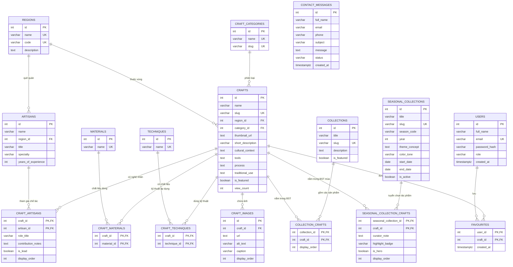

# CraftRoots – Thiết Kế Cơ Sở Dữ Liệu & Chiến Lược Migration (Database Schema & Migrations)

> **Dự án:** CraftRoots – Cổng Thông Tin Khám Phá Nghề Thủ Công Truyền Thống  
> **Chương trình:** eProject – Aptech Computer Education  
> **Phiên bản:** v1.0.0  
> **Hệ quản trị CSDL:** PostgreSQL 14+  
> **Tài liệu liên quan:** [feature-spec.md](file:///e:/eproject1/docs/feature-spec.md) | [architecture.md](file:///e:/eproject1/docs/architecture.md) | [data.md](file:///e:/eproject1/docs/data.md)

---

## Mục lục
1. [Tổng quan kiến trúc dữ liệu (Database Architecture Overview)](#1-tổng-quan-kiến-trúc-dữ-liệu-database-architecture-overview)
2. [Sơ đồ quan hệ thực thể (ERD Diagram)](#2-sơ-đồ-quan-hệ-thực-thể-erd-diagram)
3. [Từ điển dữ liệu chi tiết 17 bảng (Detailed Data Dictionary)](#3-từ-điển-dữ-liệu-chi-tiết-17-bảng-detailed-data-dictionary)
4. [Ràng buộc toàn vẹn & Chiến lược Khóa ngoại (Integrity Constraints & FK Actions)](#4-ràng-buộc-toàn-vẹn--chiến-lược-khóa-ngoại-integrity-constraints--fk-actions)
5. [Chiến lược Đánh chỉ mục (Indexing Strategy & Optimization)](#5-chiến-lược-đánh-chỉ-mục-indexing-strategy--optimization)
6. [Quy trình Quản lý Migration & Phiên bản CSDL (Migration Strategy)](#6-quy-trình-quản-lý-migration--phiên-bản-csdl-migration-strategy)
   - 6.1. [Tập lệnh Migration Khởi tạo (`001_initial_schema.sql`)](#61-tập-lệnh-migration-khởi-tạo-001_initial_schemasql)
   - 6.2. [Tập lệnh Migration Mở rộng (`002_seasonal_collections.sql`)](#62-tập-lệnh-migration-mở-rộng-002_seasonal_collectionssql)
   - 6.3. [Kịch bản Rollback / Quay lui](#63-kịch-bản-rollback--quay-lui)
   - 6.4. [Nạp dữ liệu mẫu (Seeding Strategy)](#64-nạp-dữ-liệu-mẫu-seeding-strategy)
7. [Kế hoạch Sao lưu và Phục hồi (Backup & Disaster Recovery)](#7-kế-hoạch-sao-lưu-và-phục-hồi-backup--disaster-recovery)

---

## 1. Tổng quan kiến trúc dữ liệu (Database Architecture Overview)

Cơ sở dữ liệu của **CraftRoots** được xây dựng trên nền tảng **PostgreSQL 14+**, chuẩn hóa ở mức **Dạng chuẩn 3 (3NF - Third Normal Form)** để bảo đảm toàn vẹn thông tin, ngăn chặn dị thường dữ liệu (Update/Delete Anomalies).

### Điểm đột phá kiến trúc:
- **Chuẩn hóa quan hệ Nghệ nhân – Tác phẩm:** Thay thế quan hệ 1-N truyền thống bằng mô hình **Nhiều - Nhiều (N-N)** thông qua bảng trung gian `craft_artisans`. Một tác phẩm có thể do nhiều nghệ nhân đồng chế tác (nghệ nhân tạo dáng gốm, nghệ nhân vẽ men lam...) và một nghệ nhân có thể chế tác nhiều tác phẩm khác nhau.
- **Mô hình Bộ sưu tập mùa linh hoạt (`seasonal_collections`):** Quản lý động các chủ đề văn hóa theo mùa (Xuân, Hạ, Thu, Đông) với các thuộc tính điểm nhấn như `is_hero`, `curator_note`, `highlight_badge`.
- **Hệ thống Yêu thích lưỡng thể:** Bảng `favourites` với khóa chính kép `(user_id, craft_id)` lưu trữ dữ liệu cá nhân hóa bền vững trên điện toán đám mây.

---

## 2. Sơ đồ quan hệ thực thể (ERD Diagram)



---

## 3. Từ điển dữ liệu chi tiết 17 bảng (Detailed Data Dictionary)

### 3.1. Bảng `users` (Tài khoản người dùng & Quản trị)
| Cột | Kiểu dữ liệu | Ràng buộc | Mặc định | Ý nghĩa kinh doanh |
|---|---|---|---|---|
| `id` | SERIAL | PRIMARY KEY | Nextval | Khóa chính tự tăng |
| `full_name` | VARCHAR(100) | NOT NULL | - | Họ và tên người dùng |
| `email` | VARCHAR(255) | NOT NULL, UNIQUE | - | Email đăng nhập định danh duy nhất |
| `password_hash` | VARCHAR(255) | NOT NULL | - | Mật khẩu băm an toàn bằng bcrypt |
| `role` | VARCHAR(20) | NOT NULL, CHECK in ('user', 'admin', 'editor') | 'user' | Quyền hạn trong hệ thống |
| `avatar_url` | TEXT | NULL | - | Đường dẫn ảnh đại diện cá nhân |
| `is_active` | BOOLEAN | NOT NULL | TRUE | Trạng thái kích hoạt tài khoản |
| `created_at` | TIMESTAMPTZ | NOT NULL | NOW() | Thời điểm đăng ký tài khoản |
| `updated_at` | TIMESTAMPTZ | NOT NULL | NOW() | Thời điểm cập nhật hồ sơ gần nhất |

### 3.2. Bảng `regions` (Vùng miền & Làng nghề văn hóa)
| Cột | Kiểu dữ liệu | Ràng buộc | Mặc định | Ý nghĩa kinh doanh |
|---|---|---|---|---|
| `id` | SERIAL | PRIMARY KEY | Nextval | Khóa chính vùng miền |
| `name` | VARCHAR(100) | NOT NULL, UNIQUE | - | Tên vùng (Bắc Bộ, Trung Bộ, Nam Bộ...) |
| `code` | VARCHAR(50) | NOT NULL, UNIQUE | - | Mã định danh vùng miền (bac-bo, trung-bo) |
| `description` | TEXT | NULL | - | Giới thiệu nét đặc trưng làng nghề vùng |
| `image_url` | TEXT | NULL | - | Ảnh minh họa bản đồ / phong cảnh vùng |
| `created_at` | TIMESTAMPTZ | NOT NULL | NOW() | Ngày tạo bản ghi |

### 3.3. Bảng `craft_categories` (Danh mục ngành nghề thủ công)
| Cột | Kiểu dữ liệu | Ràng buộc | Mặc định | Ý nghĩa kinh doanh |
|---|---|---|---|---|
| `id` | SERIAL | PRIMARY KEY | Nextval | Khóa chính danh mục |
| `name` | VARCHAR(100) | NOT NULL, UNIQUE | - | Tên loại hình (Gốm sứ, Dệt may, Chạm gỗ...) |
| `slug` | VARCHAR(100) | NOT NULL, UNIQUE | - | Đường dẫn thân thiện SEO (gom-su, det-may) |
| `description` | TEXT | NULL | - | Mô tả tóm tắt ngành nghề |
| `icon_url` | TEXT | NULL | - | Biểu tượng đại diện danh mục |

### 3.4. Bảng `materials` (Chất liệu chế tác)
| Cột | Kiểu dữ liệu | Ràng buộc | Mặc định | Ý nghĩa kinh doanh |
|---|---|---|---|---|
| `id` | SERIAL | PRIMARY KEY | Nextval | Khóa chính chất liệu |
| `name` | VARCHAR(100) | NOT NULL, UNIQUE | - | Tên chất liệu (Đất sét, Tơ tằm, Đồng thau, Tre...) |
| `description` | TEXT | NULL | - | Thuộc tính lý hóa và đặc tính tạo hình |

### 3.5. Bảng `techniques` (Kỹ thuật chế tác)
| Cột | Kiểu dữ liệu | Ràng buộc | Mặc định | Ý nghĩa kinh doanh |
|---|---|---|---|---|
| `id` | SERIAL | PRIMARY KEY | Nextval | Khóa chính kỹ thuật |
| `name` | VARCHAR(100) | NOT NULL, UNIQUE | - | Tên kỹ thuật (Chuốt gốm, Cẩn xà cừ, Thêu tay...) |
| `description` | TEXT | NULL | - | Quy trình kỹ thuật thực hiện |

### 3.6. Bảng `artisans` (Hồ sơ Nghệ nhân)
| Cột | Kiểu dữ liệu | Ràng buộc | Mặc định | Ý nghĩa kinh doanh |
|---|---|---|---|---|
| `id` | SERIAL | PRIMARY KEY | Nextval | Khóa chính nghệ nhân |
| `name` | VARCHAR(100) | NOT NULL | - | Họ tên đầy đủ của nghệ nhân |
| `region_id` | INT | REFERENCES regions(id) | NULL | Vùng miền / Làng nghề gốc của nghệ nhân |
| `title` | VARCHAR(100) | NULL | - | Danh hiệu (Nghệ nhân Nhân dân, Ưu tú...) |
| `specialty` | VARCHAR(150) | NULL | - | Chuyên môn chế tác sở trường |
| `years_of_experience`| INT | CHECK (>= 0) | - | Thâm niên gắn bó với nghề (năm) |
| `biography` | TEXT | NULL | - | Tiểu sử và câu chuyện làm nghề |
| `avatar_url` | TEXT | NULL | - | Chân dung nghệ nhân |
| `contact_info` | VARCHAR(255) | NULL | - | Thông tin liên lạc xưởng nghề |
| `created_at` | TIMESTAMPTZ | NOT NULL | NOW() | Ngày khởi tạo hồ sơ |

### 3.7. Bảng `crafts` (Tác phẩm / Sản phẩm thủ công truyền thống)
| Cột | Kiểu dữ liệu | Ràng buộc | Mặc định | Ý nghĩa kinh doanh |
|---|---|---|---|---|
| `id` | SERIAL | PRIMARY KEY | Nextval | Khóa chính sản phẩm |
| `name` | VARCHAR(150) | NOT NULL | - | Tên tác phẩm thủ công |
| `slug` | VARCHAR(180) | NOT NULL, UNIQUE | - | Slug đường dẫn URL sản phẩm |
| `region_id` | INT | NOT NULL, FK -> regions | - | Vùng miền xuất xứ của tác phẩm |
| `category_id` | INT | NOT NULL, FK -> craft_categories | - | Loại hình danh mục ngành nghề |
| `thumbnail_url` | TEXT | NULL | - | Ảnh đại diện thẻ sản phẩm |
| `short_description`| VARCHAR(500) | NULL | - | Tóm tắt sản phẩm hiển thị trên card |
| `cultural_context` | TEXT | NULL | - | Bối cảnh văn hóa, lịch sử và tâm linh |
| `tools` | TEXT | NULL | - | Dụng cụ chế tác chuyên dụng |
| `process` | TEXT | NULL | - | Quy trình các bước thực hiện tác phẩm |
| `traditional_use` | TEXT | NULL | - | Công năng truyền thống và ứng dụng hiện đại |
| `is_featured` | BOOLEAN | NOT NULL | FALSE | Cờ đánh dấu sản phẩm tiêu biểu trang chủ |
| `view_count` | INT | NOT NULL | 0 | Số lượt xem trang chi tiết |
| `created_at` | TIMESTAMPTZ | NOT NULL | NOW() | Ngày tạo bản ghi |
| `updated_at` | TIMESTAMPTZ | NOT NULL | NOW() | Ngày cập nhật gần nhất |

### 3.8. Bảng `craft_artisans` (Quan hệ N-N: Nghệ nhân ↔ Tác phẩm) ⭐
| Cột | Kiểu dữ liệu | Ràng buộc | Mặc định | Ý nghĩa kinh doanh |
|---|---|---|---|---|
| `craft_id` | INT | NOT NULL, FK -> crafts | - | Khóa ngoại trỏ đến sản phẩm |
| `artisan_id` | INT | NOT NULL, FK -> artisans | - | Khóa ngoại trỏ đến nghệ nhân |
| `role_title` | VARCHAR(100) | NULL | 'Chủ trì chế tác' | Vai trò đảm nhiệm trong tác phẩm |
| `contribution_notes`| TEXT | NULL | - | Ghi chú đóng góp kỹ thuật đặc biệt |
| `is_lead` | BOOLEAN | NOT NULL | FALSE | Đánh dấu nghệ nhân đại diện chính |
| `display_order` | INT | NOT NULL | 1 | Thứ tự hiển thị trên giao diện |
| `created_at` | TIMESTAMPTZ | NOT NULL | NOW() | Ngày gán liên kết |
| *PK* | COMPOSITE | PRIMARY KEY (`craft_id`, `artisan_id`) | - | Đảm bảo tính duy nhất của liên kết |

### 3.9. Bảng `craft_materials` (Quan hệ N-N: Sản phẩm ↔ Chất liệu)
| Cột | Kiểu dữ liệu | Ràng buộc | Ý nghĩa kinh doanh |
|---|---|---|---|
| `craft_id` | INT | NOT NULL, FK -> crafts (CASCADE) | Khóa ngoại trỏ đến sản phẩm |
| `material_id`| INT | NOT NULL, FK -> materials (CASCADE) | Khóa ngoại trỏ đến chất liệu |
| *PK* | COMPOSITE | PRIMARY KEY (`craft_id`, `material_id`) | Khóa chính kép |

### 3.10. Bảng `craft_techniques` (Quan hệ N-N: Sản phẩm ↔ Kỹ thuật)
| Cột | Kiểu dữ liệu | Ràng buộc | Ý nghĩa kinh doanh |
|---|---|---|---|
| `craft_id` | INT | NOT NULL, FK -> crafts (CASCADE) | Khóa ngoại trỏ đến sản phẩm |
| `technique_id`| INT | NOT NULL, FK -> techniques (CASCADE) | Khóa ngoại trỏ đến kỹ thuật |
| *PK* | COMPOSITE | PRIMARY KEY (`craft_id`, `technique_id`)| Khóa chính kép |

### 3.11. Bảng `craft_images` (Thư viện ảnh chi tiết Lightbox)
| Cột | Kiểu dữ liệu | Ràng buộc | Mặc định | Ý nghĩa kinh doanh |
|---|---|---|---|---|
| `id` | SERIAL | PRIMARY KEY | Nextval | Khóa chính ảnh |
| `craft_id` | INT | NOT NULL, FK -> crafts | - | Khóa ngoại trỏ đến tác phẩm |
| `url` | TEXT | NOT NULL | - | Đường dẫn ảnh độ phân giải cao |
| `alt_text` | VARCHAR(255) | NOT NULL | - | Văn bản thay thế hỗ trợ Accessibility |
| `caption` | VARCHAR(255) | NULL | - | Chú thích góc chụp / chi tiết nghệ thuật |
| `display_order` | INT | NOT NULL | 0 | Thứ tự hiển thị trong bộ ảnh Lightbox |
| `created_at` | TIMESTAMPTZ | NOT NULL | NOW() | Ngày thêm ảnh |

### 3.12. Bảng `collections` & 3.13. `collection_crafts` (Bộ sưu tập chuyên đề)
- `collections`: Quản lý các chuyên đề thông thường (Dệt thổ cẩm, Gốm mỹ nghệ). Cột gồm `id`, `title`, `slug`, `description`, `banner_url`, `is_featured`, `created_at`.
- `collection_crafts`: Bảng trung gian N-N liên kết `collection_id` và `craft_id` kèm `display_order`. Khóa chính kép `(collection_id, craft_id)`.

### 3.14. Bảng `seasonal_collections` (Bộ sưu tập theo mùa) ⭐
| Cột | Kiểu dữ liệu | Ràng buộc | Mặc định | Ý nghĩa kinh doanh |
|---|---|---|---|---|
| `id` | SERIAL | PRIMARY KEY | Nextval | Khóa chính bộ sưu tập mùa |
| `title` | VARCHAR(150) | NOT NULL | - | Tiêu đề BST (ví dụ: Sắc Màu Mùa Hè 2026) |
| `slug` | VARCHAR(180) | NOT NULL, UNIQUE | - | Slug URL chuyên đề mùa |
| `season_code` | VARCHAR(20) | CHECK in ('spring', 'summer', 'autumn', 'winter') | - | Mã định danh 4 mùa trong năm |
| `year` | INT | CHECK (year >= 2000) | - | Năm diễn ra chiến dịch |
| `theme_concept`| TEXT | NULL | - | Tuyên ngôn ý niệm nghệ thuật mùa |
| `banner_url` | TEXT | NULL | - | Banner hình ảnh đại diện của mùa |
| `color_tone` | VARCHAR(30) | NULL | '#0ea5e9' | Tông màu Hex chủ đạo cho giao diện |
| `start_date` | DATE | NOT NULL | - | Ngày bắt đầu mùa triển lãm |
| `end_date` | DATE | NOT NULL, CHECK (end_date >= start_date) | - | Ngày kết thúc mùa triển lãm |
| `is_active` | BOOLEAN | NOT NULL | TRUE | Bật/tắt hiển thị bộ sưu tập |
| `created_at` | TIMESTAMPTZ | NOT NULL | NOW() | Thời điểm khởi tạo |

### 3.15. Bảng `seasonal_collection_crafts` (Quan hệ N-N: Tuyển chọn tác phẩm mùa) ⭐
| Cột | Kiểu dữ liệu | Ràng buộc | Mặc định | Ý nghĩa kinh doanh |
|---|---|---|---|---|
| `seasonal_collection_id`| INT | NOT NULL, FK -> seasonal_collections | - | Khóa ngoại BST mùa |
| `craft_id` | INT | NOT NULL, FK -> crafts | - | Khóa ngoại tác phẩm được tuyển chọn |
| `curator_note` | TEXT | NULL | - | Lời bình của chuyên gia giám tuyển |
| `highlight_badge`| VARCHAR(50)| NULL | - | Nhãn nổi bật (Độc bản, Mùa hè xanh...) |
| `is_hero` | BOOLEAN | NOT NULL | FALSE | Cờ tác phẩm tiêu điểm nằm trên Hero Banner |
| `display_order` | INT | NOT NULL | 1 | Thứ tự trưng bày trong bộ sưu tập |
| `created_at` | TIMESTAMPTZ | NOT NULL | NOW() | Ngày thêm vào bộ sưu tập |
| *PK* | COMPOSITE | PRIMARY KEY (`seasonal_collection_id`, `craft_id`) | - | Khóa chính kép |

### 3.16. Bảng `favourites` (Danh sách yêu thích của người dùng)
| Cột | Kiểu dữ liệu | Ràng buộc | Ý nghĩa kinh doanh |
|---|---|---|---|
| `user_id` | INT | NOT NULL, FK -> users (CASCADE) | Khóa ngoại tài khoản người dùng |
| `craft_id`| INT | NOT NULL, FK -> crafts (CASCADE) | Khóa ngoại tác phẩm yêu thích |
| `created_at`| TIMESTAMPTZ | NOT NULL, DEFAULT NOW() | Thời điểm lưu yêu thích |
| *PK* | COMPOSITE | PRIMARY KEY (`user_id`, `craft_id`) | Khóa chính kép ngăn chặn trùng lặp |

### 3.17. Bảng `contact_messages` (Tin nhắn liên hệ từ người dùng)
| Cột | Kiểu dữ liệu | Ràng buộc | Mặc định | Ý nghĩa kinh doanh |
|---|---|---|---|---|
| `id` | SERIAL | PRIMARY KEY | Nextval | Khóa chính tin nhắn |
| `full_name` | VARCHAR(100) | NOT NULL | - | Họ và tên người gửi |
| `email` | VARCHAR(255) | NOT NULL | - | Địa chỉ email phản hồi |
| `phone` | VARCHAR(30) | NULL | - | Số điện thoại liên hệ |
| `subject` | VARCHAR(200) | NULL | - | Tiêu đề thư |
| `message` | TEXT | NOT NULL | - | Nội dung liên hệ hoặc câu hỏi |
| `status` | VARCHAR(30) | CHECK in ('unread', 'read', 'replied') | 'unread' | Trạng thái xử lý tin nhắn |
| `created_at` | TIMESTAMPTZ | NOT NULL | NOW() | Thời điểm gửi liên hệ |

---

## 4. Ràng buộc toàn vẹn & Chiến lược Khóa ngoại (Integrity Constraints & FK Actions)

| Bảng con | Khóa ngoại | Bảng cha tham chiếu | Hành vi khi bản ghi cha bị xóa (`ON DELETE`) | Lý do kiến trúc |
|---|---|---|---|---|
| `crafts` | `region_id` | `regions` | `RESTRICT` | Không được xóa một vùng miền khi vẫn còn sản phẩm thuộc vùng đó. |
| `crafts` | `category_id` | `craft_categories`| `RESTRICT` | Không được xóa danh mục khi đang có sản phẩm gán vào danh mục. |
| `artisans` | `region_id` | `regions` | `SET NULL` | Nếu vùng miền bị cơ cấu lại, quê quán của nghệ nhân tạm thời đặt `NULL`. |
| `craft_artisans`| `craft_id` | `crafts` | `CASCADE` | Khi một sản phẩm bị xóa, mối liên kết với nghệ nhân tự động xóa theo. |
| `craft_artisans`| `artisan_id`| `artisans` | `CASCADE` | Khi nghệ nhân bị xóa, liên kết bị hủy nhưng bản thân tác phẩm `crafts` vẫn tồn tại. |
| `craft_images` | `craft_id` | `crafts` | `CASCADE` | Khi xóa sản phẩm, toàn bộ ảnh gallery liên quan bị xóa hoàn toàn. |
| `favourites` | `user_id` | `users` | `CASCADE` | Khi người dùng xóa tài khoản, danh sách yêu thích của họ bị xóa. |
| `favourites` | `craft_id` | `crafts` | `CASCADE` | Khi sản phẩm bị xóa, mục yêu thích tương ứng bị gỡ bỏ. |

---

## 5. Chiến lược Đánh chỉ mục (Indexing Strategy & Optimization)

```sql
-- 1. Chỉ mục tăng tốc lọc và sắp xếp sản phẩm
CREATE INDEX idx_crafts_region ON crafts(region_id);
CREATE INDEX idx_crafts_category ON crafts(category_id);
CREATE INDEX idx_crafts_featured ON crafts(is_featured) WHERE is_featured = TRUE;
CREATE INDEX idx_crafts_created_at ON crafts(created_at DESC);

-- 2. Chỉ mục bảng nối N-N nghệ nhân - sản phẩm
CREATE INDEX idx_craft_artisans_artisan ON craft_artisans(artisan_id);
CREATE INDEX idx_craft_artisans_lead ON craft_artisans(craft_id, is_lead);

-- 3. Chỉ mục bảng nối N-N chất liệu & kỹ thuật
CREATE INDEX idx_craft_materials_mat ON craft_materials(material_id);
CREATE INDEX idx_craft_techniques_tech ON craft_techniques(technique_id);

-- 4. Chỉ mục bộ sưu tập theo mùa
CREATE INDEX idx_seasonal_collections_active ON seasonal_collections(is_active, season_code, year);
CREATE INDEX idx_seasonal_collections_dates ON seasonal_collections(start_date, end_date);
CREATE INDEX idx_sc_crafts_craft ON seasonal_collection_crafts(craft_id);
CREATE INDEX idx_sc_crafts_hero ON seasonal_collection_crafts(seasonal_collection_id, is_hero);

-- 5. Chỉ mục gallery ảnh
CREATE INDEX idx_craft_images_craft_order ON craft_images(craft_id, display_order);

-- 6. Chỉ mục Full-Text Search PostgreSQL (GIN Index)
CREATE INDEX idx_crafts_fts ON crafts USING gin (
    to_tsvector('simple', name || ' ' || COALESCE(cultural_context, '') || ' ' || COALESCE(short_description, ''))
);
```

---

## 6. Quy trình Quản lý Migration & Phiên bản CSDL (Migration Strategy)

### 6.1. Tập lệnh Migration Khởi tạo (`001_initial_schema.sql`)
Tập lệnh khởi tạo toàn bộ 13 bảng cốt lõi (Người dùng, Vùng miền, Danh mục, Chất liệu, Kỹ thuật, Nghệ nhân, Sản phẩm, Thư viện ảnh, Yêu thích và Tin nhắn liên hệ).
- Vị trí tệp: `server/db/migrations/001_initial_schema.sql`.
- Lệnh chạy:
  ```bash
  psql -U postgres -d craftroots -f server/db/schema.sql
  ```

### 6.2. Tập lệnh Migration Mở rộng (`002_seasonal_collections.sql`)
Tập lệnh bổ sung phân hệ Bộ sưu tập mùa hè & chuyên đề mùa không làm gián đoạn hệ thống (Zero Downtime).
```sql
-- Migration 002: Thêm bảng seasonal_collections và seasonal_collection_crafts
BEGIN;

CREATE TABLE IF NOT EXISTS seasonal_collections (
    id            SERIAL PRIMARY KEY,
    title         VARCHAR(150) NOT NULL,
    slug          VARCHAR(180) NOT NULL UNIQUE,
    season_code   VARCHAR(20)  NOT NULL CHECK (season_code IN ('summer', 'spring', 'autumn', 'winter')),
    year          INT          NOT NULL CHECK (year >= 2000),
    theme_concept TEXT,
    banner_url    TEXT,
    color_tone    VARCHAR(30)  DEFAULT '#0ea5e9',
    start_date    DATE         NOT NULL,
    end_date      DATE         NOT NULL CHECK (end_date >= start_date),
    is_active     BOOLEAN      NOT NULL DEFAULT TRUE,
    created_at    TIMESTAMPTZ  NOT NULL DEFAULT NOW()
);

CREATE TABLE IF NOT EXISTS seasonal_collection_crafts (
    seasonal_collection_id INT NOT NULL REFERENCES seasonal_collections(id) ON DELETE CASCADE,
    craft_id               INT NOT NULL REFERENCES crafts(id) ON DELETE CASCADE,
    curator_note           TEXT,
    highlight_badge        VARCHAR(50),
    is_hero                BOOLEAN NOT NULL DEFAULT FALSE,
    display_order          INT     NOT NULL DEFAULT 1,
    created_at             TIMESTAMPTZ NOT NULL DEFAULT NOW(),
    PRIMARY KEY (seasonal_collection_id, craft_id)
);

CREATE INDEX IF NOT EXISTS idx_seasonal_collections_active ON seasonal_collections(is_active, season_code, year);
CREATE INDEX IF NOT EXISTS idx_sc_crafts_hero ON seasonal_collection_crafts(seasonal_collection_id, is_hero);

COMMIT;
```

### 6.3. Kịch bản Rollback / Quay lui
Khi cần thu hồi một bản migration bị lỗi:
```sql
-- Rollback migration 002
BEGIN;
DROP TABLE IF EXISTS seasonal_collection_crafts CASCADE;
DROP TABLE IF EXISTS seasonal_collections CASCADE;
COMMIT;
```

### 6.4. Nạp dữ liệu mẫu (Seeding Strategy)
- Dữ liệu hạt giống được lưu tại `server/db/seed.sql` với:
  - 3 tài khoản mẫu (1 admin, 1 editor, 1 user chuẩn mật khẩu bcrypt `Craft@1234`).
  - 3 vùng miền lớn (Bắc Bộ, Trung Bộ, Nam Bộ).
  - 6 danh mục nghề (Gốm sứ, Dệt may thổ cẩm, Chạm khắc gỗ, Mây tre đan, Sơn mài, Kim hoàn đồng).
  - 10+ nghệ nhân ưu tú và 20+ tác phẩm di sản làng nghề hoàn chỉnh.
  - Bộ sưu tập Mùa Hè 2026 với tác phẩm tiêu điểm Hero Craft.

---

## 7. Kế hoạch Sao lưu và Phục hồi (Backup & Disaster Recovery)

1. **Sao lưu Logic định kỳ (pg_dump):**
   ```bash
   pg_dump -U postgres -F c -b -v -f "craftroots_backup_$(date +%Y%m%d_%H%M%S).dump" craftroots
   ```
2. **Khôi phục CSDL khi có sự cố (pg_restore):**
   ```bash
   pg_restore -U postgres -d craftroots -v -c "craftroots_backup_20261012.dump"
   ```
