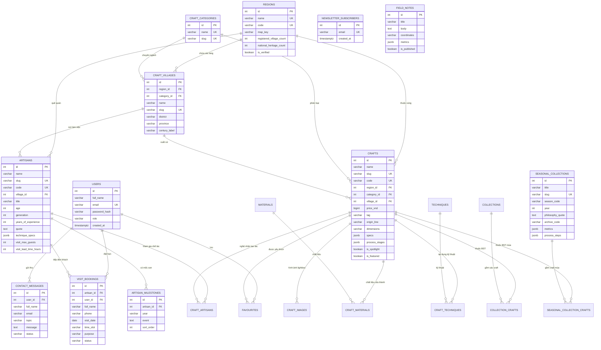

# CraftRoots – Thiết Kế Cơ Sở Dữ Liệu & Chiến Lược Migration (Database Schema & Migrations)

> **Dự án:** CraftRoots – Cổng Thông Tin Khám Phá Nghề Thủ Công Truyền Thống  
> **Chương trình:** eProject – Aptech Computer Education  
> **Phiên bản:** v1.1.0 (Nâng cấp hệ thống thiết kế Stitch UI & 22 bảng CSDL)  
> **Hệ quản trị CSDL:** PostgreSQL 14+  
> **Tài liệu liên quan:** [feature-spec.md](file:///e:/eproject1/docs/feature-spec.md) | [architecture.md](file:///e:/eproject1/docs/architecture.md) | [data.md](file:///e:/eproject1/docs/data.md) | [DESIGN.md](file:///e:/eproject1/docs/DESIGN.md) | [DECISIONS.md](file:///e:/eproject1/docs/DECISIONS.md)

---

## Mục lục
1. [Tổng quan kiến trúc dữ liệu (Database Architecture Overview)](#1-tổng-quan-kiến-trúc-dữ-liệu-database-architecture-overview)
2. [Sơ đồ quan hệ thực thể (ERD Diagram v1.1.0)](#2-sơ-đồ-quan-hệ-thực-thể-erd-diagram-v110)
3. [Từ điển dữ liệu chi tiết 22 bảng (Detailed Data Dictionary)](#3-từ-điển-dữ-liệu-chi-tiết-22-bảng-detailed-data-dictionary)
   - 3.1. [Các bảng cốt lõi (Core Tables)](#31-các-bảng-cốt-lõi-core-tables)
   - 3.2. [Các bảng liên kết N-N (Junction Tables)](#32-các-bảng-liên-kết-n-n-junction-tables)
   - 3.3. [Các bảng mở rộng theo thiết kế mới v1.1.0 (Extended Modules)](#33-các-bảng-mở-rộng-theo-thiết-kế-mới-v110-extended-modules)
4. [Ràng buộc toàn vẹn & Chiến lược Khóa ngoại (Integrity Constraints & FK Actions)](#4-ràng-buộc-toàn-vẹn--chiến-lược-khóa-ngoại-integrity-constraints--fk-actions)
5. [Chiến lược Đánh chỉ mục (Indexing Strategy & Optimization)](#5-chiến-lược-đánh-chỉ-mục-indexing-strategy--optimization)
6. [Quy trình Quản lý Migration & Phiên bản CSDL (Migration Strategy)](#6-quy-trình-quản-lý-migration--phiên-bản-csdl-migration-strategy)
   - 6.1. [Tập lệnh Khởi tạo tổng hợp (`schema.sql`)](#61-tập-lệnh-khởi-tạo-tổng-hợp-schemasql)
   - 6.2. [Migration Mở rộng v1.1.0 (`db/migrations/001_expand_schema.sql`)](#62-migration-mở-rộng-v110-dbmigrations001_expand_schemasql)
   - 6.3. [Kịch bản Rollback / Quay lui an toàn](#63-kịch-bản-rollback--quay-lui-an-toàn)
   - 6.4. [Chiến lược nạp dữ liệu Idempotent (Seeding Strategy)](#64-chiến-lược-nạp-dữ-liệu-idempotent-seeding-strategy)
7. [Kế hoạch Sao lưu và Phục hồi (Backup & Disaster Recovery)](#7-kế-hoạch-sao-lưu-và-phục-hồi-backup--disaster-recovery)

---

## 1. Tổng quan kiến trúc dữ liệu (Database Architecture Overview)

Cơ sở dữ liệu của **CraftRoots** được xây dựng trên nền tảng **PostgreSQL 14+**, chuẩn hóa ở mức **Dạng chuẩn 3 (3NF - Third Normal Form)**, bảo đảm tính toàn vẹn dữ liệu, chống dị thường cập nhật và tối ưu hóa cho ứng dụng khám phá di sản tốc độ cao.

### Điểm đột phá kiến trúc phiên bản v1.1.0:
1. **Quan hệ Nghệ nhân – Tác phẩm Nhiều - Nhiều (N-N):** Bảng `craft_artisans` phân định rõ vai trò (`role_title`), nghệ nhân chủ trì (`is_lead`), thứ tự hiển thị và ghi chú đóng góp.
2. **Quản lý làng nghề bản địa độc lập (`craft_villages`):** Tách làng nghề thành thực thể riêng gắn với vùng miền (`regions`), phân loại nghề (`craft_categories`), niên đại lịch sử (`century_label`), tọa độ hành chính (huyện/tỉnh).
3. **Phân hệ Hồ sơ nghệ nhân chuyên sâu:** Bổ sung `artisan_milestones` (niên biểu cuộc đời), thông số kỹ thuật (`technique_specs` JSONB), và các quy chuẩn tiếp đón xưởng chế tác (`visit_max_guests`, `visit_lead_time_hours`, `visit_open_days`).
4. **Hệ thống Đặt lịch thăm xưởng (`visit_bookings`):** Quản lý quy trình đăng ký đàm đạo trà và tham quan xưởng với ràng buộc lịch hẹn nghiêm ngặt (trước 24h/48h, khung giờ sáng/chiều, trạng thái pending/confirmed/cancelled).
5. **Đăng ký nhận bản tin di sản (`newsletter_subscribers`):** Lưu trữ email duy nhất không phân biệt hoa thường (`LOWER(email)` unique index).
6. **Ký họa điền dã (`field_notes`):** Lưu giữ tư liệu điền dã thực địa, tọa độ GPS, thông số lò nung (`metrics` JSONB) phục vụ trang chủ.
7. **Bản đồ 6 vùng văn hóa di sản:** Mở rộng bảng `regions` với `map_key`, `registered_village_count`, `national_heritage_count` để điều khiển bản đồ SVG tương tác.

---

## 2. Sơ đồ quan hệ thực thể (ERD Diagram v1.1.0)



---

## 3. Từ điển dữ liệu chi tiết 22 bảng (Detailed Data Dictionary)

### 3.1. Các bảng cốt lõi (Core Tables)

#### Bảng `users` (Tài khoản người dùng & Phân quyền)
| Tên cột | Kiểu dữ liệu | Ràng buộc | Mô tả |
| :--- | :--- | :--- | :--- |
| `id` | SERIAL | PRIMARY KEY | Định danh duy nhất của người dùng |
| `full_name` | VARCHAR(100) | NOT NULL | Họ và tên đầy đủ |
| `email` | VARCHAR(255) | NOT NULL, UNIQUE | Địa chỉ thư điện tử dùng đăng nhập |
| `password_hash` | VARCHAR(255) | NOT NULL | Mật khẩu băm chuẩn bcrypt (salt rounds 10) |
| `role` | VARCHAR(20) | NOT NULL, DEFAULT 'user' | Phân quyền RBAC: `user`, `editor`, `admin` |
| `avatar_url` | TEXT | NULL | Đường dẫn ảnh đại diện |
| `is_active` | BOOLEAN | NOT NULL, DEFAULT TRUE | Trạng thái kích hoạt tài khoản |
| `created_at` | TIMESTAMPTZ | NOT NULL, DEFAULT NOW() | Thời điểm khởi tạo |
| `updated_at` | TIMESTAMPTZ | NOT NULL, DEFAULT NOW() | Thời điểm cập nhật hồ sơ gần nhất |

#### Bảng `regions` (Vùng miền văn hóa & Bản đồ 6 vùng)
| Tên cột | Kiểu dữ liệu | Ràng buộc | Mô tả |
| :--- | :--- | :--- | :--- |
| `id` | SERIAL | PRIMARY KEY | Khóa chính vùng miền |
| `name` | VARCHAR(100) | NOT NULL, UNIQUE | Tên vùng (Đồng bằng Bắc Bộ, Tây Bắc...) |
| `code` | VARCHAR(50) | NOT NULL, UNIQUE | Mã định danh dạng slug (`dong-bang-bac-bo`) |
| `map_key` | VARCHAR(50) | NULL | Khóa định danh liên kết SVG bản đồ tương tác |
| `description` | TEXT | NULL | Bối cảnh lịch sử và địa văn hóa |
| `craft_summary` | TEXT | NULL | Tóm tắt các dòng nghề tiêu biểu trong vùng |
| `image_url` | TEXT | NULL | Ảnh phong cảnh làng nghề đại diện |
| `is_verified` | BOOLEAN | NOT NULL, DEFAULT TRUE | Trạng thái đã xác minh tư liệu điền dã |
| `registered_village_count`| INT | NOT NULL, DEFAULT 0 | Số lượng làng nghề đã đăng ký bảo tồn |
| `national_heritage_count` | INT | NOT NULL, DEFAULT 0 | Số lượng di sản quốc gia thuộc vùng |
| `sort_order` | INT | NOT NULL, DEFAULT 0 | Thứ tự hiển thị trên tab điều hướng |
| `created_at` | TIMESTAMPTZ | NOT NULL, DEFAULT NOW() | Thời điểm tạo |

#### Bảng `craft_categories` (Danh mục phân loại nghề)
| Tên cột | Kiểu dữ liệu | Ràng buộc | Mô tả |
| :--- | :--- | :--- | :--- |
| `id` | SERIAL | PRIMARY KEY | Khóa chính danh mục nghề |
| `name` | VARCHAR(100) | NOT NULL, UNIQUE | Tên phân loại (Gốm sứ, Dệt may, Mây tre...) |
| `slug` | VARCHAR(100) | NOT NULL, UNIQUE | Chuỗi URL thân thiện |
| `description` | TEXT | NULL | Mô tả đặc tính ngành nghề |
| `icon_url` | TEXT | NULL | Biểu tượng minh họa |

#### Bảng `craft_villages` (Làng nghề truyền thống) *(Mới v1.1.0)*
| Tên cột | Kiểu dữ liệu | Ràng buộc | Mô tả |
| :--- | :--- | :--- | :--- |
| `id` | SERIAL | PRIMARY KEY | Khóa chính làng nghề |
| `region_id` | INT | REFERENCES `regions(id)` | Thuộc vùng văn hóa nào |
| `category_id`| INT | REFERENCES `craft_categories(id)` | Ngành nghề chuyên môn cốt lõi |
| `name` | VARCHAR(150) | NOT NULL | Tên làng nghề (Làng gốm Bát Tràng...) |
| `slug` | VARCHAR(180) | NOT NULL, UNIQUE | Slug URL (`bat-trang`, `van-phuc`...) |
| `district` | VARCHAR(100) | NULL | Quận / Huyện / Thị xã |
| `province` | VARCHAR(100) | NULL | Tỉnh / Thành phố trực thuộc |
| `century_label` | VARCHAR(100) | NULL | Niên đại hình thành (Thế kỷ XIV, 500 năm...) |
| `summary` | TEXT | NULL | Tóm lược lịch sử và bí quyết độc bản |
| `created_at` | TIMESTAMPTZ | NOT NULL, DEFAULT NOW() | Thời điểm tạo bản ghi |

#### Bảng `artisans` (Hồ sơ nghệ nhân & Bậc thầy chế tác) *(Mở rộng v1.1.0)*
| Tên cột | Kiểu dữ liệu | Ràng buộc | Mô tả |
| :--- | :--- | :--- | :--- |
| `id` | SERIAL | PRIMARY KEY | Khóa chính nghệ nhân |
| `name` | VARCHAR(100) | NOT NULL | Họ và tên nghệ nhân |
| `slug` | VARCHAR(180) | UNIQUE | URL slug định danh (`nguyen-van-binh`) |
| `code` | VARCHAR(50) | UNIQUE | Mã định danh lưu trữ (vd: `ART-BT-001`) |
| `region_id` | INT | REFERENCES `regions(id)` | Vùng miền cư trú |
| `village_id` | INT | REFERENCES `craft_villages(id)` | Trực thuộc làng nghề truyền thống |
| `title` | VARCHAR(100) | NULL | Danh hiệu (Nghệ nhân Ưu tú, Nghệ nhân Nhân dân) |
| `specialty` | VARCHAR(150) | NULL | Chuyên môn tạo tác sâu |
| `age` | INT | NULL | Độ tuổi hiện thời |
| `generation` | INT | NULL | Thế hệ gia truyền nối nghiệp (Đời thứ 5, thứ 6...) |
| `years_of_experience` | INT | CHECK (>= 0) | Thâm niên thực tế trong nghề |
| `quote` | TEXT | NULL | Câu trích ngôn về đạo nghề và tâm thức |
| `biography` | TEXT | NULL | Đoạn văn tiểu sử hành trình cuộc đời |
| `signature_work` | TEXT | NULL | Tác phẩm đại diện cốt lõi |
| `technique_summary` | TEXT | NULL | Tóm lược kỹ pháp độc bản |
| `technique_specs` | JSONB | DEFAULT '[]' | Mảng thông số kỹ thuật `[{label, value}]` |
| `verification_label` | VARCHAR(255) | NULL | Nhãn xác thực di sản quốc gia |
| `is_national_heritage` | BOOLEAN | DEFAULT TRUE | Đạt chuẩn di sản văn hóa phi vật thể |
| `avatar_url` | TEXT | NULL | Đường dẫn ảnh chân dung |
| `contact_info` | VARCHAR(255) | NULL | Thông tin liên lạc xưởng chế tác |
| `visit_max_guests` | INT | NOT NULL, DEFAULT 6 | Giới hạn số khách tối đa mỗi buổi tiếp đón |
| `visit_lead_time_hours`| INT | NOT NULL, DEFAULT 48 | Thời gian yêu cầu đặt hẹn trước (giờ) |
| `visit_open_days` | INT[] | DEFAULT '{2,3,4,5,6,7}' | Các ngày mở cửa xưởng trong tuần (2–7) |
| `visit_hours` | VARCHAR(100) | DEFAULT '09:00 - 17:30' | Khung giờ làm việc đón khách |
| `visit_address` | TEXT | NULL | Địa chỉ cụ thể xưởng chế tác |
| `lat` / `lng` | NUMERIC(10,6)| NULL | Tọa độ địa lý GPS của xưởng |
| `sort_order` | INT | NOT NULL, DEFAULT 0 | Thứ tự ưu tiên hiển thị ma trận |
| `created_at` | TIMESTAMPTZ | NOT NULL, DEFAULT NOW() | Thời điểm tạo |

#### Bảng `crafts` (Tác phẩm thủ công truyền thống) *(Mở rộng v1.1.0)*
| Tên cột | Kiểu dữ liệu | Ràng buộc | Mô tả |
| :--- | :--- | :--- | :--- |
| `id` | SERIAL | PRIMARY KEY | Khóa chính sản phẩm |
| `name` | VARCHAR(150) | NOT NULL | Tên tác phẩm thủ công |
| `slug` | VARCHAR(180) | NOT NULL, UNIQUE | Đường dẫn tĩnh thân thiện |
| `code` | VARCHAR(100) | UNIQUE | Mã SKU lưu trữ di sản (vd: `CR-BT-2025-08MR`) |
| `region_id` | INT | REFERENCES `regions(id)` | Vùng địa lý xuất xứ |
| `category_id` | INT | REFERENCES `craft_categories(id)` | Phân loại danh mục nghề |
| `village_id` | INT | REFERENCES `craft_villages(id)` | Làng nghề sản xuất |
| `thumbnail_url` | TEXT | NULL | Ảnh đại diện chính |
| `short_description` | VARCHAR(500) | NULL | Tóm tắt tinh hoa tác phẩm |
| `price_vnd` | BIGINT | NULL | Giá tham chiếu (VNĐ), NULL nếu trưng bày phi thương mại |
| `tag` | VARCHAR(150) | NULL | Thẻ nhãn nổi bật (Độc bản, Di sản...) |
| `origin_line` | VARCHAR(200) | NULL | Dòng xuất xứ (`Bát Tràng // Hà Nội`) |
| `era` | VARCHAR(100) | NULL | Thời kỳ / Niên đại chế tác |
| `dimensions` | VARCHAR(150) | NULL | Kích thước hiện vật vật lý |
| `specs` | JSONB | DEFAULT '[]' | Mảng thông số chi tiết `[{label, value}]` |
| `process_stages` | JSONB | DEFAULT '[]' | Quy trình các bước thực hiện `[{label, value, note}]` |
| `cultural_context` | TEXT | NULL | Bối cảnh văn hóa và triết lý dân gian |
| `tools` | TEXT | NULL | Công cụ và thiết bị gia công |
| `process` | TEXT | NULL | Mô tả quy trình chế tác tổng quát |
| `traditional_use` | TEXT | NULL | Công năng sử dụng trong đời sống truyền thống |
| `batch_note` | TEXT | NULL | Ghi chú về mẻ nung / mẻ dệt thủ công giới hạn |
| `is_featured` | BOOLEAN | NOT NULL, DEFAULT FALSE | Đánh dấu tác phẩm nổi bật trang chủ |
| `is_spotlight` | BOOLEAN | NOT NULL, DEFAULT FALSE | Tác phẩm tiêu điểm của hệ thống (Spotlight Craft) |
| `handmade` | BOOLEAN | NOT NULL, DEFAULT TRUE | Cam kết 100% chế tác thủ công |
| `view_count` | INT | NOT NULL, DEFAULT 0 | Lượt xem tra cứu |
| `created_at` | TIMESTAMPTZ | NOT NULL, DEFAULT NOW() | Ngày nạp dữ liệu |
| `updated_at` | TIMESTAMPTZ | NOT NULL, DEFAULT NOW() | Ngày cập nhật |

---

### 3.2. Các bảng liên kết N-N (Junction Tables)

#### Bảng `craft_artisans` (Quan hệ N-N: Sản phẩm ↔ Nghệ nhân)
| Cột | Kiểu | Ràng buộc | Mô tả |
| :--- | :--- | :--- | :--- |
| `craft_id` | INT | PK, FK `crafts(id)` ON DELETE CASCADE | Khóa ngoại sản phẩm |
| `artisan_id` | INT | PK, FK `artisans(id)` ON DELETE CASCADE | Khóa ngoại nghệ nhân |
| `role_title` | VARCHAR(100) | DEFAULT 'Chủ trì chế tác' | Chức danh/vai trò trong mẻ chế tác |
| `contribution_notes` | TEXT | NULL | Ghi chú phần việc đảm nhiệm |
| `is_lead` | BOOLEAN | NOT NULL, DEFAULT FALSE | Nghệ nhân giữ vai trò chủ trì chính |
| `display_order` | INT | NOT NULL, DEFAULT 1 | Thứ tự hiển thị trong hồ sơ |

#### Bảng `craft_materials` & `craft_techniques`
- `craft_materials(craft_id, material_id)`: Liên kết nhiều - nhiều giữa sản phẩm và chất liệu.
- `craft_techniques(craft_id, technique_id)`: Liên kết nhiều - nhiều giữa sản phẩm và kỹ thuật chế tác.

#### Bảng `favourites` (Tủ lưu trữ cá nhân)
- `favourites(user_id, craft_id)`: Lưu trữ các tác phẩm được người dùng yêu thích, đồng bộ từ khách sang tài khoản đám mây.

---

### 3.3. Các bảng mở rộng theo thiết kế mới v1.1.0 (Extended Modules)

#### Bảng `artisan_milestones` (Niên biểu mốc son nghệ nhân) *(Mới v1.1.0)*
| Cột | Kiểu | Ràng buộc | Mô tả |
| :--- | :--- | :--- | :--- |
| `id` | SERIAL | PRIMARY KEY | Khóa chính mốc sự kiện |
| `artisan_id` | INT | NOT NULL, FK `artisans(id)` ON DELETE CASCADE | Nghệ nhân sở hữu niên biểu |
| `year` | VARCHAR(50) | NOT NULL | Năm diễn ra sự kiện (vd: `1974`, `1992`, `2024`) |
| `event` | TEXT | NOT NULL | Nội dung chi tiết mốc son nghề nghiệp |
| `sort_order` | INT | NOT NULL, DEFAULT 0 | Thứ tự sắp xếp niên biểu |
| `created_at` | TIMESTAMPTZ | NOT NULL, DEFAULT NOW() | Thời điểm ghi nhận |

#### Bảng `visit_bookings` (Phiếu đăng ký hẹn thăm xưởng) *(Mới v1.1.0)*
| Cột | Kiểu | Ràng buộc | Mô tả |
| :--- | :--- | :--- | :--- |
| `id` | SERIAL | PRIMARY KEY | Khóa chính phiếu đặt hẹn |
| `artisan_id` | INT | NOT NULL, FK `artisans(id)` ON DELETE CASCADE | Nghệ nhân và xưởng chế tác muốn viếng thăm |
| `user_id` | INT | NULL, FK `users(id)` ON DELETE SET NULL | Người dùng đặt hẹn (nếu đã đăng nhập) |
| `full_name` | VARCHAR(150) | NOT NULL | Họ và tên khách đại diện đoàn |
| `phone` | VARCHAR(50) | NOT NULL | Số điện thoại liên hệ xác nhận |
| `email` | VARCHAR(255) | NULL | Thư điện tử nhận thông báo điều phối |
| `visit_date` | DATE | NOT NULL | Ngày hẹn thăm xưởng thực tế |
| `time_slot` | VARCHAR(20) | NOT NULL, CHECK in (`morning`, `afternoon`) | Buổi sáng (09:30–11:30) hoặc buổi chiều (14:00–16:00) |
| `purpose` | VARCHAR(200) | NOT NULL | Mục đích: Đàm đạo trà, Thửa riêng, Triển lãm, Thẩm định |
| `note` | TEXT | NULL | Ghi chú đặc biệt hoặc số lượng người đi cùng |
| `status` | VARCHAR(30) | NOT NULL, DEFAULT 'pending' | Trạng thái: `pending`, `confirmed`, `cancelled` |
| `created_at` | TIMESTAMPTZ | NOT NULL, DEFAULT NOW() | Thời điểm gửi phiếu |

#### Bảng `newsletter_subscribers` (Bản tin di sản) *(Mới v1.1.0)*
| Cột | Kiểu | Ràng buộc | Mô tả |
| :--- | :--- | :--- | :--- |
| `id` | SERIAL | PRIMARY KEY | Khóa chính thuê bao bản tin |
| `email` | VARCHAR(255) | NOT NULL | Email đăng ký (được đánh chỉ mục Unique không phân biệt hoa thường) |
| `created_at` | TIMESTAMPTZ | NOT NULL, DEFAULT NOW() | Thời điểm đăng ký nhận tin |

#### Bảng `field_notes` (Ký họa điền dã di sản) *(Mới v1.1.0)*
| Cột | Kiểu | Ràng buộc | Mô tả |
| :--- | :--- | :--- | :--- |
| `id` | SERIAL | PRIMARY KEY | Khóa chính bài ký họa |
| `title` | VARCHAR(200) | NOT NULL | Tiêu đề ký họa (vd: Biến Biến Của Lửa & Vết Nứt Của Đất) |
| `body` | TEXT | NOT NULL | Nội dung chi tiết góc nhìn điền dã |
| `image_url` | TEXT | NULL | Ảnh chụp thực địa chất lượng cao |
| `caption` | VARCHAR(255) | NULL | Chú thích bức ảnh |
| `coordinates` | VARCHAR(100) | NULL | Tọa độ GPS ghi nhận thực địa (vd: `20°58'31"N 105°54'43"E`) |
| `metrics` | JSONB | DEFAULT '[]' | Mảng thông số đo đạc lò nung `[{label, value}]` |
| `sort_order` | INT | NOT NULL, DEFAULT 0 | Thứ tự hiển thị trên trang chủ |
| `is_published` | BOOLEAN | NOT NULL, DEFAULT TRUE | Trạng thái xuất bản |
| `created_at` | TIMESTAMPTZ | NOT NULL, DEFAULT NOW() | Thời điểm xuất bản |

#### Bảng `seasonal_collections` (Bộ sưu tập theo mùa) *(Mở rộng v1.1.0)*
| Cột | Kiểu | Ràng buộc | Mô tả |
| :--- | :--- | :--- | :--- |
| `id` | SERIAL | PRIMARY KEY | Khóa chính bộ sưu tập mùa |
| `title` | VARCHAR(150) | NOT NULL | Tên chủ đề mùa (vd: Thu Trầm & Gốm Mộc) |
| `slug` | VARCHAR(180) | NOT NULL, UNIQUE | Slug URL (`thu-tram-va-gom-moc`) |
| `season_code` | VARCHAR(20) | CHECK in (`summer`, `spring`, `autumn`, `winter`) | Mã định danh mùa |
| `year` | INT | CHECK (year >= 2000) | Năm phát hành bộ sưu tập |
| `philosophy_quote` | TEXT | NULL | Câu trích dẫn triết lý nghệ thuật của mùa |
| `quote_source` | VARCHAR(200) | NULL | Nguồn trích dẫn / Bản ghi giám tuyển |
| `metrics` | JSONB | DEFAULT '[]' | Chỉ số đo lường độc bản `[{label, value, unit}]` |
| `process_steps` | JSONB | DEFAULT '[]' | Quy trình tạo tác theo mùa `[{order, stageLabel, title, description, meta}]` |
| `archive_code` | VARCHAR(100) | NULL | Mã hồ sơ lưu trữ di sản (vd: `CR-AUTUMN-24`) |
| `banner_url` | TEXT | NULL | Ảnh bìa toàn cảnh bộ sưu tập |
| `color_tone` | VARCHAR(30) | DEFAULT '#0ea5e9' | Mã màu nhận diện thị giác phụ trợ |
| `start_date` / `end_date` | DATE | NOT NULL | Khoảng thời gian hiệu lực của mùa |
| `is_active` | BOOLEAN | NOT NULL, DEFAULT TRUE | Kích hoạt hiển thị công khai |

---

## 4. Ràng buộc toàn vẹn & Chiến lược Khóa ngoại (Integrity Constraints & FK Actions)

| Bảng nguồn | Khóa ngoại | Bảng tham chiếu | Hành vi `ON DELETE` | Lý do thiết kế & Nguyên tắc nghiệp vụ |
| :--- | :--- | :--- | :--- | :--- |
| `craft_villages` | `region_id` | `regions` | `SET NULL` | Giữ thông tin làng nghề ngay cả khi cấu trúc vùng hành chính tái định hình. |
| `artisans` | `village_id` | `craft_villages` | `SET NULL` | Bảo vệ hồ sơ tiểu sử nghệ nhân nếu làng nghề được sáp nhập hoặc điều chỉnh. |
| `crafts` | `village_id` | `craft_villages` | `SET NULL` | Giữ trọn dữ liệu tác phẩm nếu thông tin làng nghề thay đổi. |
| `artisan_milestones`| `artisan_id` | `artisans` | `CASCADE` | Xóa nghệ nhân thì xóa toàn bộ niên biểu cuộc đời liên quan. |
| `visit_bookings` | `artisan_id` | `artisans` | `CASCADE` | Xóa nghệ nhân thì hủy toàn bộ lịch hẹn thăm xưởng của nghệ nhân đó. |
| `visit_bookings` | `user_id` | `users` | `SET NULL` | Giữ nguyên phiếu hẹn phục vụ công tác điều phối nếu tài khoản người dùng bị xóa. |
| `contact_messages` | `user_id` | `users` | `SET NULL` | Giữ thư liên hệ để phục vụ công tác đối soát của quản trị viên. |
| `craft_artisans` | `craft_id` / `artisan_id` | `crafts` / `artisans` | `CASCADE` | Quan hệ liên kết N-N, tự động giải phóng bảng nối khi 1 trong 2 bên bị gỡ. |

---

## 5. Chiến lược Đánh chỉ mục (Indexing Strategy & Optimization)

```sql
-- 1. Chỉ mục định danh tra cứu nhanh sản phẩm
CREATE INDEX idx_crafts_region ON crafts(region_id);
CREATE INDEX idx_crafts_category ON crafts(category_id);
CREATE INDEX idx_crafts_village ON crafts(village_id);
CREATE INDEX idx_crafts_code ON crafts(code);
CREATE INDEX idx_crafts_featured ON crafts(is_featured) WHERE is_featured = TRUE;
CREATE INDEX idx_crafts_spotlight ON crafts(is_spotlight) WHERE is_spotlight = TRUE;
CREATE INDEX idx_crafts_created_at ON crafts(created_at DESC);

-- 2. Chỉ mục định danh nghệ nhân và làng nghề
CREATE INDEX idx_artisans_slug ON artisans(slug);
CREATE INDEX idx_artisans_code ON artisans(code);
CREATE INDEX idx_artisans_village ON artisans(village_id);
CREATE INDEX idx_artisans_region ON artisans(region_id);
CREATE INDEX idx_craft_villages_region ON craft_villages(region_id);
CREATE INDEX idx_craft_villages_category ON craft_villages(category_id);
CREATE INDEX idx_craft_villages_slug ON craft_villages(slug);

-- 3. Chỉ mục bảng quan hệ và lịch hẹn
CREATE INDEX idx_craft_artisans_artisan ON craft_artisans(artisan_id);
CREATE INDEX idx_craft_artisans_lead ON craft_artisans(craft_id, is_lead);
CREATE INDEX idx_artisan_milestones_artisan ON artisan_milestones(artisan_id, sort_order);
CREATE INDEX idx_visit_bookings_lookup ON visit_bookings(artisan_id, visit_date);

-- 4. Chỉ mục bộ sưu tập mùa & thư viện ảnh
CREATE INDEX idx_seasonal_collections_active ON seasonal_collections(is_active, season_code, year);
CREATE INDEX idx_sc_crafts_hero ON seasonal_collection_crafts(seasonal_collection_id, is_hero);
CREATE INDEX idx_craft_images_craft_order ON craft_images(craft_id, display_order);

-- 5. Chỉ mục Full-Text Search PostgreSQL (GIN Index)
CREATE INDEX idx_crafts_fts ON crafts USING gin (
    to_tsvector('simple', name || ' ' || COALESCE(cultural_context, '') || ' ' || COALESCE(short_description, ''))
);
```

---

## 6. Quy trình Quản lý Migration & Phiên bản CSDL (Migration Strategy)

### 6.1. Tập lệnh Khởi tạo tổng hợp (`schema.sql`)
Tập lệnh [db/schema.sql](file:///e:/eproject1/db/schema.sql) là bản DDL duy nhất phục vụ việc khởi dựng mới toàn bộ 22 bảng CSDL trên một hệ thống PostgreSQL trống.
- Lệnh thực thi:
  ```bash
  npm run db:init
  ```

### 6.2. Migration Mở rộng v1.1.0 (`db/migrations/001_expand_schema.sql`)
Áp dụng cơ chế nâng cấp không gián đoạn (Zero Downtime Migration) trên cơ sở dữ liệu đã có sẵn dữ liệu của phiên bản v1.0.0.
- Dùng `CREATE TABLE IF NOT EXISTS` và `ADD COLUMN IF NOT EXISTS`.
- Khởi tạo đầy đủ bảng `craft_villages`, `artisan_milestones`, `visit_bookings`, `newsletter_subscribers`, `field_notes`.
- Bổ sung các cột mở rộng cho `crafts`, `artisans`, `regions`, `seasonal_collections`, `contact_messages`.
- Chạy trong 1 transaction an toàn (`BEGIN; ... COMMIT;`).

### 6.3. Kịch bản Rollback / Quay lui an toàn
Khi cần hoàn tác migration `001_expand_schema.sql`:
```sql
BEGIN;
DROP TABLE IF EXISTS field_notes CASCADE;
DROP TABLE IF EXISTS newsletter_subscribers CASCADE;
DROP TABLE IF EXISTS visit_bookings CASCADE;
DROP TABLE IF EXISTS artisan_milestones CASCADE;
DROP TABLE IF EXISTS craft_villages CASCADE;

ALTER TABLE crafts 
  DROP COLUMN IF EXISTS code,
  DROP COLUMN IF EXISTS price_vnd,
  DROP COLUMN IF EXISTS tag,
  DROP COLUMN IF EXISTS origin_line,
  DROP COLUMN IF EXISTS era,
  DROP COLUMN IF EXISTS dimensions,
  DROP COLUMN IF EXISTS specs,
  DROP COLUMN IF EXISTS process_stages,
  DROP COLUMN IF EXISTS batch_note,
  DROP COLUMN IF EXISTS village_id,
  DROP COLUMN IF EXISTS is_spotlight,
  DROP COLUMN IF EXISTS handmade;

ALTER TABLE artisans 
  DROP COLUMN IF EXISTS slug,
  DROP COLUMN IF EXISTS code,
  DROP COLUMN IF EXISTS village_id,
  DROP COLUMN IF EXISTS age,
  DROP COLUMN IF EXISTS generation,
  DROP COLUMN IF EXISTS quote,
  DROP COLUMN IF EXISTS signature_work,
  DROP COLUMN IF EXISTS technique_summary,
  DROP COLUMN IF EXISTS technique_specs,
  DROP COLUMN IF EXISTS verification_label,
  DROP COLUMN IF EXISTS is_national_heritage,
  DROP COLUMN IF EXISTS visit_max_guests,
  DROP COLUMN IF EXISTS visit_lead_time_hours,
  DROP COLUMN IF EXISTS visit_open_days,
  DROP COLUMN IF EXISTS visit_hours,
  DROP COLUMN IF EXISTS visit_address,
  DROP COLUMN IF EXISTS lat,
  DROP COLUMN IF EXISTS lng,
  DROP COLUMN IF EXISTS sort_order;

ALTER TABLE regions
  DROP COLUMN IF EXISTS map_key,
  DROP COLUMN IF EXISTS craft_summary,
  DROP COLUMN IF EXISTS is_verified,
  DROP COLUMN IF EXISTS registered_village_count,
  DROP COLUMN IF EXISTS national_heritage_count,
  DROP COLUMN IF EXISTS sort_order;

ALTER TABLE seasonal_collections
  DROP COLUMN IF EXISTS philosophy_quote,
  DROP COLUMN IF EXISTS quote_source,
  DROP COLUMN IF EXISTS metrics,
  DROP COLUMN IF EXISTS process_steps,
  DROP COLUMN IF EXISTS archive_code;

ALTER TABLE contact_messages
  DROP COLUMN IF EXISTS user_id,
  DROP COLUMN IF EXISTS topic;

COMMIT;
```

### 6.4. Chiến lược nạp dữ liệu Idempotent (Seeding Strategy)
- Tệp nạp dữ liệu [db/seed.sql](file:///e:/eproject1/db/seed.sql) và script nạp tự động bảo đảm chạy lặp lại nhiều lần không sinh lỗi trùng lặp khóa chính hoặc khóa phụ (`ON CONFLICT (id) DO UPDATE...` hoặc `DO NOTHING`).
- Hợp nhất dữ liệu có sẵn với dữ liệu trích xuất từ 9 bản thiết kế UI Stitch.

---

## 7. Kế hoạch Sao lưu và Phục hồi (Backup & Disaster Recovery)

1. **Sao lưu định kỳ (pg_dump):**
   ```bash
   pg_dump -U postgres -F c -b -v -f "craftroots_v1.1.0_backup_$(date +%Y%m%d).dump" craftroots
   ```
2. **Khôi phục CSDL khi có sự cố (pg_restore):**
   ```bash
   pg_restore -U postgres -d craftroots -v -c "craftroots_v1.1.0_backup_20261015.dump"
   ```
