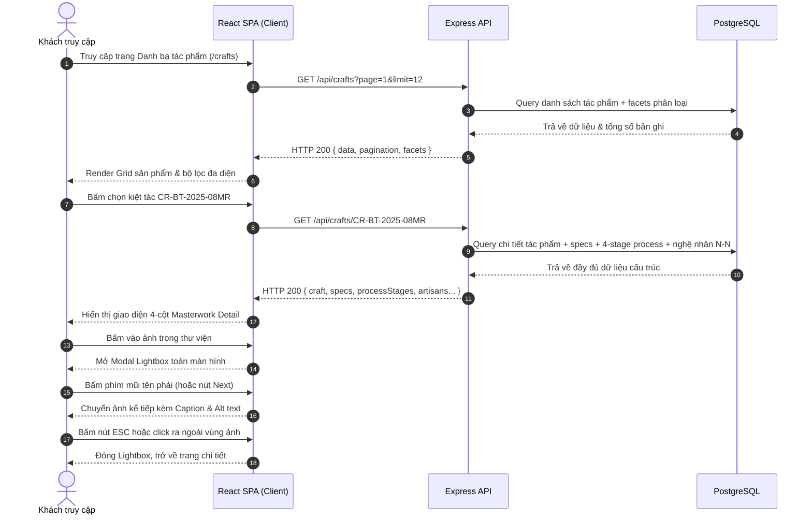
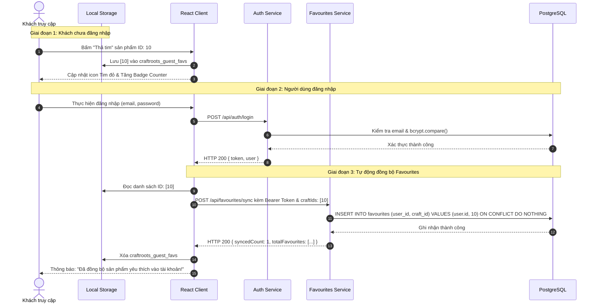
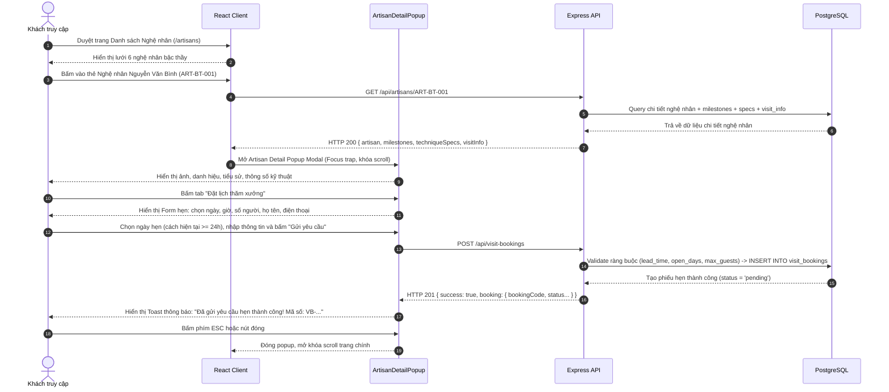

# CraftRoots – Đặc Tả Nghiệp Vụ & Yêu Cầu Tính Năng (Feature Specification)

> **Dự án:** CraftRoots – Cổng Thông Tin Khám Phá Nghề Thủ Công Truyền Thống  
> **Chương trình:** eProject – Aptech Computer Education  
> **Phiên bản tài liệu:** v1.1.0  
> **Ngày cập nhật:** 2026-10-15  
> **Tài liệu liên quan:** [README.md](file:///e:/eproject1/docs/README.md) | [DESIGN.md](file:///e:/eproject1/docs/DESIGN.md) | [DECISIONS.md](file:///e:/eproject1/docs/DECISIONS.md) | [architecture.md](file:///e:/eproject1/docs/architecture.md) | [database-schema.md](file:///e:/eproject1/docs/database-schema.md) | [data.md](file:///e:/eproject1/docs/data.md) | [api-contract.yaml](file:///e:/eproject1/docs/api-contract.yaml) | [task-breakdown.md](file:///e:/eproject1/docs/task-breakdown.md) | [test-plan.md](file:///e:/eproject1/docs/test-plan.md)

---

## Mục lục
1. [Tổng quan dự án & Mục tiêu nghiệp vụ](#1-tổng-quan-dự-án--mục-tiêu-nghiệp-vụ)
2. [Chân dung người dùng (User Personas)](#2-chân-dung-người-dùng-user-personas)
3. [Đặc tả chi tiết các phân hệ tính năng (Feature Modules)](#3-đặc-tả-chi-tiết-các-phân-hệ-tính-năng-feature-modules)
   - 3.1. [Trang chủ / Cổng khám phá Di sản (Home Portal)](#31-trang-chủ--cổng-khám-phá-di-sản-home-portal)
   - 3.2. [Danh bạ tác phẩm & Bộ lọc đa diện (Craft Directory & Facets)](#32-danh-bạ-tác-phẩm--bộ-lọc-đa-diện-craft-directory--facets)
   - 3.3. [Chi tiết tác phẩm Masterwork & 4-Stage Process (Craft Details)](#33-chi-tiết-tác-phẩm-masterwork--4-stage-process-craft-details)
   - 3.4. [Danh bạ nghệ nhân & Bậc thầy chế tác (Artisans Directory)](#34-danh-bạ-nghệ-nhân--bậc-thầy-chế-tác-artisans-directory)
   - 3.5. [Component đặc tả: Artisan Detail Popup Modal](#35-component-đặc-tả-artisan-detail-popup-modal)
   - 3.6. [Hồ sơ nghệ nhân chuyên sâu & Đặt lịch thăm xưởng (Artisan Detail Page)](#36-hồ-sơ-nghệ-nhân-chuyên-sâu--đặt-lịch-thăm-xưởng-artisan-detail-page)
   - 3.7. [Bản đồ văn hóa 6 vùng di sản & Làng nghề (Regional Cultural Map)](#37-bản-đồ-văn-hóa-6-vùng-di-sản--làng-nghề-regional-cultural-map)
   - 3.8. [Bộ sưu tập theo mùa & Tuyển chọn Giám tuyển (Seasonal Collections)](#38-bộ-sưu-tập-theo-mùa--tuyển-chọn-giám-tuyển-seasonal-collections)
   - 3.9. [Hệ thống yêu thích lưỡng thể & Thao tác hàng loạt (Hybrid Favourites & Bulk Ops)](#39-hệ-thống-yêu-thích-lưỡng-thể--thao-tác-hàng-loạt-hybrid-favourites--bulk-ops)
   - 3.10. [Biểu mẫu liên hệ & Xác thực di sản (Contact & Verification)](#310-biểu-mẫu-liên-hệ--xác-thực-di-sản-contact--verification)
   - 3.11. [Đăng ký bản tin di sản & Đặt lịch thăm xưởng (Newsletter & Visit Bookings)](#311-đăng-ký-bản-tin-di-sản--đặt-lịch-thăm-xưởng-newsletter--visit-bookings)
   - 3.12. [Xác thực người dùng & Quản lý hồ sơ (Authentication & Profile)](#312-xác-thực-người-dùng--quản-lý-hồ-sơ-authentication--profile)
   - 3.13. [Phân hệ Quản trị Dữ liệu Di sản (Admin & Editor - Mục 6.3 Tuỳ chọn)](#313-phân-hệ-quản-trị-dữ-liệu-di-sản-admin--editor---mục-63-tuỳ-chọn---chưa-có-giao-diện)
4. [Sơ đồ luồng người dùng (User Flows)](#4-sơ-đồ-luồng-người-dùng-user-flows)
   - Flow 1: Khám phá sản phẩm & Thư viện ảnh tương tác Lightbox
   - Flow 2: Tìm kiếm & Lọc đa tiêu chí kết hợp Debounce
   - Flow 3: Đánh dấu yêu thích & Đồng bộ hóa lưỡng thể (Hybrid Sync)
   - Flow 4: Mở Artisan Detail Popup Modal & Đặt lịch hẹn thăm xưởng (Visit Booking)
5. [Bộ quy tắc nghiệp vụ cốt lõi (Business Rules)](#5-bộ-quy-tắc-nghiệp-vụ-cốt-lõi-business-rules)
6. [Yêu cầu phi chức năng (Non-Functional Requirements)](#6-yêu-cầu-phi-chức-năng-non-functional-requirements)

---

## 1. Tổng quan dự án & Mục tiêu nghiệp vụ

### 1.1. Bối cảnh
Nghề thủ công truyền thống đại diện cho linh hồn, bản sắc văn hóa và bề dày lịch sử của các cộng đồng dân tộc Việt Nam. Tuy nhiên, nguồn tri thức này đang bị phân tán nghiêm trọng, trình bày thiếu hấp dẫn dưới các định dạng tĩnh, thiếu sự kết nối giữa tác phẩm, nghệ nhân chế tác, làng nghề và câu chuyện văn hóa phía sau.

### 1.2. Mục tiêu hệ thống CraftRoots (Phiên bản v1.1.0)
1. **Số hóa & Trực quan hóa Di sản:** Cung cấp cổng thông tin số chuẩn hiện đại, bám sát 9 mẫu thiết kế trực quan Stitch, giúp khách truy cập tra cứu, trải nghiệm đa chiều các sản phẩm mỹ nghệ, gốm sứ, thêu dệt, mây tre đan, điêu khắc đá, đúc đồng.
2. **Tôn vinh Nghệ nhân & Làng nghề:** Xây dựng hồ sơ nghệ nhân chuyên nghiệp với mô hình Nhiều-Nhiều (N-N), phản ánh chính xác vai trò chủ trì (`is_lead`), đời thứ truyền nghề (`generation`), thâm niên (`years_of_experience`), thông số kỹ thuật chế tác (`technique_specs`), niên biểu sự nghiệp (`artisan_milestones`) và kết nối trực tiếp với làng nghề truyền thống (`craft_villages`).
3. **Mô hình tương tác Modal Đỉnh cao:** Tích hợp **Artisan Detail Popup Modal** cho phép xem nhanh thông tin 6 nghệ nhân tiêu biểu ngay trên trang danh sách mà không làm gián đoạn luồng duyệt; kết nối liền mạch sang trang chi tiết chuyên sâu hoặc widget đăng ký thăm xưởng.
4. **Cơ chế đặt lịch thăm xưởng (`visit_bookings`):** Thiết lập quy trình đặt lịch trải nghiệm thực tế tại xưởng của nghệ nhân với quy tắc kiểm tra ngày mở cửa (`open_days`), giới hạn số khách (`max_guests_per_slot`) và thời gian đặt trước (`lead_time_hours`).
5. **Cá nhân hóa trải nghiệm & Yêu thích Lưỡng thể:** Cho phép lưu sản phẩm yêu thích linh hoạt ngay từ khi là khách vãng lai (qua `localStorage`) và tự động đồng bộ hóa lên PostgreSQL (`/api/favourites/sync`) ngay khi người dùng đăng nhập; hỗ trợ xóa hàng loạt (bulk delete) và thống kê theo danh mục (`/api/favourites/summary`).
6. **Bản đồ Văn hóa 6 Vùng Di sản:** Bản đồ SVG tương tác 6 vùng di sản văn hóa Việt Nam (`tay-bac`, `dong-bac`, `dong-bang-bac-bo`, `bac-trung-bo`, `nam-trung-bo-tay-nguyen`, `nam-bo`), lọc động làng nghề đã xác thực và các ghi chú điền dã (`field_notes`).
7. **Đăng ký bản tin di sản & Thống kê động:** Bản tin lưu trữ vào bảng `newsletter_subscribers`; thống kê toàn trang tổng hợp thời gian thực từ CSDL (`GET /api/stats`, `GET /api/home`) loại bỏ hoàn toàn số liệu mock cứng.

---

## 2. Chân dung người dùng (User Personas)

| Tiêu chí | Persona 1: Khách vãng lai (Guest Visitor) | Persona 2: Người yêu thủ công (Craft Enthusiast) | Persona 3: Quản trị viên / Giám tuyển (Curator/Admin) |
|---|---|---|---|
| **Đại diện** | Mai Lan (22 tuổi, sinh viên Mỹ thuật/Du khách) | Hoàng Nam (34 tuổi, kiến trúc sư & nhà sưu tập) | Đội ngũ quản trị & giám tuyển CraftRoots |
| **Mục tiêu** | - Tìm kiếm nhanh tài liệu văn hóa.<br>- Khám phá ảnh đẹp làng nghề và tác phẩm.<br>- Lưu tạm các mẫu vào bookmark máy khách.<br>- Đăng ký nhận bản tin di sản định kỳ. | - Lưu trữ danh bạ tác phẩm yêu thích lâu dài trên đám mây.<br>- Tìm kiếm sâu theo bộ lọc đa diện (chất liệu, kỹ pháp, làng nghề).<br>- Xem modal nghệ nhân, đặt lịch thăm xưởng thủ công.<br>- Gửi yêu cầu xác thực di sản / đặt hàng theo yêu cầu. | - Kiểm duyệt, xuất bản tác phẩm và quản lý thông số kỹ thuật.<br>- Thiết lập bộ sưu tập theo mùa và chỉ định tác phẩm Hero.<br>- Quản lý lịch hẹn thăm xưởng (`visit_bookings`) và bản tin di sản.<br>- Phản hồi tin nhắn liên hệ theo từng chủ đề chuyên biệt. |
| **Điểm chạm (Touchpoints)** | Trang chủ, Catalog, Thư viện ảnh, Chi tiết sản phẩm, Modal Nghệ nhân, Local Storage, Form Newsletter. | Form Đăng ký/Đăng nhập, Trang Yêu thích đồng bộ, Hồ sơ cá nhân, Modal Đặt lịch thăm xưởng. | Quản trị CSDL PostgreSQL 22 bảng, hệ thống REST API, Dashboard giám sát. |

---

## 3. Đặc tả chi tiết các phân hệ tính năng (Feature Modules)

### 3.1. Trang chủ / Cổng khám phá Di sản (Home Portal)
- **Mục đích:** Tạo ấn tượng thị giác đầu tiên (Hero visual impact), phản ánh bề dày văn hóa Việt Nam theo đúng thiết kế Stitch `home/code.html`, giới thiệu kiệt tác tiêu biểu và điều hướng thông minh.
- **Thành phần giao diện:**
  - **Header / Navigation:** Thanh điều hướng sticky với logo CraftRoots, menu liên kết (Trang chủ, Tác phẩm, Nghệ nhân, Vùng miền, Bộ sưu tập, Giới thiệu, Liên hệ), nút tìm kiếm nhanh mở Search Modal, icon Trái tim có badge đếm số lượng yêu thích, nút Đăng nhập / Menu tài khoản người dùng.
  - **Hero Section (Kiệt tác tiêu biểu):**
    - Trưng bày tác phẩm spotlight: **Bình Gốm Men Rạn Cổ Dáng Tỳ Bà** (Mã tác phẩm: `CR-BT-2025-08MR`).
    - Nghệ nhân chủ trì: **Nguyễn Văn Bình** (Đời thứ 5 làng gốm Bát Tràng).
    - Thông số nhanh: Niên đại kỹ pháp thế kỷ XVI, men rạn tam thái, nung củi lò bầu 1.300°C.
    - Hai nút CTA: "Khám Phá Tác Phẩm" (dẫn đến `/crafts/CR-BT-2025-08MR`) và "Xem Hồ Sơ Nghệ Nhân" (dẫn đến `/artisans/ART-BT-001` hoặc mở Artisan Popup).
  - **Dynamic Stats Bar (Chỉ số Thống kê Động):** Khối 4 chỉ số tổng hợp thời gian thực từ CSDL qua endpoint `GET /api/stats` hoặc `GET /api/home` (Số tác phẩm đã xác thực, Số nghệ nhân bậc thầy, Số làng nghề di sản, Số vùng văn hóa). Tuyệt đối không dùng số liệu mock tĩnh.
  - **Featured Crafts Grid:** Lưới 4 tác phẩm tiêu biểu gắn nhãn `is_featured = true`, hiển thị hình ảnh, tên, nguồn gốc làng nghề, chất liệu và nút thả tim nhanh.
  - **Seasonal Showcase Snippet:** Khối giới thiệu bộ sưu tập mùa đương đại (**Bộ sưu tập Mùa Hạ 2026: Đất Nung & Sợi Tự Nhiên** - Mã `CR-ARCH-SUMMER-26`) với tác phẩm tiêu điểm và liên kết tới trang Bộ sưu tập.
  - **Field Note Spotlight (Ghi chú Điền dã):** Thẻ ghi chép thực địa về "Bí quyết giữ lửa lò bầu Bát Tràng suốt 72 giờ" kèm thông tin chuyên gia điền dã.
  - **Newsletter Subscription:** Khối đăng ký bản tin di sản hàng tuần với ô nhập email và nút xác nhận, kết nối trực tiếp bảng `newsletter_subscribers`.

### 3.2. Danh bạ tác phẩm & Bộ lọc đa diện (Craft Directory & Facets)
- **Mục đích:** Không gian tra cứu toàn diện các tác phẩm thủ công theo chuẩn thiết kế Stitch `directory/code.html`.
- **Cơ chế Bộ lọc Đa diện (Faceted Filters):**
  - Trả về cấu trúc facets động từ API `GET /api/crafts`:
    - **Danh mục nghề (`categories`):** Gốm sứ, Dệt may thổ cẩm, Đồ gỗ mỹ nghệ, Mây tre đan, Kim khí đúc đồng, Sơn mài mỹ nghệ.
    - **Vùng miền (`regions`):** 6 vùng di sản văn hóa.
    - **Làng nghề (`villages`):** Bát Tràng, Vạn Phúc, Chu Đậu, Hương Canh, Phù Lãng, Đồng Xâm...
    - **Chất liệu (`materials`):** Đất sét Cao lanh, Tơ tằm tự nhiên, Gỗ gụ, Tre luồng già, Đồng đỏ...
    - **Khoảng giá (`priceRanges`):** Dưới 1 triệu, 1 - 5 triệu, 5 - 15 triệu, Trên 15 triệu VND.
- **Thẻ tác phẩm chuẩn (`CraftCard`):**
  - Ảnh đại diện (`thumbnail_url`) với hiệu ứng zoom hover tinh tế.
  - Mã tác phẩm (`code`, ví dụ: `CR-BT-2025-08MR`).
  - Tên tác phẩm (`name`) và nhãn nổi bật (`tag`, ví dụ: "KIỆT TÁC ĐỘC BẢN", "DI SẢN QUỐC GIA").
  - Dòng nguồn gốc (`origin_line`: ví dụ "Bát Tràng • Hà Nội").
  - Giá niêm yết định dạng VND (`price_vnd`).
  - Nút biểu tượng "Thả tim" tương tác tức thì (tự động lưu `localStorage` hoặc đồng bộ tài khoản).
- **Phân trang & Sắp xếp:**
  - Hỗ trợ sắp xếp: `sort=newest` (Mới nhất), `sort=price_asc` (Giá tăng dần), `sort=price_desc` (Giá giảm dần), `sort=featured` (Tiêu biểu).
  - Phân trang chuẩn phân đoạn (`page`, `limit`) với tổng số bản ghi và tổng số trang.

### 3.3. Chi tiết tác phẩm Masterwork & 4-Stage Process (Craft Details)
- **Mục đích:** Trình bày chuyên sâu kiệt tác theo bố cục 4 cột đỉnh cao của Stitch `craft-detail/code.html`.
- **Bố cục 4 khu vực thông tin:**
  - **Khu vực 1: Tác phẩm & Kỹ pháp chủ đạo:** Mã định danh, Tên tác phẩm, Niên đại kỹ pháp, Bối cảnh lịch sử văn hóa (`cultural_context`), Thể loại và Vùng xuất xứ.
  - **Khu vực 2: Đội ngũ Nghệ nhân Chế tác (Mô hình N-N):** Danh sách các nghệ nhân tham gia chế tác từ bảng `craft_artisans`. Nghệ nhân chủ trì (`is_lead = true`) được hiển thị nổi bật với vai trò (vd: "Chủ trì chế tác & Tạo hình cốt gốm"), kèm liên kết mở Artisan Detail Popup hoặc trang hồ sơ nghệ nhân.
  - **Khu vực 3: Kích thước & Thông số Kỹ thuật (`specs`):**
    - Kích thước 3 chiều (`dimensions`: Chiều cao, Đường kính miệng, Chu vi thân).
    - Trọng lượng, Nhiệt độ nung chuẩn xác (vd: 1.300°C nung củi khử oxy), Thời gian chế tác hoàn thiện.
    - Tình trạng lưu trữ / Sưu tập độc bản (`edition`).
  - **Khu vực 4: Quy trình 4 Bước Chế tác Độc bản (`process_stages`):**
    1. *Bước 1: Tuyển chọn & Luyện đất* (Đất sét cao lanh lọc 4 bể trầm tích).
    2. *Bước 2: Chuốt gốm thủ công trên bàn xoay* (Tạo hình thủ công không dùng khuôn ép).
    3. *Bước 3: Họa họa men tam thái* (Vẽ tay men lam sắc cổ bằng bút lông thỏ).
    4. *Bước 4: Nung củi khử oxy lò bầu suốt 72 giờ* (Kiểm soát lửa rơm và củi gỗ nghiến).
- **Thư viện ảnh tương tác Lightbox:** Dải ảnh chi tiết, click mở phóng to toàn màn hình, hỗ trợ phím mũi tên `←` / `→` và phím `Esc`.
- **Tác phẩm liên quan:** API `GET /api/crafts/:id/related?by=artisan|region|category` gợi ý các tác phẩm tương đồng.

### 3.4. Danh bạ nghệ nhân & Bậc thầy chế tác (Artisans Directory)
- **Mục đích:** Tôn vinh các bậc thầy gìn giữ hồn cốt di sản theo thiết kế Stitch `artisans/code.html`.
- **Bố cục Lưới Nghệ nhân (3 cột × 2 hàng):**
  - Trưng bày 6 nghệ nhân bậc thầy đại diện cho các ngành nghề di sản Việt Nam:
    1. `ART-BT-001`: **Nguyễn Văn Bình** (Gốm Men Rạn Cổ • Làng Bát Tràng, Hà Nội • Đời thứ 5 • 42 năm nghề).
    2. `ART-VP-002`: **Trần Thị Mai** (Dệt Lụa Sa Nam Đàn • Làng Vạn Phúc, Hà Nội • Đời thứ 4 • 38 năm nghề).
    3. `ART-DX-003`: **Lê Bá Hưng** (Chạm Bạc Mỹ Nghệ • Làng Đồng Xâm, Thái Bình • Đời thứ 6 • 45 năm nghề).
    4. `ART-HC-004`: **Phạm Đình Triệu** (Gốm Sành Hương Canh • Làng Hương Canh, Vĩnh Phúc • Đời thứ 3 • 35 năm nghề).
    5. `ART-CP-005`: **Võ Văn Cường** (Điêu Khắc Đá Mỹ Nghệ • Làng Non Nước, Đà Nẵng • Đời thứ 4 • 28 năm nghề).
    6. `ART-TB-006`: **Y Krang Ksor** (Dệt Thổ Cẩm Ikat • Làng Teng, Gia Lai • Đời thứ 3 • 30 năm nghề).
- **Thành phần Thẻ Nghệ nhân:**
  - Ảnh chân dung nền toàn thẻ (hiệu ứng ảnh đen trắng grayscale nghệ thuật, di chuột hover chuyển màu sống động).
  - Huy hiệu góc thẻ: "xx Năm Nghề", "Đời Thứ x", số thứ tự `#01` - `#06`.
  - Tên nghệ nhân, Nhãn nghề nghiệp, Mã REF (vd: `ART-BT-001`).
  - Làng nghề | Tỉnh thành, Mô tả ngắn (chức danh • tuổi đời • kỹ pháp tinh hoa).
  - Câu trích dẫn tâm huyết của nghệ nhân.
  - Tác phẩm tiêu biểu và Dòng xác thực: "XÁC THỰC: DI SẢN QUỐC GIA".
  - **Hành vi tương tác mở Popup:** Khi người dùng click vào **bất kỳ vị trí nào trên thẻ `<article>`** (không chỉ riêng link "Xem Hồ Sơ"), hệ thống mở ngay **Artisan Detail Popup Modal**.

### 3.5. Component đặc tả: Artisan Detail Popup Modal
- **Mục đích:** Cung cấp trải nghiệm xem thông tin nghệ nhân nhanh, tập trung, thẩm mỹ cao mà không cần điều hướng rời khỏi trang hiện tại.
- **Cơ chế vận hành:**
  - Nhận tham số nghệ nhân hiện tại qua URL query `?artisan=ART-BT-001` hoặc React Modal State.
  - Dữ liệu chuẩn xác nạp từ endpoint `GET /api/artisans/:idOrCode`.
  - Khi mở modal: Thêm class chặn cuộn trang nền (`body.modal-open { overflow: hidden; }`), bẫy tiêu điểm (Focus Trap) trong phạm vi modal.
  - Phím `Escape` hoặc click vào lớp phủ nền (`backdrop`) sẽ đóng modal ngay lập tức.
  - Nút chuyển tiếp nhanh "Xem nghệ nhân kế tiếp / trước đó" (`prev` / `next`) trực tiếp trên thanh điều hướng modal.
- **Nội dung hiển thị trong Modal:**
  - **Phần đầu (Header):** Ảnh đại diện nghệ nhân, Họ tên, Danh hiệu, Mã định danh REF, Nút đóng `×`.
  - **Thanh tab điều hướng nội bộ:**
    - *Tab 1: Tiểu sử & Triết lý nghề:* Quá trình học nghề, gia đình truyền thống, tôn chỉ sáng tác.
    - *Tab 2: Thông số kỹ thuật (`technique_specs`):* Danh sách kỹ pháp độc quyền, chất liệu sử dụng, nhiệt độ nung, bí quyết xử lý men.
    - *Tab 3: Niên biểu di sản (`artisan_milestones`):* Các mốc năm quan trọng, giải thưởng quốc gia, chứng nhận báu vật nhân văn sống.
    - *Tab 4: Tác phẩm trong bộ sưu tập:* Danh sách tác phẩm liên kết N-N, click dẫn tới trang chi tiết tác phẩm.
    - *Tab 5: Đặt lịch thăm xưởng:* Tích hợp form đăng ký lịch hẹn thăm xưởng trực tiếp với thông tin xưởng của nghệ nhân đó.
  - **Liên kết chuyển hướng:** Nút "Xem Hồ Sơ Đầy Đủ" dẫn sang trang độc lập `/artisans/:idOrCode`.

### 3.6. Hồ sơ nghệ nhân chuyên sâu & Đặt lịch thăm xưởng (Artisan Detail Page)
- **Mục đích:** Trang chi tiết độc lập theo thiết kế Stitch `artisan-detail/code.html` cho các nghiên cứu sinh, kiến trúc sư, nhà sưu tập cần tư liệu đầy đủ.
- **Nội dung:**
  - Hồ sơ toàn cảnh: ảnh chân dung lớn, danh hiệu Nhà nước vinh danh, làng nghề gốc gác.
  - Niên biểu cống hiến đầy đủ (Milestones Timeline) từ bảng `artisan_milestones`.
  - Bảng thông số kỹ pháp chuyên biệt từ trường JSONB `technique_specs`.
  - Danh bạ toàn bộ các tác phẩm đã sáng tạo hoặc đồng tham gia chế tác trong CSDL.
  - **Widget Đặt Lịch Thăm Xưởng (`visit_bookings`):**
    - Thông tin mở xưởng: Giờ tiếp khách, Ngày trong tuần (`open_days`), Quy mô tối đa mỗi khung giờ (`max_guests_per_slot`).
    - Thời gian yêu cầu đặt trước (`lead_time_hours`: mặc định 48h, riêng Nghệ nhân Nguyễn Văn Bình cam kết tiếp nhận trước 24h).
    - Biểu mẫu chọn ngày giờ, số lượng khách, mục đích chuyến thăm và thông tin liên hệ.

### 3.7. Bản đồ văn hóa 6 vùng di sản & Làng nghề (Regional Cultural Map)
- **Mục đích:** Khám phá không gian văn hóa di sản theo vùng địa lý trên thiết kế Stitch `regions/code.html`.
- **Phân định 6 Vùng Di sản:**
  1. `tay-bac`: Tây Bắc Đại Ngàn (Thêu thổ cẩm, rèn dao thủ công H'Mông).
  2. `dong-bac`: Đông Bắc Hùng Vĩ (Đồ gỗ chạm khắc, đan nón lá Tày/Nùng).
  3. `dong-bang-bac-bo`: Đồng Bằng Bắc Bộ – Cái Nôi Trăm Nghề (Gốm Bát Tràng, lụa Vạn Phúc, chạm bạc Đồng Xâm).
  4. `bac-trung-bo`: Bắc Trung Bộ Trầm Tích (Gốm tráng men Huế, đan đệm bàng Phò Trạch).
  5. `nam-trung-bo-tay-nguyen`: Duyên Hải Nam Trung Bộ & Tây Nguyên (Điêu khắc đá Non Nước, dệt thổ cẩm Chăm/Ba Na, gốm Bàu Trúc).
  6. `nam-bo`: Nam Bộ Phù Sa (Chiếu Định Yên, gốm Lái Thiêu/Biên Hòa, đan lục bình sông nước).
- **Tương tác Bản đồ SVG:**
  - Bản đồ SVG phân vùng với các vùng click tương tác (`map_key`). Khi click một vùng, vùng đó sáng viền và hiển thị panel tóm lược văn hóa.
  - Danh sách Làng nghề đã xác thực từ bảng `craft_villages` liên kết theo vùng.
  - Thẻ ghi chú điền dã chuyên đề (`field_notes`) ghi lại tư liệu thực tế của các nhà nghiên cứu tại làng nghề.
  - Danh mục tác phẩm tiêu biểu của vùng đó.

### 3.8. Bộ sưu tập theo mùa & Tuyển chọn Giám tuyển (Seasonal Collections)
- **Mục đích:** Trưng bày không gian giám tuyển theo mùa theo thiết kế Stitch `seasonal/code.html`.
- **Cấu trúc Bộ sưu tập:**
  - Mã bộ sưu tập: `CR-ARCH-SUMMER-26` (Bộ Sưu Tập Mùa Hạ 2026: Sợi Tự Nhiên & Đất Nung Giải Nhiệt).
  - Lời bình của Giám tuyển Văn hóa (`curator_note`): Ý nghĩa việc đưa chất liệu mây tre đan và gốm men mát vào không gian sống hiện đại ngày hè.
  - Tác phẩm Tiêu điểm Mùa (`is_hero = true`): Trình bày trung tâm ở kích thước lớn nhất kèm trích dẫn kỹ pháp.
  - Lưới tác phẩm tuyển chọn theo mùa: Mỗi tác phẩm có huy hiệu điểm nhấn (`highlight_badge`: "Tuyển Chọn Giám Tuyển", "Độc Bản Mùa Hạ").

### 3.9. Hệ thống yêu thích lưỡng thể & Thao tác hàng loạt (Hybrid Favourites & Bulk Ops)
- **Khách vãng lai (Guest):** Lưu danh sách ID trong `localStorage` (`craftroots_guest_favs`). Giao diện `/favourites` đọc trực tiếp danh sách ID này và gọi `GET /api/crafts?ids=1,2,3` để hiển thị thẻ sản phẩm.
- **Người dùng đăng nhập (Authenticated):**
  - Tự động kích hoạt `POST /api/favourites/sync` để chuyển toàn bộ ID từ `localStorage` lên bảng `favourites` trong PostgreSQL.
  - Sử dụng mệnh đề `ON CONFLICT DO NOTHING` chống trùng lặp dữ liệu.
  - Sau khi đồng bộ thành công, xóa trắng `localStorage` và chuyển sang sử dụng dữ liệu đám mây.
- **Thao tác hàng loạt & Thống kê:**
  - Thống kê tóm tắt yêu thích theo danh mục (`GET /api/favourites/summary`).
  - Hỗ trợ Xóa tất cả hoặc Xóa hàng loạt theo danh sách ID (`DELETE /api/favourites` với body `{ ids: [1, 2] }` hoặc query `all=true`).

### 3.10. Biểu mẫu liên hệ & Xác thực di sản (Contact & Verification)
- **Mục đích:** Kênh tương tác chính thức giữa công chúng, nghệ nhân và ban quản trị CraftRoots theo thiết kế Stitch `contact/code.html`.
- **Bộ chọn Chủ đề chuyên biệt (`topic`):**
  - `general`: Thắc mắc chung về cổng thông tin di sản.
  - `workshop_booking`: Yêu cầu phối hợp tổ chức tham quan xưởng nghệ nhân.
  - `artisan_verification`: Hồ sơ đăng ký thẩm định di sản / nghệ nhân mới.
  - `press_media`: Liên hệ báo chí, truyền thông và nghiên cứu học thuật.
- **Thông tin xác thực & Cam kết dịch vụ:**
  - Trường nhập: Họ và tên, Email, Số điện thoại, Chủ đề, Tiêu đề, Nội dung tin nhắn.
  - Cam kết phản hồi trong vòng 24 giờ làm việc đối với các yêu cầu xác thực di sản.
  - Lưu trữ vào bảng `contact_messages` trạng thái `status = 'unread'`.

### 3.11. Đăng ký bản tin di sản & Đặt lịch thăm xưởng (Newsletter & Visit Bookings)
- **Đăng ký bản tin di sản (`POST /api/newsletter`):**
  - Khách truy cập nhập email để nhận ấn phẩm di sản số hàng tuần.
  - Kiểm tra cú pháp RFC 5322, chuẩn hóa chữ thường.
  - Lưu vào bảng `newsletter_subscribers` với cơ chế Idempotent (nếu đã đăng ký thì cập nhật `is_active = true`, không báo lỗi).
- **Đặt lịch thăm xưởng (`POST /api/visit-bookings`):**
  - Người dùng chọn nghệ nhân, ngày hẹn, khung giờ, số lượng khách, họ tên, email, điện thoại và ghi chú.
  - Kiểm tra tự động các quy tắc ràng buộc: ngày mở cửa (`open_days`), số lượng khách (`max_guests_per_slot`), và thời gian đặt trước (`lead_time_hours`).
  - Lưu vào bảng `visit_bookings` với trạng thái ban đầu `pending`.

### 3.12. Xác thực người dùng & Quản lý hồ sơ (Authentication & Profile)
- **Đăng ký / Đăng nhập:** Mã hóa một chiều qua thuật toán **bcrypt (salt rounds = 10)**. Cấp phát **JWT Token** hạn 1 ngày.
- **Cập nhật Hồ sơ cá nhân (`PUT /api/auth/profile`):** Cho phép người dùng cập nhật Họ tên (`fullName`), Ảnh đại diện (`avatarUrl`), Số điện thoại (`phone`).
- **Đổi mật khẩu:** Yêu cầu mật khẩu cũ và xác thực mật khẩu mới tối thiểu 8 ký tự.

### 3.13. Phân hệ Quản trị Dữ liệu Di sản (Admin & Editor - Mục 6.3 Tuỳ chọn - Chưa có giao diện)
> ⚠️ **Quy định triển khai:** Phân hệ này là tuỳ chọn mở rộng backend API, chưa có giao diện client (UI), **chỉ thực hiện sau khi giai đoạn 1–6 hoàn tất và toàn bộ hệ thống test xanh 100%**.

Toàn bộ các endpoint trong phân hệ được bảo vệ nghiêm ngặt bằng JWT Authentication và middleware phân quyền vai trò `authorize('editor', 'admin')`:
1. **Quản lý Tác phẩm Thủ công (`crafts`):**
   - `POST /api/crafts`: Tạo mới tác phẩm, gán thông số kích thước, 4 bước chế tác độc bản (`process_stages`), chất liệu, kỹ thuật và nghệ nhân đồng sáng tạo (N-N).
   - `PUT /api/crafts/:id`: Cập nhật thông tin tác phẩm, giá VND, quy trình và thông số kỹ thuật.
   - `DELETE /api/crafts/:id`: Xóa tác phẩm khỏi hệ thống (Chỉ dành cho vai trò `admin`).
2. **Quản lý Hồ sơ Nghệ nhân (`artisans`):**
   - `POST /api/artisans`: Thêm mới hồ sơ nghệ nhân, niên biểu cống hiến (`artisan_milestones`), thông số kỹ nghệ (`specs`) và quy chuẩn tiếp đón thăm xưởng (`visit_open_days`, `visit_lead_time_hours`).
   - `PUT /api/artisans/:id`: Cập nhật tiểu sử, danh hiệu, giờ tiếp đón, số lượng khách tiếp nhận.
   - `DELETE /api/artisans/:id`: Xóa hồ sơ nghệ nhân (Chỉ dành cho vai trò `admin`; tuân thủ BR-05 bảo toàn tác phẩm liên kết).
3. **Quản lý Bộ sưu tập theo mùa (`seasonal-collections`):**
   - `POST /api/seasonal-collections`: Tạo mới bộ sưu tập theo mùa, thiết lập triết lý giám tuyển, banner, chỉ định tác phẩm tiêu điểm (`is_hero = true`) và danh mục tác phẩm liên kết.
   - `PUT /api/seasonal-collections/:id`: Cập nhật nội dung, banner, thời gian hiệu lực và danh sách tác phẩm tuyển chọn.
   - `DELETE /api/seasonal-collections/:id`: Xóa bộ sưu tập mùa (Chỉ dành cho vai trò `admin`).
4. **Quản lý Danh sách Tin nhắn Liên hệ (`contact/messages`):**
   - `GET /api/contact/messages`: Tra cứu, phân trang và lọc tin nhắn theo chủ đề (`topic`) và trạng thái (`status`: `unread`, `read`, `replied`).
   - `PATCH /api/contact/messages/:id/status`: Đổi trạng thái tin nhắn liên hệ (`unread`, `read`, `replied`) kèm ghi chú xử lý nội bộ của ban biên tập/giám tuyển.
5. **Quản lý Phiếu Hẹn Thăm Xưởng (`visit_bookings`):**
   - `GET /api/visit-bookings?all=true`: Cho phép Editor/Admin xem toàn bộ phiếu hẹn trên toàn hệ thống kèm bộ lọc theo nghệ nhân và trạng thái (`pending`, `confirmed`, `cancelled`, `completed`).
   - `PATCH /api/visit-bookings/:id/status`: Cập nhật trạng thái phiếu hẹn thăm xưởng sang `confirmed`, `cancelled`, hoặc `completed` kèm ghi chú quản trị.

---

## 4. Sơ đồ luồng người dùng (User Flows)

### Flow 1: Khám phá sản phẩm & Thư viện ảnh tương tác Lightbox


---

### Flow 2: Tìm kiếm & Lọc đa tiêu chí kết hợp Debounce
```mermaid
flowchart TD
    A([Người dùng nhập từ khóa vào ô tìm kiếm]) --> B[Client kích hoạt useDebounce - chờ 350ms]
    B --> C{Người dùng có nhập tiếp không?}
    C -- Có --> B
    C -- Không --> D[Tạo Query: q=..., region=..., category=..., priceRange=...]
    D --> E[Gửi request GET /api/crafts?q=...&facets=true]
    E --> F[Backend phân tích query, thực thi Full-Text Search tsvector]
    F --> G{Có bản ghi thỏa mãn?}
    G -- Có --> H[Trả về danh sách sản phẩm & số lượng facets]
    H --> I[Client render lại Card Grid với kết quả mới]
    G -- Không --> J[Trả về mảng rỗng [] kèm gợi ý]
    J --> K[Client hiển thị Empty State kèm nút 'Xóa bộ lọc']
    K --> L[Người dùng bấm 'Xóa bộ lọc' -> Reset toàn bộ trạng thái]
    L --> D
```

---

### Flow 3: Đánh dấu yêu thích & Đồng bộ hóa lưỡng thể (Hybrid Sync)


---

### Flow 4: Mở Artisan Detail Popup Modal & Đặt lịch hẹn thăm xưởng


---

## 5. Bộ quy tắc nghiệp vụ cốt lõi (Business Rules)

| Mã luật | Tên nghiệp vụ | Mô tả quy tắc chi tiết |
|---|---|---|
| **BR-01** | Xác thực danh tính | Mật khẩu tài khoản phải chứa ít nhất 8 ký tự, bao gồm ít nhất 1 chữ hoa, 1 chữ thường và 1 chữ số. Mật khẩu không bao giờ được lưu dạng văn bản thô (Plain Text) mà phải băm bằng **bcrypt** (salt rounds = 10). |
| **BR-02** | Tính duy nhất của Email | Một email chỉ được đăng ký duy nhất 1 tài khoản người dùng (`UNIQUE` constraint). Thông báo lỗi khi đăng nhập không được tiết lộ email có tồn tại hay không ("Email hoặc mật khẩu không chính xác"). |
| **BR-03** | Thời hạn phiên JWT | Token truy cập (JWT) có hạn mặc định là 24 giờ (`1d`). Khi hết hạn, mọi request đến API bảo vệ phải trả về mã `HTTP 401 Unauthorized` và điều hướng người dùng tới trang Đăng nhập. |
| **BR-04** | Quan hệ Nghệ nhân – Tác phẩm (N-N) | Một tác phẩm thủ công có thể có từ 1 đến nhiều nghệ nhân đồng chế tác. Mỗi liên kết trong bảng `craft_artisans` phải xác định rõ vai trò (`role_title`), đánh dấu nghệ nhân đại diện (`is_lead = true/false`) và thứ tự hiển thị (`display_order`). |
| **BR-05** | Toàn vẹn dữ liệu Nghệ nhân | Khi xóa một nghệ nhân, các tác phẩm liên quan **không bị xóa** theo (quan hệ liên kết trong `craft_artisans` bị xóa CASCADE, nhưng bản ghi trong `crafts` vẫn giữ nguyên để đảm bảo toàn vẹn di sản). |
| **BR-06** | Tính hợp lệ của Bộ sưu tập mùa | Bảng `seasonal_collections` bắt buộc có `season_code` thuộc 1 trong 4 giá trị: `spring`, `summer`, `autumn`, `winter`. `end_date` phải lớn hơn hoặc bằng `start_date`. |
| **BR-07** | Tiêu điểm của Bộ sưu tập mùa | Trong mỗi bộ sưu tập theo mùa, chỉ có tối đa 1 hoặc 2 sản phẩm được gắn nhãn tác phẩm tiêu điểm (`is_hero = true`) để hiển thị tại vị trí Banner trung tâm. |
| **BR-08** | Tính lũy đẳng của Yêu thích (Idempotency) | Một người dùng chỉ có thể yêu thích một sản phẩm tối đa 1 lần (Primary Key kép `(user_id, craft_id)`). Thao tác thêm trùng lặp qua API sync không được gây lỗi 500 (`ON CONFLICT DO NOTHING`). |
| **BR-09** | Chuyển dịch trạng thái Yêu thích khách | Khi khách chưa đăng nhập thêm sản phẩm yêu thích, lưu tối đa 50 sản phẩm trong Local Storage để tránh tràn bộ nhớ trình duyệt. Khi đăng nhập, toàn bộ danh sách hợp lệ phải được đẩy lên database và xóa sạch tại máy khách. |
| **BR-10** | Kiểm duyệt tin nhắn liên hệ | Biểu mẫu liên hệ yêu cầu Họ tên (tối thiểu 2 ký tự), Email (đúng định dạng RFC 5322), Chủ đề (`topic`), Nội dung tin nhắn (tối thiểu 10 ký tự, tối đa 2000 ký tự). Trạng thái ban đầu luôn là `unread`. Cam kết phản hồi trong vòng 24 giờ. |
| **BR-11** | Chống tấn công brute-force | Áp dụng giới hạn tần suất truy cập (`express-rate-limit`) tối đa 5 lần thử đăng nhập sai trong vòng 15 phút trên mỗi địa chỉ IP. Giới hạn tối đa 5 request gửi liên hệ / đặt lịch / bản tin mỗi 15 phút từ 1 IP. |
| **BR-12** | Truy vấn chống SQL Injection | Toàn bộ các câu truy vấn cơ sở dữ liệu qua thư viện `pg` phải sử dụng tham số hóa hoàn toàn (`$1, $2...`), nghiêm cấm nối chuỗi trực tiếp vào câu lệnh SQL. |
| **BR-13** | Quy chuẩn đặt lịch thăm xưởng (`visit_bookings`) | Phiếu hẹn phải đặt trước tối thiểu theo thuộc tính `lead_time_hours` của nghệ nhân (Mặc định 48h; riêng Nghệ nhân Nguyễn Văn Bình tiếp nhận trước 24h). Ngày hẹn phải nằm trong danh sách ngày mở cửa (`open_days`). Số khách không được vượt quá `max_guests_per_slot`. Trạng thái khởi tạo luôn là `pending`. |
| **BR-14** | Đăng ký bản tin di sản (`newsletter_subscribers`) | Email phải tuân thủ chuẩn RFC 5322, được chuẩn hóa về chữ thường trước khi lưu. Nếu email đã tồn tại nhưng có trạng thái `is_active = false`, cập nhật lại `is_active = true` và thời gian đăng ký mới thay vì báo lỗi. |
| **BR-15** | Chuẩn hóa nội dung Anti-AI (Di sản chuẩn xác) | Tuyệt đối không sử dụng văn phong dịch máy hoặc thuật ngữ tự chế. Bắt buộc dùng đúng thuật ngữ nghề truyền thống Việt Nam: "men rạn tam thái", "nung củi lò bầu", "chuốt gốm bàn xoay", "sa Nam Đàn", "ikat dệt thắt sợi", "cẩn xà cừ". Mọi thông tin chưa được thẩm định từ bảo tàng hoặc tài liệu làng nghề phải đánh dấu rõ `[CẦN XÁC MINH: nguồn đối soát]`. |
| **BR-16** | Phân quyền Quản trị (RBAC) | Các API thuộc phân hệ Quản trị Dữ liệu Di sản (Mục 6.3 Tuỳ chọn) bắt buộc xác thực qua middleware `authorize('editor', 'admin')`. Chỉ vai trò `admin` mới có quyền thực hiện các thao tác huỷ/xoá vĩnh viễn (`DELETE crafts`, `DELETE artisans`, `DELETE seasonal-collections`). `editor` và `admin` có quyền thêm mới (`POST`), cập nhật (`PUT`/`PATCH`). Phân hệ này chỉ thực hiện sau khi giai đoạn 1–6 hoàn tất và bộ test xanh 100%. |

---

## 6. Yêu cầu phi chức năng (Non-Functional Requirements)

1. **Hiệu năng & Tối ưu hóa (Performance):**
   - Thời gian phản hồi API trung bình < 120ms cho các truy vấn danh mục, tìm kiếm đa diện và lấy dữ liệu chi tiết.
   - Thời gian tải trang ban đầu (First Contentful Paint - FCP) < 1.2 giây trên mạng 4G tiêu chuẩn.
   - Bảng `crafts` và `artisans` có chỉ mục B-Tree trên các trường khóa ngoại, mã định danh và chỉ mục GIN cho Full-Text Search tiếng Việt.
2. **Khả năng tương thích thiết bị (Responsiveness):**
   - Tương thích tối ưu 100% trên các độ phân giải: Mobile (375px - 480px), Tablet (768px - 1024px), Desktop (1280px - 1920px+).
   - Thiết kế chuẩn Mobile-First, các nút bấm có vùng chạm tối thiểu 44x44px.
3. **Tiếp cận & Thân thiện người dùng (Accessibility - a11y):**
   - Tuân thủ tiêu chuẩn WCAG 2.1 cấp độ AA.
   - Toàn bộ hình ảnh trong Thư viện, Sản phẩm, Nghệ nhân đều có `alt` text mô tả ngữ cảnh di sản.
   - Hỗ trợ điều hướng bằng bàn phím (Tab, Enter, Escape, Arrow keys) với viền chỉ báo `focus-visible` rõ ràng. Mọi modal phải có bẫy tiêu điểm (focus trap).
4. **Bảo mật & Toàn vẹn (Security):**
   - Thiết lập các tiêu đề bảo mật HTTP thông qua middleware `helmet`.
   - Cấu hình chính sách chia sẻ tài nguyên nguồn gốc chéo (`cors`) nghiêm ngặt, cho phép whitelist client dev và production.
   - Mã hóa mật khẩu an toàn bằng bcrypt (salt rounds = 10), xác thực JWT an toàn.
   - Ngăn chặn triệt để SQL Injection, XSS, CSRF và Brute-Force.
