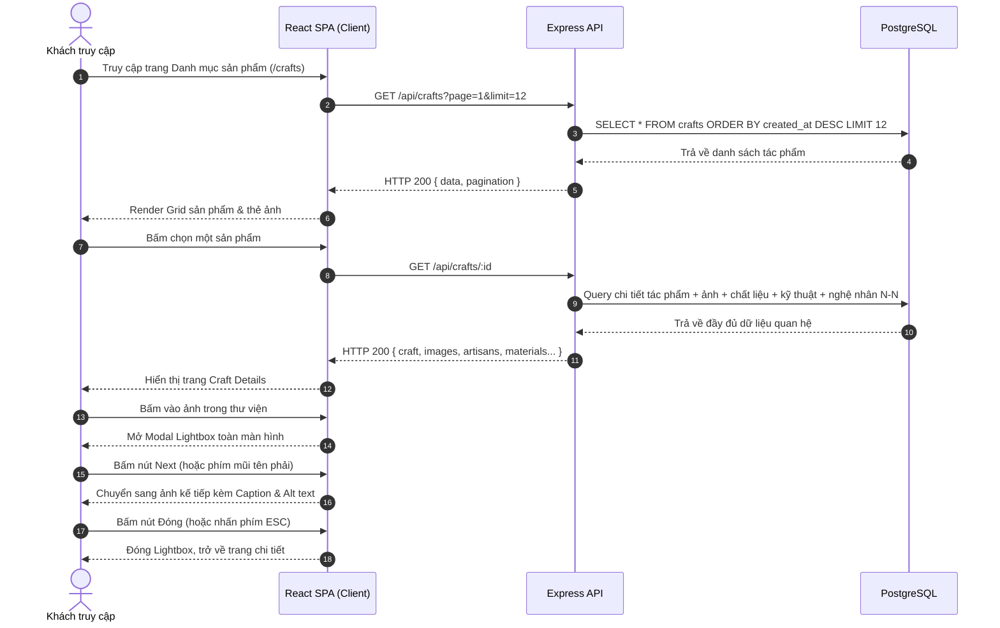
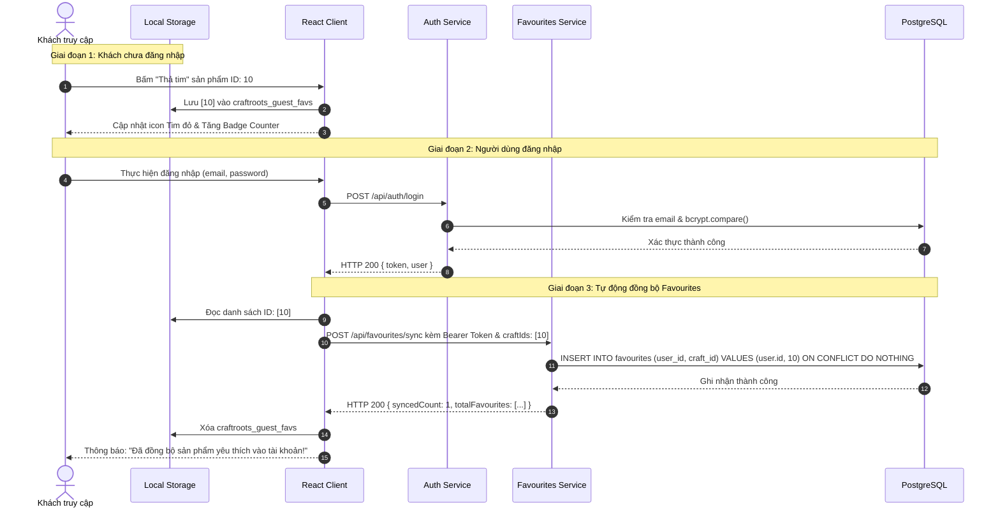

# CraftRoots – Đặc Tả Nghiệp Vụ & Yêu Cầu Tính Năng (Feature Specification)

> **Dự án:** CraftRoots – Cổng Thông Tin Khám Phá Nghề Thủ Công Truyền Thống  
> **Chương trình:** eProject – Aptech Computer Education  
> **Phiên bản tài liệu:** v1.0.0  
> **Ngày cập nhật:** 2026-10-12  
> **Tài liệu liên quan:** [README.md](file:///e:/eproject1/docs/README.md) | [architecture.md](file:///e:/eproject1/docs/architecture.md) | [database-schema.md](file:///e:/eproject1/docs/database-schema.md) | [api-contract.yaml](file:///e:/eproject1/docs/api-contract.yaml)

---

## Mục lục
1. [Tổng quan dự án & Mục tiêu nghiệp vụ](#1-tổng-quan-dự-án--mục-tiêu-nghiệp-vụ)
2. [Chân dung người dùng (User Personas)](#2-chân-dung-người-dùng-user-personas)
3. [Đặc tả chi tiết các phân hệ tính năng (Feature Modules)](#3-đặc-tả-chi-tiết-các-phân-hệ-tính-năng-feature-modules)
   - 3.1. [Trang chủ / Landing Page](#31-trang-chủ--landing-page)
   - 3.2. [Danh mục sản phẩm & Lưới hiển thị (Craft Directory)](#32-danh-mục-sản-phẩm--lưới-hiển-thị-craft-directory)
   - 3.3. [Tìm kiếm thông minh & Bộ lọc đa diện (Smart Search & Filters)](#33-tìm-kiếm-thông-minh--bộ-lọc-đa-diện-smart-search--filters)
   - 3.4. [Chi tiết sản phẩm thủ công (Craft Details)](#34-chi-tiết-sản-phẩm-thủ-công-craft-details)
   - 3.5. [Hồ sơ nghệ nhân & Quan hệ Nhiều-Nhiều (Artisan Profiles)](#35-hồ-sơ-nghệ-nhân--quan-hệ-nhiều-nhiều-artisan-profiles)
   - 3.6. [Thư viện ảnh tương tác Lightbox (Interactive Gallery)](#36-thư-viện-ảnh-tương-tác-lightbox-interactive-gallery)
   - 3.7. [Khám phá vùng miền & Bản đồ văn hóa (Regional Cultural Map)](#37-khám-phá-vùng-miền--bản-đồ-văn-hóa-regional-cultural-map)
   - 3.8. [Bộ sưu tập theo mùa & Tuyển chọn (Seasonal Collections)](#38-bộ-sưu-tập-theo-mùa--tuyển-chọn-seasonal-collections)
   - 3.9. [Quản lý yêu thích lưỡng thể (Hybrid Favourites System)](#39-quản-lý-yêu-thích-lưỡng-thể-hybrid-favourites-system)
   - 3.10. [Xác thực & Quản lý tài khoản (Authentication & Profile)](#310-xác-thực--quản-lý-tài-khoản-authentication--profile)
   - 3.11. [Biểu mẫu liên hệ (Contact Form)](#311-biểu-mẫu-liên-hệ-contact-form)
   - 3.12. [Giới thiệu sứ mệnh (About Us) & UI/UX Dùng chung](#312-giới-thiệu-sứ-mệnh-about-us--uiux-dùng-chung)
4. [Sơ đồ luồng người dùng (User Flows)](#4-sơ-đồ-luồng-người-dùng-user-flows)
5. [Bộ quy tắc nghiệp vụ cốt lõi (Business Rules)](#5-bộ-quy-tắc-nghiệp-vụ-cốt-lõi-business-rules)
6. [Yêu cầu phi chức năng (Non-Functional Requirements)](#6-yêu-cầu-phi-chức-năng-non-functional-requirements)

---

## 1. Tổng quan dự án & Mục tiêu nghiệp vụ

### 1.1. Bối cảnh
Nghề thủ công truyền thống đại diện cho linh hồn, bản sắc văn hóa và bề dày lịch sử của các cộng đồng dân tộc Việt Nam. Tuy nhiên, nguồn tri thức này đang bị phân tán nghiêm trọng, trình bày thiếu hấp dẫn dưới các định dạng tĩnh, thiếu sự kết nối giữa sản phẩm, nghệ nhân chế tác và câu chuyện văn hóa phía sau.

### 1.2. Mục tiêu hệ thống CraftRoots
1. **Số hóa & Trực quan hóa Di sản:** Cung cấp cổng thông tin số một điểm chạm (Single-page discovery portal), giúp khách truy cập tra cứu, trải nghiệm đa chiều các sản phẩm mỹ nghệ, gốm sứ, thêu dệt, mây tre đan.
2. **Tôn vinh Nghệ nhân:** Xây dựng hồ sơ nghệ nhân chuyên nghiệp, phản ánh chính xác mô hình phối hợp chế tác Nhiều-Nhiều (N-N), nơi một kiệt tác có thể được tạo nên bởi nhiều nghệ nhân bậc thầy và mỗi nghệ nhân chủ trì nhiều công trình.
3. **Cá nhân hóa trải nghiệm người dùng:** Cho phép lưu sản phẩm yêu thích linh hoạt ngay từ khi là khách vãng lai (qua Local Storage) và tự động đồng bộ hóa lên đám mây (PostgreSQL) ngay khi người dùng đăng nhập.
4. **Quảng bá chuyên đề theo mùa:** Thiết kế không gian văn hóa riêng theo 4 mùa (Xuân, Hạ, Thu, Đông) gắn liền với lễ hội, phong tục và phong cách bài trí truyền thống.

---

## 2. Chân dung người dùng (User Personas)

| Tiêu chí | Persona 1: Khách vãng lai (Guest Visitor) | Persona 2: Người yêu thủ công (Registered Craft Enthusiast) | Persona 3: Quản trị viên / Curator (Admin) |
|---|---|---|---|
| **Đại diện** | Mai Lan (22 tuổi, sinh viên Mỹ thuật/Du khách) | Hoàng Nam (34 tuổi, kiến trúc sư & nhà sưu tập) | Đội ngũ quản trị CraftRoots |
| **Mục tiêu** | - Tìm kiếm nhanh tài liệu văn hóa.<br>- Khám phá ảnh đẹp làng nghề.<br>- Lưu tạm các mẫu vào bookmark trên máy. | - Lưu trữ danh bạ tác phẩm yêu thích lâu dài trên nhiều thiết bị.<br>- Tìm kiếm sâu theo kỹ thuật, chất liệu, nghệ nhân.<br>- Liên hệ đặt câu hỏi bảo tồn/hợp tác. | - Kiểm duyệt và xuất bản các tác phẩm.<br>- Thiết lập bộ sưu tập theo mùa.<br>- Phản hồi tin nhắn liên hệ từ khách hàng. |
| **Điểm chạm (Touchpoints)** | Trang chủ, Catalog, Thư viện ảnh, Chi tiết sản phẩm, Local Storage. | Form Đăng ký/Đăng nhập, Trang Yêu thích đồng bộ, Hồ sơ cá nhân. | Hệ thống quản trị nội dung, CSDL PostgreSQL. |

---

## 3. Đặc tả chi tiết các phân hệ tính năng (Feature Modules)

### 3.1. Trang chủ / Landing Page
- **Mục đích:** Tạo ấn tượng thị giác đầu tiên (Hero impact), giới thiệu giá trị thương hiệu và điều hướng nhanh người dùng vào các không gian khám phá.
- **Thành phần giao diện:**
  - **Hero Section:** Tiêu đề truyền cảm hứng, khẩu hiệu nhận diện thương hiệu, hình ảnh/banner chất lượng cao và thanh tìm kiếm từ khóa nổi bật (Global Search Bar).
  - **Quick Categories / Fast Track:** Các phím tắt dạng icon/card dẫn nhanh đến các ngành nghề cốt lõi: Gốm sứ, Dệt may thổ cẩm, Đồ gỗ mỹ nghệ, Mây tre đan, Sơn mài, Kim hoàn.
  - **Featured Crafts:** Băng chuyền (Carousel) hoặc Grid 4-6 tác phẩm tiêu biểu được gắn cờ `is_featured = true`.
  - **Seasonal Showcase Snippet:** Khối giới thiệu bộ sưu tập theo mùa đương đại (ví dụ: "Giai điệu Mùa Hè: Sợi cói & Đất nung") với tông màu chủ đạo đồng bộ.
  - **Cultural Regions Map Preview:** Bản đồ phân vùng Bắc - Trung - Nam dạng thẻ trực quan.
  - **Artisan Highlight:** Giới thiệu ngắn về nghệ nhân tiêu biểu trong tháng.

### 3.2. Danh mục sản phẩm & Lưới hiển thị (Craft Directory)
- **Mục đích:** Trưng bày toàn bộ danh mục sản phẩm thủ công dưới bố cục lưới (Card Grid) hiện đại, thích ứng mọi màn hình.
- **Thành phần trên mỗi thẻ sản phẩm (CraftCard):**
  - Ảnh đại diện (`thumbnail_url`) kèm hiệu ứng phóng nhẹ (zoom hover).
  - Huy hiệu Vùng miền (Badge Region) và Thể loại (Category).
  - Tên tác phẩm (`name`).
  - Tóm tắt ngắn (`short_description`).
  - Chất liệu đại diện (`materials`).
  - Nút biểu tượng "Thả tim" (Favourite Button) tương tác tức thì.
- **Tính năng phân trang & sắp xếp:**
  - Hỗ trợ sắp xếp theo: Mới nhất (`created_at DESC`), Xem nhiều nhất (`view_count DESC`), Tên A-Z.
  - Phân trang chuẩn phân đoạn (Pagination) hoặc Tải thêm (Load More) tối ưu hiệu năng.

### 3.3. Tìm kiếm thông minh & Bộ lọc đa diện (Smart Search & Filters)
- **Cơ chế tìm kiếm (Full-Text Search):**
  - Người dùng nhập từ khóa vào ô tìm kiếm.
  - Tích hợp kỹ thuật **Debounce (350ms)** để chống bão hòa request.
  - Backend sử dụng PostgreSQL `to_tsvector` tìm kiếm đồng thời trên `name`, `short_description` và `cultural_context`.
- **Bộ lọc đa diện (Faceted Filters):**
  - Lọc theo **Vùng miền (Region)**: Miền Bắc, Miền Trung, Miền Nam, Tây Nguyên...
  - Lọc theo **Loại hình thủ công (Category)**: Gốm sứ, Mây tre, Dệt may, Chạm khắc...
  - Lọc theo **Chất liệu (Material)**: Đất sét, Tre nứa, Tơ tằm, Đồng, Gỗ mun...
  - Lọc theo **Kỹ thuật (Technique)**: Chuốt gốm thủ công, Dệt thổ cẩm ikat, Cẩn xà cừ...
- **Xử lý trạng thái phản hồi:**
  - Tự động cập nhật số lượng kết quả trùng khớp.
  - Nút **"Xóa bộ lọc" (Clear All Filters)** hiển thị khi có ít nhất một tiêu chí lọc được chọn.
  - **Trạng thái rỗng (Empty State):** Khi không có sản phẩm nào thỏa mãn, hiển thị minh họa văn hóa sinh động kèm gợi ý từ khóa phổ biến.

### 3.4. Chi tiết sản phẩm thủ công (Craft Details)
- **Mục đích:** Cung cấp đầy đủ chiều sâu văn hóa, kỹ thuật, dụng cụ và con người chế tác cho một tác phẩm.
- **Nội dung hiển thị:**
  - **Bộ sưu tập ảnh đa góc độ:** Ảnh chính kèm dải ảnh thu nhỏ (thumbnails), click mở Lightbox.
  - **Bối cảnh văn hóa & Lịch sử (`cultural_context`):** Nguồn gốc ra đời, ý nghĩa biểu tượng, vai trò trong đời sống tâm linh/lễ hội.
  - **Nguyên liệu & Dụng cụ chế tác (`tools`, `materials`):** Chi tiết chất liệu chọn lọc và công cụ đặc thù của phường thợ.
  - **Quy trình chế tác (`process`, `techniques`):** Các bước từ chuẩn bị nguyên liệu thô đến khi ra thành phẩm.
  - **Công dụng truyền thống & Đương đại (`traditional_use`).**
  - **Danh sách Nghệ nhân đồng tham gia (`craft_artisans`):** Thẻ thông tin nghệ nhân chủ trì, vai trò và ghi chú đóng góp kỹ thuật.
  - **Sản phẩm liên quan (Related Crafts):** Các sản phẩm cùng chất liệu, cùng vùng miền hoặc cùng nghệ nhân.
  - **Nút Yêu thích (Add/Remove Favourites):** Trạng thái active/inactive rõ ràng.

### 3.5. Hồ sơ nghệ nhân & Quan hệ Nhiều-Nhiều (Artisan Profiles)
- **Đặc tả nghiệp vụ N-N:**
  - Một tác phẩm thủ công có thể ghi danh nhiều nghệ nhân: ví dụ, Bình gốm men lam Bát Tràng có thể do 1 nghệ nhân tạo cốt gốm và 1 nghệ nhân vẽ họa tiết men.
  - Một nghệ nhân có thể sáng tạo ra hàng chục tác phẩm thuộc nhiều danh mục.
- **Nội dung hồ sơ nghệ nhân:**
  - Ảnh chân dung (`avatar_url`), họ tên, danh hiệu vinh danh (Nghệ nhân Nhân dân, Nghệ nhân Ưu tú).
  - Vùng đất xuất thân, thâm niên làm nghề (`years_of_experience`).
  - Chuyên môn kỹ thuật đặc trưng (`specialty`).
  - Tiểu sử và triết lý làm nghề (`biography`).
  - Danh sách các tác phẩm trong hệ thống do nghệ nhân đó thực hiện (kèm vai trò: Chủ trì, Cố vấn, Nghệ nhân tạo hình...).

### 3.6. Thư viện ảnh tương tác Lightbox (Interactive Gallery)
- **Mục đích:** Mang lại trải nghiệm thị giác sống động như tại bảo tàng số.
- **Hành vi tương tác:**
  - Click vào bất kỳ ảnh nào trong trang Gallery hoặc trang Chi tiết để phóng to toàn màn hình (Modal Lightbox).
  - Hỗ trợ chuyển ảnh trước/sau bằng nút mũi tên trên UI, swipe trên màn hình cảm ứng, hoặc phím mũi tên `←` / `→` trên bàn phím.
  - Nhấn phím `Esc` hoặc bấm vùng ngoài (backdrop click) để đóng Lightbox.
  - Hiển thị đầy đủ chú thích ảnh (`caption`), văn bản thay thế (`alt_text`) phục vụ tiếp cận (Accessibility - WCAG 2.1).

### 3.7. Khám phá vùng miền & Bản đồ văn hóa (Regional Cultural Map)
- **Bố cục giao diện:**
  - Bản đồ văn hóa đồ họa tĩnh/SVG phân định 3 miền: Bắc Bộ, Trung Bộ, Nam Bộ và Tây Nguyên.
  - Khi người dùng click chọn một vùng miền:
    - Hiển thị thẻ tóm lược bản sắc làng nghề vùng miền đó.
    - Lọc động danh sách toàn bộ các sản phẩm và nghệ nhân thuộc vùng đó.

### 3.8. Bộ sưu tập theo mùa & Tuyển chọn (Seasonal Collections)
- **Khái niệm nghiệp vụ:**
  - Mỗi mùa trong năm gắn với chủ đề văn hóa đặc thù (Mùa Hè: sản phẩm thanh nhiệt, chiếu cói, quạt giấy, gốm men mát; Mùa Xuân: đồ gốm thờ cúng, tranh dân gian đón Tết...).
- **Cấu trúc bộ sưu tập mùa:**
  - Tiêu đề mùa, Năm phát hành (`year`), Mã mùa (`spring`, `summer`, `autumn`, `winter`).
  - Banner chuyên đề và Tông màu chủ đạo (`color_tone`).
  - Tác phẩm nổi bật nhất mùa (`is_hero = true`) kèm ghi chú giám tuyển (`curator_note`).
  - Huy hiệu điểm nhấn sản phẩm (`highlight_badge`).

### 3.9. Quản lý yêu thích lưỡng thể (Hybrid Favourites System)
- **Khách chưa đăng nhập (Guest):**
  - Danh sách ID sản phẩm được lưu trong `localStorage` của trình duyệt (`craftroots_guest_favs`).
  - Người dùng có thể xem trang Favourites cá nhân ngay trên thiết bị hiện tại mà không bị chặn đăng nhập.
- **Khách đăng nhập tài khoản (Authenticated):**
  - Ngay sau khi đăng nhập thành công, hệ thống tự động kiểm tra `localStorage`.
  - Nếu có sản phẩm trong `localStorage`, client kích hoạt API `/api/favourites/sync` gửi danh sách lên backend.
  - Backend thực hiện nạp dữ liệu vào bảng `favourites`, giải quyết trùng lặp bằng cú pháp `ON CONFLICT DO NOTHING`.
  - Client làm sạch `localStorage` và chuyển sang sử dụng dữ liệu nguồn từ PostgreSQL.
  - Khi đổi sang thiết bị khác và đăng nhập, toàn bộ danh sách yêu thích được giữ nguyên.

### 3.10. Xác thực & Quản lý tài khoản (Authentication & Profile)
- **Đăng ký:** Họ và tên (`fullName`), Email hợp lệ, Mật khẩu (tối thiểu 8 ký tự, có chữ hoa, thường và số), Xác nhận mật khẩu. Mật khẩu được mã hóa một chiều qua thuật toán **bcrypt (salt rounds = 10)**.
- **Đăng nhập:** Email + Mật khẩu. Khi thành công, server trả về **JWT Token** (hạn 1 ngày) và thông tin cơ bản của user.
- **Quản lý phiên:** Client lưu trữ JWT và gửi kèm header `Authorization: Bearer <token>` ở mọi request cần bảo vệ.
- **Hồ sơ cá nhân:** Xem thông tin tài khoản, danh sách yêu thích trên đám mây, và chức năng Đổi mật khẩu an toàn.

### 3.11. Biểu mẫu liên hệ (Contact Form)
- **Trường thông tin:** Họ và tên, Email, Số điện thoại (tùy chọn), Tiêu đề, Nội dung tin nhắn.
- **Kiểm tra hợp lệ:**
  - Phía Client: Kiểm tra trường bắt buộc, định dạng email regex, số ký tự tối thiểu.
  - Phía Server: Kiểm tra bằng middleware validation, chống gửi spam và mã độc.
  - Dữ liệu lưu vào bảng `contact_messages` trạng thái `status = 'unread'`.
  - Hiển thị thông báo Toast xác nhận gửi thành công tức thì và reset form.

### 3.12. Giới thiệu sứ mệnh (About Us) & UI/UX Dùng chung
- **Trang Giới thiệu:** Trình bày tôn chỉ bảo tồn văn hóa của dự án CraftRoots, sự tôn vinh bàn tay vàng của người thợ thủ công Việt.
- **Thành phần dùng chung:**
  - Header / Sticky Navbar với menu đa cấp, chỉ báo số lượng yêu thích (Badge Counter), trạng thái đăng nhập.
  - Mobile Hamburger Menu đóng/mở mượt mà với hiệu ứng trượt (Drawer).
  - Footer chứa liên kết chính sách, liên hệ, mạng xã hội, bản quyền Aptech eProject.
  - Breadcrumbs điều hướng phân cấp (Trang chủ > Sản phẩm > Gốm Bát Tràng).
  - Nút Back-to-Top tự động xuất hiện khi cuộn qua màn hình đầu tiên.
  - Loading Skeletons (khung xương tải trang) giảm cảm giác chờ đợi.

---

## 4. Sơ đồ luồng người dùng (User Flows)

### Flow 1: Khám phá sản phẩm & Thư viện ảnh tương tác Lightbox


---

### Flow 2: Tìm kiếm & Lọc đa tiêu chí kết hợp Debounce
```mermaid
flowchart TD
    A([Người dùng nhập từ khóa vào ô tìm kiếm]) --> B[Client kích hoạt useDebounce - chờ 350ms]
    B --> C{Người dùng có nhập tiếp không?}
    C -- Có --> B
    C -- Không --> D[Tạo Query Parameters: q=..., region=..., category=...]
    D --> E[Gửi request GET /api/crafts?q=...&...]
    E --> F[Backend phân tích query, thực thi Full-Text Search tsvector]
    F --> G{Có bản ghi thỏa mãn?}
    G -- Có --> H[Trả về danh sách sản phẩm & số lượng kết quả]
    H --> I[Client render lại Card Grid với kết quả mới]
    G -- Không --> J[Trả về mảng rỗng []]
    J --> K[Client hiển thị Empty State kèm nút 'Xóa bộ lọc']
    K --> L[Người dùng bấm 'Xóa bộ lọc' -> Reset toàn bộ trạng thái]
    L --> D
```

---

### Flow 3: Đánh dấu yêu thích & Đồng bộ hóa lưỡng thể (Hybrid Sync)


---

## 5. Bộ quy tắc nghiệp vụ cốt lõi (Business Rules)

| Mã luật | Tên nghiệp vụ | Mô tả quy tắc chi tiết |
|---|---|---|
| **BR-01** | Xác thực danh tính | Mật khẩu tài khoản phải chứa ít nhất 8 ký tự, bao gồm ít nhất 1 chữ hoa, 1 chữ thường và 1 chữ số. Mật khẩu không bao giờ được lưu dạng văn bản thô (Plain Text) mà phải băm bằng **bcrypt** (salt rounds = 10). |
| **BR-02** | Tính duy nhất của Email | Một email chỉ được đăng ký duy nhất 1 tài khoản người dùng (`UNIQUE` constraint). Thông báo lỗi khi đăng nhập không được tiết lộ email có tồn tại hay không ("Email hoặc mật khẩu không chính xác"). |
| **BR-03** | Thời hạn phiên JWT | Token truy cập (JWT) có hạn mặc định là 24 giờ (`1d`). Khi hết hạn, mọi request đến API bảo vệ phải trả về mã `HTTP 401 Unauthorized` và điều hướng người dùng tới trang Đăng nhập. |
| **BR-04** | Quan hệ Nghệ nhân – Tác phẩm (N-N) | Một tác phẩm thủ công có thể có từ 1 đến nhiều nghệ nhân đồng chế tác. Mỗi liên kết trong bảng `craft_artisans` phải xác định rõ vai trò (`role_title`), đánh dấu nghệ nhân đại diện (`is_lead = true/false`) và thứ tự hiển thị (`display_order`). |
| **BR-05** | Toàn vẹn dữ liệu Nghệ nhân | Khi xóa một nghệ nhân, các tác phẩm liên quan **không bị xóa** theo (quan hệ liên kết trong `craft_artisans` bị xóa CASCADE, nhưng bản ghi trong `crafts` vẫn giữ nguyên để đảm bảo toàn vẹn di sản). |
| **BR-06** | Tính hợp lệ của Bộ sưu tập mùa | Bảng `seasonal_collections` bắt buộc có `season_code` thuộc 1 trong 4 giá trị: `spring`, `summer`, `autumn`, `winter`. `end_date` phải lớn hơn hoặc bằng `start_date`. |
| **BR-07** | Tiêu điểm của Bộ sưu tập mùa | Trong mỗi bộ sưu tập theo mùa, chỉ có tối đa 1 hoặc 2 sản phẩm được gắn nhãn tác phẩm tiêu điểm (`is_hero = true`) để hiển thị tại vị trí Banner trung tâm. |
| **BR-08** | Tính lũy đẳng của Yêu thích (Idempotency) | Một người dùng chỉ có thể yêu thích một sản phẩm tối đa 1 lần (Primary Key kép `(user_id, craft_id)`). Thao tác thêm trùng lặp qua API sync không được gây lỗi 500 (`ON CONFLICT DO NOTHING`). |
| **BR-09** | Chuyển dịch trạng thái Yêu thích khách | Khi khách chưa đăng nhập thêm sản phẩm yêu thích, lưu tối đa 50 sản phẩm trong Local Storage để tránh tràn bộ nhớ trình duyệt. Khi đăng nhập, toàn bộ danh sách hợp lệ phải được đẩy lên database và xóa sạch tại máy khách. |
| **BR-10** | Kiểm duyệt tin nhắn liên hệ | Biểu mẫu liên hệ yêu cầu Họ tên (tối thiểu 2 ký tự), Email (đúng định dạng RFC 5322), Nội dung tin nhắn (tối thiểu 10 ký tự, tối đa 2000 ký tự). Trạng thái ban đầu của tin nhắn luôn là `unread`. |
| **BR-11** | Chống tấn công brute-force | Áp dụng giới hạn tần suất truy cập (`express-rate-limit`) tối đa 5 lần thử đăng nhập sai trong vòng 15 phút trên mỗi địa chỉ IP. |
| **BR-12** | Truy vấn chống SQL Injection | Toàn bộ các câu truy vấn cơ sở dữ liệu qua thư viện `pg` phải sử dụng tham số hóa hoàn toàn (`$1, $2...`), nghiêm cấm nối chuỗi trực tiếp vào câu lệnh SQL. |

---

## 6. Yêu cầu phi chức năng (Non-Functional Requirements)

1. **Hiệu năng (Performance):**
   - Thời gian phản hồi API trung bình < 150ms cho các truy vấn danh mục và tìm kiếm thông thường.
   - Thời gian tải trang ban đầu (First Contentful Paint - FCP) < 1.5 giây trên mạng 4G tiêu chuẩn.
   - Bảng `crafts` có chỉ mục B-Tree trên các trường khóa ngoại và chỉ mục GIN cho Full-Text Search.
2. **Khả năng tương thích thiết bị (Responsiveness):**
   - Tương thích tối ưu 100% trên các độ phân giải: Mobile (375px - 480px), Tablet (768px - 1024px), Desktop (1280px - 1920px+).
   - Thiết kế chuẩn Mobile-First, các nút bấm có vùng chạm tối thiểu 44x44px.
3. **Tiếp cận & Thân thiện người dùng (Accessibility - a11y):**
   - Tuân thủ tiêu chuẩn WCAG 2.1 cấp độ AA.
   - Tất cả hình ảnh trong Thư viện và Sản phẩm đều có `alt` text mô tả ngữ cảnh.
   - Hỗ trợ điều hướng bằng bàn phím (Tab, Enter, Escape, Arrow keys) với viền chỉ báo `focus-visible` rõ ràng.
4. **Bảo mật (Security):**
   - Thiết lập các tiêu đề bảo mật HTTP thông qua middleware `helmet`.
   - Cấu hình chính sách chia sẻ tài nguyên nguồn gốc chéo (`cors`) nghiêm ngặt, chỉ cho phép tên miền của client React.
   - Mã hóa mật khẩu an toàn, không có cửa hậu (Backdoor).
