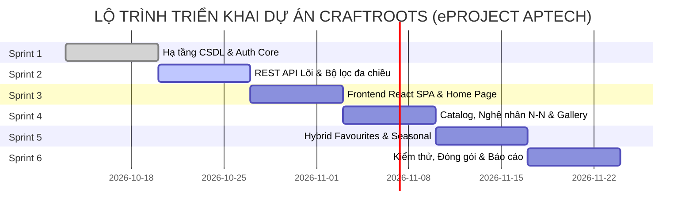

# CraftRoots – Bảng Phân Rã Công Việc & Kế Hoạch Triển Khai (Task Breakdown & WBS)

> **Dự án:** CraftRoots – Cổng Thông Tin Khám Phá Nghề Thủ Công Truyền Thống  
> **Chương trình:** eProject – Aptech Computer Education  
> **Phiên bản:** v1.0.0  
> **Phương pháp quản lý:** Agile / Scrum (6 Sprints x 1 tuần)  
> **Tài liệu liên quan:** [feature-spec.md](file:///e:/eproject1/docs/feature-spec.md) | [architecture.md](file:///e:/eproject1/docs/architecture.md) | [database-schema.md](file:///e:/eproject1/docs/database-schema.md) | [api-contract.yaml](file:///e:/eproject1/docs/api-contract.yaml)

---

## Mục lục
1. [Cơ cấu nhân sự & Phân vai dự án](#1-cơ-cấu-nhân-sự--phân-vai-dự-án)
2. [Quy ước thang điểm ước lượng (Story Points & Time Estimation)](#2-quy-ước-thang-điểm-ước-lượng-story-points--time-estimation)
3. [Lộ trình các Sprint & Mốc bàn giao (Milestones)](#3-lộ-trình-các-sprint--mốc-bàn-giao-milestones)
4. [Bảng phân rã chi tiết công việc (Detailed Work Breakdown Structure)](#4-bảng-phân-rã-chi-tiết-công-việc-detailed-work-breakdown-structure)
   - [Sprint 1: Nền tảng hạ tầng, CSDL PostgreSQL & Module Xác thực Auth](#sprint-1-nền-tảng-hạ-tầng-csdl-postgresql--module-xác-thực-auth)
   - [Sprint 2: Xây dựng RESTful API dữ liệu & Bộ lọc thông minh](#sprint-2-xây-dựng-restful-api-dữ-liệu--bộ-lọc-thông-minh)
   - [Sprint 3: Xây dựng nền tảng Client React SPA, Layout & Trang chủ](#sprint-3-xây-dựng-nền-tảng-client-react-spa-layout--trang-chủ)
   - [Sprint 4: Khám phá sản phẩm, Hồ sơ Nghệ nhân N-N & Lightbox Gallery](#sprint-4-khám-phá-sản-phẩm-hồ-sơ-nghệ-nhân-n-n--lightbox-gallery)
   - [Sprint 5: Yêu thích lưỡng thể, Bộ sưu tập mùa & Form liên hệ](#sprint-5-yêu-thích-lưỡng-thể-bộ-sưu-tập-mùa--form-liên-hệ)
   - [Sprint 6: Kiểm thử chất lượng, Tối ưu hiệu năng & Đóng gói eProject](#sprint-6-kiểm-thử-chất-lượng-tối-ưu-hiệu-năng--đóng-gói-eproject)
5. [Đường găng dự án & Quản lý rủi ro (Critical Path & Risk Management)](#5-đường-găng-dự-án--quản-lý-rủi-ro-critical-path--risk-management)

---

## 1. Cơ cấu nhân sự & Phân vai dự án

| Ký hiệu | Vai trò trong nhóm | Trách nhiệm chính |
|---|---|---|
| **TECH-LEAD** | Fullstack Lead & Architect | Quản trị kiến trúc, thiết kế schema CSDL, review mã nguồn, điều phối tích hợp hệ thống. |
| **BACKEND-DEV** | Backend Engineer | Thiết kế REST API Express, viết controller, middleware, cấu hình pg connection pool, bảo mật API. |
| **FRONTEND-DEV** | Frontend Engineer | Xây dựng UI React 18, React Router, tích hợp API Axios, quản lý Context và Custom Hooks. |
| **DESIGN-AI** | UI/UX & AI Designer | Phác thảo wireframe, thiết kế style guide Figma, tạo ảnh di sản bằng công cụ AI, tối ưu tài nguyên media. |
| **QA-TESTER** | QA / Test Engineer | Viết kịch bản test plan, thực hiện kiểm thử tự động/thủ công, kiểm tra bảo mật, viết báo cáo bug. |

---

## 2. Quy ước thang điểm ước lượng (Story Points & Time Estimation)

- Thang điểm Fibonacci: `1, 2, 3, 5, 8` Story Points (SP).
- Quy đổi chuẩn: `1 SP ≈ 3 - 4 giờ làm việc tập trung`.
- Tổng quy mô dự án: **48 Story Points** (~ 180 giờ kỹ thuật).

---

## 3. Lộ trình các Sprint & Mốc bàn giao (Milestones)

---

## 4. Bảng phân rã chi tiết công việc (Detailed Work Breakdown Structure)

### Sprint 1: Nền tảng hạ tầng, CSDL PostgreSQL & Module Xác thực Auth
*Mục tiêu:* Thiết lập môi trường dự án, khởi tạo thành công 17 bảng CSDL PostgreSQL, hoàn thành luồng đăng ký/đăng nhập bằng JWT & bcrypt.

| Task ID | Module / Epic | Tiêu đề & Nội dung công việc | Người thực hiện | Ước lượng | Phụ thuộc | Tiêu chí nghiệm thu (Acceptance Criteria) |
|---|---|---|---|---|---|---|
| **TSK-01** | Infra & DB | Thiết lập repository Git, cấu hình ESLint, Prettier và cấu trúc thư mục chuẩn `client/`, `server/`, `db/`, `docs/`. | TECH-LEAD | 2 SP (7h) | Không | Git repo hoạt động tốt, có branch protection, `.gitignore` loại trừ node_modules và file `.env`. |
| **TSK-02** | Database | Viết mã nguồn DDL `db/schema.sql` khởi tạo 17 bảng, các ràng buộc toàn vẹn khóa ngoại và chỉ mục B-Tree, GIN FTS. | TECH-LEAD | 3 SP (11h) | TSK-01 | Chạy lệnh `npm run db:init` tạo thành công 17 bảng không lỗi cú pháp trên PostgreSQL 14+. |
| **TSK-03** | Database | Xây dựng tập dữ liệu hạt giống `db/seed.sql` gồm vùng miền, danh mục, chất liệu, kỹ thuật, nghệ nhân và tác phẩm mẫu. | BACKEND-DEV | 3 SP (10h) | TSK-02 | Chạy `npm run db:seed` nạp thành công 3 users mẫu, 3 regions, 6 categories, 10 nghệ nhân và 20 tác phẩm. |
| **TSK-04** | Backend Core | Cấu hình Node.js Express server, tích hợp middleware `helmet`, `cors`, `express-rate-limit`, và thiết lập `pg.Pool` kết nối DB. | BACKEND-DEV | 2 SP (8h) | TSK-01 | Endpoint `GET /api/health` trả về `{ status: 'UP', database: 'connected' }`, bảo vệ HTTP headers chuẩn. |
| **TSK-05** | Auth API | Xây dựng API Đăng ký `POST /api/auth/register` mã hóa mật khẩu bằng bcrypt (salt rounds = 10) và lưu bảng `users`. | BACKEND-DEV | 3 SP (10h) | TSK-02, TSK-04 | Validate email hợp lệ, mật khẩu >= 8 ký tự; trả về mã HTTP 201 kèm token; không lưu plain-text password. |
| **TSK-06** | Auth API | Xây dựng API Đăng nhập `POST /api/auth/login` so sánh mật khẩu và ký JWT token (thời hạn 1 ngày). | BACKEND-DEV | 2 SP (7h) | TSK-05 | Sai tài khoản/mật khẩu trả HTTP 401; đúng trả về HTTP 200 kèm access token và thông tin user. |
| **TSK-07** | Middleware | Viết middleware `authenticate.js` kiểm tra Bearer token và middleware xử lý lỗi tập trung `errorHandler.js`. | BACKEND-DEV | 2 SP (6h) | TSK-06 | Request thiếu/sai token trả về HTTP 401 JSON chuẩn; controller ném ngoại lệ được bắt và định dạng đúng schema. |

---

### Sprint 2: Xây dựng RESTful API dữ liệu & Bộ lọc thông minh
*Mục tiêu:* Cung cấp đầy đủ các endpoint đọc dữ liệu sản phẩm, tìm kiếm toàn văn bản, dữ liệu phân loại và nghệ nhân.

| Task ID | Module / Epic | Tiêu đề & Nội dung công việc | Người thực hiện | Ước lượng | Phụ thuộc | Tiêu chí nghiệm thu (Acceptance Criteria) |
|---|---|---|---|---|---|---|
| **TSK-08** | Crafts API | Xây dựng API `GET /api/crafts` hỗ trợ phân trang (`page`, `limit`), sắp xếp (`sort`) và lọc đa tiêu chí (region, category, material). | BACKEND-DEV | 5 SP (18h) | TSK-03, TSK-07 | Trả về danh sách sản phẩm kèm siêu dữ liệu phân trang chuẩn RFC; latency truy vấn < 100ms. |
| **TSK-09** | Search Engine | Tích hợp Full-Text Search PostgreSQL với chỉ mục GIN trên trường `name` và `cultural_context` vào endpoint `GET /api/crafts?q=...`. | BACKEND-DEV | 3 SP (10h) | TSK-08 | Tìm kiếm từ khóa trả về kết quả chính xác không phụ thuộc dấu tiếng Việt cơ bản; không bị SQL injection. |
| **TSK-10** | Detail API | Xây dựng API `GET /api/crafts/:id` trả về đầy đủ chi tiết sản phẩm, gallery ảnh, chất liệu, kỹ thuật và nghệ nhân đồng chế tác N-N. | BACKEND-DEV | 3 SP (11h) | TSK-08 | Query ghép nối (JOIN) trả về đúng danh sách nghệ nhân liên kết kèm vai trò (`role_title`, `is_lead`); trả 404 nếu không tìm thấy. |
| **TSK-11** | Artisans API | Xây dựng API `GET /api/artisans` và `GET /api/artisans/:id` lấy hồ sơ nghệ nhân cùng danh sách tác phẩm liên quan. | BACKEND-DEV | 3 SP (10h) | TSK-10 | Trả về thông tin nghệ nhân và mảng các tác phẩm do nghệ nhân đó tham gia thực hiện; sắp xếp tác phẩm mới nhất. |
| **TSK-12** | Meta APIs | Xây dựng các API lấy danh mục bộ lọc: `GET /regions`, `GET /categories`, `GET /materials`, `GET /techniques`. | BACKEND-DEV | 2 SP (7h) | TSK-04 | Các endpoint trả về mảng dữ liệu danh mục để phục vụ Client render thanh filter. |

---

### Sprint 3: Xây dựng nền tảng Client React SPA, Layout & Trang chủ
*Mục tiêu:* Thiết lập khung giao diện React 18 SPA với Vite, hệ thống điều hướng React Router, layout dùng chung và Trang chủ ấn tượng.

| Task ID | Module / Epic | Tiêu đề & Nội dung công việc | Người thực hiện | Ước lượng | Phụ thuộc | Tiêu chí nghiệm thu (Acceptance Criteria) |
|---|---|---|---|---|---|---|
| **TSK-13** | UI Design | Thiết kế Style Guide (màu sắc HSL, font Inter, bo góc, bóng đổ) và Wireframe các trang chính trên Figma kết hợp AI. | DESIGN-AI | 3 SP (12h) | Không | Bộ Figma đầy đủ biến màu, kiểu typography, linh kiện Card, Button, Navbar, tương thích Mobile và Desktop. |
| **TSK-14** | Client Infra | Khởi tạo dự án React 18 với Vite, cài đặt `react-router-dom`, cấu hình biến môi trường `.env` (`VITE_API_URL`) và hệ thống biến CSS. | FRONTEND-DEV | 2 SP (6h) | TSK-13 | Ứng dụng chạy mượt mà trên `localhost:5173`, nạp biến CSS toàn cục chuẩn xác, không có lỗi console. |
| **TSK-15** | Layout Module | Xây dựng `Navbar` (có menu di động Drawer), `Footer` chuẩn bản quyền Aptech, `Breadcrumbs` và nút `BackToTop`. | FRONTEND-DEV | 3 SP (11h) | TSK-14 | Navbar cố định (sticky), menu mở trượt mượt trên mobile, nút BackToTop tự hiện khi cuộn quá 400px. |
| **TSK-16** | Context Layer | Xây dựng `AuthContext` quản lý token, trạng thái đăng nhập và các phương thức `login()`, `logout()`, `register()`. | FRONTEND-DEV | 3 SP (10h) | TSK-06, TSK-14 | Lưu JWT vào state/storage; tự động giải mã lấy thông tin `user`; cung cấp component bảo vệ `PrivateRoute`. |
| **TSK-17** | Landing Page | Xây dựng `HomePage`: Hero Section với ô tìm kiếm nhanh, Khối danh mục phím tắt, Carousel tác phẩm nổi bật (`is_featured`). | FRONTEND-DEV | 4 SP (15h) | TSK-08, TSK-15 | Giao diện hiện đại, hình ảnh tối ưu, có Skeleton Loader khi đang fetch dữ liệu từ API; responsive 100%. |

---

### Sprint 4: Khám phá sản phẩm, Hồ sơ Nghệ nhân N-N & Lightbox Gallery
*Mục tiêu:* Hoàn thành trang Danh mục sản phẩm (Directory), Bộ lọc đa diện kết hợp Debounce, Trang chi tiết sản phẩm và Thư viện ảnh tương tác Lightbox.

| Task ID | Module / Epic | Tiêu đề & Nội dung công việc | Người thực hiện | Ước lượng | Phụ thuộc | Tiêu chí nghiệm thu (Acceptance Criteria) |
|---|---|---|---|---|---|---|
| **TSK-18** | Filter Bar | Xây dựng component `FilterBar` đa tiêu chí (Vùng miền, Thể loại, Chất liệu) và ô tìm kiếm tích hợp `useDebounce` (350ms). | FRONTEND-DEV | 3 SP (11h) | TSK-12, TSK-14 | Người dùng gõ tìm kiếm không bị giật lag; chọn nhiều bộ lọc cùng lúc tự động đồng bộ lên URL query parameters. |
| **TSK-19** | Directory Page | Xây dựng `DirectoryPage` hiển thị lưới sản phẩm (`CraftCard`), phân trang phân đoạn và thông báo khi rỗng (Empty State). | FRONTEND-DEV | 4 SP (14h) | TSK-18, TSK-08 | Thẻ sản phẩm có ảnh, badge, tên, hover zoom nhẹ; khi không có kết quả hiển thị thông điệp văn hóa và nút xóa lọc. |
| **TSK-20** | Craft Detail | Xây dựng trang `CraftDetailPage` hiển thị bối cảnh văn hóa, công cụ, quy trình chế tác và danh sách nghệ nhân N-N. | FRONTEND-DEV | 4 SP (16h) | TSK-10, TSK-15 | Hiển thị thẻ nghệ nhân chủ trì (`is_lead`); danh sách sản phẩm liên quan; nút bấm yêu thích phản hồi tức thì. |
| **TSK-21** | Lightbox Modal | Xây dựng component `LightboxModal` phóng to ảnh chất lượng cao, chuyển ảnh bằng chuột hoặc phím mũi tên bàn phím (`←`/`→`, `ESC`). | FRONTEND-DEV | 3 SP (10h) | TSK-20 | Mở ảnh nét căng toàn màn hình, có chú thích (`caption`) và `alt` text; bấm vùng ngoài hoặc phím ESC tự động đóng. |
| **TSK-22** | Artisan Page | Xây dựng trang `ArtisansPage` và `ArtisanDetailPage` giới thiệu tiểu sử, danh hiệu và các tác phẩm tiêu biểu của từng nghệ nhân. | FRONTEND-DEV | 3 SP (10h) | TSK-11, TSK-15 | Hiển thị danh hiệu (Nghệ nhân Nhân dân/Ưu tú), thâm niên nghề nghiệp và danh sách tác phẩm liên kết N-N. |

---

### Sprint 5: Yêu thích lưỡng thể, Bộ sưu tập mùa & Form liên hệ
*Mục tiêu:* Hiện thực hóa cơ chế Favourites Hybrid Sync, xây dựng không gian trưng bày Bộ sưu tập mùa và Biểu mẫu liên hệ hoàn chỉnh.

| Task ID | Module / Epic | Tiêu đề & Nội dung công việc | Người thực hiện | Ước lượng | Phụ thuộc | Tiêu chí nghiệm thu (Acceptance Criteria) |
|---|---|---|---|---|---|---|
| **TSK-23** | Favourites API | Xây dựng các API quản lý yêu thích trên server: `GET /api/favourites`, `POST /api/favourites/:id`, `DELETE /api/favourites/:id`. | BACKEND-DEV | 3 SP (10h) | TSK-07 | Chỉ cho phép truy cập khi có token hợp lệ; thao tác thêm/xóa cập nhật trực tiếp vào bảng `favourites` của PostgreSQL. |
| **TSK-24** | Favourites Sync | Xây dựng API đồng bộ `POST /api/favourites/sync` nhận mảng `craftIds` từ client và insert an toàn `ON CONFLICT DO NOTHING`. | BACKEND-DEV | 2 SP (8h) | TSK-23 | Đồng bộ không gây lỗi 500 nếu ID đã tồn tại; trả về số lượng bản ghi đã đồng bộ và danh sách cập nhật mới nhất. |
| **TSK-25** | Favourites Ctx | Xây dựng `FavouritesContext` phía React: khách vãng lai lưu vào `localStorage`, khi đăng nhập tự kích hoạt API sync và làm sạch storage. | FRONTEND-DEV | 4 SP (14h) | TSK-16, TSK-24 | Khách chưa đăng nhập thả tim được ngay; sau khi đăng nhập tim vẫn đỏ và được chuyển lên đám mây; đồng bộ đa thiết bị. |
| **TSK-26** | Seasonal API | Xây dựng API `GET /api/seasonal-collections` và `GET /api/seasonal-collections/:id` lấy chi tiết BST mùa kèm tác phẩm Hero. | BACKEND-DEV | 3 SP (11h) | TSK-02 | Trả về đúng thông tin mùa hiện tại (Xuân/Hạ/Thu/Đông), cờ `is_hero`, tông màu `color_tone` và ghi chú giám tuyển. |
| **TSK-27** | Seasonal UI | Xây dựng giao diện trưng bày Bộ sưu tập mùa trên Frontend với theme màu linh hoạt theo từng mùa và banner tác phẩm Hero. | FRONTEND-DEV | 3 SP (11h) | TSK-26 | Đổi tông màu chủ đạo linh hoạt theo thuộc tính `color_tone` của BST mùa; liên kết trực tiếp vào trang chi tiết sản phẩm. |
| **TSK-28** | Contact Module | Xây dựng API `POST /api/contact` và giao diện Form liên hệ `ContactPage` có validate 2 đầu (Client + Server), lưu vào bảng `contact_messages`. | FULLSTACK | 3 SP (10h) | TSK-02, TSK-15 | Validate email regex, nội dung tối thiểu 10 ký tự; gửi thành công hiển thị Toast notification xanh và làm mới form. |

---

### Sprint 6: Kiểm thử chất lượng, Tối ưu hiệu năng & Đóng gói eProject
*Mục tiêu:* Thực hiện toàn bộ kịch bản kiểm thử, tối ưu hóa điểm số Lighthouse, rà soát lỗ hổng bảo mật và xuất bản báo cáo theo tiêu chuẩn Aptech.

| Task ID | Module / Epic | Tiêu đề & Nội dung công việc | Người thực hiện | Ước lượng | Phụ thuộc | Tiêu chí nghiệm thu (Acceptance Criteria) |
|---|---|---|---|---|---|---|
| **TSK-29** | API Testing | Viết bộ kiểm thử tự động API trên Postman / Supertest cho 100% các endpoint trong tài liệu `api-contract.yaml`. | QA-TESTER | 4 SP (14h) | Toàn bộ API | Đạt 100% test cases Pass, bao gồm cả trường hợp hợp lệ và các mã lỗi 400, 401, 404, 409. |
| **TSK-30** | Security Audit | Kiểm thử rà soát lỗ hổng: tấn công SQL Injection, XSS qua input form, Brute-Force đăng nhập, truy cập API trái phép. | QA-TESTER | 3 SP (10h) | TSK-29 | Hệ thống chặn 100% payload tấn công; rate limiter khóa tạm thời sau 5 lần thử sai; không rò rỉ stack trace. |
| **TSK-31** | Responsive QA | Kiểm thử giao diện và độ tương thích trên các thiết bị thực tế (iPhone, iPad, Laptop màn hình rộng) và đa trình duyệt. | QA-TESTER | 3 SP (11h) | Toàn bộ UI | Không vỡ layout ở mọi breakpoint (375px, 768px, 1024px, 1440px); bàn phím điều hướng được toàn bộ các nút. |
| **TSK-32** | Performance Opt | Tối ưu hóa kích thước ảnh (WebP format), Lazy loading hình ảnh, nén gzip backend, đạt điểm Lighthouse Performance > 85. | TECH-LEAD | 3 SP (10h) | TSK-31 | FCP < 1.5s, TBT < 200ms, đạt tiêu chuẩn Core Web Vitals của Google. |
| **TSK-33** | Documentation | Hoàn thiện toàn bộ bộ tài liệu báo cáo eProject: Flowchart, DFD, Test Data, hướng dẫn cài đặt và video demo sản phẩm. | TECH-LEAD & ALL | 4 SP (15h) | TSK-32 | Bộ tài liệu hoàn chỉnh, không lỗi chính tả, tuân thủ đúng yêu cầu đề bài của Aptech; đóng gói tệp ZIP bàn giao. |

---

## 5. Đường găng dự án & Quản lý rủi ro (Critical Path & Risk Management)

### 5.1. Chuỗi công việc trên đường găng (Critical Path):
`TSK-01 (Setup)` ➔ `TSK-02 (Schema DDL)` ➔ `TSK-04 (Server & Pool)` ➔ `TSK-05 / 06 (Auth & JWT)` ➔ `TSK-08 (Crafts API)` ➔ `TSK-10 (Detail N-N API)` ➔ `TSK-16 (Auth Context)` ➔ `TSK-20 (Craft Detail UI)` ➔ `TSK-24 / 25 (Hybrid Favourites Sync)` ➔ `TSK-29 / 30 (Security & Testing)` ➔ `TSK-33 (Bàn giao eProject)`.

### 5.2. Ma trận rủi ro & Kế hoạch giảm thiểu (Risk Matrix)
1. **Rủi ro rò rỉ dữ liệu hoặc lộ mật khẩu:**
   - *Biện pháp:* Bắt buộc mã hóa bcrypt tại Backend; không lưu token trong cookie không an toàn; biến môi trường nhạy cảm giữ trong `.env` không commit Git.
2. **Rủi ro xung đột dữ liệu khi đồng bộ Yêu thích (Favourites Conflict):**
   - *Biện pháp:* Khóa chính kép `(user_id, craft_id)` và sử dụng mệnh đề `ON CONFLICT DO NOTHING` ở câu lệnh INSERT.
3. **Rủi ro suy giảm hiệu năng khi tìm kiếm từ khóa:**
   - *Biện pháp:* Tích hợp kỹ thuật `useDebounce` ở frontend (350ms) kết hợp với chỉ mục GIN Index của PostgreSQL trên backend.
