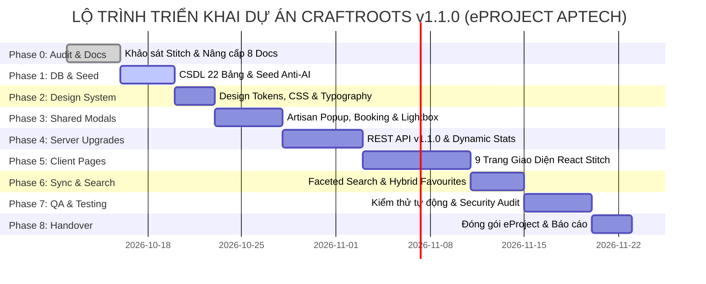

# CraftRoots – Bảng Phân Rã Công Việc & Kế Hoạch Triển Khai (Task Breakdown & WBS)

> **Dự án:** CraftRoots – Cổng Thông Tin Khám Phá Nghề Thủ Công Truyền Thống  
> **Chương trình:** eProject – Aptech Computer Education  
> **Phiên bản tài liệu:** v1.1.0  
> **Ngày cập nhật:** 2026-10-15  
> **Phương pháp quản lý:** Agile / Scrum kết hợp WBS 9 Giai đoạn (Phases 0 – 8)  
> **Tài liệu liên quan:** [README.md](file:///e:/eproject1/docs/README.md) | [DESIGN.md](file:///e:/eproject1/docs/DESIGN.md) | [DECISIONS.md](file:///e:/eproject1/docs/DECISIONS.md) | [feature-spec.md](file:///e:/eproject1/docs/feature-spec.md) | [architecture.md](file:///e:/eproject1/docs/architecture.md) | [database-schema.md](file:///e:/eproject1/docs/database-schema.md) | [data.md](file:///e:/eproject1/docs/data.md) | [api-contract.yaml](file:///e:/eproject1/docs/api-contract.yaml) | [test-plan.md](file:///e:/eproject1/docs/test-plan.md)

---

## Mục lục
1. [Cơ cấu nhân sự & Phân vai dự án](#1-cơ-cấu-nhân-sự--phân-vai-dự-án)
2. [Quy ước thang điểm ước lượng (Story Points & Time Estimation)](#2-quy-ước-thang-điểm-ước-lượng-story-points--time-estimation)
3. [Lộ trình các Sprint & Mốc bàn giao (Milestones)](#3-lộ-trình-các-sprint--mốc-bàn-giao-milestones)
4. [Bảng phân rã chi tiết công việc theo các giai đoạn (Detailed WBS Phases 0 – 8)](#4-bảng-phân-rã-chi-tiết-công-việc-theo-các-giai-đoạn-detailed-wbs-phases-0--8)
   - [Phase 0: Khảo sát thiết kế Stitch & Nâng cấp tài liệu kỹ thuật (Audit & Docs)](#phase-0-khảo-sát-thiết-kế-stitch--nâng-cấp-tài-liệu-kỹ-thuật-audit--docs)
   - [Phase 1: Nâng cấp Cơ sở dữ liệu 22 Bảng & Dữ liệu hạt giống chuẩn di sản (DB & Seed)](#phase-1-nâng-cấp-cơ-sở-dữ-liệu-22-bảng--dữ-liệu-hạt-giống-chuẩn-di-sản-db--seed)
   - [Phase 2: Xây dựng Design System & Nền tảng Styling (Design Tokens & CSS)](#phase-2-xây-dựng-design-system--nền-tảng-styling-design-tokens--css)
   - [Phase 3: Phát triển Components dùng chung & Hệ thống Modals (Shared UI & Modals)](#phase-3-phát-triển-components-dùng-chung--hệ-thống-modals-shared-ui--modals)
   - [Phase 4: Nâng cấp Server RESTful API v1.1.0 & Bảo mật (Server API Upgrades)](#phase-4-nâng-cấp-server-restful-api-v110--bảo-mật-server-api-upgrades)
   - [Phase 5: Xây dựng 9 Trang giao diện React SPA theo thiết kế Stitch (Client Pages)](#phase-5-xây-dựng-9-trang-giao-diện-react-spa-theo-thiết-kế-stitch-client-pages)
   - [Phase 6: Tích hợp Đồng bộ Yêu thích Lưỡng thể & Tìm kiếm Đa diện (Sync & Search)](#phase-6-tích-hợp-đồng-bộ-yêu-thích-lưỡng-thể--tìm-kiếm-đa-diện-sync--search)
   - [Phase 7: Kiểm thử toàn diện, Đánh giá Bảo mật & Tối ưu Hiệu năng (QA & Testing)](#phase-7-kiểm-thử-toàn-diện-đánh-giá-bảo-mật--tối-ưu-hiệu-năng-qa--testing)
   - [Phase 8: Đóng gói dự án eProject, Hướng dẫn triển khai & Nghiệm thu (Delivery)](#phase-8-đóng-gói-dự-án-eproject-hướng-dẫn-triển-khai--nghiệm-thu-delivery)
5. [Đường găng dự án & Quản lý rủi ro (Critical Path & Risk Management)](#5-đường-găng-dự-án--quản-lý-rủi-ro-critical-path--risk-management)

---

## 1. Cơ cấu nhân sự & Phân vai dự án

| Ký hiệu | Vai trò trong nhóm | Trách nhiệm chính trong phiên bản v1.1.0 |
|---|---|---|
| **TECH-LEAD** | Fullstack Lead & Solution Architect | Quản trị kiến trúc, thiết kế schema CSDL 22 bảng, review mã nguồn, phân giải xung đột kỹ thuật, giám sát tiêu chuẩn Anti-AI. |
| **BACKEND-DEV** | Backend Engineer | Mở rộng REST API Express (`/home`, `/stats`, `/search`, `/visit-bookings`, `/newsletter`...), tối ưu `pg.Pool`, bảo mật Helmet, CORS và Rate Limiting. |
| **FRONTEND-DEV** | Frontend Engineer | Tái cấu trúc Client React 18 SPA bám sát 9 mẫu thiết kế Stitch, xây dựng hệ thống Modal (Artisan Detail Popup, Visit Booking, Lightbox), quản lý Context. |
| **DESIGN-AI** | UI/UX & Heritage Content Designer | Chuẩn hóa Design System tokens trong `DESIGN.md`, trích xuất tài nguyên hình ảnh từ Stitch, thẩm định tính xác thực của thuật ngữ di sản thủ công truyền thống. |
| **QA-TESTER** | QA / Test Engineer | Mở rộng Master Test Plan cho 22 bảng và các luồng mới, thực hiện kiểm thử tự động API, kiểm thử UI/UX, audit an ninh mạng và hiệu năng Core Web Vitals. |

---

## 2. Quy ước thang điểm ước lượng (Story Points & Time Estimation)

- Thang điểm Fibonacci: `1, 2, 3, 5, 8` Story Points (SP).
- Quy đổi chuẩn: `1 SP ≈ 3 - 4 giờ làm việc tập trung`.
- Tổng quy mô dự án mở rộng: **68 Story Points** (~ 240 giờ kỹ thuật).

---

## 3. Lộ trình các Sprint & Mốc bàn giao (Milestones)



---

## 4. Bảng phân rã chi tiết công việc theo các giai đoạn (Detailed WBS Phases 0 – 8)

### Phase 0: Khảo sát thiết kế Stitch & Nâng cấp tài liệu kỹ thuật (Audit & Docs)
*Mục tiêu:* Đối soát toàn diện 9 bản thiết kế HTML Stitch, phân giải triệt để các xung đột kỹ thuật, đồng bộ hóa 100% tài liệu trong thư mục `docs/`.

| Task ID | Giai đoạn | Tiêu đề & Nội dung công việc | Người thực hiện | Ước lượng | Phụ thuộc | Tiêu chí nghiệm thu (Acceptance Criteria) |
|---|---|---|---|---|---|---|
| **TSK-P0-01** | Phase 0 | Khảo sát 9 file `code.html` của Stitch, lập ma trận Gap Analysis ghi nhận vào [DECISIONS.md](file:///e:/eproject1/docs/DECISIONS.md). | TECH-LEAD | 3 SP (10h) | Không | Tài liệu DECISIONS.md ghi rõ phân tích 9 trang, giải pháp cho 9 xung đột kỹ thuật (Nguyễn Văn Bình đời thứ 5, kiệt tác `CR-BT-2025-08MR`, lead time 24h vs 48h, 6 vùng di sản). |
| **TSK-P0-02** | Phase 0 | Mở rộng [DESIGN.md](file:///e:/eproject1/docs/DESIGN.md) với Design Tokens hoàn chỉnh và đặc tả **Artisan Detail Popup Modal**. | DESIGN-AI | 3 SP (11h) | TSK-P0-01 | DESIGN.md chứa token màu, font, bóng đổ, z-index, cùng đặc tả 6 view của popup và mô hình dữ liệu JSON cho Nguyễn Văn Bình `ART-BT-001`. |
| **TSK-P0-03** | Phase 0 | Nâng cấp [database-schema.md](file:///e:/eproject1/docs/database-schema.md) & [data.md](file:///e:/eproject1/docs/data.md) lên chuẩn v1.1.0 (22 bảng). | TECH-LEAD | 3 SP (10h) | TSK-P0-01 | ERD Mermaid 22 bảng; từ điển dữ liệu chi tiết cho 5 bảng mới (`craft_villages`, `artisan_milestones`, `visit_bookings`, `newsletter_subscribers`, `field_notes`) và các cột mở rộng. |
| **TSK-P0-04** | Phase 0 | Nâng cấp [api-contract.yaml](file:///e:/eproject1/docs/api-contract.yaml) lên OpenAPI 3.0.3 v1.1.0 đầy đủ schemas và endpoints mới. | BACKEND-DEV | 3 SP (11h) | TSK-P0-03 | Bổ sung tags: Home, Stats, Search, Bookings, Newsletter; mở rộng query params và schemas cho toàn bộ endpoints mới. |
| **TSK-P0-05** | Phase 0 | Cập nhật [architecture.md](file:///e:/eproject1/docs/architecture.md), [feature-spec.md](file:///e:/eproject1/docs/feature-spec.md), [task-breakdown.md](file:///e:/eproject1/docs/task-breakdown.md) và [test-plan.md](file:///e:/eproject1/docs/test-plan.md). | TECH-LEAD & QA | 4 SP (14h) | TSK-P0-04 | 100% bộ tài liệu `docs/` đồng bộ phiên bản v1.1.0, không có mâu thuẫn hay sai lệch tên biến, bảng, endpoint. |

---

### Phase 1: Nâng cấp Cơ sở dữ liệu 22 Bảng & Dữ liệu hạt giống chuẩn di sản (DB & Seed)
*Mục tiêu:* Triển khai migration mở rộng schema PostgreSQL lên 22 bảng, nạp tập dữ liệu hạt giống chuẩn văn hóa di sản (Anti-AI).

| Task ID | Giai đoạn | Tiêu đề & Nội dung công việc | Người thực hiện | Ước lượng | Phụ thuộc | Tiêu chí nghiệm thu (Acceptance Criteria) |
|---|---|---|---|---|---|---|
| **TSK-P1-01** | Phase 1 | Viết file migration `db/migrations/001_expand_schema.sql` và cập nhật `db/schema.sql` (22 bảng, FKs, indexes). | TECH-LEAD | 2 SP (7h) | TSK-P0-03 | Chạy migration thành công trên PostgreSQL 14+, bảo toàn dữ liệu cũ của 17 bảng và tạo mới 5 bảng mở rộng. |
| **TSK-P1-02** | Phase 1 | Nâng cấp `db/seed.sql` với dữ liệu chuẩn di sản (6 vùng văn hóa, 6 làng nghề di sản, 6 nghệ nhân tiêu biểu, kiệt tác `CR-BT-2025-08MR`, BST Hạ 2026). | BACKEND-DEV | 3 SP (12h) | TSK-P1-01 | Dữ liệu đúng thuật ngữ làng nghề truyền thống, không bịa đặt niên đại; nghệ nhân Nguyễn Văn Bình đời thứ 5 thâm niên 42 năm; nạp thành công qua `npm run db:seed`. |

---

### Phase 2: Xây dựng Design System & Nền tảng Styling (Design Tokens & CSS)
*Mục tiêu:* Thiết lập toàn bộ hệ thống biến CSS (Vanilla CSS), typography Google Fonts (Cinzel / Playfair Display kết hợp Inter), bảng màu di sản và hiệu ứng chuyển động mượt mà.

| Task ID | Giai đoạn | Tiêu đề & Nội dung công việc | Người thực hiện | Ước lượng | Phụ thuộc | Tiêu chí nghiệm thu (Acceptance Criteria) |
|---|---|---|---|---|---|---|
| **TSK-P2-01** | Phase 2 | Xây dựng file `client/src/styles/variables.css` chứa đầy đủ tokens (colors, typography, spacing, shadows, z-indexes, modal overlay). | FRONTEND-DEV | 2 SP (8h) | TSK-P0-02 | Các biến CSS khớp chuẩn [DESIGN.md](file:///e:/eproject1/docs/DESIGN.md), hỗ trợ tông màu hoàng gia, đất nung terracotta, men lam cobalt và xanh lục ngọc. |
| **TSK-P2-02** | Phase 2 | Thiết lập `client/src/styles/global.css` với CSS Reset hiện đại, hiệu ứng cuộn mượt (smooth scrolling), typography hierarchy và utilities. | FRONTEND-DEV | 2 SP (6h) | TSK-P2-01 | Toàn bộ giao diện có nền tảng đồng nhất; phông chữ hiển thị sắc nét tiếng Việt có dấu; hiệu ứng focus-visible chuẩn WCAG 2.1 AA. |

---

### Phase 3: Phát triển Components dùng chung & Hệ thống Modals (Shared UI & Modals)
*Mục tiêu:* Xây dựng các linh kiện giao diện nền tảng tái sử dụng và bộ 4 modal tương tác (Artisan Detail Popup, Visit Booking, Lightbox, Search).

| Task ID | Giai đoạn | Tiêu đề & Nội dung công việc | Người thực hiện | Ước lượng | Phụ thuộc | Tiêu chí nghiệm thu (Acceptance Criteria) |
|---|---|---|---|---|---|---|
| **TSK-P3-01** | Phase 3 | Xây dựng `Navbar` (Sticky header, Search button, Favs badge counter, Mobile drawer) và `Footer` (Heritage branding, Aptech eProject credits). | FRONTEND-DEV | 3 SP (11h) | TSK-P2-02 | Navbar bám sát thiết kế Stitch; menu di động trượt mượt mà; badge đếm yêu thích cập nhật thời gian thực. |
| **TSK-P3-02** | Phase 3 | Xây dựng component đặc tả **Artisan Detail Popup Modal** (`ArtisanDetailPopup.jsx`). | FRONTEND-DEV | 4 SP (14h) | TSK-P0-02, TSK-P2-02 | Hỗ trợ 6 view, 5 tabs thông tin, bẫy tiêu điểm (focus trap), đóng bằng phím ESC / click backdrop, nút chuyển nghệ nhân Next/Prev. |
| **TSK-P3-03** | Phase 3 | Xây dựng `VisitBookingModal.jsx` tích hợp form đăng ký lịch hẹn thăm xưởng với validation lead time (24h/48h) và open days. | FRONTEND-DEV | 3 SP (10h) | TSK-P3-02 | Form validate ngày hẹn hợp lệ; chặn chọn ngày quá khứ hoặc chưa đủ lead time; hiển thị thông báo kết quả qua Toast. |
| **TSK-P3-04** | Phase 3 | Xây dựng `LightboxModal.jsx` (phóng to ảnh kiệt tác, chuyển ảnh mũi tên, caption, WCAG alt) và `SearchModal.jsx` (tìm kiếm nhanh toàn trang). | FRONTEND-DEV | 3 SP (10h) | TSK-P2-02 | Lightbox chuyển ảnh mượt mà bằng bàn phím; Search Modal tích hợp debounce tìm kiếm đa năng. |

---

### Phase 4: Nâng cấp Server RESTful API v1.1.0 & Bảo mật (Server API Upgrades)
*Mục tiêu:* Mở rộng các router và controller backend để phục vụ đầy đủ dữ liệu động cho 9 trang Stitch và hệ thống modals mới.

| Task ID | Giai đoạn | Tiêu đề & Nội dung công việc | Người thực hiện | Ước lượng | Phụ thuộc | Tiêu chí nghiệm thu (Acceptance Criteria) |
|---|---|---|---|---|---|---|
| **TSK-P4-01** | Phase 4 | Xây dựng controller và router `GET /api/home` & `GET /api/stats` tổng hợp dữ liệu động từ PostgreSQL (không mock). | BACKEND-DEV | 3 SP (10h) | TSK-P1-02 | Endpoint trả về đầy đủ hero spotlight kiệt tác `CR-BT-2025-08MR`, số lượng thực tế tác phẩm, nghệ nhân, làng nghề, và field notes. |
| **TSK-P4-02** | Phase 4 | Nâng cấp `GET /api/crafts` bổ sung query params `village`, `ids`, `sort=price_asc|price_desc` và trả về `facets` động. | BACKEND-DEV | 3 SP (11h) | TSK-P1-02 | Hỗ trợ lọc theo nhiều làng nghề, nhiều ID cùng lúc cho Favourites; trả về facets danh mục/chất liệu/khoảng giá; truy vấn < 100ms. |
| **TSK-P4-03** | Phase 4 | Nâng cấp `GET /api/crafts/:id` trả về `specs`, `dimensions`, `processStages` 4 bước và API `GET /api/crafts/:id/related`. | BACKEND-DEV | 3 SP (10h) | TSK-P1-02 | Trả về chuẩn cấu trúc 4 cột thông tin kiệt tác; endpoint related gợi ý chính xác theo artisan / region / category. |
| **TSK-P4-04** | Phase 4 | Nâng cấp `GET /api/artisans` và `GET /api/artisans/:idOrCode` (tìm theo ID số hoặc mã REF `ART-BT-001`, trả về milestones & specs). | BACKEND-DEV | 3 SP (10h) | TSK-P1-02 | Tìm kiếm linh hoạt theo cả ID số và mã REF; trả về niên biểu sự nghiệp và thông số kỹ thuật chế tác từ bảng quan hệ. |
| **TSK-P4-05** | Phase 4 | Xây dựng phân hệ Đặt lịch thăm xưởng: `POST /api/visit-bookings` (validate lead time, open days, max guests) và `GET /api/visit-bookings`. | BACKEND-DEV | 3 SP (10h) | TSK-P1-02 | Kiểm tra nghiêm ngặt BR-13; sinh mã booking code chuẩn `VB-YYYYMMDD-XXXX`; lưu trữ an toàn trong DB. |
| **TSK-P4-06** | Phase 4 | Xây dựng API Đăng ký bản tin di sản `POST /api/newsletter` và Tìm kiếm đa diện tập trung `GET /api/search?q=...`. | BACKEND-DEV | 2 SP (8h) | TSK-P1-02 | Newsletter validate email RFC 5322 và xử lý idempotent; search API tìm kiếm đồng thời trên crafts, artisans, villages. |
| **TSK-P4-07** | Phase 4 | Nâng cấp Favourites API: `GET /api/favourites/summary` và `DELETE /api/favourites` hỗ trợ xóa hàng loạt (bulk delete). | BACKEND-DEV | 2 SP (7h) | TSK-P1-02 | Xóa danh sách nhiều ID hoặc toàn bộ yêu thích; thống kê tổng số tác phẩm yêu thích theo từng danh mục. |
| **TSK-P4-08** | Phase 4 | Nâng cấp Auth API: `PUT /api/auth/profile` cập nhật thông tin cá nhân và tăng cường bảo mật CORS / JWT_SECRET trong `env.js`. | BACKEND-DEV | 2 SP (7h) | TSK-P1-02 | Cập nhật họ tên, ảnh đại diện, số điện thoại; chặn khởi động nếu JWT_SECRET yếu ở chế độ production. |

---

### Phase 5: Xây dựng 9 Trang giao diện React SPA theo thiết kế Stitch (Client Pages)
*Mục tiêu:* Hiện thực hóa toàn bộ 9 trang giao diện React 18 SPA bám sát từng dòng mã HTML và cấu trúc thị giác trong các file `code.html` của Stitch.

| Task ID | Giai đoạn | Tiêu đề & Nội dung công việc | Người thực hiện | Ước lượng | Phụ thuộc | Tiêu chí nghiệm thu (Acceptance Criteria) |
|---|---|---|---|---|---|---|
| **TSK-P5-01** | Phase 5 | Xây dựng `HomePage.jsx` theo Stitch `home/code.html` (Hero kiệt tác `CR-BT-2025-08MR`, Dynamic Stats, Featured Grid, Seasonal Snippet, Field Note). | FRONTEND-DEV | 4 SP (15h) | TSK-P3-01, TSK-P4-01 | Giao diện ấn tượng, nạp dữ liệu động từ API, hình ảnh sắc nét, tương tác mượt mà trên cả di động và desktop. |
| **TSK-P5-02** | Phase 5 | Xây dựng `DirectoryPage.jsx` theo Stitch `directory/code.html` (Thanh lọc đa diện Facets, sắp xếp giá/mới nhất, phân trang, thẻ CraftCard chuẩn). | FRONTEND-DEV | 4 SP (14h) | TSK-P4-02, TSK-P2-02 | Lưới sản phẩm responsive, lọc đa tiêu chí không giật lag, hiển thị đúng tag/originLine/priceVnd. |
| **TSK-P5-03** | Phase 5 | Xây dựng `CraftDetailPage.jsx` theo Stitch `craft-detail/code.html` (Bố cục 4 cột: Tác phẩm, Nghệ nhân N-N, Kích thước/Thông số, Quy trình 4 bước). | FRONTEND-DEV | 5 SP (18h) | TSK-P4-03, TSK-P3-04 | Tái hiện xuất sắc layout 4 cột của kiệt tác; click vào nghệ nhân mở Artisan Popup; click ảnh mở Lightbox. |
| **TSK-P5-04** | Phase 5 | Xây dựng `ArtisansPage.jsx` theo Stitch `artisans/code.html` (Lưới 3 cột x 2 hàng, 6 thẻ nghệ nhân với ảnh grayscale hover color, click mở popup). | FRONTEND-DEV | 4 SP (14h) | TSK-P4-04, TSK-P3-02 | Bấm vào bất kỳ vị trí nào trên thẻ nghệ nhân đều mở Artisan Detail Popup Modal tương ứng. |
| **TSK-P5-05** | Phase 5 | Xây dựng `ArtisanDetailPage.jsx` theo Stitch `artisan-detail/code.html` (Hồ sơ toàn diện, Niên biểu cống hiến, Bảng thông số kỹ thuật, Widget đặt lịch). | FRONTEND-DEV | 4 SP (15h) | TSK-P4-04, TSK-P3-03 | Trang độc lập chuyên sâu, hiển thị timeline mốc son sự nghiệp và tích hợp form đặt lịch thăm xưởng. |
| **TSK-P5-06** | Phase 5 | Xây dựng `RegionsPage.jsx` theo Stitch `regions/code.html` (Bản đồ tương tác 6 vùng di sản SVG, Làng nghề đã xác thực, Ghi chú điền dã). | FRONTEND-DEV | 4 SP (14h) | TSK-P4-01, TSK-P2-02 | Click vào từng vùng trên bản đồ SVG đổi trạng thái sáng viền và lọc danh sách làng nghề/tác phẩm tương ứng. |
| **TSK-P5-07** | Phase 5 | Xây dựng `SeasonalPage.jsx` theo Stitch `seasonal/code.html` (Bộ sưu tập Mùa Hạ 2026 `CR-ARCH-SUMMER-26`, Lời bình Giám tuyển, Tác phẩm Hero). | FRONTEND-DEV | 3 SP (12h) | TSK-P4-01, TSK-P2-02 | Theme màu xanh hạ tươi mát, khối tác phẩm Hero nổi bật trung tâm, lưới tác phẩm tuyển chọn đồng điệu. |
| **TSK-P5-08** | Phase 5 | Xây dựng `FavouritesPage.jsx` theo Stitch `favourites/code.html` (Hỗ trợ khách vãng lai + đã đăng nhập, xóa hàng loạt, tóm tắt theo danh mục). | FRONTEND-DEV | 3 SP (11h) | TSK-P4-07, TSK-P2-02 | Hiển thị sản phẩm yêu thích kèm thống kê phân loại; nút xóa tất cả hoạt động tức thì. |
| **TSK-P5-09** | Phase 5 | Xây dựng `ContactPage.jsx` theo Stitch `contact/code.html` (Bộ chọn chủ đề topic, cam kết xác thực di sản 24h, form liên hệ chuẩn). | FRONTEND-DEV | 3 SP (10h) | TSK-P1-02, TSK-P2-02 | Form nhập liệu trực quan, validate email regex, gửi thành công hiển thị Toast notification xanh. |
| **TSK-P5-10** | Phase 5 | Hoàn thiện các trang phụ trợ: `AboutPage.jsx`, `LoginPage.jsx`, `RegisterPage.jsx`, `ProfilePage.jsx`, `NotFoundPage.jsx`. | FRONTEND-DEV | 3 SP (10h) | TSK-P4-08, TSK-P3-01 | Đồng bộ phong cách thiết kế di sản, cập nhật hồ sơ cá nhân mượt mà, định tuyến an toàn. |

---

### Phase 6: Tích hợp Đồng bộ Yêu thích Lưỡng thể & Tìm kiếm Đa diện (Sync & Search)
*Mục tiêu:* Hoàn thiện các cơ chế dữ liệu phức tạp phía máy khách: Hybrid Sync Favourites, Search Modal kết hợp Debounce, và liên kết tương tác giữa các trang.

| Task ID | Giai đoạn | Tiêu đề & Nội dung công việc | Người thực hiện | Ước lượng | Phụ thuộc | Tiêu chí nghiệm thu (Acceptance Criteria) |
|---|---|---|---|---|---|---|
| **TSK-P6-01** | Phase 6 | Hoàn thiện `FavouritesContext`: quản lý song song `localStorage` và PostgreSQL, kích hoạt API sync tự động sau khi login. | FRONTEND-DEV | 3 SP (10h) | TSK-P4-07, TSK-P5-08 | Khách chưa đăng nhập thả tim được ngay; sau khi đăng nhập dữ liệu tự đẩy lên CSDL không gây lỗi trùng lặp. |
| **TSK-P6-02** | Phase 6 | Tích hợp `SearchModal` toàn cục: phím tắt `Ctrl + K` hoặc nút kính lúp trên Navbar, debounce 350ms, kết quả phân nhóm. | FRONTEND-DEV | 3 SP (10h) | TSK-P4-06, TSK-P3-04 | Tìm kiếm tức thì theo thời gian thực; phân chia rõ kết quả: Tác phẩm, Nghệ nhân, Làng nghề di sản. |

---

### Phase 7: Kiểm thử toàn diện, Đánh giá Bảo mật & Tối ưu Hiệu năng (QA & Testing)
*Mục tiêu:* Thực hiện toàn bộ 40+ ca kiểm thử trong Master Test Plan, thẩm định bảo mật và tối ưu Core Web Vitals.

| Task ID | Giai đoạn | Tiêu đề & Nội dung công việc | Người thực hiện | Ước lượng | Phụ thuộc | Tiêu chí nghiệm thu (Acceptance Criteria) |
|---|---|---|---|---|---|---|
| **TSK-P7-01** | Phase 7 | Chạy bộ kiểm thử tự động API (Postman / Supertest) cho toàn bộ 20+ endpoints RESTful v1.1.0. | QA-TESTER | 4 SP (14h) | Phase 4 | Đạt 100% Pass rate cho cả mã 200/201 và các tình huống ngoại lệ 400, 401, 404, 409, 429. |
| **TSK-P7-02** | Phase 7 | Kiểm thử tương tác UI/UX: Artisan Detail Popup Modal (6 view, phím ESC, focus trap), Visit Booking, Bản đồ SVG 6 vùng. | QA-TESTER | 3 SP (11h) | Phase 5 | Mọi tương tác chuyển động êm ái, không vỡ khung hình, không xung đột sự kiện cuộn trang. |
| **TSK-P7-03** | Phase 7 | Rà soát an ninh mạng: Thử nghiệm payload SQL Injection, XSS, Brute-Force Rate Limiting (5 lần/15 phút). | QA-TESTER | 3 SP (10h) | TSK-P7-01 | Hệ thống an toàn tuyệt đối, không làm lộ stack trace hay thông tin nhạy cảm. |
| **TSK-P7-04** | Phase 7 | Đo lường hiệu năng bằng Google Lighthouse và kiểm định chuẩn tiếp cận WCAG 2.1 AA. | TECH-LEAD | 3 SP (10h) | TSK-P7-02 | Điểm số Lighthouse: Performance > 85, Accessibility > 90, Best Practices > 90, SEO = 100. |

---

### Phase 8: Đóng gói dự án eProject, Hướng dẫn triển khai & Nghiệm thu (Delivery)
*Mục tiêu:* Đóng gói mã nguồn sạch, cập nhật tài liệu nghiệm thu và hoàn thiện hồ sơ báo cáo theo quy chuẩn Aptech Computer Education.

| Task ID | Giai đoạn | Tiêu đề & Nội dung công việc | Người thực hiện | Ước lượng | Phụ thuộc | Tiêu chí nghiệm thu (Acceptance Criteria) |
|---|---|---|---|---|---|---|
| **TSK-P8-01** | Phase 8 | Cập nhật root `README.md` và `docs/README.md` phản ánh đầy đủ hướng dẫn cài đặt, cấu hình `.env`, lệnh khởi tạo DB 22 bảng. | TECH-LEAD | 2 SP (7h) | Phase 7 | Hướng dẫn rõ ràng từng bước, người mới có thể khởi chạy dự án trong dưới 5 phút. |
| **TSK-P8-02** | Phase 8 | Rà soát tính toàn vẹn của mã nguồn, chạy linter dọn dẹp mã thừa, kiểm tra `.gitignore`. | TECH-LEAD | 2 SP (6h) | TSK-P8-01 | Không có file rác, file `.env` không bị lộ vào Git, mã nguồn tuân thủ clean code. |
| **TSK-P8-03** | Phase 8 | Xuất bản báo cáo eProject Aptech hoàn chỉnh: Sơ đồ kiến trúc, Lược đồ CSDL, Danh mục kiểm thử và Video demo vận hành. | TOÀN ĐỘI | 3 SP (11h) | TSK-P8-02 | Hồ sơ nghiệm thu chỉn chu, đáp ứng 100% tiêu chí chấm điểm xuất sắc của Hội đồng Aptech. |

---

## 5. Đường găng dự án & Quản lý rủi ro (Critical Path & Risk Management)

### 5.1. Chuỗi công việc trên đường găng (Critical Path v1.1.0)
```
TSK-P0-01 (Audit Stitch) ➔ TSK-P0-03 (Schema Docs 22 Bảng) ➔ TSK-P1-01 (DDL & Migrations) ➔ TSK-P1-02 (Anti-AI Seed) ➔ TSK-P4-01/02/03 (Server APIs v1.1.0) ➔ TSK-P3-02 (Artisan Popup Modal) ➔ TSK-P5-01/03/04 (9 Stitch Client Pages) ➔ TSK-P6-01 (Hybrid Sync) ➔ TSK-P7-01/03 (QA & Security) ➔ TSK-P8-03 (Bàn giao eProject).
```

### 5.2. Ma trận rủi ro & Kế hoạch giảm thiểu (Risk Matrix)

| Rủi ro kỹ thuật | Mức độ | Hậu quả tiềm tàng | Biện pháp giảm thiểu & Kiểm soát |
|---|---|---|---|
| **Lệch cấu trúc dữ liệu giữa thiết kế Stitch và CSDL cũ** | Cao | Giao diện thiếu trường thông tin (giá VND, tag, 4 bước chế tác, specs, milestones). | Đã giải quyết triệt để tại Phase 0 & Phase 1 qua tài liệu [DECISIONS.md](file:///e:/eproject1/docs/DECISIONS.md) và migration 22 bảng v1.1.0. |
| **Nội dung do AI tạo ra làm sai lệch tri thức làng nghề truyền thống** | Cao | Bị trừ điểm học thuật eProject; sai niên đại, sai kỹ pháp men gốm, xúc phạm di sản. | Áp dụng triệt để quy tắc **BR-15 (Anti-AI Content)**: đối soát với tài liệu Bảo tàng Lịch sử Quốc gia; mọi chi tiết chưa kiểm chứng gắn nhãn `[CẦN XÁC MINH: nguồn đối soát]`. |
| **Xung đột cuộn trang & Bẫy tiêu điểm khi mở Artisan Detail Popup Modal** | Trung bình | Người dùng bị kẹt cuộn nền hoặc không thể đóng modal bằng phím ESC trên di động. | Áp dụng kỹ thuật bẫy tiêu điểm (focus trap), khóa scroll `document.body.style.overflow = 'hidden'`, bắt sự kiện phím `Escape` toàn cục. |
| **Lỗi tràn bộ nhớ do lưu quá nhiều Yêu thích trong Local Storage** | Thấp | Trình duyệt máy khách báo lỗi QuotaExceeded. | Giới hạn tối đa 50 ID sản phẩm trong `localStorage`; tự động làm sạch ngay khi đồng bộ lên PostgreSQL sau đăng nhập. |
| **Tấn công từ chối dịch vụ vào API Đặt lịch thăm xưởng và Bản tin** | Trung bình | Cơ sở dữ liệu bị spam hàng ngàn bản ghi rác. | Áp dụng `express-rate-limit` tối đa 5 request / 15 phút trên từng IP; validate nghiêm ngặt email RFC 5322 và quy tắc BR-13. |
