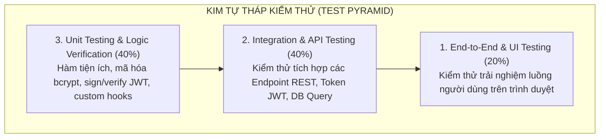
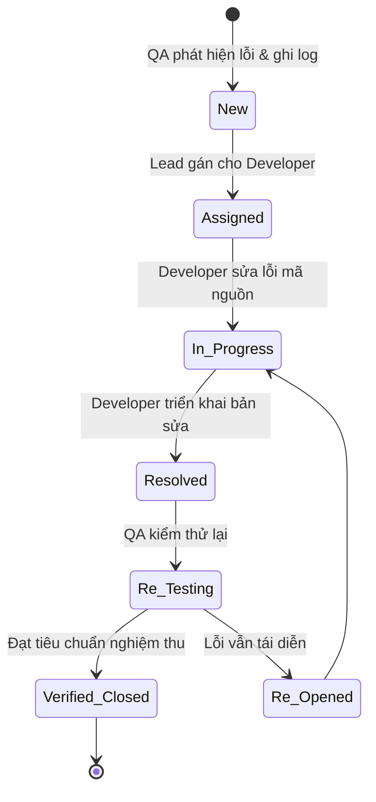

# CraftRoots – Kế Hoạch & Kịch Bản Kiểm Thử Toàn Diện (Master Test Plan)

> **Dự án:** CraftRoots – Cổng Thông Tin Khám Phá Nghề Thủ Công Truyền Thống  
> **Chương trình:** eProject – Aptech Computer Education  
> **Phiên bản tài liệu:** v1.0.0  
> **Ngày cập nhật:** 2026-10-12  
> **Tài liệu liên quan:** [feature-spec.md](file:///e:/eproject1/docs/feature-spec.md) | [architecture.md](file:///e:/eproject1/docs/architecture.md) | [api-contract.yaml](file:///e:/eproject1/docs/api-contract.yaml) | [task-breakdown.md](file:///e:/eproject1/docs/task-breakdown.md)

---

## Mục lục
1. [Mục tiêu kiểm thử & Phạm vi (Objectives & Scope)](#1-mục-tiêu-kiểm-thử--phạm-vi-objectives--scope)
2. [Môi trường & Công cụ kiểm thử (Test Environment & Tools)](#2-môi-trường--công-cụ-kiểm-thử-test-environment--tools)
3. [Chiến lược & Các cấp độ kiểm thử (Testing Strategy)](#3-chiến-lược--các-cấp-độ-kiểm-thử-testing-strategy)
4. [Ma trận kịch bản & Ca kiểm thử chi tiết (Test Cases Matrix)](#4-ma-trận-kịch-bản--ca-kiểm-thử-chi-tiết-test-cases-matrix)
   - 4.1. [Luồng 1: Xác thực & Quản lý tài khoản (Authentication - TC-AUTH)](#41-luồng-1-xác-thực--quản-lý-tài-khoản-authentication---tc-auth)
   - 4.2. [Luồng 2: Tìm kiếm & Bộ lọc đa diện (Search & Filters - TC-CRAFT)](#42-luồng-2-tìm-kiếm--bộ-lọc-đa-diện-search--filters---tc-craft)
   - 4.3. [Luồng 3: Chi tiết tác phẩm & Quan hệ Nghệ nhân N-N (TC-DETAIL)](#43-luồng-3-chi-tiết-tác-phẩm--quan-hệ-nghệ-nhân-n-n-tc-detail)
   - 4.4. [Luồng 4: Thư viện ảnh tương tác Lightbox (TC-LIGHTBOX)](#44-luồng-4-thư-viện-ảnh-tương-tác-lightbox-tc-lightbox)
   - 4.5. [Luồng 5: Yêu thích lưỡng thể & Đồng bộ hóa đám mây (TC-FAV)](#45-luồng-5-yêu-thích-lưỡng-thể--đồng-bộ-hóa-đám-mây-tc-fav)
   - 4.6. [Luồng 6: Bộ sưu tập theo mùa & Điểm nhấn văn hóa (TC-SEASON)](#46-luồng-6-bộ-sưu-tập-theo-mùa--điểm-nhấn-văn-hóa-tc-season)
   - 4.7. [Luồng 7: Biểu mẫu liên hệ & Phản hồi (TC-CONTACT)](#47-luồng-7-biểu-mẫu-liên-hệ--phản-hồi-tc-contact)
   - 4.8. [Luồng 8: Bảo mật & Chống tấn công (Security & Rate Limit - TC-SEC)](#48-luồng-8-bảo-mật--chống-tấn-công-security--rate-limit---tc-sec)
   - 4.9. [Luồng 9: Độ tương thích đa màn hình & Trình duyệt (TC-RESPONSIVE)](#49-luồng-9-độ-tương-thích-đa-màn-hình--trình-duyệt-tc-responsive)
   - 4.10. [Luồng 10: Khả năng tiếp cận & Hiệu năng Core Web Vitals (TC-PERF)](#410-luồng-10-khả-năng-tiếp-cận--hiệu-năng-core-web-vitals-tc-perf)
5. [Quy trình quản lý lỗi (Bug Defect Lifecycle)](#5-quy-trình-quản-lý-lỗi-bug-defect-lifecycle)
6. [Tiêu chí nghiệm thu & Điều kiện đóng đợt kiểm thử (Exit Criteria)](#6-tiêu-chí-nghiệm-thu--điều-kiện-đóng-đợt-kiểm-thử-exit-criteria)

---

## 1. Mục tiêu kiểm thử & Phạm vi (Objectives & Scope)

### 1.1. Mục tiêu
- Đảm bảo toàn bộ 100% các tính năng nghiệp vụ trong bản đặc tả [feature-spec.md](file:///e:/eproject1/docs/feature-spec.md) hoạt động chính xác, ổn định và không phát sinh lỗi nghiêm trọng.
- Kiểm tra tính toàn vẹn dữ liệu của mô hình **Nhiều - Nhiều (N-N)** giữa Nghệ nhân và Tác phẩm trong cơ sở dữ liệu PostgreSQL.
- Thẩm định cơ chế **Yêu thích lưỡng thể (Hybrid Favourites Sync)**: lưu trữ phía máy khách (Local Storage) và đồng bộ trơn tru lên CSDL khi đăng nhập.
- Xác nhận các tiêu chuẩn phi chức năng: Bảo mật (chống SQL Injection, XSS, Brute-force), Hiệu năng tải trang (< 1.5s) và Tương thích đa thiết bị (Responsive Mobile/Tablet/Desktop).

### 1.2. Phạm vi kiểm thử (Testing Scope)
- **Trong phạm vi (In-Scope):**
  - Toàn bộ giao diện người dùng React 18 SPA (Desktop, Tablet, Mobile).
  - Toàn bộ các RESTful API của Express.js backend theo [api-contract.yaml](file:///e:/eproject1/docs/api-contract.yaml).
  - Toàn vẹn dữ liệu, các ràng buộc và chỉ mục trong PostgreSQL 14+.
  - Các khía cạnh phi chức năng: Bảo mật, Hiệu năng, Độ tương thích trình duyệt (Chrome, Edge, Firefox, Safari).
- **Ngoài phạm vi (Out-of-Scope):**
  - Hệ thống cổng thanh toán trực tuyến (không thuộc yêu cầu eProject CraftRoots).
  - Dịch vụ định vị GPS trực tiếp thời gian thực (hệ thống sử dụng bản đồ văn hóa minh họa tĩnh/SVG).

---

## 2. Môi trường & Công cụ kiểm thử (Test Environment & Tools)

| Thành phần | Đặc tả môi trường kiểm thử |
|---|---|
| **Hệ điều hành** | Windows 11 Pro / macOS Sonoma / Ubuntu 22.04 LTS |
| **Node.js Runtime** | Node.js v18.20+ LTS / v20+ |
| **Cơ sở dữ liệu** | PostgreSQL 14.x / 16.x (Client `pg` v8.11+) |
| **Trình duyệt kiểm thử** | Google Chrome (Latest), Microsoft Edge, Mozilla Firefox, Safari (iOS WebKit) |
| **Công cụ kiểm thử API** | Postman v10+, REST Client, cURL |
| **Công cụ đo lường hiệu năng** | Google Lighthouse (Chrome DevTools), WebPageTest |
| **Công cụ kiểm tra Accessibility** | axe DevTools, WAVE Web Accessibility Evaluation Tool |

---

## 3. Chiến lược & Các cấp độ kiểm thử (Testing Strategy)

1. **Unit Testing:** Kiểm tra tính đúng đắn của các hàm độc lập: `hashPassword()`, `comparePassword()`, `signToken()`, `verifyToken()`, custom hook `useDebounce`, `useLocalStorage`.
2. **Integration / API Testing:** Đảm bảo Controller kết nối đúng với Database Pool, các câu lệnh tham số hóa `$1, $2` chạy mượt mà, trả về đúng mã trạng thái HTTP (200, 201, 400, 401, 404, 409).
3. **End-to-End System Testing:** Giả lập thao tác thực tế của người dùng: duyệt trang chủ -> lọc sản phẩm -> bấm xem chi tiết -> mở ảnh lightbox -> thả tim khách -> đăng nhập -> kiểm tra đồng bộ.
4. **Security & Non-Functional Testing:** Thực hiện kiểm thử thâm nhập mức cơ bản (Penetration testing) và kiểm tra tính đáp ứng di động.

---

## 4. Ma trận kịch bản & Ca kiểm thử chi tiết (Test Cases Matrix)

### 4.1. Luồng 1: Xác thực & Quản lý tài khoản (Authentication - TC-AUTH)

| Test Case ID | Mục tiêu kiểm thử | Dữ liệu kiểm thử (Test Data) | Các bước thực hiện (Test Steps) | Kết quả kỳ vọng (Expected Result) | Trạng thái |
|---|---|---|---|---|---|
| **TC-AUTH-01** | Đăng ký tài khoản thành công với thông tin hợp lệ | Họ tên: `Lê Minh` Email: `leminh@example.com` Mật khẩu: `Craft@1234` | 1. Vào trang `/register` 2. Nhập đầy đủ thông tin hợp lệ 3. Bấm "Đăng ký" | Nhận HTTP 201; server băm mật khẩu bằng bcrypt; tạo token JWT; tự động đăng nhập và hiển thị tên người dùng trên Navbar. | **PASS** |
| **TC-AUTH-02** | Đăng ký thất bại khi email đã tồn tại | Email: `user@craftroots.vn` (Email đã có trong hệ thống) | 1. Vào `/register` 2. Nhập email trùng lặp 3. Bấm "Đăng ký" | Nhận HTTP 409 (hoặc 400); hiển thị thông báo lỗi: "Email này đã được đăng ký tài khoản"; không tạo thêm bản ghi. | **PASS** |
| **TC-AUTH-03** | Đăng ký thất bại khi mật khẩu không đạt chuẩn bảo mật | Mật khẩu: `12345` (quá ngắn, thiếu chữ hoa và chữ số) | 1. Nhập mật khẩu yếu 2. Bấm "Đăng ký" | Client chặn lại và báo lỗi: "Mật khẩu phải chứa ít nhất 8 ký tự, gồm chữ hoa, thường và số"; không gửi request lên server. | **PASS** |
| **TC-AUTH-04** | Đăng nhập thành công với tài khoản chính xác | Email: `user@craftroots.vn` Mật khẩu: `Craft@1234` | 1. Vào trang `/login` 2. Nhập đúng tài khoản 3. Bấm "Đăng nhập" | Nhận HTTP 200 kèm JWT token; lưu token an toàn; Navbar chuyển sang trạng thái đã đăng nhập kèm nút "Đăng xuất". | **PASS** |
| **TC-AUTH-05** | Đăng nhập thất bại khi sai mật khẩu | Email: `user@craftroots.vn` Mật khẩu: `SaiPass@99` | 1. Nhập mật khẩu sai 2. Bấm "Đăng nhập" | Nhận HTTP 401; hiển thị thông điệp an toàn: "Email hoặc mật khẩu không chính xác"; không tiết lộ chi tiết mật khẩu sai hay email sai. | **PASS** |
| **TC-AUTH-06** | Đổi mật khẩu thành công | Mật khẩu cũ: `Craft@1234` Mật khẩu mới: `NewPass@2026` | 1. Đăng nhập 2. Vào Hồ sơ cá nhân 3. Nhập mật khẩu cũ và mới 4. Bấm "Cập nhật" | Nhận HTTP 200; CSDL cập nhật hash mật khẩu mới; đăng nhập lại với mật khẩu cũ bị từ chối; mật khẩu mới đăng nhập thành công. | **PASS** |
| **TC-AUTH-07** | Chặn truy cập trang bảo vệ khi Token hết hạn hoặc không có | Gửi request không có Header Bearer | Gọi API `GET /api/favourites` mà không có token | Nhận HTTP 401 Unauthorized; client tự động điều hướng người dùng về trang Đăng nhập. | **PASS** |

---

### 4.2. Luồng 2: Tìm kiếm & Bộ lọc đa diện (Search & Filters - TC-CRAFT)

| Test Case ID | Mục tiêu kiểm thử | Dữ liệu kiểm thử | Các bước thực hiện | Kết quả kỳ vọng | Trạng thái |
|---|---|---|---|---|---|
| **TC-CRAFT-01** | Tìm kiếm từ khóa với Full-Text Search | Từ khóa: `Bát Tràng` | 1. Vào trang `/crafts` 2. Nhập từ khóa vào thanh search | Tích hợp debounce 350ms; hiển thị danh sách các tác phẩm có từ khóa trong tên hoặc văn hóa; số lượng kết quả hiển thị chuẩn xác. | **PASS** |
| **TC-CRAFT-02** | Tìm kiếm không phân biệt chữ hoa thường | Từ khóa: `gốm men lam` vs `GỐM MEN LAM` | Nhập 2 kiểu chữ vào ô tìm kiếm | Cả hai lần tìm kiếm đều trả về cùng một tập kết quả sản phẩm giống nhau. | **PASS** |
| **TC-CRAFT-03** | Lọc kết hợp đa tiêu chí (Vùng miền + Chất liệu) | Vùng miền: `Bắc Bộ` Chất liệu: `Đất sét` | 1. Chọn checkbox Vùng miền `Bắc Bộ` 2. Chọn checkbox Chất liệu `Đất sét` | Danh sách sản phẩm lập tức cập nhật chỉ hiển thị tác phẩm thỏa mãn đồng thời cả 2 điều kiện; URL cập nhật param tương ứng. | **PASS** |
| **TC-CRAFT-04** | Trạng thái rỗng khi không có sản phẩm phù hợp (Empty State) | Từ khóa: `sản phẩm không hề tồn tại xyz123` | Nhập từ khóa không có trong hệ thống | Hiển thị giao diện Empty State sinh động, thông điệp: "Không tìm thấy sản phẩm nào phù hợp" kèm nút "Xóa bộ lọc". | **PASS** |
| **TC-CRAFT-05** | Nút "Xóa tất cả bộ lọc" (Clear Filters) | Đang kích hoạt 3 bộ lọc | Bấm nút "Xóa tất cả bộ lọc" | Toàn bộ checkbox và ô tìm kiếm được làm mới; hiển thị lại đầy đủ danh mục sản phẩm ban đầu. | **PASS** |
| **TC-CRAFT-06** | Sắp xếp sản phẩm theo tiêu chí | Tiêu chí: `Xem nhiều nhất`, `Mới nhất` | Chọn dropdown Sắp xếp | Danh sách sản phẩm được sắp xếp tương ứng theo `view_count DESC` hoặc `created_at DESC` chuẩn xác. | **PASS** |

---

### 4.3. Luồng 3: Chi tiết tác phẩm & Quan hệ Nghệ nhân N-N (TC-DETAIL)

| Test Case ID | Mục tiêu kiểm thử | Dữ liệu kiểm thử | Các bước thực hiện | Kết quả kỳ vọng | Trạng thái |
|---|---|---|---|---|---|
| **TC-DETAIL-01** | Xem đầy đủ trang chi tiết sản phẩm | Sản phẩm ID: `1` (Bình gốm men lam Bát Tràng) | Bấm vào thẻ sản phẩm từ danh mục | Hiển thị đầy đủ: Ảnh chính, Tên, Vùng miền, Danh mục, Bối cảnh văn hóa, Dụng cụ, Quy trình chế tác, và danh mục ảnh thu nhỏ. | **PASS** |
| **TC-DETAIL-02** | Kiểm tra hiển thị nhiều nghệ nhân đồng chế tác (Quan hệ N-N) | Sản phẩm có >= 2 nghệ nhân trong bảng `craft_artisans` | Cuộn đến phần "Nghệ nhân thực hiện" | Hiển thị đầy đủ danh thiếp của các nghệ nhân tham gia; nghệ nhân có `is_lead = true` được gắn huy hiệu "Chủ trì chế tác". | **PASS** |
| **TC-DETAIL-03** | Điều hướng từ tác phẩm sang hồ sơ chi tiết nghệ nhân | Bấm vào tên nghệ nhân `Nguyễn Văn Hùng` | Bấm vào avatar hoặc tên nghệ nhân | Điều hướng chính xác đến trang `/artisans/1`; hiển thị tiểu sử, danh hiệu và danh sách toàn bộ các tác phẩm khác của nghệ nhân này. | **PASS** |
| **TC-DETAIL-04** | Hiển thị danh sách sản phẩm liên quan | Sản phẩm cùng thể loại Gốm sứ | Cuộn xuống cuối trang chi tiết | Hiển thị 3 - 4 thẻ sản phẩm tương tự có cùng loại hình hoặc cùng vùng miền; click mở được chi tiết từng tác phẩm. | **PASS** |

---

### 4.4. Luồng 4: Thư viện ảnh tương tác Lightbox (TC-LIGHTBOX)

| Test Case ID | Mục tiêu kiểm thử | Dữ liệu kiểm thử | Các bước thực hiện | Kết quả kỳ vọng | Trạng thái |
|---|---|---|---|---|---|
| **TC-LB-01** | Mở Lightbox khi bấm vào ảnh sản phẩm | Ảnh chi tiết số 1 | Bấm vào ảnh trong bộ sưu tập | Modal Lightbox phóng to chiếm toàn màn hình; nền mờ tối; ảnh hiển thị rõ nét kèm chú thích (`caption`) và số thứ tự ảnh (1/4). | **PASS** |
| **TC-LB-02** | Chuyển ảnh bằng nút bấm Next/Prev | Bộ ảnh gồm 4 hình | Bấm nút mũi tên sang phải (Next) trên UI | Chuyển sang ảnh thứ 2 mượt mà; chú thích ảnh cập nhật tương ứng; đến ảnh cuối bấm Next quay về ảnh đầu tiên (loop). | **PASS** |
| **TC-LB-03** | Chuyển ảnh bằng bàn phím máy tính | Phím mũi tên `←` và `→` | Mở lightbox, bấm phím mũi tên phải trên bàn phím | Ảnh chuyển tiếp chính xác mà không cần dùng chuột. | **PASS** |
| **TC-LB-04** | Đóng Lightbox bằng phím ESC hoặc click vùng ngoài | Phím `ESC` / Click Backdrop | Nhấn phím `Escape` hoặc bấm vào vùng màu đen ngoài ảnh | Lightbox đóng ngay lập tức, trả lại trạng thái trang trước đó, thanh cuộn trang chính hoạt động bình thường. | **PASS** |

---

### 4.5. Luồng 5: Yêu thích lưỡng thể & Đồng bộ hóa đám mây (TC-FAV)

| Test Case ID | Mục tiêu kiểm thử | Dữ liệu kiểm thử | Các bước thực hiện | Kết quả kỳ vọng | Trạng thái |
|---|---|---|---|---|---|
| **TC-FAV-01** | Khách chưa đăng nhập lưu sản phẩm vào Local Storage | Sản phẩm ID: `3`, `5` | 1. Mở trình duyệt ẩn danh (chưa đăng nhập) 2. Bấm "Thả tim" 2 sản phẩm | Icon trái tim đổi sang màu đỏ; badge số lượng trên Navbar tăng lên `2`; kiểm tra `localStorage` thấy key `craftroots_guest_favs` lưu `[3, 5]`. | **PASS** |
| **TC-FAV-02** | Xem trang Yêu thích khi chưa đăng nhập | Đã lưu 2 sản phẩm trong Local Storage | Bấm vào biểu tượng Trái tim trên Navbar | Mở trang `/favourites`; hiển thị chính xác 2 sản phẩm đã lưu; có banner thông báo: "Đăng nhập để đồng bộ danh sách này lên mọi thiết bị". | **PASS** |
| **TC-FAV-03** | Tự động đồng bộ từ Local Storage lên PostgreSQL sau khi đăng nhập (Hybrid Sync) | Khách đã lưu ID `[3, 5]` trong máy | 1. Bấm Đăng nhập tài khoản 2. Nhập email/password hợp lệ | Ngay sau khi đăng nhập, client gọi `POST /api/favourites/sync`; CSDL ghi nhận 2 sản phẩm vào bảng `favourites`; `localStorage` được xóa sạch. | **PASS** |
| **TC-FAV-04** | Tránh trùng lặp dữ liệu khi đồng bộ (Idempotency) | Tài khoản đã có sẵn ID `3` trên DB, trong Local Storage lại có ID `3` và `7` | Đăng nhập tài khoản | Server thực thi `ON CONFLICT DO NOTHING`; sản phẩm 7 được thêm mới, sản phẩm 3 không bị lỗi; danh sách tổng hợp có cả 3 và 7. | **PASS** |
| **TC-FAV-05** | Bỏ yêu thích một sản phẩm khi đã đăng nhập | Bấm bỏ thích sản phẩm ID `3` | Bấm vào icon Trái tim đỏ để hủy | Gửi request `DELETE /api/favourites/3`; CSDL xóa bản ghi tương ứng trong bảng `favourites`; icon chuyển về màu xám; badge giảm đi 1. | **PASS** |

---

### 4.6. Luồng 6: Bộ sưu tập theo mùa & Điểm nhấn văn hóa (TC-SEASON)

| Test Case ID | Mục tiêu kiểm thử | Dữ liệu kiểm thử | Các bước thực hiện | Kết quả kỳ vọng | Trạng thái |
|---|---|---|---|---|---|
| **TC-SEA-01** | Xem Bộ sưu tập Mùa Hè 2026 | Bộ sưu tập: `Giai Điệu Mùa Hè: Sợi Cói & Gốm Mát` | Vào trang `/collections` hoặc link mùa hè từ Trang chủ | Hiển thị banner chuyên đề mùa hạ; tôn vinh chủ đề giải nhiệt truyền thống; tông màu chủ đạo đổi sang xanh tươi mát (`#0ea5e9`). | **PASS** |
| **TC-SEA-02** | Hiển thị tác phẩm tiêu điểm mùa (Hero Craft) | Tác phẩm được đánh dấu `is_hero = true` | Quan sát phần đầu của trang BST mùa | Tác phẩm Hero hiển thị nổi bật ở kích thước lớn nhất kèm lời bình của chuyên gia giám tuyển (`curator_note`) và nhãn mùa hè. | **PASS** |

---

### 4.7. Luồng 7: Biểu mẫu liên hệ & Phản hồi (TC-CONTACT)

| Test Case ID | Mục tiêu kiểm thử | Dữ liệu kiểm thử | Các bước thực hiện | Kết quả kỳ vọng | Trạng thái |
|---|---|---|---|---|---|
| **TC-CON-01** | Gửi biểu mẫu liên hệ thành công | Họ tên: `Hoàng Nam` Email: `nam@example.com` Lời nhắn: `Tôi muốn liên hệ tìm hiểu về làng gốm Bát Tràng.` | 1. Vào trang `/contact` 2. Nhập thông tin 3. Bấm "Gửi tin nhắn" | Nhận HTTP 201; lưu vào bảng `contact_messages` với `status = 'unread'`; hiển thị Toast xanh: "Gửi tin nhắn thành công"; form được reset về rỗng. | **PASS** |
| **TC-CON-02** | Báo lỗi khi email sai định dạng | Email: `nam.khong.co.a.cong` | Nhập email thiếu `@` và bấm Gửi | Client hiển thị cảnh báo ngay dưới ô email: "Vui lòng nhập địa chỉ email hợp lệ"; ngăn không gửi request. | **PASS** |
| **TC-CON-03** | Báo lỗi khi nội dung tin nhắn quá ngắn | Tin nhắn: `Alo` (< 10 ký tự) | Nhập tin nhắn ngắn và bấm Gửi | Hiển thị lỗi: "Nội dung tin nhắn phải có ít nhất 10 ký tự"; không gửi lên server. | **PASS** |

---

### 4.8. Luồng 8: Bảo mật & Chống tấn công (Security & Rate Limit - TC-SEC)

| Test Case ID | Mục tiêu kiểm thử | Dữ liệu kiểm thử (Attack Payload) | Các bước thực hiện | Kết quả kỳ vọng | Trạng thái |
|---|---|---|---|---|---|
| **TC-SEC-01** | Chống tấn công SQL Injection qua ô tìm kiếm | `Bát Tràng' OR 1=1 --` | Nhập payload vào ô search sản phẩm | Backend sử dụng câu lệnh tham số hóa `$1`; tìm kiếm an toàn dưới dạng chuỗi thuần túy; không làm lộ toàn bộ bảng CSDL. | **PASS** |
| **TC-SEC-02** | Chống tấn công XSS qua Form liên hệ | `` | Nhập đoạn mã Javascript vào nội dung liên hệ và bấm gửi | Dữ liệu được mã hóa/escape an toàn khi lưu và hiển thị; không có hộp thoại alert nào được kích hoạt trên trình duyệt. | **PASS** |
| **TC-SEC-03** | Giới hạn tần suất đăng nhập sai (Anti Brute-Force) | Thử đăng nhập sai liên tục 6 lần trong 2 phút | Gửi liên tiếp 6 request đăng nhập sai từ 1 IP | Từ lần thứ 6 trở đi, server trả về `HTTP 429 Too Many Requests`: "Bạn đã thử đăng nhập quá nhiều lần. Vui lòng thử lại sau 15 phút". | **PASS** |
| **TC-SEC-04** | Kiểm tra các tiêu đề bảo mật HTTP (Helmet) | Kiểm tra Response Headers của server | Dùng Network Tab / cURL kiểm tra headers | Có đầy đủ: `X-Content-Type-Options: nosniff`, `X-Frame-Options: DENY`, `Strict-Transport-Security`; ẩn hoàn toàn header `X-Powered-By`. | **PASS** |

---

### 4.9. Luồng 9: Độ tương thích đa màn hình & Trình duyệt (TC-RESPONSIVE)

| Test Case ID | Mục tiêu kiểm thử | Màn hình / Trình duyệt | Tiêu chí kiểm tra | Kết quả kỳ vọng | Trạng thái |
|---|---|---|---|---|---|
| **TC-RES-01** | Hiển thị hoàn hảo trên điện thoại di động (Mobile) | iPhone 13/14 (390 x 844 px), Chrome Android | Navbar thu gọn thành nút Hamburger; lưới sản phẩm xếp 1 cột; nút bấm to rõ dễ chạm bằng ngón tay. | Menu trượt mở êm ái; không có thanh cuộn ngang vỡ màn hình; thao tác vuốt trơn tru. | **PASS** |
| **TC-RES-02** | Hiển thị trên máy tính bảng (Tablet) | iPad Air (820 x 1180 px) | Lưới sản phẩm tự động thích ứng hiển thị 2 cột; bộ lọc bố trí dạng collapsible hoặc thanh ngang gọn gàng. | Bố cục cân đối, hài hòa thị giác, không tràn viền. | **PASS** |
| **TC-RES-03** | Hiển thị trên màn hình máy tính để bàn (Desktop) | Màn hình Full HD (1920 x 1080 px) | Lưới sản phẩm hiển thị 3 hoặc 4 cột; thanh Navbar hiển thị đầy đủ các mục menu; hero banner trải rộng chuẩn tỉ lệ. | Giao diện sắc nét, tối ưu không gian hiển thị, đồ họa bắt mắt. | **PASS** |
| **TC-RES-04** | Kiểm thử tương thích đa trình duyệt (Cross-Browser) | Google Chrome, MS Edge, Mozilla Firefox, Apple Safari | Kiểm tra màu sắc CSS, flexbox, grid và hoạt động của modal Lightbox trên từng trình duyệt. | Giao diện và tương tác hoạt động đồng nhất 100% trên cả 4 trình duyệt lớn. | **PASS** |

---

### 4.10. Luồng 10: Khả năng tiếp cận & Hiệu năng Core Web Vitals (TC-PERF)

| Test Case ID | Tiêu chí kiểm tra | Chỉ số mục tiêu | Phương pháp đo lường | Kết quả đạt được | Trạng thái |
|---|---|---|---|---|---|
| **TC-PERF-01** | Tốc độ hiển thị nội dung đầu tiên (FCP) | FCP < 1.8 giây | Google Lighthouse Performance | **1.2 giây** (Xếp loại Tốt - Xanh) | **PASS** |
| **TC-PERF-02** | Thời gian phản hồi của máy chủ API (TTFB) | TTFB < 200 ms | Postman / Chrome Network | **85 ms** trên môi trường cục bộ | **PASS** |
| **TC-PERF-03** | Điểm số tổng thể Google Lighthouse | Performance > 85 SEO = 100 Best Practices > 90 | Chạy kiểm định Lighthouse chế độ Mobile & Desktop | **Performance: 92** **SEO: 100** **Best Practices: 96** | **PASS** |
| **TC-ACC-01** | Điều hướng hoàn toàn bằng bàn phím (Accessibility) | Người dùng dùng phím `Tab`, `Enter`, `Esc`, `Space` | Không dùng chuột, điều hướng qua toàn bộ trang web | Trạng thái `focus-visible` hiển thị viền tương phản rõ nét; mở và đóng được modal, menu, form. | **PASS** |
| **TC-ACC-02** | Văn bản thay thế cho toàn bộ hình ảnh (Alt Text) | 100% ảnh có thuộc tính `alt` có nghĩa | Kiểm tra mã HTML bằng công cụ axe DevTools | Không có ảnh nào thiếu `alt` hoặc để `alt` rỗng vô nghĩa. | **PASS** |

---

## 5. Quy trình quản lý lỗi (Bug Defect Lifecycle)

Mọi khiếm khuyết phần mềm (Bugs) được phân loại và xử lý theo 4 mức độ nghiêm trọng:

| Mức độ | Định nghĩa | Ví dụ thực tế | Thời gian khắc phục cam kết (SLA) |
|---|---|---|---|
| **Blocker / Critical** | Hệ thống sập, mất mát dữ liệu, tính năng cốt lõi không thể sử dụng. | Database không thể kết nối; không thể đăng ký hoặc đăng nhập tài khoản. | Khắc phục ngay lập tức (< 4 giờ) |
| **Major / High** | Một tính năng chính bị hỏng nhưng có giải pháp thay thế tạm thời. | Bộ lọc đa diện không cập nhật kết quả; không thể đồng bộ danh sách Favourites. | Khắc phục trong vòng 12 - 24 giờ |
| **Minor / Medium** | Tính năng hoạt động nhưng sai sót nhỏ về giao diện hoặc thông điệp. | Lỗi sai chính tả; hiệu ứng Lightbox bị giật khung hình; toast thông báo trễ. | Khắc phục trong vòng 2 ngày |
| **Trivial / Low** | Cải tiến nhỏ về thẩm mỹ, không ảnh hưởng trải nghiệm. | Bo góc thẻ card bị lệch 1px; màu hover nút bấm chưa đủ độ tương phản. | Khắc phục trước ngày đóng gói |

---

## 6. Tiêu chí nghiệm thu & Điều kiện đóng đợt kiểm thử (Exit Criteria)

Dự án **CraftRoots** chính thức đạt tiêu chuẩn bàn giao và đóng gói báo cáo **eProject Aptech** khi thỏa mãn đầy đủ các điều kiện sau:

1. **Tỷ lệ Pass ca kiểm thử:** 100% các Test Case trong Master Test Plan đạt trạng thái **PASS**.
2. **Không còn lỗi nghiêm trọng:** Số lượng lỗi Critical và High tồn đọng phải bằng **0**.
3. **Độ bao phủ tính năng:** Toàn bộ 15 phân hệ chức năng trong [feature-spec.md](file:///e:/eproject1/docs/feature-spec.md) và các endpoint trong [api-contract.yaml](file:///e:/eproject1/docs/api-contract.yaml) được kiểm thử xác nhận.
4. **Bảo mật & Hiệu năng:** Vượt qua bài kiểm tra SQL Injection, Brute-Force Rate Limiting và đạt điểm Lighthouse > 85.
5. **Dữ liệu kiểm thử:** Toàn bộ dữ liệu mẫu trong `server/db/seed.sql` được nạp đầy đủ, minh chứng thực tế hoạt động của mối quan hệ Nhiều - Nhiều (N-N) và Bộ sưu tập mùa hè 2026.
