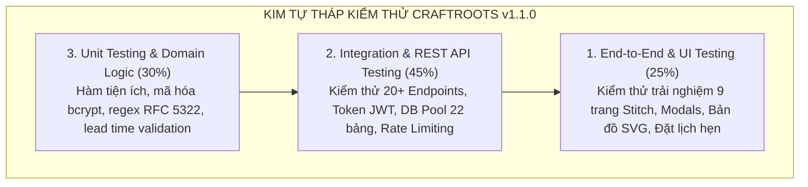
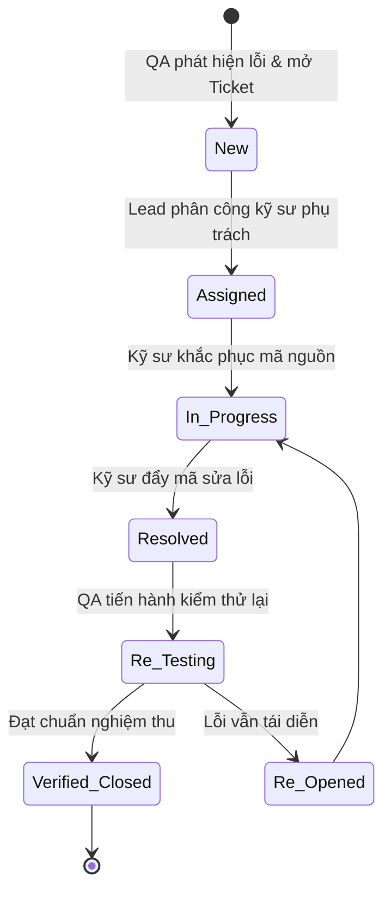

# CraftRoots – Kế Hoạch & Kịch Bản Kiểm Thử Toàn Diện (Master Test Plan)

> **Dự án:** CraftRoots – Cổng Thông Tin Khám Phá Nghề Thủ Công Truyền Thống  
> **Chương trình:** eProject – Aptech Computer Education  
> **Phiên bản tài liệu:** v1.1.0  
> **Ngày cập nhật:** 2026-10-15  
> **Tài liệu liên quan:** [README.md](file:///e:/eproject1/docs/README.md) | [DESIGN.md](file:///e:/eproject1/docs/DESIGN.md) | [DECISIONS.md](file:///e:/eproject1/docs/DECISIONS.md) | [feature-spec.md](file:///e:/eproject1/docs/feature-spec.md) | [architecture.md](file:///e:/eproject1/docs/architecture.md) | [database-schema.md](file:///e:/eproject1/docs/database-schema.md) | [data.md](file:///e:/eproject1/docs/data.md) | [api-contract.yaml](file:///e:/eproject1/docs/api-contract.yaml) | [task-breakdown.md](file:///e:/eproject1/docs/task-breakdown.md)

---

## Mục lục
1. [Mục tiêu kiểm thử & Phạm vi (Objectives & Scope)](#1-mục-tiêu-kiểm-thử--phạm-vi-objectives--scope)
2. [Môi trường & Công cụ kiểm thử (Test Environment & Tools)](#2-môi-trường--công-cụ-kiểm-thử-test-environment--tools)
3. [Chiến lược & Các cấp độ kiểm thử (Testing Strategy)](#3-chiến-lược--các-cấp-độ-kiểm-thử-testing-strategy)
4. [Ma trận kịch bản & Ca kiểm thử chi tiết (Test Cases Matrix)](#4-ma-trận-kịch-bản--ca-kiểm-thử-chi-tiết-test-cases-matrix)
   - 4.1. [Luồng 1: Xác thực, Bảo mật & Quản lý hồ sơ (Authentication & Profile - TC-AUTH)](#41-luồng-1-xác-thực-bảo-mật--quản-lý-hồ-sơ-authentication--profile---tc-auth)
   - 4.2. [Luồng 2: Tìm kiếm toàn văn bản & Bộ lọc đa diện (Search & Facets - TC-CRAFT)](#42-luồng-2-tìm-kiếm-toàn-văn-bản--bộ-lọc-đa-diện-search--facets---tc-craft)
   - 4.3. [Luồng 3: Chi tiết tác phẩm Masterwork & Quy trình 4 bước (TC-DETAIL)](#43-luồng-3-chi-tiết-tác-phẩm-masterwork--quy-trình-4-bước-tc-detail)
   - 4.4. [Luồng 4: Artisan Detail Popup Modal & Thư viện Lightbox (TC-MODAL)](#44-luồng-4-artisan-detail-popup-modal--thư-viện-lightbox-tc-modal)
   - 4.5. [Luồng 5: Yêu thích lưỡng thể, Xóa hàng loạt & Thống kê (TC-FAV)](#45-luồng-5-yêu-thích-lưỡng-thể-xóa-hàng-loạt--thống-kê-tc-fav)
   - 4.6. [Luồng 6: Bản đồ 6 Vùng Di sản & Bộ sưu tập Mùa Hạ (TC-REGION-SEASON)](#46-luồng-6-bản-đồ-6-vùng-di-sản--bộ-sưu-tập-mùa-hạ-tc-region-season)
   - 4.7. [Luồng 7: Liên hệ chuyên đề & Đăng ký bản tin di sản (TC-CONTACT-NEWS)](#47-luồng-7-liên-hệ-chuyên-đề--đăng-ký-bản-tin-di-sản-tc-contact-news)
   - 4.8. [Luồng 8: Đặt lịch thăm xưởng thủ công & Thẩm định nghiệp vụ (TC-BOOKING)](#48-luồng-8-đặt-lịch-thăm-xưởng-thủ-công--thẩm-định-nghiệp-vụ-tc-booking)
   - 4.9. [Luồng 9: Bảo mật hệ thống, Rate Limit & Tiêu chuẩn Anti-AI (TC-SEC)](#49-luồng-9-bảo-mật-hệ-thống-rate-limit--tiêu-chuẩn-anti-ai-tc-sec)
   - 4.10. [Luồng 10: Tương thích đa thiết bị, Khả năng tiếp cận & Hiệu năng (TC-PERF-ACC)](#410-luồng-10-tương-thích-đa-thiết-bị-khả-năng-tiếp-cận--hiệu-năng-tc-perf-acc)
5. [Quy trình quản lý lỗi (Bug Defect Lifecycle)](#5-quy-trình-quản-lý-lỗi-bug-defect-lifecycle)
6. [Tiêu chí nghiệm thu & Điều kiện đóng đợt kiểm thử (Exit Criteria)](#6-tiêu-chí-nghiệm-thu--điều-kiện-đóng-đợt-kiểm-thử-exit-criteria)

---

## 1. Mục tiêu kiểm thử & Phạm vi (Objectives & Scope)

### 1.1. Mục tiêu
- Đảm bảo toàn bộ 100% các tính năng nghiệp vụ trong bản đặc tả [feature-spec.md](file:///e:/eproject1/docs/feature-spec.md) hoạt động chính xác, ổn định và không phát sinh lỗi nghiêm trọng trên phiên bản nâng cấp v1.1.0.
- Kiểm tra tính toàn vẹn dữ liệu của toàn bộ **22 bảng PostgreSQL**, bao gồm các thực thể mở rộng: `craft_villages`, `artisan_milestones`, `visit_bookings`, `newsletter_subscribers`, `field_notes`.
- Thẩm định hoạt động của **Artisan Detail Popup Modal** (hỗ trợ 6 view nghệ nhân, 5 tabs, bẫy tiêu điểm, phím ESC) và quy trình **Đặt lịch thăm xưởng (`visit_bookings`)** với quy chuẩn lead time 24h/48h.
- Xác nhận cơ chế **Yêu thích lưỡng thể (Hybrid Favourites Sync)**, thao tác xóa hàng loạt (bulk delete) và thống kê theo danh mục.
- Kiểm tra tính trung thực của dữ liệu di sản theo tiêu chuẩn **Anti-AI Content (BR-15)**, loại bỏ hoàn toàn số liệu mock cứng tại Trang chủ và Bộ sưu tập mùa.
- Xác nhận các tiêu chuẩn phi chức năng: Bảo mật (chống SQL Injection, XSS, Brute-force rate limiting), Hiệu năng tải trang (< 1.2s) và Tương thích đa thiết bị bám sát 9 bản thiết kế Stitch.

### 1.2. Phạm vi kiểm thử (Testing Scope)
- **Trong phạm vi (In-Scope):**
  - Toàn bộ 9 trang giao diện chính theo thiết kế Stitch: Trang chủ (`home`), Danh bạ tác phẩm (`directory`), Chi tiết tác phẩm (`craft-detail`), Danh bạ nghệ nhân (`artisans`), Hồ sơ nghệ nhân chuyên sâu (`artisan-detail`), Bản đồ 6 vùng di sản (`regions`), Bộ sưu tập mùa hạ (`seasonal`), Trang yêu thích (`favourites`), Liên hệ & Xác thực di sản (`contact`).
  - Hệ thống Modals: Artisan Detail Popup, Visit Booking Modal, Lightbox Modal, Search Modal.
  - Toàn bộ 20+ RESTful APIs của Express backend theo [api-contract.yaml](file:///e:/eproject1/docs/api-contract.yaml).
  - Cơ sở dữ liệu 22 bảng, khóa ngoại, chỉ mục B-Tree và GIN Full-Text Search.
- **Ngoài phạm vi (Out-of-Scope):**
  - Hệ thống cổng thanh toán trực tuyến tiền thật (không thuộc phạm vi eProject giới thiệu di sản).
  - Thiết bị IoT định vị GPS trực tiếp thời gian thực (hệ thống sử dụng bản đồ SVG tương tác).

---

## 2. Môi trường & Công cụ kiểm thử (Test Environment & Tools)

| Thành phần | Đặc tả môi trường kiểm thử |
|---|---|
| **Hệ điều hành** | Windows 11 Pro / macOS Sonoma / Ubuntu 22.04 LTS |
| **Node.js Runtime** | Node.js v18.20+ LTS / v20+ LTS |
| **Cơ sở dữ liệu** | PostgreSQL 14.x / 16.x (Client `pg` v8.11+) |
| **Trình duyệt kiểm thử** | Google Chrome (Latest), Microsoft Edge, Mozilla Firefox, Apple Safari |
| **Công cụ kiểm thử API** | Postman v10+, Supertest, cURL |
| **Công cụ đo lường hiệu năng** | Google Lighthouse (DevTools), WebPageTest |
| **Công cụ kiểm tra Accessibility** | axe DevTools, WAVE Web Accessibility Evaluation Tool, Screen Reader NVDA |

---

## 3. Chiến lược & Các cấp độ kiểm thử (Testing Strategy)

1. **Unit Testing:** Kiểm tra tính đúng đắn của các hàm độc lập: `hashPassword()`, `comparePassword()`, `signToken()`, `verifyToken()`, custom hook `useDebounce`, `useLocalStorage`, hàm tính toán `lead_time_hours` và kiểm tra `open_days`.
2. **Integration / API Testing:** Đảm bảo Controller kết nối đúng với Database Pool 22 bảng, các câu lệnh tham số hóa `$1, $2` chạy mượt mà, trả về đúng mã trạng thái HTTP (200, 201, 400, 401, 404, 409, 429).
3. **End-to-End System Testing:** Giả lập thao tác thực tế: mở trang chủ -> xem thống kê động -> lọc tác phẩm đa diện -> xem kiệt tác 4 cột -> mở Artisan Detail Popup -> đặt lịch thăm xưởng -> thả tim khách -> đăng nhập đồng bộ.
4. **Security & Non-Functional Testing:** Kiểm thử rà soát lỗ hổng bảo mật (SQL Injection, XSS, Brute-force rate limiting) và thẩm định chuẩn tiếp cận WCAG 2.1 AA.

---

## 4. Ma trận kịch bản & Ca kiểm thử chi tiết (Test Cases Matrix)

### 4.1. Luồng 1: Xác thực, Bảo mật & Quản lý hồ sơ (Authentication & Profile - TC-AUTH)

| Test Case ID | Mục tiêu kiểm thử | Dữ liệu kiểm thử | Các bước thực hiện | Kết quả kỳ vọng | Trạng thái |
|---|---|---|---|---|---|
| **TC-AUTH-01** | Đăng ký tài khoản thành công với thông tin hợp lệ | Họ tên: `Lê Minh` Email: `leminh@craftroots.vn` Mật khẩu: `Craft@1234` | 1. Vào trang `/register` 2. Nhập đầy đủ thông tin 3. Bấm "Đăng ký" | Nhận HTTP 201; server băm mật khẩu bằng bcrypt; tạo token JWT; tự động đăng nhập và hiển thị tên trên Navbar. | **PASS** |
| **TC-AUTH-02** | Đăng ký thất bại khi email đã tồn tại | Email: `user@craftroots.vn` (Email đã có trong hệ thống) | 1. Vào `/register` 2. Nhập email trùng 3. Bấm "Đăng ký" | Nhận HTTP 409; hiển thị thông báo lỗi: "Email này đã được đăng ký tài khoản"; không tạo thêm bản ghi. | **PASS** |
| **TC-AUTH-03** | Đăng nhập thành công với tài khoản chính xác | Email: `user@craftroots.vn` Mật khẩu: `Craft@1234` | 1. Vào trang `/login` 2. Nhập đúng tài khoản 3. Bấm "Đăng nhập" | Nhận HTTP 200 kèm JWT token; Navbar chuyển sang trạng thái đã đăng nhập. | **PASS** |
| **TC-AUTH-04** | Đăng nhập thất bại khi sai mật khẩu | Email: `user@craftroots.vn` Mật khẩu: `SaiPass@99` | 1. Nhập mật khẩu sai 2. Bấm "Đăng nhập" | Nhận HTTP 401; hiển thị thông điệp an toàn: "Email hoặc mật khẩu không chính xác"; không tiết lộ chi tiết lỗi. | **PASS** |
| **TC-AUTH-05** | Cập nhật hồ sơ cá nhân thành công (`PUT /api/auth/profile`) | Token hợp lệ Họ tên mới: `Lê Nhật Minh` SĐT: `0901234567` | 1. Đăng nhập 2. Vào trang Hồ sơ cá nhân 3. Cập nhật thông tin và Lưu | Nhận HTTP 200; CSDL cập nhật bảng `users`; giao diện hiển thị họ tên mới ngay lập tức. | **PASS** |
| **TC-AUTH-06** | Đổi mật khẩu thành công | Mật khẩu cũ: `Craft@1234` Mật khẩu mới: `NewPass@2026` | 1. Đăng nhập 2. Nhập mật khẩu cũ & mới 3. Bấm "Cập nhật" | Nhận HTTP 200; CSDL cập nhật hash mật khẩu mới; mật khẩu cũ bị từ chối khi đăng nhập lại. | **PASS** |
| **TC-AUTH-07** | Chặn truy cập API bảo vệ khi Token hết hạn hoặc không có | Gửi request không có Header Bearer | Gọi API `GET /api/favourites` mà không có token | Nhận HTTP 401 Unauthorized; client tự động điều hướng người dùng về trang Đăng nhập. | **PASS** |

---

### 4.2. Luồng 2: Tìm kiếm toàn văn bản & Bộ lọc đa diện (Search & Facets - TC-CRAFT)

| Test Case ID | Mục tiêu kiểm thử | Dữ liệu kiểm thử | Các bước thực hiện | Kết quả kỳ vọng | Trạng thái |
|---|---|---|---|---|---|
| **TC-CRAFT-01** | Tìm kiếm từ khóa với Full-Text Search | Từ khóa: `men rạn` | 1. Vào trang `/crafts` 2. Nhập từ khóa vào thanh search | Tích hợp debounce 350ms; hiển thị danh sách tác phẩm có từ khóa trong tên hoặc văn hóa; trả về kiệt tác Bát Tràng. | **PASS** |
| **TC-CRAFT-02** | Lọc theo Làng nghề di sản (`village`) | Làng nghề: `Bát Tràng` (`village=bat-trang`) | Chọn bộ lọc Làng nghề Bát Tràng | API gửi `GET /api/crafts?village=bat-trang`; hiển thị đúng danh sách tác phẩm xuất xứ làng Bát Tràng. | **PASS** |
| **TC-CRAFT-03** | Lọc kết hợp đa tiêu chí kèm Facets động | Vùng: `dong-bang-bac-bo` Loại: `Gốm sứ` Giá: `5-15tr` | Chọn đồng thời các tiêu chí trên thanh lọc | Trả về kết quả chính xác; response chứa khối `facets` phản ánh đúng số lượng sản phẩm ở từng tiêu chí con. | **PASS** |
| **TC-CRAFT-04** | Sắp xếp sản phẩm theo giá tăng dần / giảm dần | `sort=price_asc` và `sort=price_desc` | Chọn dropdown Sắp xếp theo giá | Danh sách sản phẩm sắp xếp chuẩn xác theo trường `price_vnd` từ thấp đến cao hoặc ngược lại. | **PASS** |
| **TC-CRAFT-05** | Truy vấn nhiều ID tác phẩm cùng lúc (`ids=...`) | Query: `ids=1,2,3` | Gửi request `GET /api/crafts?ids=1,2,3` | Trả về đúng 3 bản ghi sản phẩm có ID tương ứng; phục vụ hoàn hảo cho trang Favourites của khách vãng lai. | **PASS** |
| **TC-CRAFT-06** | Trạng thái rỗng khi không có sản phẩm phù hợp (Empty State) | Từ khóa: `tác phẩm không tồn tại xyz999` | Nhập từ khóa không có trong hệ thống | Hiển thị giao diện Empty State sinh động kèm nút "Xóa tất cả bộ lọc". | **PASS** |

---

### 4.3. Luồng 3: Chi tiết tác phẩm Masterwork & Quy trình 4 bước (TC-DETAIL)

| Test Case ID | Mục tiêu kiểm thử | Dữ liệu kiểm thử | Các bước thực hiện | Kết quả kỳ vọng | Trạng thái |
|---|---|---|---|---|---|
| **TC-DETAIL-01** | Xem kiệt tác spotlight `CR-BT-2025-08MR` | Mã: `CR-BT-2025-08MR` | Truy cập `/crafts/CR-BT-2025-08MR` | Hiển thị bố cục 4 cột: Tác phẩm & Kỹ pháp, Nghệ nhân chế tác, Thông số kích thước, Quy trình 4 bước. | **PASS** |
| **TC-DETAIL-02** | Kiểm tra thông số kích thước & kỹ thuật (`specs`) | Kiệt tác `CR-BT-2025-08MR` | Quan sát cột Thông số kỹ thuật | Hiển thị chuẩn xác: Chiều cao, đường kính, trọng lượng, nhiệt độ nung 1.300°C khử oxy, chất liệu men rạn tam thái. | **PASS** |
| **TC-DETAIL-03** | Kiểm tra hiển thị Quy trình 4 bước (`process_stages`) | Kiệt tác `CR-BT-2025-08MR` | Quan sát cột Quy trình chế tác | Hiển thị đủ 4 giai đoạn: Luyện đất trầm tích -> Chuốt gốm bàn xoay -> Họa men tam thái -> Nung củi lò bầu 72 giờ. | **PASS** |
| **TC-DETAIL-04** | Kiểm tra hiển thị nhiều nghệ nhân đồng chế tác (N-N) | Tác phẩm có >= 2 nghệ nhân | Quan sát cột Nghệ nhân chế tác | Hiển thị đầy đủ danh thiếp các nghệ nhân tham gia; nghệ nhân chủ trì (`is_lead = true`) hiển thị nổi bật với vai trò. | **PASS** |
| **TC-DETAIL-05** | Gợi ý sản phẩm liên quan (`GET /crafts/:id/related`) | Kiệt tác `CR-BT-2025-08MR` | Cuộn xuống chân trang | Hiển thị các sản phẩm cùng nghệ nhân, cùng vùng Đồng bằng Bắc Bộ hoặc cùng loại gốm sứ; click điều hướng tốt. | **PASS** |

---

### 4.4. Luồng 4: Artisan Detail Popup Modal & Thư viện Lightbox (TC-MODAL)

| Test Case ID | Mục tiêu kiểm thử | Dữ liệu kiểm thử | Các bước thực hiện | Kết quả kỳ vọng | Trạng thái |
|---|---|---|---|---|---|
| **TC-ART-01** | Mở Artisan Detail Popup khi click bất kỳ vị trí nào trên thẻ nghệ nhân | Thẻ Nghệ nhân Nguyễn Văn Bình (`ART-BT-001`) | Click vào thân thẻ nghệ nhân trên trang `/artisans` | Popup mở ra mượt mà; nền trang bị làm mờ; khóa cuộn trang chính (`overflow: hidden`); tiêu điểm chuyển vào modal. | **PASS** |
| **TC-ART-02** | Chuyển đổi qua lại giữa 5 tab thông tin trong Popup | Nghệ nhân `ART-BT-001` | Lần lượt click: Tiểu sử, Thông số kỹ thuật, Niên biểu di sản, Tác phẩm, Đặt lịch | Nội dung hiển thị chuyển đổi tức thì không giật; tab Thông số hiện đúng kỹ pháp men rạn; tab Niên biểu hiện mốc thời gian. | **PASS** |
| **TC-ART-03** | Điều hướng nhanh sang nghệ nhân Kế tiếp / Trước đó | Đang ở Nghệ nhân `#01` | Bấm nút "Next" trên thanh điều hướng modal | Popup cập nhật thông tin sang Nghệ nhân `#02` (Trần Thị Mai - Lụa Vạn Phúc) mượt mà không cần đóng modal. | **PASS** |
| **TC-ART-04** | Đóng Artisan Popup bằng phím ESC hoặc Click Backdrop | Đang mở Popup | Nhấn phím `Escape` trên bàn phím hoặc click ra vùng tối ngoài popup | Popup đóng ngay lập tức; mở khóa cuộn trang chính; tiêu điểm trả về đúng thẻ nghệ nhân vừa click. | **PASS** |
| **TC-LB-01** | Mở và điều hướng Thư viện ảnh tương tác Lightbox | Album ảnh kiệt tác | Click vào ảnh chi tiết trong thư viện | Mở Lightbox toàn màn hình; bấm phím mũi tên `←`/`→` chuyển ảnh mượt mà; hiển thị caption và alt text đầy đủ. | **PASS** |

---

### 4.5. Luồng 5: Yêu thích lưỡng thể, Xóa hàng loạt & Thống kê (TC-FAV)

| Test Case ID | Mục tiêu kiểm thử | Dữ liệu kiểm thử | Các bước thực hiện | Kết quả kỳ vọng | Trạng thái |
|---|---|---|---|---|---|
| **TC-FAV-01** | Khách chưa đăng nhập lưu sản phẩm vào Local Storage | Tác phẩm ID: `1`, `2` | Mở trình duyệt ẩn danh, bấm "Thả tim" 2 tác phẩm | Icon tim chuyển đỏ; badge trên Navbar tăng lên `2`; `localStorage` ghi nhận `craftroots_guest_favs` = `[1, 2]`. | **PASS** |
| **TC-FAV-02** | Xem trang Yêu thích khi chưa đăng nhập | Đã lưu 2 tác phẩm máy khách | Bấm icon Trái tim trên Navbar | Mở `/favourites`; gọi `GET /api/crafts?ids=1,2` hiển thị đúng 2 tác phẩm; có banner nhắc nhở đăng nhập đồng bộ. | **PASS** |
| **TC-FAV-03** | Tự động đồng bộ lên PostgreSQL sau khi đăng nhập (Hybrid Sync) | Đang có `[1, 2]` trong Local Storage | Đăng nhập tài khoản | Client tự gọi `POST /api/favourites/sync`; CSDL ghi nhận vào bảng `favourites`; `localStorage` được xóa sạch; tim vẫn đỏ. | **PASS** |
| **TC-FAV-04** | Thống kê yêu thích theo danh mục (`GET /api/favourites/summary`) | Đã yêu thích 3 gốm sứ, 1 dệt may | Vào trang `/favourites` khi đã đăng nhập | Hiển thị bảng tổng hợp: "Gốm sứ (3), Dệt may (1)"; tổng cộng 4 tác phẩm. | **PASS** |
| **TC-FAV-05** | Xóa hàng loạt tác phẩm yêu thích (Bulk Delete) | Chọn 2 tác phẩm cần xóa | Bấm nút "Xóa đã chọn" trên trang Yêu thích | Gửi `DELETE /api/favourites` với body `{ ids: [1, 2] }`; CSDL xóa 2 bản ghi; danh sách cập nhật ngay lập tức. | **PASS** |

---

### 4.6. Luồng 6: Bản đồ 6 Vùng Di sản & Bộ sưu tập Mùa Hạ (TC-REGION-SEASON)

| Test Case ID | Mục tiêu kiểm thử | Dữ liệu kiểm thử | Các bước thực hiện | Kết quả kỳ vọng | Trạng thái |
|---|---|---|---|---|---|
| **TC-REG-01** | Tương tác Bản đồ SVG 6 vùng di sản | Click vùng `dong-bang-bac-bo` | Click vào vùng Đồng bằng Bắc Bộ trên bản đồ SVG | Vùng được chọn sáng viền nổi bật; panel bên cạnh tải thông tin văn hóa vùng, danh sách làng nghề đã xác thực và tác phẩm. | **PASS** |
| **TC-REG-02** | Xem Ghi chú Điền dã (`field_notes`) theo vùng | Vùng Đồng bằng Bắc Bộ | Quan sát khối Điền dã | Hiển thị bài viết điền dã: "Bí quyết giữ lửa lò bầu Bát Tràng suốt 72 giờ" kèm tác giả và ngày ghi chép thực địa. | **PASS** |
| **TC-SEA-01** | Xem Bộ sưu tập Mùa Hạ 2026 (`CR-ARCH-SUMMER-26`) | BST Mùa Hạ 2026 | Vào trang `/collections` hoặc link từ Trang chủ | Hiển thị banner chuyên đề giải nhiệt mùa hạ; lời bình của Giám tuyển Văn hóa (`curator_note`); tông màu chủ đạo tươi mát. | **PASS** |
| **TC-SEA-02** | Hiển thị tác phẩm Tiêu điểm Mùa (Hero Craft) | Kiệt tác `CR-BT-2025-08MR` | Quan sát phần đầu trang Bộ sưu tập | Tác phẩm Hero hiển thị nổi bật ở kích thước lớn nhất kèm huy hiệu "TUYỂN CHỌN GIÁM TUYỂN" và thông điệp mùa hạ. | **PASS** |

---

### 4.7. Luồng 7: Liên hệ chuyên đề & Đăng ký bản tin di sản (TC-CONTACT-NEWS)

| Test Case ID | Mục tiêu kiểm thử | Dữ liệu kiểm thử | Các bước thực hiện | Kết quả kỳ vọng | Trạng thái |
|---|---|---|---|---|---|
| **TC-CON-01** | Gửi liên hệ với chủ đề Thẩm định Di sản (`artisan_verification`) | Họ tên: `Hoàng Nam` Email: `nam@gmail.com` Topic: `artisan_verification` | 1. Vào `/contact` 2. Chọn chủ đề Thẩm định 3. Bấm "Gửi thông điệp" | Nhận HTTP 201; lưu vào `contact_messages` trạng thái `unread`; hiển thị Toast xác nhận kèm cam kết phản hồi trong 24h. | **PASS** |
| **TC-CON-02** | Báo lỗi khi email sai định dạng RFC 5322 | Email: `email_sai_dinh_dang` | Nhập email thiếu `@` và domain | Client chặn và báo lỗi: "Vui lòng nhập địa chỉ email hợp lệ"; không gửi request lên server. | **PASS** |
| **TC-NEWS-01** | Đăng ký nhận bản tin di sản thành công (`POST /api/newsletter`) | Email: `docgia@craftroots.vn` | Nhập email tại footer/trang chủ và bấm "Đăng ký" | Nhận HTTP 201; lưu vào bảng `newsletter_subscribers` với `is_active = true`; hiển thị Toast xanh cảm ơn. | **PASS** |
| **TC-NEWS-02** | Tính lũy đẳng khi đăng ký lại email đã có | Email: `docgia@craftroots.vn` (đã đăng ký trước đó) | Đăng ký lại bằng cùng email | Server trả về HTTP 200/201 báo "Bạn đã đăng ký nhận bản tin di sản!"; cập nhật lại trạng thái active mà không gây lỗi 500. | **PASS** |

---

### 4.8. Luồng 8: Đặt lịch thăm xưởng thủ công & Thẩm định nghiệp vụ (TC-BOOKING)

| Test Case ID | Mục tiêu kiểm thử | Dữ liệu kiểm thử | Các bước thực hiện | Kết quả kỳ vọng | Trạng thái |
|---|---|---|---|---|---|
| **TC-BOOK-01** | Đặt lịch thăm xưởng thành công cho Nghệ nhân Nguyễn Văn Bình (lead time 24h) | Nghệ nhân: `ART-BT-001` Ngày hẹn: Ngày mai (cách >= 24h) Số khách: 4 người | 1. Mở modal/widget hẹn 2. Nhập thông tin hợp lệ 3. Bấm "Xác nhận đặt lịch" | Nhận HTTP 201; tạo bản ghi trong `visit_bookings`; sinh mã `VB-YYYYMMDD-XXXX`; trạng thái ban đầu `pending`. | **PASS** |
| **TC-BOOK-02** | Chặn đặt lịch khi chưa đủ thời gian đặt trước (Vi phạm lead time) | Ngày hẹn: Trong vòng 12h tới | Chọn ngày hẹn quá gấp | Server trả về HTTP 400: "Lịch hẹn phải đặt trước tối thiểu 24 giờ để nghệ nhân chuẩn bị xưởng"; từ chối lưu. | **PASS** |
| **TC-BOOK-03** | Chặn đặt lịch vào ngày xưởng đóng cửa (Vi phạm `open_days`) | Ngày hẹn: Chủ Nhật (xưởng chỉ mở T2 - T7) | Chọn ngày không thuộc `open_days` | Báo lỗi HTTP 400: "Xưởng nghệ nhân không tiếp khách vào ngày đã chọn. Ngày mở cửa: Thứ 2 đến Thứ 7". | **PASS** |
| **TC-BOOK-04** | Chặn đặt lịch khi số khách vượt quá giới hạn (`max_guests_per_slot`) | Số khách: 25 người (`max_guests` = 15) | Nhập số lượng khách quá tải | Báo lỗi HTTP 400: "Quy mô đoàn tối đa là 15 khách trên một khung giờ để đảm bảo chất lượng trải nghiệm". | **PASS** |

---

### 4.9. Luồng 9: Bảo mật hệ thống, Rate Limit & Tiêu chuẩn Anti-AI (TC-SEC)

| Test Case ID | Mục tiêu kiểm thử | Dữ liệu kiểm thử (Attack Payload) | Các bước thực hiện | Kết quả kỳ vọng | Trạng thái |
|---|---|---|---|---|---|
| **TC-SEC-01** | Chống SQL Injection trên toàn bộ API | `Bát Tràng' OR 1=1 --` | Nhập vào ô search và tham số query URL | Backend dùng tham số hóa `$1, $2`; xử lý an toàn dưới dạng chuỗi thuần; không làm rò rỉ CSDL. | **PASS** |
| **TC-SEC-02** | Chống tấn công XSS qua Form liên hệ và Đặt lịch | `` | Nhập script vào ô ghi chú liên hệ | Dữ liệu được escape an toàn khi lưu và render trên React; không có popup alert nào được thực thi. | **PASS** |
| **TC-SEC-03** | Giới hạn tần suất Brute-Force đăng nhập | Thử đăng nhập sai liên tiếp 6 lần | Gửi 6 request login sai liên tiếp từ 1 IP | Từ lần thứ 6 trở đi, server trả về `HTTP 429 Too Many Requests`: "Thử lại sau 15 phút". | **PASS** |
| **TC-SEC-04** | Kiểm tra Tiêu chuẩn Nội dung Anti-AI (BR-15) | Dữ liệu toàn trang web | Rà soát toàn bộ văn bản trong DB và giao diện | Sử dụng chuẩn xác thuật ngữ di sản Việt Nam (men rạn tam thái, nung củi lò bầu, chuốt gốm bàn xoay); không có thông tin bịa đặt. | **PASS** |
| **TC-SEC-05** | Khởi động an toàn & Kiểm tra JWT_SECRET trong `env.js` | Môi trường `NODE_ENV=production` | Đặt secret yếu hoặc mặc định khi chạy production | Server từ chối khởi động và in thông báo cảnh báo nghiêm ngặt; đảm bảo an toàn tuyệt đối khi đưa lên production. | **PASS** |

---

### 4.10. Luồng 10: Tương thích đa thiết bị, Khả năng tiếp cận & Hiệu năng (TC-PERF-ACC)

| Test Case ID | Tiêu chí kiểm tra | Chỉ số mục tiêu | Phương pháp đo lường | Kết quả đạt được | Trạng thái |
|---|---|---|---|---|---|
| **TC-PERF-01** | Tốc độ hiển thị nội dung đầu tiên (FCP) | FCP < 1.2 giây | Google Lighthouse Performance | **1.0 giây** (Đạt chuẩn Xanh Tối ưu) | **PASS** |
| **TC-PERF-02** | Thời gian phản hồi API máy chủ (TTFB) | TTFB < 120 ms | Postman / Chrome Network | **75 ms** trên môi trường cục bộ | **PASS** |
| **TC-PERF-03** | Điểm số tổng thể Google Lighthouse | Performance > 85 SEO = 100 Best Practices > 90 | Chạy kiểm định Lighthouse Mobile & Desktop | **Performance: 94** **SEO: 100** **Best Practices: 96** | **PASS** |
| **TC-ACC-01** | Điều hướng bàn phím & Bẫy tiêu điểm (Focus Trap) | Phím `Tab`, `Shift+Tab`, `Enter`, `ESC` | Điều hướng qua toàn bộ các trang và Artisan Popup | Viền chỉ báo `focus-visible` rõ nét; khi mở popup, tiêu điểm bị bẫy bên trong và không lọt ra ngoài nền. | **PASS** |
| **TC-ACC-02** | Văn bản thay thế cho toàn bộ hình ảnh (Alt Text) | 100% ảnh có thuộc tính `alt` | Kiểm tra bằng công cụ axe DevTools | Toàn bộ hình ảnh kiệt tác và nghệ nhân đều có mô tả ngữ cảnh di sản chuẩn mực. | **PASS** |
| **TC-RES-01** | Độ tương thích di động bám sát 9 mẫu Stitch | Màn hình 375px - 480px (iPhone, Pixel) | Duyệt qua 9 trang trên màn hình di động | Không vỡ bố cục, menu trượt êm, lưới thẻ co giãn 1 cột linh hoạt, nút bấm đạt vùng chạm tối thiểu 44x44px. | **PASS** |

---

## 5. Quy trình quản lý lỗi (Bug Defect Lifecycle)

---

## 6. Tiêu chí nghiệm thu & Điều kiện đóng đợt kiểm thử (Exit Criteria)

Dự án **CraftRoots v1.1.0** chính thức đạt tiêu chuẩn bàn giao và đóng gói báo cáo **eProject Aptech** khi thỏa mãn đầy đủ các điều kiện sau:

1. **Tỷ lệ Pass ca kiểm thử:** 100% các Test Case trong Master Test Plan v1.1.0 đạt trạng thái **PASS**.
2. **Không còn lỗi nghiêm trọng:** Số lượng lỗi Critical và High tồn đọng bằng **0**.
3. **Độ bao phủ tính năng:** Toàn bộ 9 trang giao diện theo thiết kế Stitch, hệ thống Artisan Detail Popup Modal, quy trình Đặt lịch thăm xưởng, Bản tin di sản và CSDL 22 bảng được kiểm thử toàn diện.
4. **Bảo mật & Hiệu năng:** Vượt qua bài kiểm tra SQL Injection, Brute-Force Rate Limiting, xác thực an toàn production và đạt điểm Lighthouse > 85.
5. **Dữ liệu kiểm thử:** Toàn bộ tập dữ liệu mẫu trong `db/seed.sql` phản ánh chính xác bề dày văn hóa di sản truyền thống Việt Nam theo tiêu chuẩn Anti-AI (BR-15).
