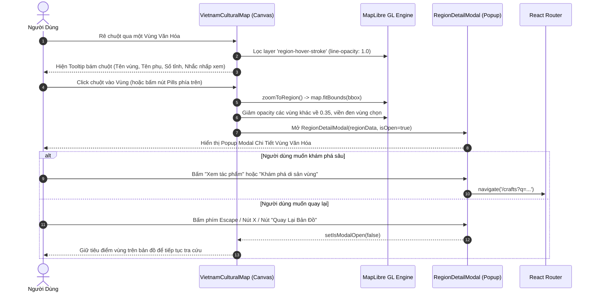

# CraftRoots — Đặc Tả Kỹ Thuật Bản Đồ Di Sản Văn Hóa Làng Nghề Việt Nam
**Vietnam Cultural & Heritage Map Specification (v1.2.0)**

---

## 1. Tổng Quan & Triết Lý Thiết Kế Bản Đồ

### 1.1. Mục đích xây dựng
Bản đồ Di sản Văn hóa Làng nghề Việt Nam (**Vietnam Cultural Map**) là một trong những tính năng cốt lõi và trực quan nhất của nền tảng **CraftRoots**. Thay vì hiển thị một bản đồ hành chính 63 tỉnh thành khô cứng, bản đồ di sản được thiết kế nhằm mục đích:
- **Tái hiện 7 không gian văn hóa làng nghề truyền thống** gắn liền với địa lý nhân văn, thổ nhưỡng, nguồn nguyên liệu bản địa và tập quán sinh hoạt của 54 dân tộc anh em.
- **Trực quan hóa sự phân bố của các dòng nghề thủ công tinh hoa**: Gốm sứ men tro, dệt lanh thổ cẩm, mây tre đan mắt cáo, chạm khắc bạc đồng, sơn mài then cẩn trứng.
- **Tạo ra không gian khám phá tương tác trực quan (Interactive Discovery)**: Cho phép du khách và nhà nghiên cứu di sản tra cứu thông tin đa chiều từ tổng quan dải đất hình chữ S đến cận cảnh từng làng nghề, tỉnh thành và nghệ nhân.

### 1.2. Triết lý văn hóa dân tộc học & Địa lý nhân văn
1. **Hợp nhất dòng chảy văn hóa (Border Dissolution):** Nghề thủ công truyền thống không bị giới hạn bởi ranh giới hành chính của từng tỉnh riêng biệt. Các kỹ pháp như dệt thổ cẩm trải dài khắp rẻo cao Tây Bắc – Việt Bắc; dòng men gốm sa thạch và phù sa kết nối toàn bộ lưu vực Sông Hồng. Do đó, bản đồ xóa bỏ các đường viền ngăn cách tỉnh, chỉ giữ lại ranh giới giữa **7 vùng văn hóa di sản lớn** để tôn vinh sự liên tục của tri thức dân gian.
2. **Khẳng định chủ quyền quốc gia toàn vẹn & bất khả xâm phạm:** Bản đồ cô lập lãnh thổ Việt Nam trên nền không gian biển đảo đặc quyền; hiển thị trang trọng, chính xác hai quần đảo **Hoàng Sa** (trực thuộc TP. Đà Nẵng) và **Trường Sa** (trực thuộc Tỉnh Khánh Hòa) với hiệu ứng thị giác và nhãn định danh HTML cố định.

---

## 2. Kiến Trúc Kỹ Thuật & Công Nghệ GIS

### 2.1. Công nghệ nền tảng (Tech Stack)
- **Engine kết xuất bản đồ:** `maplibre-gl` (v6.14.0) – Công nghệ render vector 2D tốc độ cao dựa trên WebGL Canvas.
- **Worker chuyên dụng:** `maplibre-gl-worker.mjs` chạy đa luồng ngầm (Multi-threaded Web Worker), đảm bảo giao diện 60 FPS mượt mà không chặn UI chính.
- **Dữ liệu địa lý (GeoJSON):** `/data/vietnam-cultural-regions.geojson` chứa ranh giới Polygon đã được xử lý làm mịn và giải tỏa ranh giới tỉnh (dissolved borders).
- **Kiến trúc Component:**
  - Component điều phối chính: `VietnamCulturalMap.jsx` ([VietnamCulturalMap.jsx](file:///c:/Users/Admin/studyspace/eproject1/eproject1/client/src/components/map/VietnamCulturalMap.jsx))
  - Component trang chi tiết vùng (Modal): `RegionDetailModal.jsx` ([RegionDetailModal.jsx](file:///c:/Users/Admin/studyspace/eproject1/eproject1/client/src/components/map/RegionDetailModal.jsx))
  - Cấu hình địa chí & làng nghề: `regionsConfig.js` ([regionsConfig.js](file:///c:/Users/Admin/studyspace/eproject1/eproject1/client/src/components/map/regionsConfig.js)), `craftVillages.js` ([craftVillages.js](file:///c:/Users/Admin/studyspace/eproject1/eproject1/client/src/components/map/craftVillages.js))

### 2.2. Cơ chế khóa 2D nghiêm ngặt (Strict 2D Mode)
Để bảo đảm tính tôn nghiêm của tư liệu địa chí lịch sử và tránh hiện tượng biến dạng địa hình do góc nhìn 3D góc nghiêng:
```javascript
const map = new Map({
  container: mapContainerRef.current,
  style: HERITAGE_MAP_STYLE,
  center: [108.5, 15.5],
  zoom: 4.8,
  minZoom: 3.2,
  maxZoom: 11.0,
  pitch: 0,             // Nghiêm cấm góc nghiêng
  bearing: 0,           // Cố định hướng Bắc thẳng đứng
  maxPitch: 0,          // Khóa tuyệt đối không cho bẻ góc 3D
  dragRotate: false,    // Vô hiệu hóa thao tác xoay chuột phải
  touchPitch: false,    // Vô hiệu hóa cảm ứng nghiêng 2 ngón tay
  maxBounds: [
    [88.0, 2.0],        // Tây Nam (Giới hạn biển Tây Nam)
    [132.0, 28.0]       // Đông Bắc (Bao quát toàn bộ thềm lục địa & biển đảo)
  ],
  attributionControl: false
});
```

### 2.3. Bố cục hiển thị & Căn chỉnh tự động (Dynamic Viewport Fitting)
Bản đồ được cấu hình luôn tự động tính toán kích thước khung nhìn thực tế của trình duyệt (thông qua `ResizeObserver`) và tự căn vừa vặn toàn bộ dải đất hình chữ S vào chính giữa màn hình với vùng đệm an toàn:
- **Chế độ Toàn cảnh (Overview Mode):** Áp dụng bounding box `VIETNAM_BOUNDS`: `[[102.14, 8.18], [114.5, 23.39]]` với padding `{ top: 60, bottom: 40, left: 40, right: 40 }`.
- **Chế độ Cận cảnh Vùng (Focused Region Mode):** Tính toán bounding box thu gọn động từ các tọa độ GeoJSON thực của vùng đó và zoom tới cận cảnh (tối đa zoom 8.5x) với hiệu ứng chuyển động mượt 1.100ms.

---

## 3. Hệ Thống 7 Vùng Văn Hóa Làng Nghề & Bảng Màu Nhận Diện

Lấy cảm hứng từ hệ màu ngũ sắc tranh dân gian Đông Hồ - Hàng Trống và men tro củi nung truyền thống, mỗi vùng văn hóa được cấp một mã màu độc bản có độ tương phản cao trên nền vải Canvas Linen:

```
                                  [ TÂY BẮC - VIỆT BẮC ]
                                  Màu Vàng Hoa Hòe (#D49A24)
                                             │
                                  [ ĐỒNG BẰNG SÔNG HỒNG ]
                                  Màu Đỏ Vang Gỗ Vang (#A83827)
                                             │
                                     [ BẮC TRUNG BỘ ]
                                  Màu Tím Men Tro Lam (#5E4B7A)
                                             │
                                  [ NAM TRUNG BỘ ] ──────── [ QUẦN ĐẢO HOÀNG SA ]
                                  Màu Lam Chàm (#266B88)     (TP. Đà Nẵng - VN)
                                      /      \
             [ TÂY NGUYÊN ] ─────────         ─────── [ QUẦN ĐẢO TRƯỜNG SA ]
             Màu Cam Lửa (#CE5C23)                     (Tỉnh Khánh Hòa - VN)
                   │
             [ ĐÔNG NAM BỘ ]
             Màu Nâu Hổ Phách (#8A5232)
                   │
             [ TÂY NAM BỘ ]
             Màu Xanh Gỉ Đồng (#327555)
```

### Bảng chi tiết 7 Không Gian Văn Hóa:

| STT | Mã Định Danh (`regionId`) | Tên Không Gian Văn Hóa | Sắc Màu Nhận Diện | Số Địa Phương | Làng Nghề & Kỹ Pháp Tiêu Biểu |
|:---:|:---|:---|:---:|:---:|:---|
| **1** | `TAY_BAC_VIET_BAC` | **Trung du & Miền núi phía Bắc** *(Tây Bắc – Đông Bắc & Việt Bắc)* | **Vàng Hoa Hòe** (`#D49A24`) | **14 Tỉnh** (Hà Giang, Cao Bằng, Lào Cai, Sơn La, Điện Biên, Lạng Sơn...) | • Dệt lanh thổ cẩm Lùng Tám<br>• Rèn đúc thủ công Phúc Sen<br>• Chạm khắc bạc người Dao Tiền |
| **2** | `DONG_BANG_SONG_HONG` | **Đồng Bằng Sông Hồng** *(Cái nôi văn minh lúa nước & Làng nghề cổ)* | **Đỏ Vang Gỗ Vang** (`#A83827`) | **10 Tỉnh/TP** (Hà Nội, Bắc Ninh, Thái Bình, Nam Định, Hải Phòng, Ninh Bình...) | • Gốm men rạn Bát Tràng<br>• Dệt lụa Vạn Phúc<br>• Chạm bạc Đồng Xâm<br>• Mây tre đan Phú Vinh |
| **3** | `BAC_TRUNG_BO` | **Bắc Trung Bộ** *(Không gian Cố đô & Nghệ thuật cung đình)* | **Tím Men Tro Lam** (`#5E4B7A`) | **6 Tỉnh** (Thừa Thiên Huế, Quảng Trị, Quảng Bình, Hà Tĩnh, Nghệ An, Thanh Hóa) | • Đúc đồng Ngũ Xã - Phường Đúc<br>• Nón lá bài thơ Tây Hồ<br>• Hoa giấy thanh tiên Huế |
| **4** | `NAM_TRUNG_BO` | **Duyên Hải Nam Trung Bộ** *(Văn hóa biển đảo & Di sản Chăm Pa)* | **Lam Chàm Men Cổ** (`#266B88`) | **8 Tỉnh/TP** (Đà Nẵng, Quảng Nam, Bình Định, Ninh Thuận, Khánh Hòa...) | • Gốm Chăm Bàu Trúc<br>• Dệt thổ cẩm Mỹ Nghiệp<br>• Điêu khắc đá Non Nước |
| **5** | `TAY_NGUYEN` | **Cao Nguyên Trung Phần (Tây Nguyên)** *(Không gian Cồng chiêng & Sử thi)* | **Cam Lửa Nung Củi** (`#CE5C23`) | **5 Tỉnh** (Đắk Lắk, Gia Lai, Kon Tum, Đắk Nông, Lâm Đồng) | • Đan lát mây tre voi Buôn Ma Thuột<br>• Dệt thổ cẩm người Ba Na & Ê Đê<br>• Chế tác cồng chiêng |
| **6** | `DONG_NAM_BO` | **Đông Nam Bộ** *(Giao thương cảng thị & Thủ công bản địa)* | **Nâu Hổ Phách** (`#8A5232`) | **6 Tỉnh/TP** (TP. Hồ Chí Minh, Bình Dương, Đồng Nai, Bà Rịa - Vũng Tàu...) | • Gốm sành Lái Thiêu & Biên Hòa<br>• Sơn mài mỹ nghệ Tương Bình Hiệp<br>• Đúc đồng Hòa Hưng |
| **7** | `TAY_NAM_BO` | **Tây Nam Bộ** *(Vùng đồng bằng phù sa châu thổ Cửu Long)* | **Xanh Gỉ Đồng Cổ** (`#327555`) | **13 Tỉnh/TP** (Cần Thơ, An Giang, Đồng Tháp, Vĩnh Long, Trà Vinh, Cà Mau...) | • Chiếu lụa lác Định Yên<br>• Dệt khăn rằn Chăm Châu Phong<br>• Lò gốm nung củi Mang Thít |

---

## 4. Đặc Tả Khẳng Định Chủ Quyền Biển Đảo Hoàng Sa & Trường Sa

Bản đồ áp dụng cơ chế định danh độc lập, cố định và nổi bật để đảm bảo tuyệt đối tính chuẩn mực về chủ quyền lãnh thổ Việt Nam:

1. **Quần đảo Hoàng Sa:**
   - **Tọa độ GIS:** Kinh độ `112.0° E`, Vĩ độ `16.5° N`.
   - **Thực thể quản lý hành chính:** Thành phố Đà Nẵng – Việt Nam.
   - **Thành phần giao diện:** Khung viền mực nổi Terracotta 2 lớp, hiệu ứng điểm sáng radar nhấp nháy (`animate-ping`), nhãn định danh viết hoa `QUẦN ĐẢO HOÀNG SA`.
2. **Quần đảo Trường Sa:**
   - **Tọa độ GIS:** Kinh độ `114.0° E`, Vĩ độ `10.0° N`.
   - **Thực thể quản lý hành chính:** Tỉnh Khánh Hòa – Việt Nam.
   - **Thành phần giao diện:** Điểm định vị phát sáng tọa độ trung tâm biển Đông, nhãn xác nhận `QUẦN ĐẢO TRƯỜNG SA (TỈNH KHÁNH HÒA – VIỆT NAM)`.
3. **Lớp hiển thị đảo:** Sử dụng GeoJSON Source `vn-sovereignty-source` với các điểm sáng tròn màu Terracotta `#B86B35` viền trắng bảo đảm quan sát rõ ràng ở mọi cấp độ thu phóng (Zoom Level từ 3.2x đến 11.0x).

---

## 5. Đặc Tả Tương Tác & Trải Nghiệm Người Dùng (UX Flows)

### 5.1. Sơ đồ tuần tự tương tác (Sequence Interaction Flow)


### 5.2. Các trạng thái trực quan trên bản đồ
1. **Trạng thái Mặc định (Default State):**
   - 7 vùng văn hóa phủ màu men tro cổ với độ trong suốt 92% (`fill-opacity: 0.92`).
   - Đường biên giới ngoài có lớp rãnh trắng bọc ngoài (Outer Casing: `#FFFFFF`, độ dày 2.5px - 5.2px) và chỉ mực đen bên trong (Inner Sharp Linework: `#1C1B1A`, độ dày 1.2px - 2.6px), giúp ranh giới các vùng luôn sắc bén trên mọi độ phân giải màn hình.
2. **Trạng thái Rê chuột (Hover State):**
   - Đổi con trỏ sang dạng bàn tay chỉ mục (`cursor: pointer`).
   - Viền Terracotta rực sáng quanh toàn bộ chu vi vùng được chọn (`line-color: #B86B35`, `line-width: 3.8px`).
   - Tooltip nổi (`backdrop-blur-md`, nền `#FFFFFF/98`, viền `#E6E2DA`) bám sát tọa độ chuột, hiển thị tên vùng bằng font *Playfair Display*, danh hiệu phụ và số lượng tỉnh thành.
3. **Trạng thái Đã Chọn (Selected State):**
   - Vùng được chọn giữ nguyên độ đậm nét 100% (`fill-opacity: 1.0`), bao bọc bởi đường viền mực đen dày 4.5px (`#1C1B1A`).
   - Toàn bộ 6 vùng còn lại tự động mờ xuống (`fill-opacity: 0.35`) để làm nổi bật tâm điểm không gian văn hóa.
   - Bản đồ kích hoạt hoạt ảnh lướt camera mượt mà (smooth flyTo/fitBounds) đưa vùng đó vào vị trí trọng tâm.

---

## 6. Đặc Tả Popup Trang Chi Tiết Vùng Di Sản (`RegionDetailModal.jsx`)

### 6.1. Rationale kiến trúc: Chuyển đổi từ Side Panel sang Popup Modal
Trong các phiên bản ban đầu, giao diện sử dụng thanh bên (side panel) cố định chiếm 35% chiều ngang màn hình. Điều này dẫn đến các nhược điểm:
- Làm bản đồ Việt Nam bị dồn ép sang một bên, mất cân đối thị giác.
- Trên màn hình máy tính bảng và laptop nhỏ, diện tích tương tác bản đồ bị thu hẹp nghiêm trọng.

**Giải pháp tối ưu v1.2.0:** Thay thế bằng **Popup Trang Chi Tiết (`RegionDetailModal.jsx`)**:
- Trả lại 100% không gian hiển thị toàn màn hình cho bản đồ GIS.
- Khi người dùng nhấp vào vùng, một khung tư liệu di sản sang trọng (chuẩn bảo tàng văn hóa) xuất hiện ngay trung tâm màn hình với hiệu ứng làm mờ nền phía sau (`backdrop-blur-sm`).

### 6.2. Cấu trúc dữ liệu và bố cục bên trong Popup
1. **Dải chỉ thị màu (Region Header Accent):**
   - Dải màu dày 6px ở viền trên cùng phản ánh chính xác sắc màu nhận diện của vùng.
2. **Tiêu đề & Định danh di sản:**
   - Huy hiệu mã vùng: `TAY_BAC_VIET_BAC`, `DONG_BANG_SONG_HONG`...
   - Tên không gian di sản cỡ lớn (24px – 32px) bằng font có chân *Playfair Display*.
   - Lời tựa giới thiệu phong vị địa chí in nghiêng.
3. **Thanh Chỉ Số Di Sản (Heritage Stats Bar):**
   - Khung 3 cột chia ngăn sắc nét:
     - Cột 1: Tổng số địa phương trực thuộc.
     - Cột 2: Số lượng làng nghề truyền thống tiêu biểu được kiểm kê.
     - Cột 3: Bản sắc thủ công tinh hoa đặc trưng.
4. **Khối Nội Dung Cuộn 3 Tầng (Scrollable Content):**
   - **Tầng 1 - Đặc trưng văn hóa nghề:** Bài khảo cứu về điều kiện tự nhiên, nguồn tài nguyên bản địa (đất sét, quặng thép, rừng trúc, biển mặn) và không gian sinh tồn của làng nghề.
   - **Tầng 2 - Danh sách Làng nghề truyền thống tiêu biểu:** Thẻ làng nghề dạng lưới 2 cột, hiển thị tên làng, huyện/tỉnh, tóm tắt kỹ pháp cổ truyền và liên kết xem tác phẩm (`/crafts?q=...`).
   - **Tầng 3 - Địa giới hành chính đầy đủ:** Danh sách toàn bộ các tỉnh thành trực thuộc vùng được thể hiện dưới dạng thẻ huy hiệu (Pill Badges) gọn gàng.
5. **Chân trang hành động (Action Footer):**
   - Nút chính: **"Khám Phá Toàn Bộ Di Sản Vùng"** (Chuyển trang sang danh mục tác phẩm đã lọc theo tên vùng).
   - Nút phụ: **"Quay Lại Bản Đồ"** (Đóng modal nhanh và tiếp tục tương tác bản đồ).

### 6.3. Tiêu chuẩn tương tác & Trợ năng (Accessibility - A11y)
- **Đóng bằng phím Escape:** Lắng nghe sự kiện bàn phím toàn cục `keydown` (phím `Esc`) để lập tức đóng popup.
- **Click Backdrop:** Nhấp chuột vào bất kỳ vị trí nào bên ngoài khung nội dung để đóng.
- **Ngăn chặn nổi bọt sự kiện:** `e.stopPropagation()` trên khung modal bảo đảm mọi thao tác click/chọn văn bản bên trong không gây đóng nhầm modal.
- **Khóa cuộn trang ngầm:** Ngăn chặn trang bị cuộn nền khi đang mở modal.

---

## 7. Quy Chuẩn Typography & Thẩm Mỹ "Human-Crafted Sharp Linework"

Bản đồ và toàn bộ thành phần popup được lập trình tuân thủ tuyệt đối Hệ thống Thiết kế độc bản của CraftRoots:

### 7.1. Bảng màu giao diện (Design Tokens)
- **Nền bản đồ:** `#F9F8F6` (Canvas Linen – Màu mộc bản mộc mạc của giấy điệp, vải thô).
- **Màu mực chủ đạo:** `#1C1B1A` (Traditional Ink – Đen mực tàu truyền thống).
- **Màu chữ thứ cấp:** `#5A5854` (Màu chì xám cho thông tin địa chí phụ trợ).
- **Đường viền sắc nét:** `#E6E2DA` (Linework Border – Đường nét chỉ vẽ kỹ thuật 1px sắc sảo, không bo tròn tuỳ tiện).
- **Màu thương hiệu điểm nhấn:** `#B86B35` (Accent Terracotta – Màu son đất nung Bát Tràng).

### 7.2. Chuẩn hóa Phông chữ chống lỗi Tiếng Việt (Vietnamese Typography)
Để triệt tiêu hoàn toàn lỗi vỡ font tiếng Việt do các phông mặc định của hệ điều hành:
- **Tiêu đề trang trọng:** Sử dụng lớp `font-headline-title font-serif` kế thừa font **Playfair Display**, hiển thị thanh lịch, đậm chất văn hóa.
- **Tiêu đề thẻ & Làng nghề:** Sử dụng `font-title-card font-serif` (*Playfair Display*).
- **Lời tựa & Ký họa:** Sử dụng `font-label-signature italic` (*Playfair Display Italic*).
- **Nội dung bài viết & Tên tỉnh thành:** Sử dụng lớp `font-body-spec` kế thừa font **Inter**, tròn trịa, tương thích 100% với các dấu thanh phức hợp tiếng Việt (*Đ, Ắ, Ằ, Ể, Ễ, Ổ, Ỗ, Ứ, Ự...*).
- **Thẻ huy hiệu, Số liệu & Nút điều khiển:** Sử dụng `font-label-action` và `font-spec-code` (*Montserrat* / *Inter*), tạo cảm giác chỉn chu của một hồ sơ lưu trữ di sản quốc gia.

---

## 8. Cấu Trúc File & Mã Nguồn Liên Quan

| Đường Dẫn Tệp | Vai Trò Kỹ Thuật Trong Phân Hệ Bản Đồ |
|:---|:---|
| [VietnamCulturalMap.jsx](file:///c:/Users/Admin/studyspace/eproject1/eproject1/client/src/components/map/VietnamCulturalMap.jsx) | Component lõi khởi tạo MapLibre GL, điều khiển lớp bản đồ, xử lý sự kiện tương tác chuột và căn chỉnh camera. |
| [RegionDetailModal.jsx](file:///c:/Users/Admin/studyspace/eproject1/eproject1/client/src/components/map/RegionDetailModal.jsx) | Component Popup Modal trang chi tiết vùng di sản văn hóa, hiển thị tư liệu làng nghề và tỉnh thành. |
| [regionsConfig.js](file:///c:/Users/Admin/studyspace/eproject1/eproject1/client/src/components/map/regionsConfig.js) | Cấu hình dữ liệu địa chí 7 vùng văn hóa, danh mục làng nghề, mã màu và tọa độ chủ quyền Hoàng Sa, Trường Sa. |
| [craftVillages.js](file:///c:/Users/Admin/studyspace/eproject1/eproject1/client/src/components/map/craftVillages.js) | Dữ liệu định vị GPS và hồ sơ lịch sử của các làng nghề truyền thống trên cả nước. |
| [VillageDrawer.jsx](file:///c:/Users/Admin/studyspace/eproject1/eproject1/client/src/components/map/VillageDrawer.jsx) | Drawer thanh bên phụ hiển thị chi tiết khi nhấp xem một làng nghề cụ thể. |
| [vietnam-cultural-regions.geojson](file:///c:/Users/Admin/studyspace/eproject1/eproject1/client/public/data/vietnam-cultural-regions.geojson) | Tệp dữ liệu không gian GeoJSON chứa tọa độ đa giác 7 vùng văn hóa di sản. |
| [RegionsPage.jsx](file:///c:/Users/Admin/studyspace/eproject1/eproject1/client/src/pages/RegionsPage.jsx) | Trang chủ tuyến đường `/regions` trong ứng dụng web React. |

---

## 9. Hướng Dẫn Vận Hành & Tích Hợp

### 9.1. Gọi Component trên trang bất kỳ
```jsx
import React from 'react';
import VietnamCulturalMap from '../components/map/VietnamCulturalMap';

export default function CulturalMapSection() {
  return (
    <div className="w-full h-[650px] border border-border-neutral overflow-hidden">
      <VietnamCulturalMap
        className="w-full h-full"
        initialRegionId="DONG_BANG_SONG_HONG"
        onRegionSelect={(region) => {
          console.log('Đã chọn không gian văn hóa:', region?.name);
        }}
      />
    </div>
  );
}
```

### 9.2. Phím tắt và thao tác chuột
- **Cuộn bánh xe chuột (Mouse Wheel):** Phóng to / Thu nhỏ bản đồ mượt mà.
- **Kéo chuột trái (Left Drag):** Di chuyển góc nhìn (Pan) trong phạm vi lãnh thổ Việt Nam.
- **Nhấp chuột trái vào vùng (Click):** Mở Popup Trang Chi Tiết Di Sản của vùng tương ứng.
- **Phím Escape (`Esc`):** Đóng ngay Popup Chi Tiết Vùng.
- **Nút `⛶` góc dưới trái:** Đưa toàn bộ dải đất chữ S về chính giữa màn hình.
